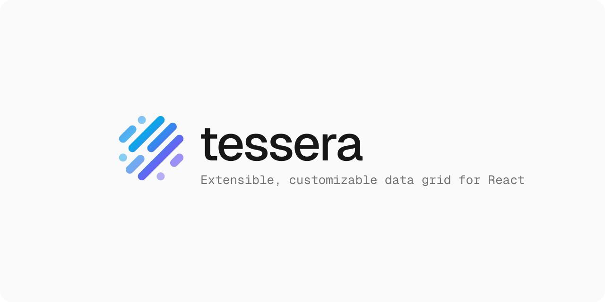

<picture>
  <source media="(prefers-color-scheme: dark)" srcset="brand/readme/banner-color-dark.svg">
  
</picture>

<h1>Tessera</h1>

**Your table, your components, your rules.**

Customize the look and feel to suit your needs, choose how data is displayed and edited within cells, control the flexibility of your columns and rows, and integrate existing plugins or build your own. Tessera handles the rest.

Free of charge. Dare to be different and start focusing on what truly matters — today.

## Overview

Tessera is a table library for React built on TanStack Table. It provides ready-to-use table components with a built-in user interface and uses an extensible data model.

- **Compatibility.** Tessera works with React 18 and 19 and uses modern, compatible technologies.
- **Column and row virtualization.** With TanStack Virtual, the table renders only a portion of the data as you scroll.
- **Client-side or server-side data.** Work with local data right away or load data from the server in chunks.
- **Customizable behavior and appearance.** Choose which actions are available for columns, rows, and cells. Adjust sorting, order, visibility, and more.
- **Built-in UI kit.** Reuse and customize the ready-to-use components.

## Try the live demo

Explore the full collection of [interactive Storybook examples](https://master--6ace36e34624f121dc46dd4d.chromatic.com/).

## Read the documentation

Coming soon

## Included for free

| Feature                                                                                                                                                                  | Benefit                                                                             |
| ------------------------------------------------------------------------------------------------------------------------------------------------------------------------ | ----------------------------------------------------------------------------------- |
| [Server-side row model](https://master--6ace36e34624f121dc46dd4d.chromatic.com/?path=/story/tessera-datagrid-data-loading-server-row-model--server-row-model-playground) | Load and cache rows in blocks as you scroll, with support for server-side grouping. |
| [Row grouping and aggregation](https://master--6ace36e34624f121dc46dd4d.chromatic.com/?path=/story/tessera-datagrid-rows-grouping--row-grouping-playground)              | Group rows by column values and calculate totals for each group.                    |
| [Cell range selection and clipboard paste](https://master--6ace36e34624f121dc46dd4d.chromatic.com/?path=/story/tessera-datagrid-cells-selection--cell-selection-range)   | Select a rectangular range of cells and paste values into multiple cells at once.   |
| [Excel export](https://master--6ace36e34624f121dc46dd4d.chromatic.com/?path=/story/tessera-datagrid-export--export-excel)                                                | Download table data as an Excel workbook (`.xlsx`).                                 |

  <picture>
    <source media="(prefers-color-scheme: dark)" srcset="brand/mark/mark-color-dark-bg.svg">
    
  </picture>

