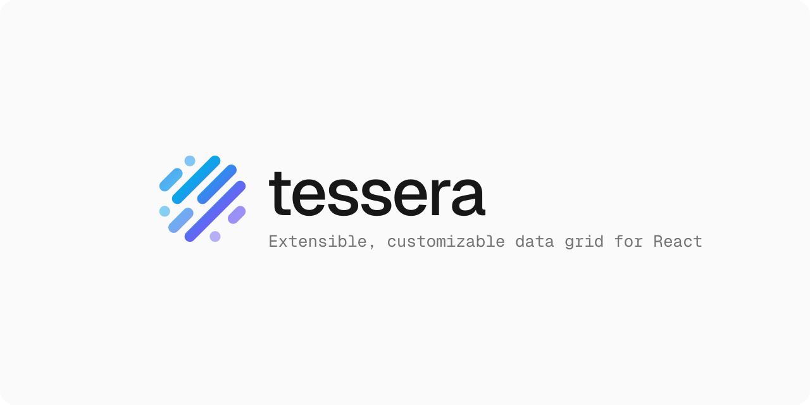

<picture>
  <source media="(prefers-color-scheme: dark)" srcset="brand/readme/banner-color-dark.svg">
  
</picture>

<h1>Tessera</h1>

**Ваша таблица, ваши компоненты, ваши правила.**

Настройте внешний вид под себя, выберите, как показывать и править данные в ячейках, решите,
насколько гибкими будут колонки и строки, подключите готовые плагины или напишите свои. Остальное
Tessera берёт на себя.

## Обзор

Tessera — библиотека таблиц для React поверх TanStack Table. Она даёт готовую таблицу со
встроенным интерфейсом и расширяемой моделью данных.

- **Совместимость.** Tessera работает с React 18 и 19.
- **Виртуализация строк и колонок.** Через TanStack Virtual таблица рисует только видимую часть
  данных.
- **Данные на клиенте или на сервере.** Работайте с локальными данными сразу или грузите их с
  сервера блоками.
- **Настраиваемое поведение и вид.** Выбирайте, какие действия доступны колонкам, строкам и
  ячейкам: сортировка, порядок, видимость и другое.
- **Встроенный UI-кит.** Используйте и настраивайте готовые компоненты.

## Установка

```bash
npm install @tessera-grid/tessera @tanstack/react-table react react-dom
```

## Пример

```tsx
import { DataGrid, useCreateTable } from '@tessera-grid/tessera'
import { columnSizing, columnSorting } from '@tessera-grid/tessera/plugins'
import '@tessera-grid/tessera/style.css'

const plugins = [columnSorting(), columnSizing()] as const

export const People = ({ columns, people }) => {
  const table = useCreateTable({ columns, data: people, plugins: [...plugins] })

  return <DataGrid table={table} height={400} />
}
```

## Документация

Руководства, справочник API и примеры:
[tessera-grid.github.io/tessera/ru](https://tessera-grid.github.io/tessera/ru/). In English:
[README.md](README.md).

## Живое демо

Все возможности — в [интерактивных историях Storybook](https://master--6ace36e34624f121dc46dd4d.chromatic.com/).
