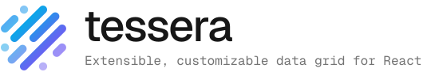
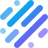
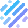
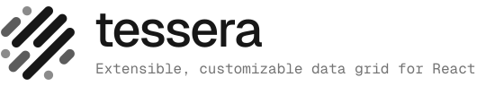
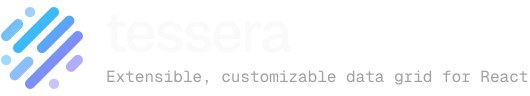
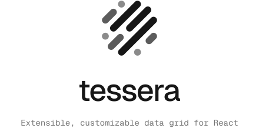
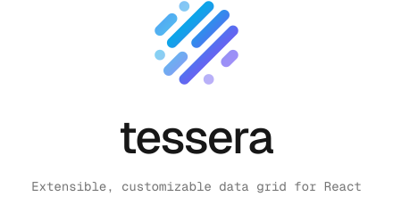
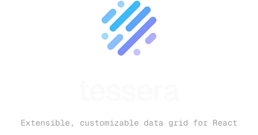

# Tessera — Brand Guidelines

<picture>
  <source media="(prefers-color-scheme: dark)" srcset="./lockup/lockup-tagline-color-dark-bg.svg">
  
</picture>

Знак **«Andamento»** уходит корнями в вековую историю мозаики и переводится с итальянского как «течение». Это визуальная мелодия, которую поют линии укладки. Мастера античности и эпохи Возрождения знали: мало просто расколоть камень на модули — нужно найти их правильный путь. Именно _andamento_ превращало разрозненную смальту в живое полотно, заставляя свет играть на гранях элементов.

Слово **«Tessera»** пришло из античности: в Древней Греции и Риме так называли маленький кубик из смальты, мрамора или обожженной глины. Сама по себе _tessera_ — это простейшая неделимая частица, первоэлемент мозаики. Однако мастера прошлого видели в ней не просто осколок камня, а носитель цвета и света. Они гранили каждый кусочек вручную, зная, что даже самый крошечный модуль важен для общего масштаба мозаичного полотна.

В архитектуре нашей библиотеки _tessera_ стала неделимым первоэлементом. Подобно тому, как из тысяч разноцветных кубиков рождались бессмертные шедевры античности, интерфейс выстраивает масштабные, гибкие и монументальные таблицы. Это живое воплощение идеи о том, что в дизайне нет незначительных деталей: каждая ячейка, каждый мельчайший элемент имеет значение и служит единой гармонии системы.

---

## 01 · Знак

|                      mono · light                       |                       mono · dark                        |                        color · light                         |                        color · dark                         |
| :-----------------------------------------------------: | :------------------------------------------------------: | :----------------------------------------------------------: | :---------------------------------------------------------: |
|  |  |  |  |

### Построение

|              |                                                               |
| ------------ | ------------------------------------------------------------- |
| поле         | 48 × 48 ед., модуль 1 ед.                                     |
| ряды         | 5 осей под 45°, шаг 14 ед. по оси x (9.9 ед. перпендикулярно) |
| узлы         | концы штрихов и центры точек — в целых координатах            |
| состав       | 6 штрихов + 3 точки                                           |
| толщина      | 6 ед. · скругление R 3 (½ толщины)                            |
| точка        | Ø 6                                                           |
| зазор        | 3.9 ед. между рядами                                          |
| прозрачность | 1 — длинные · 0.7 — короткие · 0.5 — точки                    |

### Охранное поле

x = 1.5 × толщины штриха = **9 ед.** со всех сторон (при 48 px — 9 px, при 96 px — 18 px). Полный знак — от 48 px.

## 02 · Упрощённый знак

Для 16–32 px и фавикона.

|                         mono · light                          |                          mono · dark                           |                           color · light                            |                           color · dark                            |
| :-----------------------------------------------------------: | :------------------------------------------------------------: | :----------------------------------------------------------------: | :---------------------------------------------------------------: |
|  |  |  |  |

|         |                                  |
| ------- | -------------------------------- |
| поле    | 16 × 16 px                       |
| ряды    | 4 оси под 45°, шаг 5 px по оси x |
| толщина | 1.75 px · R 0.875 · точка Ø 1.75 |
| зазор   | 1.79 px                          |
| поля    | 1.875 px со всех сторон          |

## 03 · Цвет

Все цвета — токены темы Tessera.

|          | светлая тема                                  | тёмная тема                                   |
| -------- | --------------------------------------------- | --------------------------------------------- |
| Ink      | `#171717` --primary                           | `#FAFAFA`                                     |
| Canvas   | `#FAFAFA` --background                        | `#0A0A0A`                                     |
| Muted    | `#737373` --muted-foreground                  | `#A1A1A1`                                     |
| Градиент | `#0070F3` → `#0EA5E9` → `#6366F1` → `#8B5CF6` | `#3B82F6` → `#38BDF8` → `#818CF8` → `#A78BFA` |

Градиент — только в цветном знаке. Wordmark всегда сплошной. Печать и высокая контрастность — монохром.

## 04 · Логотип

Wordmark «tessera» — Geist Medium 500, трекинг −3.5 %, строчные. Подпись — Geist Mono Regular. Текст в файлах переведён в кривые.

|                |                               mono · light                                |                               mono · dark                                |                               color · light                                |                               color · dark                                |
| -------------- | :-----------------------------------------------------------------------: | :----------------------------------------------------------------------: | :------------------------------------------------------------------------: | :-----------------------------------------------------------------------: |
| Горизонтальный |           |           |           |           |
| С подписью     |   |   |   |   |
| Вертикальный   |  |  |  |  |

## 05 · Применения

- **Вкладка браузера** — упрощённый знак: `favicon/favicon.svg`, `favicon.ico`, `favicon-16/32.png`.
- **Аватар GitHub и npm** — `avatar/avatar-*.png`, знак вписан в круглую обрезку.
- **Storybook** — `storybook/storybook-brand-light/dark.svg` как `brandImage`.
- **README репозитория** — `lockup/lockup-tagline-color-*-bg.svg` через `<picture>` (тёмный и светлый вариант для GitHub), запасной — `lockup/lockup-tagline-universal.svg` для просмотрщиков без `<picture>` (npm, превью IDE).
- **Превью в соцсетях** — `readme/banner-*-2x.png` (GitHub → Settings → Social preview).
- **Веб-манифест** — `favicon/icon-192.png`, `icon-512.png`, `apple-touch-icon-180.png`.

## 06 · Правила

- **tessera** — в логотипе, строчными
- **Tessera** — в тексте, как имя собственное
- `@mstrvtt/tessera` — в коде и командах

Нельзя: поворачивать знак · добавлять тени и эффекты · менять цвета вне токенов · использовать полный знак мельче 48 px.

---

## Состав пака

## mark/ — знак

| файл                                                  | где                                                                                                                                                                                                                   |
| ----------------------------------------------------- | --------------------------------------------------------------------------------------------------------------------------------------------------------------------------------------------------------------------- |
| mark-mono-dark.svg (#171717)                          | на светлом фоне, документация, слайды                                                                                                                                                                                 |
| mark-mono-light.svg (#FAFAFA)                         | на тёмном фоне                                                                                                                                                                                                        |
| mark-black.svg (#000)                                 | печать, режим высокой контрастности                                                                                                                                                                                   |
| mark-color-light-bg.svg / mark-color-dark-bg.svg      | цветной знак, градиент лоадера (--info → sky → indigo → violet)                                                                                                                                                       |
| mark-small-*.svg                                      | упрощённый знак для 16–32 px — вариант **b4 «Ритм»**: 4 штриха + точка в сетке 16: толщина 1.75 px (R 0.875), шаг рядов 5 px по оси x, зазор 1.79 px, поля 1.875 px со всех сторон, крайние штрихи — прозрачность 0.7 |
| mark-small-option-a/b/c.svg, mark-small-option-b4.svg | варианты упрощения; целевой — **b4**                                                                                                                                                                                  |

Полный знак сохраняет прозрачность штрихов 0.5 / 0.7. Для печати в одну краску замените её сплошными оттенками.

## lockup/ — знак + wordmark

`lockup-*` — горизонтальный, `lockup-tagline-*` — с подписью «Extensible, customizable data grid for React», `lockup-vertical-*` — вертикальный. Суффикс — фон, на который ставится: `mono|color` × `light-bg|dark-bg`.

`lockup-tagline-universal.svg` — прозрачный, слово и подпись `#797979`: читается и на белом, и на тёмном фоне (контраст 4,3:1 на белом и `#0D1117`, 3,2:1 на `#2B2D30`). Для мест, где тема неизвестна.

## readme/ — баннер 1280×640

| файл                                           | где                                                                |
| ---------------------------------------------- | ------------------------------------------------------------------ |
| banner-_-light.svg + banner-_-dark.svg         | README на GitHub через `<picture>` (`prefers-color-scheme`)        |
| banner-mono-light.png / banner-color-light.png | README на npm (одна картинка, PNG)                                 |
| banner-_.png, banner-_-2x.png (2560×1280)      | превью репозитория в соцсетях (GitHub → Settings → Social preview) |

```html
<picture>
  <source
    media="(prefers-color-scheme: dark)"
    srcset="./logo/banner-color-dark.svg"
  />
  
</picture>
```

## storybook/

storybook-brand-light.svg / -dark.svg — `brandImage` в теме Storybook manager (логотип в шапке). Фавикон Storybook — `favicon/favicon.svg` (через `managerHead`).

## favicon/ — вкладка браузера

| файл                           | где                                                                          |
| ------------------------------ | ---------------------------------------------------------------------------- |
| favicon.svg                    | основной фавикон, упрощённый знак; #171717, в тёмной теме браузера — #FAFAFA |
| favicon.ico (16 + 32 + 48)     | запасной для старых браузеров и `/favicon.ico`                               |
| favicon-16.png, favicon-32.png | PNG-фавиконы (без переключения темы)                                         |
| apple-touch-icon-180.png       | iOS, полный знак                                                             |
| icon-192.png, icon-512.png     | веб-манифест, полный цветной знак на #FAFAFA, отступ 10 %                    |

## avatar/ — 512×512

Знак 400 px по центру (78 % холста): все элементы вписаны в круг радиусом 204 px, поэтому круглая обрезка GitHub ничего не срезает (запас 52 px).
Аватар организации на GitHub и в npm: SVG + PNG, моно и цвет, светлый и тёмный фон.

## Метаданные

Метаданные C2PA сняты.
