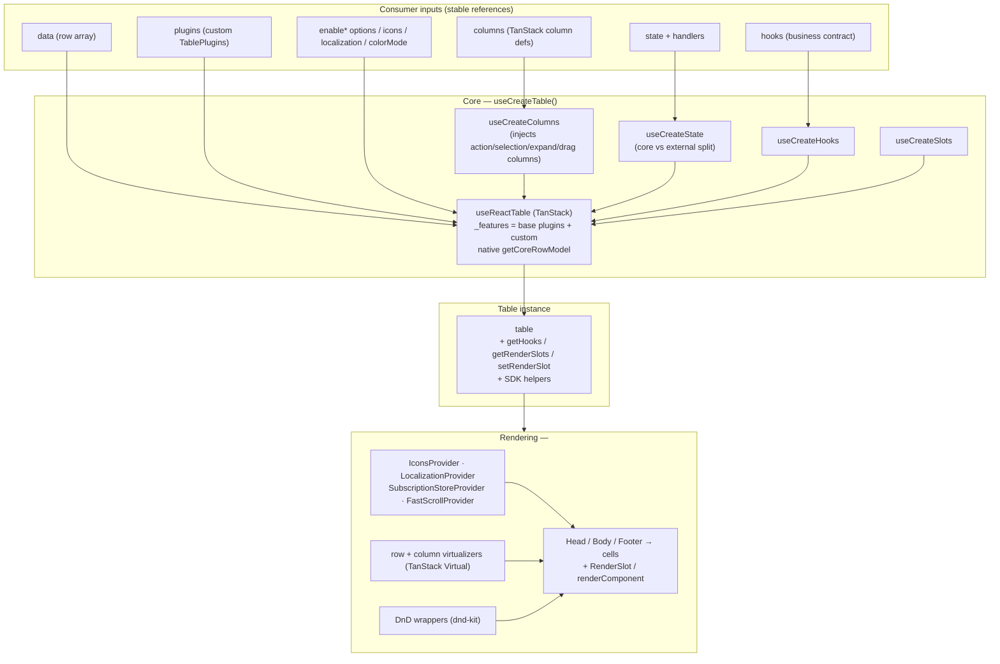

# Tessera — Architecture

`@mstrvtt/tessera` is a headless-first, plugin-driven data grid built on top of
**TanStack Table v8** (table model), **TanStack Virtual** (row/column
virtualization), and **dnd-kit** (drag & drop). Tessera does not fork these
libraries — it composes and extends them, adding a plugin/slot rendering layer,
a granular Pub-Sub reactivity mechanism, and a theme-agnostic UI built on CSS
variables.

> This knowledge base is written for **contributors**. It reflects the current
> source (verified against code, not only the README). Where a section describes
> an upstream library, it is a conceptual summary and is labelled as such.

## Why Tessera exists

Tessera began as the answer to a concrete problem: **highload CRM tables** that
had to be flexible, extensible, and fast across many different use cases — and no
existing option fit.

- **react-base-table** — what the project ran on, but effectively abandoned for years.
- **Modern React table kits** (e.g. Material React Table) — ruled out by the host
  project's dated stack.
- **AG Grid** — capable, but its licensing was not an option to pay for.
- **Canvas-rendered grids** — powerful for raw performance, but the development
  complexity was disproportionate.

So Tessera was designed from scratch, around four priorities:

1. **Agnostic** — not tied to any one app, design system, or backend.
2. **A modern core** — build on TanStack Table rather than a bespoke or canvas model.
3. **Performance** — virtualization and granular reactivity as first-class concerns.
4. **Extensibility from the outside** — teams needed genuinely different things:
   render their own buttons into rows, change table behavior in response to
   external state, and compose complex structures inside the table. The plugin +
   slot + `hooks` model exists to serve exactly that.

### Audience & scope

Tessera targets **any system that needs complex, flexible table interfaces** — CRM
was the origin, not the ceiling. A flexible, customizable visual layer is an
explicit goal (today: a theme-agnostic CSS-variable contract; see the rendering
doc).

### Non-goals

- **Not a canvas grid.** The DOM + virtualization path is a deliberate trade of
  peak throughput for development tractability and extensibility.
- **Not a batteries-included styled UI kit.** Tessera ships no runtime component
  library; it provides mechanics and override contracts, and leaves final visuals
  to the consumer.

The design decisions behind these choices are recorded as ADRs in
[`docs/decisions/`](../decisions/).

## Documents

| Doc                                                                | Scope                                                                                          |
| ------------------------------------------------------------------ | ---------------------------------------------------------------------------------------------- |
| [upstream-foundations.md](upstream-foundations.md)                 | How TanStack Table / Virtual and dnd-kit work, and which extension points Tessera hooks into   |
| [table-assembly.md](table-assembly.md)                             | `useCreateTable`: columns, state split, hooks, slots, plugin injection                         |
| [plugins-and-slots.md](plugins-and-slots.md)                       | The `TablePlugin` (TableFeature) lifecycle, slot registration, render slots, `renderComponent` |
| [rowdragging.md](rowdragging.md)                                   | The `rowDragging` plugin: activation, service column, drag handle, overlay, drop indicator     |
| [reactivity.md](reactivity.md)                                     | The two update mechanisms: reference identity vs Pub-Sub                                       |
| [rendering-and-virtualization.md](rendering-and-virtualization.md) | `DataGrid` render pipeline, flex vs grid layout, virtualization, DnD, theming                  |

## The layers

Tessera is deliberately layered so that **table mechanics** and **consumer
business logic** never fuse into a God object. Data flows down; events flow up
through `hooks`; rendering is driven by state, plugins, and slots.

## Reading order

1. **upstream-foundations** — so the TanStack/dnd-kit terms below make sense.
2. **table-assembly** — how a `table` instance is built.
3. **plugins-and-slots** — how features render into the grid.
4. **reactivity** — how updates propagate (the perf story).
5. **rendering-and-virtualization** — how it all paints.

## Design invariants

- **Stable references.** `columns` and `data` identity changes recreate the
  table model from scratch (TanStack behavior). Consumers must memoize inputs.
- **`hooks` never re-render.** Business callbacks live in `hooks`; reading them
  does not subscribe to anything. Dynamic values that must drive rendering live
  in `state`.
- **Theme-agnostic.** No component library at runtime; theming is a CSS-variable
  contract driven by a `colorMode` prop. See rendering doc.
- **Plugins are TanStack features.** A `TablePlugin` _is_ a TanStack
  `TableFeature` with extra lifecycle sugar. See plugins doc.
