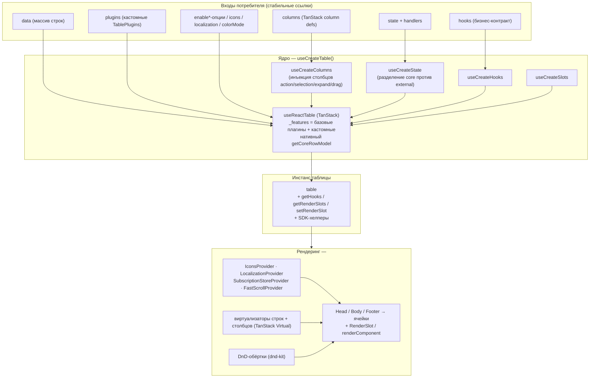

# Tessera — архитектура

`@mstrvtt/tessera` — это headless-first, plugin-driven таблица данных, построенная
поверх **TanStack Table v8** (модель таблицы), **TanStack Virtual** (виртуализация
строк/столбцов) и **dnd-kit** (drag & drop). Tessera не форкает эти библиотеки —
она их компонует и расширяет, добавляя слой рендеринга на плагинах/слотах,
гранулярный механизм реактивности Pub-Sub и theme-agnostic UI на CSS-переменных.

> Эта база знаний написана для **контрибьюторов**. Она отражает текущий
> исходный код (сверено с кодом, а не только с README). Там, где раздел описывает
> upstream-библиотеку, это концептуальное резюме, и оно помечено как таковое.

## Зачем нужна Tessera

Tessera решает конкретный класс задач: **highload-таблицы со сложным, гибким
поведением**, которым нужно быть расширяемыми и быстрыми в множестве разных
сценариев. Существующие варианты для этого не подошли:

- **Современные React-киты для таблиц** (например, Material React Table) —
  поставляют стилизованный batteries-included UI, несовместимый с agnostic-целью.
- **AG Grid** — функционально мощный, но с неподходящей моделью лицензирования.
- **Гриды на canvas** — сильны в чистой производительности, но несоразмерно сложны
  в разработке.

Поэтому Tessera была спроектирована с нуля вокруг четырёх приоритетов:

1. **Agnostic** — не привязана ни к одному приложению, дизайн-системе или бэкенду.
2. **Современное ядро** — построение на TanStack Table, а не на самодельной или
   canvas-модели.
3. **Производительность** — виртуализация и гранулярная реактивность как
   first-class-задачи.
4. **Расширяемость снаружи** — командам нужны были действительно разные вещи:
   рендерить свои кнопки в строки, менять поведение таблицы в ответ на внешнее
   состояние и компоновать сложные структуры внутри таблицы. Модель plugin + slot
   + `hooks` существует именно ради этого.

### Аудитория и охват

Tessera нацелена на **любую систему, которой нужны сложные, гибкие табличные
интерфейсы** — highload-сценарии вроде CRM это пример такой системы, а не её
потолок. Гибкий, кастомизируемый
визуальный слой — явная цель (сегодня: theme-agnostic контракт на CSS-переменных;
см. документ о рендеринге).

### Non-goals

- **Не canvas-грид.** Путь DOM + виртуализация — это осознанный размен пиковой
  пропускной способности на управляемость разработки и расширяемость.
- **Не batteries-included стилизованный UI-кит.** Tessera не поставляет
  runtime-библиотеку компонентов; она предоставляет механику и контракты
  переопределения, а финальный визуал оставляет на потребителя.

Проектные решения за этими выборами зафиксированы как ADR в
[`docs/decisions/`](../decisions/).

## Документы

| Документ                                                           | Охват                                                                                          |
| ------------------------------------------------------------------ | ---------------------------------------------------------------------------------------------- |
| [upstream-foundations.md](upstream-foundations.md)                 | Как работают TanStack Table / Virtual и dnd-kit и в какие точки расширения врезается Tessera    |
| [table-assembly.md](table-assembly.md)                             | `useCreateTable`: столбцы, разделение состояния, hooks, слоты, инъекция плагинов                |
| [plugins-and-slots.md](plugins-and-slots.md)                       | Жизненный цикл `TablePlugin` (TableFeature), регистрация слотов, render-слоты, `renderComponent` |
| [reactivity.md](reactivity.md)                                     | Два механизма обновления: идентичность ссылки против Pub-Sub                                    |
| [rendering.md](rendering.md)                                       | Пайплайн `DataGrid`: стек провайдеров, layout flex против grid, отрисовка, состояния загрузки   |
| [virtualization.md](virtualization.md)                             | Два виртуализатора, кастомные range extractors, filler-столбцы, динамическое измерение строк    |
| [dnd.md](dnd.md)                                                   | DnD рендер-слоя: обёртки head/body, reorder столбцов и строк, overlay, collision/modifiers       |
| [theming-and-overrides.md](theming-and-overrides.md)               | Контракты переопределения: `colorMode` → CSS-переменные, иконки, локализация                    |

## Слои

Tessera намеренно слоистая, чтобы **механика таблицы** и **бизнес-логика
потребителя** никогда не сливались в God object. Данные текут вниз; события текут
вверх через `hooks`; рендеринг управляется состоянием, плагинами и слотами.

## Порядок чтения

1. **upstream-foundations** — чтобы термины TanStack/dnd-kit ниже обрели смысл.
2. **table-assembly** — как собирается инстанс `table`.
3. **plugins-and-slots** — как фичи рендерятся в грид.
4. **reactivity** — как распространяются обновления (история про производительность).
5. **rendering** — как `DataGrid` всё это отрисовывает, а следом — механики
   рендер-слоя: **virtualization**, **dnd** и **theming-and-overrides**.

## Инварианты дизайна

- **Стабильные ссылки.** Смена идентичности `columns` и `data` пересоздаёт модель
  таблицы с нуля (поведение TanStack). Потребители обязаны мемоизировать входы.
- **`hooks` никогда не вызывают перерендер.** Бизнес-колбэки живут в `hooks`; их
  чтение ни на что не подписывается. Динамические значения, которые должны
  управлять рендерингом, живут в `state`.
- **Theme-agnostic.** Нет библиотеки компонентов в рантайме; темизация — это
  контракт на CSS-переменных, управляемый пропом `colorMode`. См. документ о
  рендеринге.
- **Плагины — это TanStack-фичи.** `TablePlugin` _является_ TanStack
  `TableFeature` с дополнительным сахаром жизненного цикла. См. документ о плагинах.
- **Каждый плагин и компонент покрыт тестами — визуальными и перформанс.** Каждый
  плагин и UI-компонент поставляется с обоими видами тестов — по одному на
  требование спецификации, самовосстанавливающимися, названными по спецификации.
  См. [ADR 0009](../decisions/0009-test-coverage-visual-and-performance.md).
