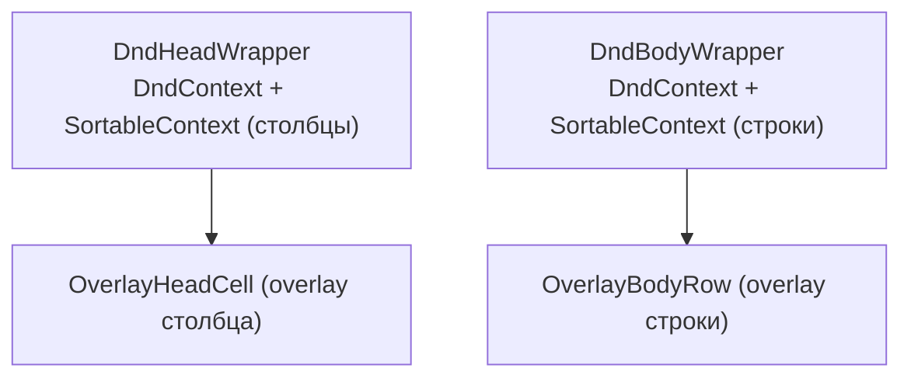

# Drag & drop

Tessera строит перетаскивание рендер-слоя поверх **dnd-kit** (что это такое
концептуально — в [upstream-foundations.md](upstream-foundations.md)). Поддержаны
два вида: переупорядочивание **столбцов** (в заголовке) и переупорядочивание
**строк** (в body, с иерархией). Этот документ описывает общий механизм DnD в
`<DataGrid/>`; **плагинный** deep-dive по перетаскиванию строк (активация,
сервисный столбец, drag-ручка, drop-индикатор, алгоритм переупорядочивания) — в
[ADR 0008](../decisions/0008-rowdragging-plugin.md).

## DnD-обёртки

Head и body оборачиваются в отдельные обёртки, каждая со своим `DndContext` +
`SortableContext`:

- **`DndHeadWrapper`** (`src/lib/ui/Head/DndHeadWrapper.tsx`) — оборачивает
  заголовки в `DndContext` + `SortableContext` для переупорядочивания **столбцов**.
- **`DndBodyWrapper`** (`src/lib/ui/Body/DndBodyWrapper.tsx`) — то же для
  переупорядочивания **строк**; поднимает вертикальный `SortableContext` и
  подключает handlers из `getRowDraggingEvents(table)`.

## Overlay при активном перетаскивании

Активное перетаскивание рендерит плавающий overlay, следующий за курсором:
`OverlayHeadCell` для столбца и `OverlayBodyRow` для строки. Состояние принятия
row-drag питает CSS-переменные, тонирующие accept/reject (детали заливки строки —
в [ADR 0008](../decisions/0008-rowdragging-plugin.md)).

## Collision detection и modifiers

Tessera поставляет **кастомную стратегию коллизий** для столбцов и **модификаторы**
для ограничения движения (`src/lib/core/dnd/`). Автоскролл у края ограничен
**только вертикальной осью** (`autoScroll={autoScrollOnlyY}`,
`core/dnd/parameters.ts`): удержание указателя у верхнего/нижнего края скроллит
таблицу вертикально, горизонтальный автоскролл отключён.

## Отдача порядка потребителю

Итог перетаскивания отдаётся обратно потребителю через контракт `state`/handlers:

- порядок столбцов — `columnOrder` / `onColumnOrderChange`;
- порядок строк — `onRowOrderChange` (updater переупорядоченного массива).

Корректность после скролла обеспечивает виртуализатор: математика перемещения
опирается на индексы реально отрендеренных строк (см.
[virtualization.md](virtualization.md)).
