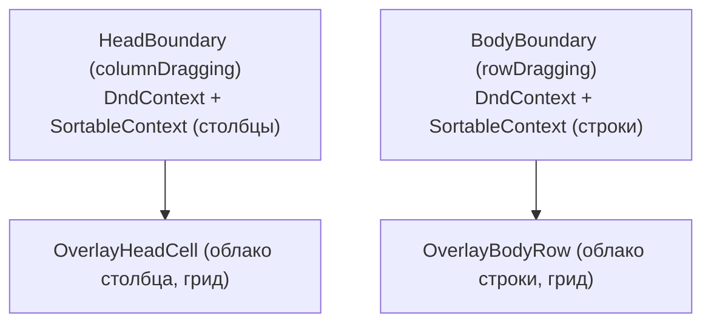

# Drag & drop

Tessera строит перетаскивание рендер-слоя поверх **dnd-kit** (что это такое
концептуально — в [upstream-foundations.md](upstream-foundations.md)). Поддержаны
два вида: переупорядочивание **столбцов** (в заголовке) и переупорядочивание
**строк** (в body, с иерархией). Этот документ описывает общий механизм DnD в
`<DataGrid/>`; **плагинный** deep-dive по перетаскиванию строк и столбцов
(активация, сервисный столбец, drag-ручка, drop-индикатор, алгоритм
переупорядочивания) — в [ADR 0006](../decisions/0006-dnd-with-dnd-kit.md).

## DnD-обёртки

dnd-kit и логика перетаскивания живут в плагинах `rowDragging` и `columnDragging`; грид и
ядро dnd-kit не импортируют ([ADR 0168](../decisions/0168-dnd-in-plugins.md)). Плагин
встраивается обёртками и декораторами — внутренними слотами записи (`wrappers`,
`core/pluginWrappers.ts`), грид вкладывает их вокруг тела, шапки, строки и ячейки
(`grid/pluginWrappers.tsx`); без записи грид рисует всё как есть, без лишних компонентов:

- **`HeadBoundary`** (`plugins/columnDragging`) — `DndContext` + `SortableContext` шапки
  для переупорядочивания **столбцов**; `HeadSeries` — `SortableContext` серии соседей в строке
  шапки; `SortableHeadCell` — `useSortable` ячейки, отдаёт `HeadCell` привязку
  (`HeadDragBinding`: ref, сдвиг, скрытие, занятость).
- **`BodyBoundary`** (`plugins/rowDragging`) — то же для **строк**: вертикальный
  `SortableContext` окна и обработчики `getRowDraggingEvents(table)`; `SortableRow` —
  `useSortable` строки, отдаёт `BodyRow` привязку (`RowDragBinding`) и сам сдвигает её
  элемент; `DroppablePendingRow` — незагруженная строка как место броска.
- Обёртки тела и шапки собираются и у выключенного плагина: начатая сессия доживает до
  отмены (RX14). Облака рисует грид по `renderCloud` обёртки, ручку облака строки даёт плагин.
- Общее у двух плагинов — `shared/dnd` (сенсоры, доступность, замер, модель ручки
  `DragHandler` и её контекст) и `shared/handleMenu` (модель меню ручки). Вид — в ките:
  кнопка-ручка `ui/DragHandle` и попап меню `ui/Popup/HandleMenuPopup` (ADR 0168, DM3).

> **Ловушка.** `DndContext` по умолчанию рендерит свой live region
> (`role="status"`) и скрытые инструкции **на месте** — то есть внутри
> `role="table"`, где axe допускает только строки (`aria-required-children`). Обе
> обёртки передают `accessibility={dndAccessibility}` (`shared/dnd/parameters.ts`),
> и dnd-kit порталит эту разметку в `document.body` (ADR 0036, PQ4).
>
> Облака перетаскивания (`OverlayBodyRow`, `OverlayHeadCell`) тоже рисуются внутри
> таблицы, пока идёт перетаскивание и анимация броска, и ролей строк у них нет. Оба —
> визуальные клоны и помечены `inert`: вне дерева доступности и фокуса (ADR 0052, ND13;
> ADR 0006, D37).

## Overlay при активном перетаскивании

Активное перетаскивание рендерит плавающий overlay, следующий за курсором:
`OverlayHeadCell` для столбца и `OverlayBodyRow` для строки.

Сессия перетаскивания — срез, тип и ключ которого объявляет ядро (`core/dragSession.ts`,
[ADR 0168](../decisions/0168-dnd-in-plugins.md), §3): плагин пишет активный id, место, уровень,
допустимость и смещение облака, а `DataGrid`, `DataGridTable` и `Body` читают их типом ядра —
атрибуты контейнера, автопрокрутку, превью броска и будущего родителя (`findDropParent`).
Пункты «вложить» и «вынести» меню ручки строки следуют факту ядра «иерархия строк»
(`core/rowHierarchy.ts`, §4): его объявляет модель дерева.

Слот строки — сама перетаскиваемая строка, нарисованная скелетом на уровне броска
(ADR [0108](../decisions/0108-row-drop-preview.md)): `Body` передаёт ей `slotDepth`,
ячейки рисуют полоски и отступ этой глубины. Недопустимое место — `data-row-drop-invalid`
на контейнере: облако залито `--tsr-comp-row-drop-invalid-overlay-bg`, полоски слота
обычные, линии — по проекции, как на допустимом месте (ADR
[0137](../decisions/0137-invalid-drop-on-row-cloud.md)). Уровень слота — ближайший к уровню
указателя допустимый уровень места (`getAllowedDepth`: пределы места, строка с детьми —
только на уровень 0, без `onRowDragEnd` — не в ленивую группу); недопустимо место только
без допустимого уровня. Перетаскиваемая группа на время сессии сворачивается одна: срез
`expanded === true` перед этим раскладывается в запись всех групп. С линиями дерева
`Body` считает ветки окна по проекции броска (`projectTreeLines`): строки окна в
порядке dnd-kit, перетаскиваемая — на месте `over` с целевой глубиной; проход стартует
с состояния строки за окном. Место и глубина приходят в срез `rowDragging`
(`fromIndex`, `overIndex`, `depth`) из `onDragMove` и `onDragOver` — смена `over`
без движения указателя тоже обновляет превью.

Свёрнутая группа, под которой слот стоит на уровне её детей, раскрывается паузой
(ADR [0109](../decisions/0109-drop-into-collapsed-groups.md)): таймер
`createExpandTimer` живёт в `BodyBoundary` дольше обработчиков одного рендера,
раскрытие идёт путём клика (`row.setExpandedByUser` из `rowExpanding` — без импорта
плагина). Раскрытые паузой группы — в срезе `openedByDelay`, после сессии они
сворачиваются, кроме группы броска и её предков. Цель вложения — `canNestInto`: группа
с переключателем (`hasExpandToggle`) или уже раскрытая; свёрнутая группа дерева
`rowExpandingModel` без `rowExpanding` для паузы, броска и меню ручки — лист (ADR 0109,
§5). Строки окна сдвигаются без движения
указателя — `BodyBoundary` выравнивает `fromIndex` и `overIndex` по id (`overId`).
Строки и облако dnd-kit мерит `getLayoutRect` — без `transform` и без `translate`
движения строк: с `translate` раскрытие посреди сессии ставило слот под облако, и
местом броска становился он сам. Будущий родитель слота — `findDropParent` по строкам
окна, атрибут `data-row-drop-parent`. Раскрытая паузой ленивая группа, чья загрузка
упала, свернулась посреди сессии — вложение в неё запрещено, и слот в том же кадре уходит
на её уровень (`onRowModelChange` из выравнивающего эффекта, ADR
[0112](../decisions/0112-lazy-tree-row-moves.md), §4).

С движением строк (ADR [0107](../decisions/0107-row-motion.md)) соседи и слот
сдвигаются переходом `transform` только на время сессии (`data-row-dragging` на
контейнере). Пока грид прокручивается (`data-scrolling`), слот меняется каждый кадр:
слот и соседи сдвигаются переходом втрое короче (RM24). Быстрая прокрутка во время
перетаскивания включается указателем в ближней к краю половине зоны автопрокрутки
(`isNearAutoScrollEdge`, RM25; у границы зоны — умеренная, RM27): пришедшие строки —
скелеты, слот скрыт (`data-fast-scrolling`) и после режима проявляется на месте. При броске анимации у облака нет (`dropAnimation={null}`): облако пропадает, строка
вспыхивает на новом месте итогом `arrived` — `table.flashOutcome`
(ADR [0110](../decisions/0110-row-drop-flash.md), [0134](../decisions/0134-outcome-flash.md));
перестановка с клавиатуры и из меню ручки отмечает строку так же.

## Collision detection и modifiers

Tessera поставляет **кастомную стратегию коллизий** для столбцов и **модификаторы**
для ограничения движения (`plugins/columnDragging`, `shared/dnd/parameters.ts`). Автоскролл у края ограничен
**только вертикальной осью** (`autoScroll={autoScrollOnlyY}`,
`core/dnd/parameters.ts`): удержание указателя у верхнего/нижнего края скроллит
таблицу вертикально, горизонтальный автоскролл отключён.

## Вложенная шапка: узлы и соседи

Под многоуровневой шапкой перетаскивается **узел** — нарисованный заголовок листа или
группы ([ADR 0052](../decisions/0052-dnd-under-nested-headers.md), `core/columnNodes.ts`).
Соседи узла — узлы того же родителя в той же зоне закрепления; переносится он только
среди них, поэтому структура шапки не меняется. Механика:

- `HeadRow` оборачивает каждую серию соседей строки в свой `SortableContext` — это
  провайдер без DOM, порядок ячеек в CSS grid сохраняется; сортируемый id — `header.id`
  (сегменты разрезанной пиннингом группы делят id колонки);
- столкновения считаются только с соседями активного узла (`siblingKey` в `data`
  сортируемого элемента), бросок за край прижимает узел к краю группы;
- ячейки под группой лежат в других строках сетки, обёрткой их не охватить: сдвиг и
  скрытие они берут у предка через стор `plugins/columnDragging/nodeShift.ts`, который публикует
  ячейка группы;
- бросок переставляет блок листьев узла (`moveBlock`), колбэк получает `columnId` и
  новый `columnOrder`.

Призрак `OverlayHeadCell` — `inert`: визуальный клон не попадает ни в дерево
доступности, ни в фокус.

## Порог старта и меню ручки

Сенсоры dnd-kit (`Pointer`, `Mouse`, `Touch`) в обеих обёртках получают
`activationConstraint: { distance: 5 }` (`shared/dnd/parameters.ts`): перетаскивание
начинается после сдвига на 5 px. Короткое нажатие — обычный клик: ручка
`DragHandler` — кнопка меню команд перестановки (WCAG 2.5.7,
[ADR 0034](../decisions/0034-wcag-22-dragging-and-target-size.md)). Пункты меню
дают плагины (`ColumnDraggingComponent`, `RowDraggingComponent`) и вызывают ту же
логику, что `Alt+Shift+стрелки` (`moveColumn.ts`, `moveRow.ts`). Попап
(`shared/handleMenu`) грузится лениво — при наведении и фокусе на ручке — и монтируется
только открытым; нажатие до загрузки открывает меню после неё, долгое ожидание видно
на ручке ([ADR 0061](../decisions/0061-lazy-popover-loading.md)). Грип ширины
`columnSizing` использует тот же попап.

## Перетаскивание в серверной модели строк

Массива строк у серверной модели нет ([ADR 0159](../decisions/0159-ssrm-row-dragging.md)):
редьюсер, обёртка тела, место броска и меню ручки берут строки через `dragRowsOf`
(`plugins/rowDragging/dragRows.ts`) — в клиентском режиме это модель TanStack, в серверной —
источник строк страницы. id для `SortableContext` — только загруженные строки окна;
незагруженная строка (`PendingRow`) — место dnd-kit без строки (`useDroppable`, данные
`{ pending: true }`): над ней слот скрыт (`data-row-slot-hidden`), бросок отменяется. Бросок,
меню и клавиши идут через `commitServerMove` (`serverMove.ts`): перенос — транзакция
источника `RowSource.moveRow(id, { parentId, index })` (ADR 0157), место — ветка и индекс
среди сестёр из `dropPlace` (у корней — сквозной, с учётом страницы), откат — тот же перенос
назад в прежнюю ветку; строка, ушедшая из кэша за окно, встаёт по своим данным. Ожидание
переноса снимает только его итог — `reconcileRowMoves` ищет строку и в кэше источника.
Ветки (этап 2): место в свёрнутой ветке или в ветке, чьи строки в пути (`branchSize` нет),
недопустимо — срез перетаскивания помечает его `waitsForBranch`, пауза раскрывает ветку
(ADR 0109), а `onRowModelChange` пересчитывает место, когда строки пришли, без движения
указателя. Сестра за незагруженной строкой делает место неизвестным (`dropPlace` — индекс
`-1`). Будущего родителя `Body` ищет по источнику строк. Меню ручки — в пределах ветки
строки; «вложить» и «вынести» в SSRM нет. Серверные группы (этап 3) — те же ветки: строки-группы
не берутся, уровень броска листа — только его уровень, `onRowDragEnd` получает ещё
`groupValues` и `previousGroupValues` (значения колонок группировки по пути групп), а
строки-группы приложение обновляет транзакцией `update` с `parentId` их ветки. Откат строки,
ушедшей из кэша, закрывает её новое место (`closePlace`): итоги обеих веток возвращаются без
запроса (MV13).

## Отдача порядка потребителю

Итог перетаскивания отдаётся обратно потребителю через контракт `state`/handlers:

- порядок столбцов — `columnOrder` / `onColumnOrderChange`;
- порядок строк — `onRowOrderChange` (updater переупорядоченного массива).

Любой перенос строки — бросок, клавиатура, меню ручки — проходит `commitRowMove`
(`plugins/rowDragging/commitRowMove.ts`, [ADR 0112](../decisions/0112-lazy-tree-row-moves.md)):
`onRowDragEnd` получает место после переноса (`parentId`, `previousParentId`, `index` —
`dropPlace` по проекции окна), промис колбэка — запись в срезе `rowMoves` и свет ожидания
на ручке; строку с записью не переносят (`isMovableRow`, `disabled` у `useSortable`).
Перенос, задевающий ленивого родителя (`row.getIsLazyParent` из `rowExpanding`), в
`data` и ответы `loadedChildren` сразу не пишется: исходная модель `rowExpanding`
собирается из данных и ответов с ним (`applyRowMoves`, `shared/rowMoves.ts`) — модули
общие, плагины друг друга не импортируют. Место держится за id соседних сестёр. Итог
промиса пишет грид (`setLoadedChildren`, `onRowOrderChange`), отказ снимает стадию;
`reconcileRowMoves` после рендера снимает переносы ушедших строк и родителей и вставляет
строку в ответ, пришедший после подтверждения. Пока ждут ленивые переносы, индексы модели
не индексы `data` — обычный перенос пишется по id (`withRowNear`), а не `reorderRows`.

Перенос колонки — бросок, `Alt+Shift+←/→`, меню ручки — идёт через `applyNodeMove`
(`plugins/columnDragging/moveColumn.ts`, [ADR 0114](../decisions/0114-async-column-moves.md)):
промис `onColumnDragEnd` — запись в срезе `columnMoves` (листья узла и его соседи до
переноса) и свет ожидания на ручке; узел с записью не переносят (`isMovableColumn`,
`disabled.draggable` у `useSortable`). Отказ — `restoreBlock` ставит листья узла перед
прежним правым соседом, иначе после левого, через `setColumnOrder`; узел, ушедший из
модели, снимает запись (`reconcileColumnMoves`). Откат — опция `revertOnReject` обеих
фабрик (по умолчанию `true`): обычная строка откатывается в `data` той же записью по id
(`writeDataMove`), без отката ленивый перенос пишется как при успехе. Перенесённая колонка
вспыхивает итогом `arrived`, выполненный промис — `accepted` на цели на её месте, отказ —
`reverted` там, где строка или колонка оказалась, в одном кадре с заполнением ручки
(`flashOutcome`, ADR [0134](../decisions/0134-outcome-flash.md)); группа — целиком. Ручка колонки — та же кнопка кита, что у
строки, в обёртке `.cell__button--hidden` перед подписью: в покое шириной 0, раскрывается
по ширине; у закреплённого узла её нет.

Корректность после скролла обеспечивает виртуализатор: математика перемещения
опирается на индексы реально отрендеренных строк (см.
[virtualization.md](virtualization.md)).
