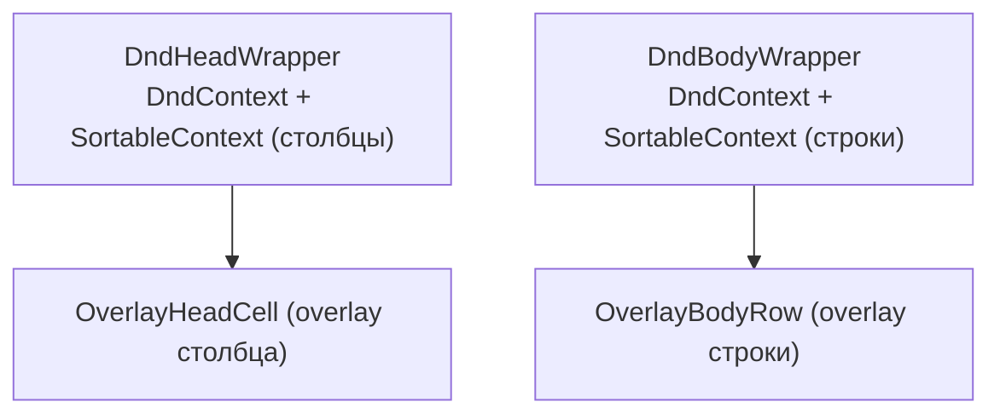

# Drag & drop

Tessera строит перетаскивание рендер-слоя поверх **dnd-kit** (что это такое
концептуально — в [upstream-foundations.md](upstream-foundations.md)). Поддержаны
два вида: переупорядочивание **столбцов** (в заголовке) и переупорядочивание
**строк** (в body, с иерархией). Этот документ описывает общий механизм DnD в
`<DataGrid/>`; **плагинный** deep-dive по перетаскиванию строк и столбцов
(активация, сервисный столбец, drag-ручка, drop-индикатор, алгоритм
переупорядочивания) — в [ADR 0006](../decisions/0006-dnd-with-dnd-kit.md).

## DnD-обёртки

Head и body оборачиваются в отдельные обёртки, каждая со своим `DndContext` +
`SortableContext`:

- **`DndHeadWrapper`** (`src/lib/grid/DndHeadWrapper.tsx`) — оборачивает
  заголовки в `DndContext` + `SortableContext` для переупорядочивания **столбцов**.
- **`DndBodyWrapper`** (`src/lib/grid/DndBodyWrapper.tsx`) — то же для
  переупорядочивания **строк**; поднимает вертикальный `SortableContext` и
  подключает handlers из `getRowDraggingEvents(table)`.

> **Ловушка.** `DndContext` по умолчанию рендерит свой live region
> (`role="status"`) и скрытые инструкции **на месте** — то есть внутри
> `role="table"`, где axe допускает только строки (`aria-required-children`). Обе
> обёртки передают `accessibility={dndAccessibility}` (`grid/dnd/parameters.ts`),
> и dnd-kit порталит эту разметку в `document.body` (ADR 0036, PQ4).
>
> Облака перетаскивания (`OverlayBodyRow`, `OverlayHeadCell`) тоже рисуются внутри
> таблицы, пока идёт перетаскивание и анимация броска, и ролей строк у них нет. Оба —
> визуальные клоны и помечены `inert`: вне дерева доступности и фокуса (ADR 0052, ND13;
> ADR 0006, D37).

## Overlay при активном перетаскивании

Активное перетаскивание рендерит плавающий overlay, следующий за курсором:
`OverlayHeadCell` для столбца и `OverlayBodyRow` для строки. Состояние принятия
row-drag питает CSS-переменные, тонирующие accept/reject (детали заливки строки —
в [ADR 0006](../decisions/0006-dnd-with-dnd-kit.md)).

## Collision detection и modifiers

Tessera поставляет **кастомную стратегию коллизий** для столбцов и **модификаторы**
для ограничения движения (`src/lib/grid/dnd/`). Автоскролл у края ограничен
**только вертикальной осью** (`autoScroll={autoScrollOnlyY}`,
`core/dnd/parameters.ts`): удержание указателя у верхнего/нижнего края скроллит
таблицу вертикально, горизонтальный автоскролл отключён.

## Вложенная шапка: узлы и соседи

Под многоуровневой шапкой перетаскивается **узел** — нарисованный заголовок листа или
группы ([ADR 0052](../decisions/0052-dnd-under-nested-headers.md), `core/columnNodes.ts`).
Соседи узла — узлы того же родителя в той же зоне закрепления; переносится он только
среди них, поэтому структура шапки не меняется. Механика:

- `HeadRow` оборачивает каждую серию соседей строки в свой `SortableContext` — это
  провайдер без DOM, порядок ячеек в CSS grid сохраняется; сортируемый id — `header.id`
  (сегменты разрезанной пиннингом группы делят id колонки);
- столкновения считаются только с соседями активного узла (`siblingKey` в `data`
  сортируемого элемента), бросок за край прижимает узел к краю группы;
- ячейки под группой лежат в других строках сетки, обёрткой их не охватить: сдвиг и
  скрытие они берут у предка через стор `grid/dnd/nodeShift.ts`, который публикует
  ячейка группы;
- бросок переставляет блок листьев узла (`moveBlock`), колбэк получает `columnId` и
  новый `columnOrder`.

Призрак `OverlayHeadCell` — `inert`: визуальный клон не попадает ни в дерево
доступности, ни в фокус.

## Порог старта и меню ручки

Сенсоры dnd-kit (`Pointer`, `Mouse`, `Touch`) в обеих обёртках получают
`activationConstraint: { distance: 5 }` (`grid/dnd/parameters.ts`): перетаскивание
начинается после сдвига на 5 px. Короткое нажатие — обычный клик: ручка
`DragHandler` — кнопка меню команд перестановки (WCAG 2.5.7,
[ADR 0034](../decisions/0034-wcag-22-dragging-and-target-size.md)). Пункты меню
дают плагины (`ColumnDraggingComponent`, `RowDraggingComponent`) и вызывают ту же
логику, что `Alt+Shift+стрелки` (`moveColumn.ts`, `moveRow.ts`). Попап
(`grid/handleMenu`) грузится лениво — при наведении и фокусе на ручке — и монтируется
только открытым; нажатие до загрузки открывает меню после неё, долгое ожидание видно
на ручке ([ADR 0061](../decisions/0061-lazy-popover-loading.md)). Грип ширины
`columnSizing` использует тот же попап.

## Отдача порядка потребителю

Итог перетаскивания отдаётся обратно потребителю через контракт `state`/handlers:

- порядок столбцов — `columnOrder` / `onColumnOrderChange`;
- порядок строк — `onRowOrderChange` (updater переупорядоченного массива).

Корректность после скролла обеспечивает виртуализатор: математика перемещения
опирается на индексы реально отрендеренных строк (см.
[virtualization.md](virtualization.md)).
