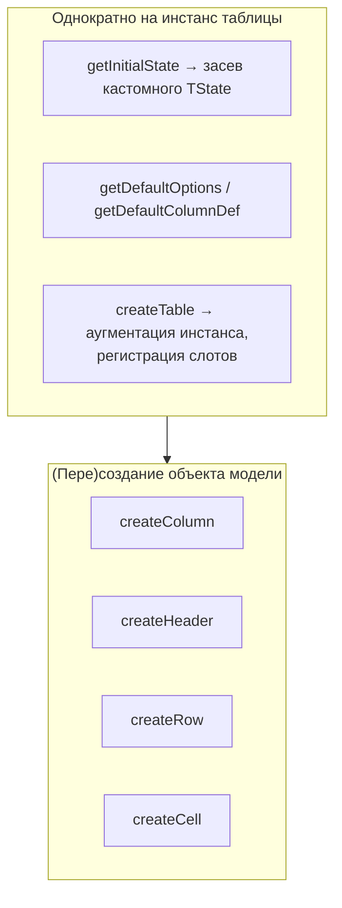
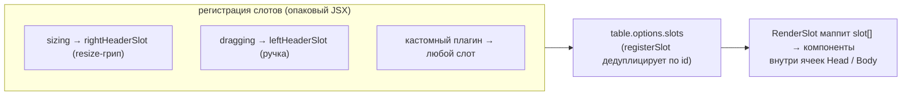

# Плагины и слоты

**Плагин** Tessera — это TanStack `TableFeature` (`TablePlugin`; контракт
принадлежит ядру — `src/lib/core/pluginContract.ts`, `plugins/types.ts` его
реэкспортит, ADR 0010) плюс конвенция рендеринга, построенная на **слотах** и
переопределениях `renderComponent` на уровне ячейки/заголовка. Потребителю плагин
доставляется фабрикой-записью `RegistryEntry` (presence-based композиция): фича
остаётся плоским `TablePlugin`, а привязка сервисной колонки, тонкие опции и
hook-слайс живут в записи.

## Жизненный цикл `TablePlugin`

```ts
interface TablePlugin<TData, THooks, TState, TOptions, TValue> {
  // однократно, при конструировании инстанса
  createTable?(table): void
  getDefaultColumnDef?(): Partial<ColumnDef>
  getDefaultOptions?(table): Partial<TableOptionsResolved> & TOptions
  getInitialState?(initialState?): InitialTableState & TState

  // на каждый инстанс каждого объекта модели
  createColumn?(column, table): void
  createHeader?(header, table): void
  createRow?(row, table): void
  createCell?(cell, column, row, table): void
}
```



> **Модель стоимости.** `createTable` / `getDefaultOptions` / `getInitialState`
> выполняются **однократно**. `createColumn/Header/Row/Cell` выполняются при каждом
> (пере)создании этого объекта — держите их дешёвыми. Не делайте тяжёлой работы или
> решений о рендеринге в `createCell`.

### `commonPlugin` — bootstrap-фича

`commonPlugin` выполняется первым и в `createTable` устанавливает расширения, от
которых зависят каждый другой плагин и UI:

- `table.getHooks()` → `table.options.hooks`
- `table.getRenderSlots()` → `table.options.slots`
- `table.getSlotActions()` → `table.options.slotActions` (дескрипторы действий, ADR 0024)
- `table.setRenderSlot(params)` → `registerSlot({ ...params, table })`
- плюс хелперы: `getHeaderGroups` (обёрнут флагами первой/последней группы),
  `getIsAnyColumnResizing` и хелперы на строку/заголовок/ячейку через остальные
  `create*`-хуки.

## Слоты

**Слот** — это именованная точка вставки, рендерящаяся вокруг содержимого
ячейки/заголовка. «Корзины» (`useCreateSlots`):

`leftHeaderSlot`, `rightHeaderSlot`, `leftCellSlot`, `rightCellSlot`,
`actionRowSlot`.

Плагины регистрируются в слотах в своём хуке **`createTable`** (это переехало из
`createHeader`/`createRow` — регистрация это забота уровня «однократно на таблицу»):

```ts
createTable: table => {
  table.setRenderSlot({
    id: 'myPlugin', // уникальный id — ключ дедупликации
    slot: 'rightHeaderSlot',
    order: 0, // число = индекс splice, 'last'/undefined = push
    component: MyButton, // либо `render: (ctx) => ReactNode`
  })
}
```

> Слоты рендерят **опаковый** JSX. Кнопки-действия встроенных плагинов (пиннинг/
> сортировка/группировка) на слотах больше **не** живут — они объявляются единым
> дескриптором `slotActions` (см. ниже «Действия слота»); на слотах остаются
> аффордансы (resize-грип `columnSizing`, ручка `columnDragging`) и произвольный
> пользовательский JSX.

`registerSlot` (`core/createSlots/registerSlot.ts`) **дедуплицирует по `id`**: если
id уже существует в слоте, он обновляет `visible/render/component` на месте, иначе
вставляет (по `order`) или пушит. Так что повторная регистрация безопасна и
идемпотентна.



При рендере `HeadCell` / `BodyCell` вытягивают релевантный массив слота из
`table.getRenderSlots()` и передают его в `RenderSlot`, который рендерит каждый
зарегистрированный `component`/`render` с контекстом ячейки/заголовка.

## Переопределения `renderComponent`

Помимо слотов, плагин может заменить всё содержимое конкретной ячейки или
заголовка, задав `renderComponent` в `createCell` / `createHeader`:

```ts
createCell: cell => {
  if (cell.column.id !== COLUMN_SELECTION_ID) return
  cell.renderComponent = RowSelectionComponent
}
```

`BodyCell` предпочитает `cell.renderComponent`, когда он присутствует. Именно так
встроенные сервисные столбцы (чекбокс выбора, expander) инъектируют свой UI и так
`switchActionPlugin` из Guide подменяет рендерер ячейки столбца.

## Действия слота (дескриптор) и кебаб-меню

Кнопки-действия (пиннинг, сортировка, группировка, действия строки) объявляются не
опаковым слот-компонентом, а **единым дескриптором `SlotAction`** — данными (ADR
0024). Плагин кладёт их в `RegistryEntry.slotActions`; ядро сворачивает реактивно
(как `slots`, маршрутизируя по `slot`) в `table.options.slotActions` и **само решает
подачу**: инлайн иконка-кнопка или строка раскрывающегося кебаб-меню.

```ts
export const pinHeaderAction: HeaderAction = {
  id: 'columnPinning',
  slot: 'rightHeaderSlot',
  order: 0,
  visible: ({ column }) => column.getCanPin(), // применимость (и участие в пороге)
  icon: () => <PinActionIcon />, // компонент — доступ к useIcons
  label: (ctx, labels) => (isPinned(ctx) ? labels.unpin : labels.pin), // labels инъектируются
  active: isPinned, // подсветка инлайн + галочка в меню
  onSelect: togglePin,
  subscribe: ({ column }) => [column.getIsPinned(), column.getCanPin()], // Pub-Sub ключи
}
```

Дженерик по контексту: `HeaderAction = SlotAction<HeaderComponentProps>` (шапка),
`RowAction = SlotAction<CellComponentProps, 'actionRowSlot'>` (строка). Один движок
(`resolveActionLayout`) и рендереры (`ActionButton`, `ActionMenu`, `ActionsZone`)
обслуживают оба; `ActionsZone` встроена в `HeadCell` (слоты шапки) и `BodyCell`
(колонка действий строки).

Схлопывание включает **плагин-меню** (`headerActionMenu` / `rowActionMenu`): он
объявляет `RegistryEntry.actionMenu` (`{ slots, mode, threshold }`), ядро сворачивает
декларации в карту `table.options.actionMenu` по слотам. Правило **all-or-nothing**:
применимые действия слота либо все инлайн, либо (при достижении порога или
`mode: 'always'`) все схлопнутых — в кебаб. Опаковые слот-компоненты не схлопываются
(всегда инлайн), но учитываются в пороге; аффорданс с `countsAsHeaderAction: false`
(resize-грип) — не учитывается. `menuItems` разворачивает одно действие в несколько
пунктов меню (сортировка → asc/desc/сброс), `adornment` — довесок инлайн-кнопки
(бейдж приоритета).

## Руководство для авторов

- **Действие-кнопка (пиннинг/сортировка/…), которое может уехать в кебаб-меню** →
  объявите `slotActions: [SlotAction]` в записи реестра (данными), не опаковый
  компонент.
- **Рендерить произвольный JSX в каждой строке/ячейке/заголовке** → зарегистрируйте
  слот в `createTable` (или декларативный `slots`); такой компонент кебаб не
  схлопывает.
- **Владеть ячейкой/заголовком всего столбца** → задайте `renderComponent` в
  `createCell`/`createHeader`, защитив по id столбца.
- **Добавить кастомное состояние таблицы** → `getInitialState` + типизация через
  `TState`.
- **Добавить кастомные методы/опции** → `createTable` / `getDefaultOptions` +
  типизация через `TOptions`.
- **Реагировать на внешние значения внутри компонента плагина** → читайте
  `table.getState()` и подписывайтесь через `useSubscribeStore`
  ([reactivity.md](reactivity.md)); вызывайте бизнес-функции через
  `table.getHooks()`.
