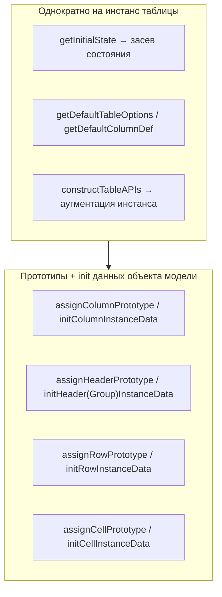

# Плагины и слоты

**Плагин** Tessera — это v9 `TableFeature` плюс конвенция рендеринга на **слотах** и
переопределениях рендера на уровне ячейки/заголовка. Потребителю плагин доставляется
записью `TesseraFeatureEntry` (presence-based композиция,
[features.ts](../../src/lib/core/features.ts), ADR 0010): фрагмент карты фич живёт в
`entry.slot`, а сервисная колонка, тонкие опции, декларативные слоты/действия и
императивный `setup` — в остальных полях записи.

## Жизненный цикл фичи (v9 `TableFeature`)

```ts
interface TableFeature {
  // однократно, при конструировании инстанса
  constructTableAPIs?(table): void // методы таблицы (getHooks, setRenderSlot, …)
  getDefaultTableOptions?(table): Partial<TableOptions>
  getDefaultColumnDef?(): Partial<ColumnDef>
  getInitialState?(initialState?): TableState

  // методы на ПРОТОТИПЫ (используют this) + начальные данные на инстанс
  assignColumnPrototype?(prototype, table): void
  assignHeaderPrototype?(prototype, table): void
  assignRowPrototype?(prototype, table): void
  assignCellPrototype?(prototype, table): void
  initColumnInstanceData?(column): void
  initHeaderInstanceData?(header): void
  initHeaderGroupInstanceData?(headerGroup): void
  initRowInstanceData?(row): void
  initCellInstanceData?(cell): void
}
```

> **Принципиальный сдвиг с v8:** методы теперь живут на **прототипах** и обращаются к
> `this` (нельзя деструктурировать), а собственные мутабельные данные объекта кладутся
> через `init*InstanceData` — вместо v8-хуков `create*`, замыкавших конкретный
> инстанс.



> **Модель стоимости.** `constructTableAPIs` / `getDefaultTableOptions` /
> `getInitialState` выполняются **однократно**; `assign*Prototype` — тоже однократно
> (на прототип), но повешенные ими методы зовутся часто, а `init*InstanceData` бежит
> при каждом (пере)создании объекта — держите их дешёвыми.

### `commonFeature` — bootstrap-фича

`commonFeature` — always-on фича ядра; в `constructTableAPIs` она ставит расширения,
от которых зависят каждый другой плагин и UI:

- `table.getHooks()` → `table.options.hooks`
- `table.getRenderSlots()` → `table.options.slots`
- `table.getSlotActions()` → `table.options.slotActions` (дескрипторы действий, ADR 0024)
- `table.getContextMenuActions()` → `table.options.contextMenuActions` (пункты
  контекстного меню, ADR 0030)
- `table.options.stubEntries` — записи реестра заглушек пустой таблицы из поля `stubs`
  записей плагинов (ADR 0123); грид сводит их с записями ядра (`stubEntriesOf`) и
  показывает первую по приоритету с выполненным `when`
- `table.getKeyboardActions()` → `table.options.keyboardActions` (клавиатурные
  действия ячеек: `Space`/`Enter`/`F2`, ADR 0021; упорядочены по `priority`)
- `table.reportPluginError(id, error)` → реестр ошибок плагинов: `logError` один раз
  на плагин + `status: 'error'` в снимке (ADR 0037, PE5). Компоненты слотов и сервисных
  колонок ядро само рендерит в `PluginErrorBoundary` с `id` плагина (метку ставит
  `foldEntries`; PE1–PE2). Обёртка кэшируется по (шаблон, `id` плагина): новая ссылка
  `columns` не перемонтирует служебные ячейки (PE7–PE8). `setup` (PE3), `diagnose` (PE4) и `reconcile` (PE6) обёрнуты
  в `try/catch`.
- `table.getPluginDiagnostics()` → снимок `active`/`inert` (+`reason`) по каждой
  записи из `table.options.pluginDiagnostics`, считается на момент вызова через
  `diagnose` записи (ADR 0022, PC12–PC14)
- `table.setRenderSlot(params)` → регистрация слота на месте
- `table.reportAction(report)` → канал действий (ADR 0125): действие уходит в опцию
  `onDebugAction` с номером экземпляра; без слушателя метод возвращает `undefined` и
  `detail`-функцию не вызывает. Подробно — [ниже](#канал-действий).
- плюс хелперы: `getHeaderGroups` (флаги первой/последней группы через
  `initHeaderGroupInstanceData`), `getIsAnyColumnResizing` и флаги на
  колонку/заголовок/строку/ячейку через `assign*Prototype`.

### Канал действий

Что сделал пользователь, приложение или сам грид, видно опцией `onDebugAction`
(ADR 0125). Декларативные действия ядро сообщает само — плагину вызывать ничего не нужно:
слот-действие и пункт меню (`id` действия, плагин-владелец — запись, объявившая
дескриптор), клавиатурное действие, пункт контекстного меню и меню ручки, открытие и
закрытие поповеров `useLazyPopover`, навигация клавиатуры, серверное действие
`runServerAction` с итогом. Явный вызов нужен только жесту и своему контролу:

```ts
import { reportAction, reportOutcome, sourceOf } from '@tessera-grid/tessera'

const id = reportAction(table, {
  plugin: 'starRows', // id своей записи
  action: 'starAll',
  detail: () => ({ rows: count }), // функция — только при слушателе
  source: sourceOf(event), // 'pointer' | 'keyboard' | 'api' | 'auto'
})
reportOutcome(table, { plugin: 'starRows', action: 'save', cause: id }, promise)
```

Жест — пара `phase: 'start'` и `'end'` (протяжка, перетаскивание, сессия правки).
`reportOutcome` сообщает итог промиса отдельным действием `<action>Resolved` или
`<action>Rejected` с `cause`; без `cause` причина — последнее действие той же задачи.
Ключ причины — сам метод `reportAction`, поэтому копия таблицы, пришедшая плагину, её не
теряет. Колбэк, который глотает отказ (логирует и не пробрасывает), сообщает итог по
исходному промису, а не по своему. Строка перечня ADR 0125 обязательна для каждого
экспорта `/plugins` (AL8).

### Согласование состояния: `reconcile`

Поле записи `reconcile(table, { enabled, hooks })` (ADR 0040, §2) ядро зовёт после
каждого рендера таблицы (`useTableEffects`, layout-эффект без зависимостей) у **всех
присутствующих** записей — и у выключенных (SS16), и у «призраков» удалённых после
монтирования (SS19). Хуки у включённой записи живые (`table.getHooks()`), у выключенной —
из самой записи. Назначение — сверить с таблицей состояние, которое переживает
размонтирование компонентов: `cellEditing` так завершает сессию правки, когда строка
ушла из данных (`unavailable`, SS5), плагин выключили или `canEditCell` запретил ячейку
вне экрана (`revoke`, SS16). Поле зовётся на каждый рендер — без открытой сессии оно обязано
выходить сразу.

### Сессии действий

Правка, перетаскивание и ресайз — сессии с причиной завершения (ADR 0040):
`commit` зовёт колбэк успеха, остальное (`cancel`/`revoke`/`unavailable`) — колбэк
отмены плагина. Причина проходит через `core/cancelInteraction.ts`: у
перетаскивания — синхронно вокруг синтетического `Escape`, у ресайза — меткой на
событии конца протяжки. Хуки плагина запоминаются на начало сессии
(`holdSessionHooks`), чтобы отмена дошла и при выключенном посреди неё плагине
(SS13, SS16). `Head`/`Body`/`Footer` на время ресайза заморожены memo-компаратором,
поэтому исчезновение колонки посреди протяжки ловит `DataGrid`, а не ручка (SS15).

### Плагин модели и плагин интерфейса

Модель строк и управление ею — разные плагины ([ADR 0120](../decisions/0120-model-and-interface-plugins.md),
образец — дерево, [ADR 0119](../decisions/0119-tree-data-model.md)). Плагин модели
(`rowExpandingModel`) приносит фичи, модель строк, режим данных и сужение среза без
контролов; плагин интерфейса (`rowExpanding`) включает модель полем `model` в
`definePlugin` — фабрикой модели и списком аргументов, которые ей передаёт.

- **Раскрытие.** `expandIncludedModels` (`core/pluginModels.ts`) ставит включённую модель
  своей записью перед интерфейсом с пометкой `includedBy`; `foldEntries`,
  `buildTesseraFeatures` и `useCreateTable` видят уже раскрытый набор. Включённая явная модель в
  наборе главнее: её аргументы действуют, расхождение с аргументами интерфейса — dev-
  предупреждение (MP5). Выключенная явная модель рядом с включённым интерфейсом уступает
  модели интерфейса: модель включена, если включена хоть одна несущая её запись.
- **Опции модели** (`enableExpanding`…) выставляет только модель — порядок записей итог
  не меняет (MP4). Сужения срезов складываются от всех записей: `maxDepth` интерфейса
  ограничивает дерево и рядом с явной моделью.
- **Диагностика.** Включённая модель — часть записи интерфейса и в
  `getPluginDiagnostics()` не видна; явная — своей записью (MP16).
- **Срезы в аргументах.** Модель объявляет `slices: ['expanded']`: аргументы `<срез>`,
  `on<Срез>Change` и `initial<Срез>` (MP8, MP9). Срез с внешним значением (или со своим
  сужением) ведёт ядро, как суженный (`useEffectiveState`); без них срезом владеет
  TanStack, а ядро оборачивает его `makeStateUpdater`, чтобы колбэк получил новое
  значение. `initial<Срез>` уходит и в `initialState` TanStack: автосброс
  (`autoResetCellSelection`) и `reset*` возвращают к нему. Сброс среза ядра в
  `undefined` передаётся TanStack своим свойством — иначе v9 берёт прежнее из базового
  атома. В `state`/`handlers` ядра срезов плагинов нет (MP6–MP7).
- **Выключенная модель** сужает свой срез до пустого (фильтры, поиск, группировка, выбор
  строк), но пустой срез отдаёт тем же значением: новая ссылка сбросила бы страницу
  подпиской `resetPageOnReorder` (PG10).
- **Tree-shaking.** Интерфейс импортирует модель, модель интерфейс — никогда;
  `check:tree-shaking` разрешает плагину модули моделей по цепочке `entry.model`.

Выключенную модель показывает пустой срез — сужение `narrowExpandingOff`
(`core/expandedRowModel.ts`), сохранённое значение не меняется. Общий код модели и
интерфейса живёт вне их папок (IV3).

## Слоты

**Слот** — это именованная точка вставки, рендерящаяся вокруг содержимого
ячейки/заголовка. «Корзины» (`useCreateSlots`):

`leftHeaderSlot`, `rightHeaderSlot`, `leftCellSlot`, `rightCellSlot`,
`actionRowSlot`, `cellSlot`, `toolbarSlot`, `statusBarSlot`, `bodyEndSlot`, `tableEndSlot`.

`toolbarSlot` — табличный слот верхнего тулбара (ADR 0035): компонент получает
`{ table }` (контекста колонки нет), кнопки группируются полем `group`; группы идут
по наименьшему `order`, между ними — разделитель. Кнопку рисует `ToolbarButton`
(семейство F4); вне тулбара она не работает. Тулбар есть, пока есть хоть один активный
`toolbarSlot`; `enableToolbar: true` / `false` это переопределяет (ADR 0046, PB1–PB2).

`statusBarSlot` — табличный слот нижней панели (ADR 0038): сведения о данных
(счётчики, пагинация), компонент получает `{ table }`. Поле `align` (`'start'` по
умолчанию или `'end'`) выбирает сторону, внутри стороны — порядок по `order`
(`resolveStatusBarSides`, `core/statusBar.ts`; SB4). Панель рисуется, пока есть хоть
один активный слот (SB1); `enableStatusBar: true` / `false` это переопределяет
(ADR 0046, PB3). Запись с `showsPanel: false` рисуется в панели, но сама её не
вызывает (`countPanelSlots`, `core/panels.ts`;
[ADR 0082](../decisions/0082-back-to-top.md), BT3): так стоит кнопка «наверх». Правило
границы: сверху (тулбар) — контролы, снизу — сведения и навигация по набору.

`bodyEndSlot` — строки сразу за последней строкой тела, вне модели и вне
виртуализатора строк ([ADR 0081](../decisions/0081-infinite-scroll.md)): компонент
получает `{ table, layout, leafColumns, virtualColumns, isVirtualColumns,
nextAriaRowIndex }`, чтобы его строки повторяли ширины, закрепление и окно колонок
тела. Так лента (`infiniteScroll`) рисует хвост скелет-строк (`SkeletonRows` из
`grid/SkeletonBody`).

`tableEndSlot` — строки в конце таблицы с тем же контекстом: до закреплённого футера и
после незакреплённого ([ADR 0118](../decisions/0118-column-footer.md), §3). Там лента
рисует строку ошибки с повтором. Контрол такой строки с атрибутом `data-kn-body-end`
получает фокус по `↓` с последней строки тела, а под незакреплённым футером — с футера;
над закреплённым футером в неё же ведёт `↑` с футера. Ядро читает и общие
опции плагина с лишними строками: `getTotalRowCount` (`aria-rowcount` больше `data`
или `-1`; итог источника строк серверной модели, `RowSource.total`, главнее неё —
опции плагинов сливаются, и последний перетёр бы его, ADR 0138; перезапись опции или
хуков чужим плагином ядро показывает предупреждением с ключом и `id` обоих, ADR 0140),
`getBodyBusy` (`aria-busy` таблицы по срезу плагина), `partialData`
(выгрузка подписывает «все строки» как загруженные), — не импортируя плагин.

`cellSlot` — особый канал: его компонент-владелец получает собственный рендер
ячейки пропсом `content` и решает, показать его как есть или заместить своим
(инлайн-редактор `cellEditing`). Это единственный канал, подавляющий `{render}`
ячейки; на несколько владельцев одного `cellSlot` ядро выдаёт дев-варн (ADR 0028,
DP16).

Плагины объявляют слоты **декларативно** в записи (`TesseraFeatureEntry.slots`);
`foldEntries` сворачивает слоты активных записей в `table.options.slots`. Императивный
`table.setRenderSlot(...)` от `commonFeature` остаётся как escape-hatch для
пользовательских плагинов.

```ts
// поле записи фичи
slots: [
  {
    id: 'myPlugin', // уникальный id — ключ дедупликации
    slot: 'rightHeaderSlot',
    order: 0, // число = индекс splice, 'last'/undefined = push
    component: MyButton, // либо `render: (ctx) => ReactNode`
  },
]
```

> Слоты рендерят **опаковый** JSX. Кнопки-действия встроенных плагинов (пиннинг/
> сортировка/группировка) на слотах больше **не** живут — они объявляются единым
> дескриптором `slotActions` (см. ниже «Действия слота»); на слотах остаются
> аффордансы (resize-грип `columnSizing`, ручка `columnDragging`) и произвольный
> пользовательский JSX.

Регистрация слота (`registerSlotInto`, `core/createSlots`) **дедуплицирует по `id`**:
если id уже существует в слоте, обновляет `visible/render/component` на месте, иначе
вставляет (по `order`) или пушит. Так что повторная регистрация безопасна и
идемпотентна ([ADR 0010](../decisions/0010-invert-core-plugins-registry.md), IV12).


При рендере `HeadCell` / `BodyCell` вытягивают релевантный массив слота из
`table.getRenderSlots()` и передают его в `RenderSlot`, который рендерит каждый
зарегистрированный `component`/`render` с контекстом ячейки/заголовка.

## Свой рендер ячейки/заголовка колонки

По умолчанию содержимое рендерится нативным `FlexRender` от `columnDef.cell` /
`columnDef.header`. Чтобы владеть всей колонкой, задайте `cell` / `header`
**компонентом напрямую** в определении (сервисной) колонки — так делают встроенные
сервисные столбцы (чекбокс выбора, expander):

```ts
const leafColumn = {
  id: COLUMN_SELECTION_ID,
  header: HeadSelectionComponent,
  cell: RowSelectionComponent,
}
```

**Показ по условию.** Служебная колонка в `definePlugin` может объявить
`presence(table, context, opts)` — когда она нужна; без поля колонка видна всегда.
Условие смотрит только на исходные строки (`getCoreRowModel`), аргументы фабрики и
свёртку набора (`context.options`, `context.slotActions`), но не на вид. Ложное
условие скрывает колонку сужением среза `columnVisibility` в эффективном состоянии —
идентичность `columns` не меняется. Плагин с условием даёт приложению опцию
`column: 'auto' | 'always'` ([ADR 0050](../decisions/0050-service-column-presence.md)).

Дополнительно `BodyCell` / `HeadCell` уважают **приоритетный** override
`cell.renderComponent` (escape-hatch — если фиче нужно подменить рендерер на уровне
инстанса ячейки через `assignCellPrototype` / `init*InstanceData`).

## Действия слота (дескриптор) и кебаб-меню

Кнопки-действия (пиннинг, сортировка, группировка, действия строки) объявляются не
опаковым слот-компонентом, а **единым дескриптором `SlotAction`** — данными (ADR
0024). Плагин кладёт их в `RegistryEntry.slotActions`; ядро сворачивает реактивно
(как `slots`, маршрутизируя по `slot`) в `table.options.slotActions` и **само решает
подачу**: инлайн иконка-кнопка или строка раскрывающегося кебаб-меню.

```ts
export const pinHeaderAction: HeaderAction = {
  id: 'columnPinning',
  slot: 'rightHeaderSlot',
  order: 0,
  visible: ({ column }) => column.getCanPin(), // применимость (и участие в пороге)
  icon: () => <PinActionIcon />, // компонент — доступ к useIcons
  label: (ctx, labels) => (isPinned(ctx) ? labels.unpin : labels.pin), // labels инъектируются
  active: isPinned, // подсветка инлайн + галочка в меню
  onSelect: togglePin,
}
```

> Поля `visible`/`active`/`label` — чистые функции контекста; их реактивность
> обеспечивает сам компонент действия, подписываясь на нужный срез через
> `useSlice`/`useTableState`. Прежнее поле `subscribe` (ключи Pub-Sub) в v9 убрано.

Дженерик по контексту: `HeaderAction = SlotAction<HeaderComponentProps>` (шапка),
`RowAction = SlotAction<CellComponentProps, 'actionRowSlot'>` (строка). Один движок
(`resolveActionLayout`) и рендереры (`ActionButton`, `ActionMenu`, `ActionsZone`)
обслуживают оба; `ActionsZone` встроена в `HeadCell` (слоты шапки) и `BodyCell`
(колонка действий строки).

Схлопывание включает **плагин-меню** (`headerActionMenu` / `rowActionMenu`): он
объявляет `RegistryEntry.actionMenu` (`{ slots, mode, threshold }`), ядро сворачивает
декларации в карту `table.options.actionMenu` по слотам. Правило **all-or-nothing**:
применимые действия слота либо все инлайн, либо (при достижении порога или
`mode: 'always'`) все схлопнутых — в кебаб (AM10, AM15). Опаковые слот-компоненты не схлопываются
(всегда инлайн), но учитываются в пороге; аффорданс с `countsAsHeaderAction: false`
(resize-грип) — не учитывается (AM14). `menuItems` разворачивает одно действие в несколько
пунктов меню (сортировка → asc/desc/сброс), `count` — число в бабле включённой
инлайн-кнопки вместо точки (номер приоритета, [ADR 0129](../decisions/0129-button-active-state.md)). `placement: 'menu'` — действие только для кебаба («Скрыть
колонку», ADR 0035): инлайн не рисуется, но само по себе показывает кебаб, и этот
кебаб считается в пороге одной кнопкой (AM22); без плагина-меню у такого действия нет
поверхности (AM23). `panel(ctx, { close, initialFocusRef })` — **действие с панелью**
(фильтр колонки, [ADR 0045](../decisions/0045-filtering.md)): инлайн-кнопка и пункт
кебаба открывают поповер с этим содержимым (у кебаба — у его кнопки), `onSelect` не
вызывается; фокус при открытии — на `initialFocusRef`, при закрытии — на открывшую
кнопку.

### Асинхронные действия

Пункты меню бывают асинхронными ([ADR 0078](../decisions/0078-async-menu-actions.md)):

- **`disabled(ctx, signal)` может вернуть промис** — проверка доступности на сервере.
  Её запускает сессия меню: при наведении и фокусе на кебабе (или при открытии, если
  сессии ещё нет), до закрытия; закрытие прерывает `signal`. Пока проверка идёт, пункт
  заблокирован с бликом по контуру. Ядро зовёт `disabled` и в рендере — для синхронных
  значений; дескриптор, однажды вернувший промис, рендер больше не вызывает. У
  инлайн-кнопки асинхронный `disabled` не поддержан — кнопка заблокирована, dev-warn.
  `visible` остаётся синхронным.
- **Причина блокировки** — ответ `disabled`: `{ kind: 'done' | 'forbidden', reason? }`
  (`true` — запрещено). Значок у правого края: галочка «уже сделано», замок
  «запрещено» с текстом (без текста пункт только гаснет); отклонённый промис — проверка не удалась: иконка ошибки, пункт доступен,
  нажатие проверяет заново. `reason` — в тултипе и `aria-describedby`.
- **`onSelect` может вернуть промис** — долгое действие. Ожидание и отказ живут в
  always-on срезе `actionStatus` (`actionStatusFeature`) по ключу «цель + действие»
  (`actionTarget`: колонка заголовка или ячейка строки) и переживают виртуализацию.
  Кебаб бликует, пока ждёт хотя бы одно действие, и после отказа держит отметку
  ошибки до открытия меню; имя и тултип кебаба перечисляют ждущие и упавшие
  действия. В пункте отказ — иконка `actionFailed` с полным текстом в тултипе
  (`errorMessage`, иначе текст ошибки). Инлайн-кнопка показывает ожидание кольцом и
  отказ вспышкой.
- **Отмена** ([ADR 0153](../decisions/0153-cancel-long-operations.md)) — `onSelect`
  получает `{ signal }`. Ждущий пункт доступен: подпись «Отменить: ‹имя›» со спиннером,
  выбор отменяет. Инлайн-кнопка через `--tsr-comp-cancel-arm-delay` показывает «стоп»;
  у кебаба «стопа» нет — он открывает меню, где отменяет пункт. Отмена тихая: ни
  отметки отказа, ни вспышки; ответ после отмены игнорируется. Мини-меню инлайн-кнопки
  (`ActionInlineMenu`) отменяет так же, как кебаб, — отдельной проверки этого пути нет
  (см. [roadmap](../roadmap.md#известные-проблемы)).

Пункты кебаба, мини-меню и контекстного меню рисует один компонент
`ActionMenuItems`; запуск выбора — `runMenuAction`.

### Вложенные разделы

`submenu(ctx, labels) → { title, items }` превращает пункт в раздел
([ADR 0079](../decisions/0079-nested-menu-sections.md)): шеврон и необязательное
значение `hint`, вход — смена содержимого в том же окне сдвигом с подстройкой размера.
`items` — те же `MenuAction` (раздел может содержать раздел) или промис: раздел
открывается сразу со скелетом, загрузка начинается при наведении на пункт, отказ —
строка повтора. Стек уровней — путь по `id` (`resolveMenuLevel`), хранит его меню
(`useMenuSections`); уходящий уровень — снимок разметки без ролей, чтобы Base UI не
вёл по нему стрелки. Ожидание и отказ пунктов разделов кебаб собирает по цели.
`closeOnSelect: false` — у раздела (умолчание для его пунктов) или у пункта (переопределяет):
выбор не закрывает меню, состояние пункта обновляется на месте, асинхронное действие
видно лоадером в пункте; пункт с `active` становится флажком (`menuitemcheckbox`).

## Подсветка строк, ячеек и колонок

Плагин и приложение выделяют цель через `table.highlight(target, options)`
([ADR 0080](../decisions/0080-highlight-api.md)): `{ row }`, `{ cell: [rowId,
columnId] }` или `{ column }`. Вызов возвращает `{ clear() }`; `duration` гасит
подсветку по времени, `until` — по завершении промиса (подтверждение удаления,
сохранение), `key` объединяет подсветки в группу для `table.clearHighlights(key)`.
Под API — ядровый срез `highlights` (фича `highlightFeature`, всегда включена): цель
хранится по id и переживает виртуализацию, сортировку, фильтр и страницу, а строка,
ушедшая из `data`, и колонка, ушедшая из `columns`, теряют подсветку. Строка читает
свою подсветку в `useRowStateSubscription`, ячейка — свою и колонки в подписке формы
колонок: подсветка одной цели перерисовывает только её. `label` объявляется через
`table.announce` и висит `aria-description` цели — цвет не единственный сигнал.

## Вспышка итога на цели

Итог своего асинхронного действия плагин и приложение показывают на цели через
`table.flashOutcome(target, outcome)` ([ADR 0134](../decisions/0134-outcome-flash.md)):
цель — та же форма, что у подсветки, или массив целей; итог — `arrived` (здесь
появилось), `accepted` (сервер принял запись) или `reverted` (вернули прежнее). Вспышка
держится по токенам темы и гаснет сама, у всех итогов одинаково; `reverted` зовут в том
же обработчике, что и вспышку ошибки кнопки-инициатора (ADR 0127), — они начинаются вместе. Под API —
ядровый срез `flashes` (фича `flashFeature`, всегда включена), отдельный от
`highlights`: подсветку приложения вспышка не трогает. Цель хранится по id и переживает
виртуализацию и страницу; строка вне `data` и колонка вне `columns` теряют вспышку. Один
таймер на таблицу переводит вспышку в угасание и снимает её. Вспышка ничего не объявляет:
итог объявляет носитель.

## Серверные действия

Сортировка, фильтры, поиск и страница серверного режима задают один запрос данных
([ADR 0116](../decisions/0116-async-server-actions.md)). Плагины `columnSorting`,
`columnFiltering`, `quickSearch` и `pagination` меняют срез и зовут свой колбэк через
`runServerAction` (`core/serverActions`, модуль вне папок плагинов — IV3); в клиентском
режиме он только применяет срез и зовёт колбэк.

- **Контракт колбэка.** Последний аргумент — `{ signal }`, результат — `void` или
  промис. Следующее серверное действие и размонтирование (`abortServerActions` в
  `useTableEffects`) прерывают `signal`, итог прерванного вызова игнорируется.
- **Ожидание и отказ** — ядровый срез `serverAction` (фича `serverActionFeature`,
  всегда включена): `pending` и `failed` с причиной `{ control, columns, menu }` и
  `retry`. Причина подписана `useServerActionMarks` только на то, касается ли срез её
  самой; свет ожидания — `aria-busy` и `data-pending`, а не `pending` кнопки: нажатия
  во время ожидания разрешены.
- **Откат.** Сортировка и страница до первого действия цепочки ожидания — цель отката
  (`setSorting` / `setPagination`, колбэки действий не зовутся). `revertOnReject: false`
  у `columnSorting` и `pagination` оставляет новое состояние. Текст поиска и значения
  фильтра не откатываются.
- **Повтор** из плашки возвращает сортировку и страницу отказавшей попытки и зовёт тот
  же колбэк с теми же аргументами.
- **Фильтр колонки** в серверном режиме отправляет условие кнопкой «Применить» и Enter
  ([ADR 0154](../decisions/0154-server-filter-apply-and-draft.md)); набранное хранит
  черновик колонки (`columnFiltering/filterDraft`) до применения, «Сбросить» или смены
  фильтра снаружи.
- **Отмена** ([ADR 0153](../decisions/0153-cancel-long-operations.md)): кнопка-причина
  показывает «стоп» (`serverCancelProps`), действие дольше
  `--tsr-comp-cancel-hint-delay` — плашка `PendingActionBanner` с кнопкой «Отменить»;
  Escape в теле и в поле поиска. Отмена прерывает `signal` и откатывает срезы, как отказ,
  но тихо: без красного света и плашки отказа; живая область объявляет отмену
  (`markLoadCancelled`). Пункты меню, серверные действия, выгрузка, ленивые дети и
  копирование в SSRM регистрируют отмену в общем реестре `core/cancellation`;
  приложение отменяет их `table.cancelPending(filter?)`. У пункта меню с целью `'table'`
  плашки нет — он отменяется только из меню (см.
  [roadmap](../roadmap.md#известные-проблемы)).

- **Каждый встроенный плагин объявляет `diagnose`** ([ADR 0036](../decisions/0036-plugin-contract-diagnostics-and-a11y.md)):
  функция причины инертности (или `neverInert`, если инертным он не бывает). Ядро
  предупреждает о статических причинах при монтировании; причины, зависящие от
  состояния, гейт `getCan*` предупреждает сам через `warnPluginInert` — из той же
  функции, что и `diagnose`. Новый плагин добавляется в карту axe-прогона
  `visual/plugin-a11y.test.tsx` (PQ4), иначе тест падает.

- **Действие-кнопка (пиннинг/сортировка/…), которое может уехать в кебаб-меню** →
  объявите `slotActions: [SlotAction]` в записи реестра (данными), не опаковый
  компонент.
- **Рендерить произвольный JSX в каждой строке/ячейке/заголовке** → объявите слот
  декларативно (`entry.slots`) или императивно `table.setRenderSlot`; такой компонент
  кебаб не схлопывает.
- **Владеть ячейкой/заголовком всего столбца** → задайте `cell`/`header` компонентом
  в определении колонки (или приоритетный `cell.renderComponent`), защитив по id
  столбца.
- **Добавить кастомное состояние таблицы** → `getInitialState` фичи + declaration
  merging через `TableState_FeatureMap`.
- **Добавить кастомные методы/опции** → `constructTableAPIs` / `getDefaultTableOptions`
  фичи + declaration merging через `Table_FeatureMap` / `TableOptions_FeatureMap`.
- **Реагировать на внешние значения внутри компонента плагина** → подписывайтесь на
  срез через `useSlice(table, key)` / `useTableState(table, selector)`
  ([reactivity.md](reactivity.md)); вызывайте бизнес-функции через `table.getHooks()`.
