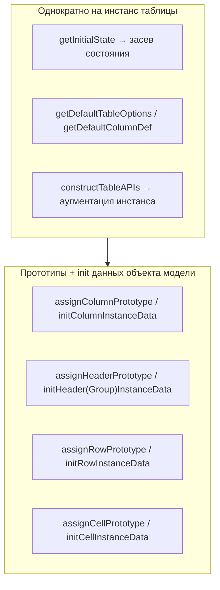

# Плагины и слоты

**Плагин** Tessera — это v9 `TableFeature` плюс конвенция рендеринга на **слотах** и
переопределениях рендера на уровне ячейки/заголовка. Потребителю плагин доставляется
записью `TesseraFeatureEntry` (presence-based композиция,
[features.ts](../../src/lib/core/features.ts), ADR 0010): фрагмент карты фич живёт в
`entry.slot`, а сервисная колонка, тонкие опции, декларативные слоты/действия и
императивный `setup` — в остальных полях записи.

## Жизненный цикл фичи (v9 `TableFeature`)

```ts
interface TableFeature {
  // однократно, при конструировании инстанса
  constructTableAPIs?(table): void // методы таблицы (getHooks, setRenderSlot, …)
  getDefaultTableOptions?(table): Partial<TableOptions>
  getDefaultColumnDef?(): Partial<ColumnDef>
  getInitialState?(initialState?): TableState

  // методы на ПРОТОТИПЫ (используют this) + начальные данные на инстанс
  assignColumnPrototype?(prototype, table): void
  assignHeaderPrototype?(prototype, table): void
  assignRowPrototype?(prototype, table): void
  assignCellPrototype?(prototype, table): void
  initColumnInstanceData?(column): void
  initHeaderInstanceData?(header): void
  initHeaderGroupInstanceData?(headerGroup): void
  initRowInstanceData?(row): void
  initCellInstanceData?(cell): void
}
```

> **Принципиальный сдвиг с v8:** методы теперь живут на **прототипах** и обращаются к
> `this` (нельзя деструктурировать), а собственные мутабельные данные объекта кладутся
> через `init*InstanceData` — вместо v8-хуков `create*`, замыкавших конкретный
> инстанс.



> **Модель стоимости.** `constructTableAPIs` / `getDefaultTableOptions` /
> `getInitialState` выполняются **однократно**; `assign*Prototype` — тоже однократно
> (на прототип), но повешенные ими методы зовутся часто, а `init*InstanceData` бежит
> при каждом (пере)создании объекта — держите их дешёвыми.

### `commonFeature` — bootstrap-фича

`commonFeature` — always-on фича ядра; в `constructTableAPIs` она ставит расширения,
от которых зависят каждый другой плагин и UI:

- `table.getHooks()` → `table.options.hooks`
- `table.getRenderSlots()` → `table.options.slots`
- `table.getSlotActions()` → `table.options.slotActions` (дескрипторы действий, ADR 0024)
- `table.getContextMenuActions()` → `table.options.contextMenuActions` (пункты
  контекстного меню, ADR 0030)
- `table.getKeyboardActions()` → `table.options.keyboardActions` (клавиатурные
  действия ячеек: `Space`/`Enter`/`F2`, ADR 0021; упорядочены по `priority`)
- `table.reportPluginError(id, error)` → реестр ошибок плагинов: `logError` один раз
  на плагин + `status: 'error'` в снимке (ADR 0037). Компоненты слотов и сервисных
  колонок ядро само рендерит в `PluginErrorBoundary` с `id` плагина (метку ставит
  `foldEntries`), `setup` и `diagnose` обёрнуты в `try/catch`.
- `table.getPluginDiagnostics()` → снимок `active`/`inert` (+`reason`) по каждой
  записи из `table.options.pluginDiagnostics`, считается на момент вызова через
  `diagnose` записи (ADR 0022, PC12–PC14)
- `table.setRenderSlot(params)` → регистрация слота на месте
- плюс хелперы: `getHeaderGroups` (флаги первой/последней группы через
  `initHeaderGroupInstanceData`), `getIsAnyColumnResizing` и флаги на
  колонку/заголовок/строку/ячейку через `assign*Prototype`.

## Слоты

**Слот** — это именованная точка вставки, рендерящаяся вокруг содержимого
ячейки/заголовка. «Корзины» (`useCreateSlots`):

`leftHeaderSlot`, `rightHeaderSlot`, `leftCellSlot`, `rightCellSlot`,
`actionRowSlot`, `cellSlot`, `toolbarSlot`.

`toolbarSlot` — табличный слот верхнего тулбара (ADR 0035): компонент получает
`{ table }` (контекста колонки нет), кнопки группируются полем `group`; группы идут
по наименьшему `order`, между ними — разделитель. Кнопку рисует `ToolbarButton`
(семейство F4); вне тулбара она не работает.

`cellSlot` — особый канал: его компонент-владелец получает собственный рендер
ячейки пропсом `content` и решает, показать его как есть или заместить своим
(инлайн-редактор `cellEditing`). Это единственный канал, подавляющий `{render}`
ячейки; на несколько владельцев одного `cellSlot` ядро выдаёт дев-варн (ADR 0028).

Плагины объявляют слоты **декларативно** в записи (`TesseraFeatureEntry.slots`);
`foldEntries` сворачивает слоты активных записей в `table.options.slots`. Императивный
`table.setRenderSlot(...)` от `commonFeature` остаётся как escape-hatch для
пользовательских плагинов.

```ts
// поле записи фичи
slots: [
  {
    id: 'myPlugin', // уникальный id — ключ дедупликации
    slot: 'rightHeaderSlot',
    order: 0, // число = индекс splice, 'last'/undefined = push
    component: MyButton, // либо `render: (ctx) => ReactNode`
  },
]
```

> Слоты рендерят **опаковый** JSX. Кнопки-действия встроенных плагинов (пиннинг/
> сортировка/группировка) на слотах больше **не** живут — они объявляются единым
> дескриптором `slotActions` (см. ниже «Действия слота»); на слотах остаются
> аффордансы (resize-грип `columnSizing`, ручка `columnDragging`) и произвольный
> пользовательский JSX.

Регистрация слота (`registerSlotInto`, `core/createSlots`) **дедуплицирует по `id`**:
если id уже существует в слоте, обновляет `visible/render/component` на месте, иначе
вставляет (по `order`) или пушит. Так что повторная регистрация безопасна и
идемпотентна.


При рендере `HeadCell` / `BodyCell` вытягивают релевантный массив слота из
`table.getRenderSlots()` и передают его в `RenderSlot`, который рендерит каждый
зарегистрированный `component`/`render` с контекстом ячейки/заголовка.

## Свой рендер ячейки/заголовка колонки

По умолчанию содержимое рендерится нативным `FlexRender` от `columnDef.cell` /
`columnDef.header`. Чтобы владеть всей колонкой, задайте `cell` / `header`
**компонентом напрямую** в определении (сервисной) колонки — так делают встроенные
сервисные столбцы (чекбокс выбора, expander):

```ts
const leafColumn = {
  id: COLUMN_SELECTION_ID,
  header: HeadSelectionComponent,
  cell: RowSelectionComponent,
}
```

Дополнительно `BodyCell` / `HeadCell` уважают **приоритетный** override
`cell.renderComponent` (escape-hatch — если фиче нужно подменить рендерер на уровне
инстанса ячейки через `assignCellPrototype` / `init*InstanceData`).

## Действия слота (дескриптор) и кебаб-меню

Кнопки-действия (пиннинг, сортировка, группировка, действия строки) объявляются не
опаковым слот-компонентом, а **единым дескриптором `SlotAction`** — данными (ADR
0024). Плагин кладёт их в `RegistryEntry.slotActions`; ядро сворачивает реактивно
(как `slots`, маршрутизируя по `slot`) в `table.options.slotActions` и **само решает
подачу**: инлайн иконка-кнопка или строка раскрывающегося кебаб-меню.

```ts
export const pinHeaderAction: HeaderAction = {
  id: 'columnPinning',
  slot: 'rightHeaderSlot',
  order: 0,
  visible: ({ column }) => column.getCanPin(), // применимость (и участие в пороге)
  icon: () => <PinActionIcon />, // компонент — доступ к useIcons
  label: (ctx, labels) => (isPinned(ctx) ? labels.unpin : labels.pin), // labels инъектируются
  active: isPinned, // подсветка инлайн + галочка в меню
  onSelect: togglePin,
}
```

> Поля `visible`/`active`/`label` — чистые функции контекста; их реактивность
> обеспечивает сам компонент действия, подписываясь на нужный срез через
> `useSlice`/`useTableState`. Прежнее поле `subscribe` (ключи Pub-Sub) в v9 убрано.

Дженерик по контексту: `HeaderAction = SlotAction<HeaderComponentProps>` (шапка),
`RowAction = SlotAction<CellComponentProps, 'actionRowSlot'>` (строка). Один движок
(`resolveActionLayout`) и рендереры (`ActionButton`, `ActionMenu`, `ActionsZone`)
обслуживают оба; `ActionsZone` встроена в `HeadCell` (слоты шапки) и `BodyCell`
(колонка действий строки).

Схлопывание включает **плагин-меню** (`headerActionMenu` / `rowActionMenu`): он
объявляет `RegistryEntry.actionMenu` (`{ slots, mode, threshold }`), ядро сворачивает
декларации в карту `table.options.actionMenu` по слотам. Правило **all-or-nothing**:
применимые действия слота либо все инлайн, либо (при достижении порога или
`mode: 'always'`) все схлопнутых — в кебаб. Опаковые слот-компоненты не схлопываются
(всегда инлайн), но учитываются в пороге; аффорданс с `countsAsHeaderAction: false`
(resize-грип) — не учитывается. `menuItems` разворачивает одно действие в несколько
пунктов меню (сортировка → asc/desc/сброс), `adornment` — довесок инлайн-кнопки
(бейдж приоритета). `placement: 'menu'` — действие только для кебаба («Скрыть
колонку», ADR 0035): инлайн не рисуется, но само по себе показывает кебаб, и этот
кебаб считается в пороге одной кнопкой; без плагина-меню у такого действия нет
поверхности.

## Руководство для авторов

- **Каждый встроенный плагин объявляет `diagnose`** ([ADR 0036](../decisions/0036-plugin-contract-diagnostics-and-a11y.md)):
  функция причины инертности (или `neverInert`, если инертным он не бывает). Ядро
  предупреждает о статических причинах при монтировании; причины, зависящие от
  состояния, гейт `getCan*` предупреждает сам через `warnPluginInert` — из той же
  функции, что и `diagnose`. Новый плагин добавляется в карту axe-прогона
  `visual/plugin-a11y.test.tsx` (PQ4), иначе тест падает.

- **Действие-кнопка (пиннинг/сортировка/…), которое может уехать в кебаб-меню** →
  объявите `slotActions: [SlotAction]` в записи реестра (данными), не опаковый
  компонент.
- **Рендерить произвольный JSX в каждой строке/ячейке/заголовке** → объявите слот
  декларативно (`entry.slots`) или императивно `table.setRenderSlot`; такой компонент
  кебаб не схлопывает.
- **Владеть ячейкой/заголовком всего столбца** → задайте `cell`/`header` компонентом
  в определении колонки (или приоритетный `cell.renderComponent`), защитив по id
  столбца.
- **Добавить кастомное состояние таблицы** → `getInitialState` фичи + declaration
  merging через `TableState_FeatureMap`.
- **Добавить кастомные методы/опции** → `constructTableAPIs` / `getDefaultTableOptions`
  фичи + declaration merging через `Table_FeatureMap` / `TableOptions_FeatureMap`.
- **Реагировать на внешние значения внутри компонента плагина** → подписывайтесь на
  срез через `useSlice(table, key)` / `useTableState(table, selector)`
  ([reactivity.md](reactivity.md)); вызывайте бизнес-функции через `table.getHooks()`.
