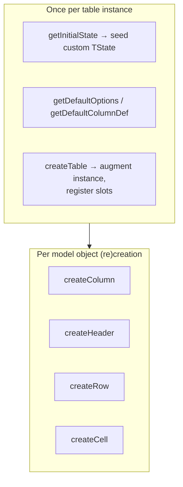
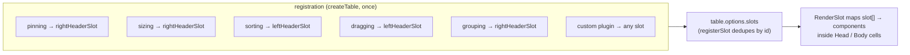

# Plugins & slots

A Tessera **plugin** is a TanStack `TableFeature` (`TablePlugin` in
`src/lib/plugins/types.ts`) plus a rendering convention built on **slots** and
per-cell/per-header `renderComponent` overrides.

## The `TablePlugin` lifecycle

```ts
interface TablePlugin<TData, THooks, TState, TOptions, TValue> {
  // one-time, at instance construction
  createTable?(table): void
  getDefaultColumnDef?(): Partial<ColumnDef>
  getDefaultOptions?(table): Partial<TableOptionsResolved> & TOptions
  getInitialState?(initialState?): InitialTableState & TState

  // per-instance of each model object
  createColumn?(column, table): void
  createHeader?(header, table): void
  createRow?(row, table): void
  createCell?(cell, column, row, table): void
}
```



> **Cost model.** `createTable` / `getDefaultOptions` / `getInitialState` run
> **once**. `createColumn/Header/Row/Cell` run on every (re)creation of that
> object — keep them cheap. Do not do heavy work or rendering decisions in
> `createCell`.

### `commonPlugin` — the bootstrap feature

`commonPlugin` runs first and, in `createTable`, installs the extensions every
other plugin and the UI depend on:

- `table.getHooks()` → `table.options.hooks`
- `table.getRenderSlots()` → `table.options.slots`
- `table.setRenderSlot(params)` → `registerSlot({ ...params, table })`
- plus helpers: `getHeaderGroups` (wrapped with first/last-group flags),
  `getIsAnyColumnResizing`, and per-row/header/cell helpers via the other
  `create*` hooks.

## Slots

A **slot** is a named insertion point rendered around cell/header content. The
buckets (`useCreateSlots`) are:

`leftHeaderSlot`, `rightHeaderSlot`, `leftCellSlot`, `rightCellSlot`,
`actionRowSlot`.

Plugins register into slots in their **`createTable`** hook (this moved out of
`createHeader`/`createRow` — registration is a once-per-table concern):

```ts
createTable: table => {
  table.setRenderSlot({
    id: 'columnPinningPlugin', // unique id — dedup key
    slot: 'rightHeaderSlot',
    order: 0, // number = splice index, 'last'/undefined = push
    component: PinButton, // or `render: (ctx) => ReactNode`
  })
}
```

`registerSlot` (`core/createSlots/registerSlot.ts`) **dedupes by `id`**: if the
id already exists in the slot it updates `visible/render/component` in place,
otherwise it inserts (by `order`) or pushes. So repeated registration is safe
and idempotent.



At render, `HeadCell` / `BodyCell` pull the relevant slot array from
`table.getRenderSlots()` and hand it to `RenderSlot`, which renders each
registered `component`/`render` with the cell/header context.

## `renderComponent` overrides

Besides slots, a plugin can replace the entire content of a specific cell or
header by setting `renderComponent` in `createCell` / `createHeader`:

```ts
createCell: cell => {
  if (cell.column.id !== COLUMN_SELECTION_ID) return
  cell.renderComponent = RowSelectionComponent
}
```

`BodyCell` prefers `cell.renderComponent` when present. This is how the built-in
service columns (selection checkbox, expander) inject their UI, and how the
Guide's `switchActionPlugin` swaps a column's cell renderer.

## Authoring guidance

- **Render a button in every row/cell/header** → register a slot in
  `createTable`.
- **Own an entire column's cell/header** → set `renderComponent` in
  `createCell`/`createHeader` guarded by the column id.
- **Add custom table state** → `getInitialState` + type via `TState`.
- **Add custom methods/options** → `createTable` / `getDefaultOptions` + type
  via `TOptions`.
- **React to external values inside a plugin component** → read `table.getState()`
  and subscribe with `useSubscribeStore` ([reactivity.md](reactivity.md)); call
  business functions via `table.getHooks()`.
