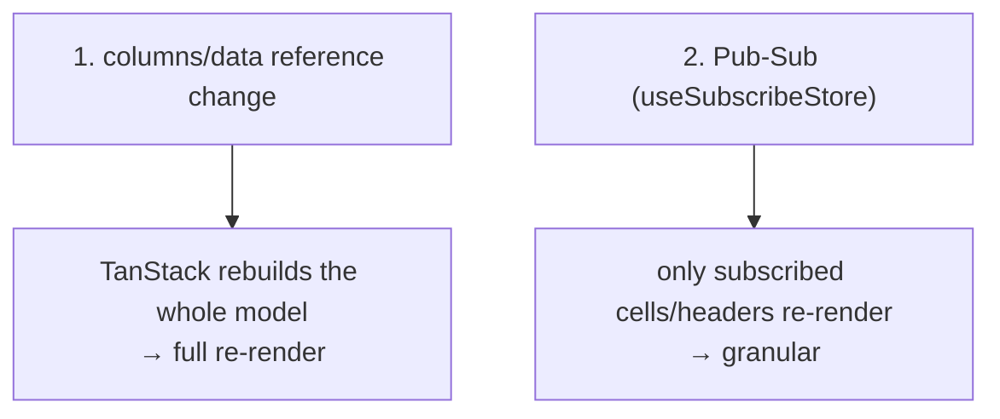
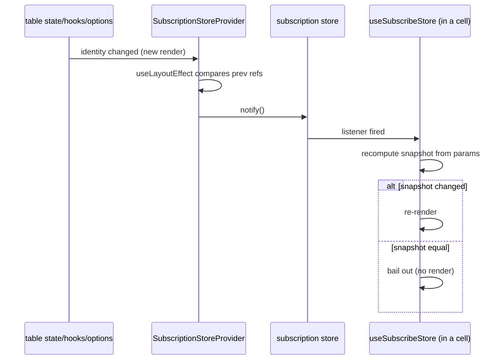

# Reactivity

There are **two** ways content updates in Tessera. Understanding which one
fires — and how wide its blast radius is — is the core of the performance story.



> **Pub-Sub is the only mechanism for reacting to external state.** Reference
> identity aside, nothing forces a model rebuild.

## 1. Reference identity (TanStack-native)

If `columns` or `data` change identity, TanStack recomputes its models from
scratch and the grid re-renders wholesale. This is why the #1 consumer rule is
**memoize `columns` and `data`**. Nothing Tessera does changes this.

Tessera uses TanStack's native `getCoreRowModel()` and native `getHeaderGroups()`
directly (the built-in header builder already orders pinned columns left → center →
right in a single row). `commonPlugin` only wraps `getHeaderGroups` to tag each
group with `getIsFirstGroup` / `getIsLastGroup` — a rendering convenience, **not** a
reactivity concern.

## 2. Pub-Sub (the mechanism for external state)

Pub-Sub gives **granular** updates: a plugin/cell subscribes to exactly the
state/values it cares about and re-renders only when those change — without
rebuilding any model. Source: `core/subscribeStore/subscribeStore.tsx`.

Two parts:

- **`SubscriptionStoreProvider`** wraps the grid. On every render it compares the
  identities of `table.getState()`, `table.getHooks()`, and `table.options`
  against the previous render (in `useLayoutEffect`). If any changed, it calls
  `store.notify()`, waking **all** subscribers.
- **`useSubscribeStore(() => [primitives])`** is a `useSyncExternalStore` hook.
  On notify, each subscriber recomputes its snapshot — the primitive array joined
  into a single string (separated by a NUL char) — and React re-renders that
  component **only if its snapshot string changed**.



Usage inside a plugin/cell component:

```tsx
export const CellHiddenComponent = memo(
  ({ cell, table }: CellComponentProps) => {
    useSubscribeStore(() => [table.getState().hiddenCells[cell.id]])
    const isHidden = table.getState().hiddenCells[cell.id]
    // ...
  },
)
```

### Granularity is a React bail-out, not addressed delivery

`notify()` wakes **every** subscriber; the filtering happens per-subscriber in
`useSyncExternalStore` by comparing the joined-primitive snapshot. So:

- **Pro:** no model rebuild; only components whose snapshot actually changed
  re-render; `hooks` need not be memoized.
- **Cost:** every state/hooks/options identity change runs every subscriber's
  snapshot getter. With thousands of subscribed cells this fan-out is unmeasured
  and is a known area to profile (possible future: keyed/selector-based
  notification).

## Choosing a mechanism

| Need                                | Use                                  |
| ----------------------------------- | ------------------------------------ |
| New static data set                 | new `data` reference (#1)            |
| Cell/header reacts to a state value | `useSubscribeStore` (#2)             |
| Call a business function            | `table.getHooks()` (no subscription) |
