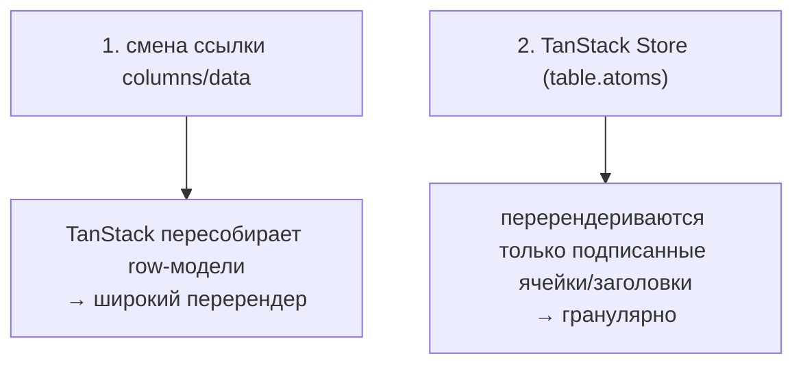

# Реактивность

Содержимое в Tessera обновляется **двумя** способами. Понимание того, какой из них
срабатывает — и насколько широк радиус поражения, — это суть истории про
производительность.

> **Гранулярные подписки — штатный механизм реакции на состояние.** С миграцией на
> TanStack Table v9 ([ADR 0026](../decisions/0026-migrate-to-tanstack-v9.md))
> состояние живёт в **TanStack Store**, и собственный Pub-Sub (`useSubscribeStore`,
> отменённый [ADR 0007](../decisions/0007-reactivity-pubsub.md)) больше не нужен —
> удалён.

## 1. Идентичность ссылки (нативно для TanStack)

Если `columns` или `data` меняют идентичность, TanStack пересчитывает row-модели и
грид перерендеривается широко. Именно поэтому правило потребителя №1 —
**мемоизировать `columns` и `data`**. Ничто из того, что делает Tessera, этого не
меняет. (В v9 пересчёт мемоизирован тоньше, чем в v8: незатронутые срезы состояния
сохраняют референс-идентичность, поэтому смена одного слайса больше не перестраивает
всю модель — это и был мотив миграции.)

## 2. TanStack Store (гранулярные подписки на состояние)

Состояние v9 хранится в TanStack Store и **слайс-адресуемо**: `table.atoms.<slice>` —
атом среза (например `table.atoms.sorting`), а незатронутый срез сохраняет
идентичность. Плагин/ячейка подписывается ровно на нужный срез и перерендеривается
только когда он меняется — не перестраивая никакую модель.

Тонкий слой Tessera поверх этого — `src/lib/core/reactivity.ts`:

- **`useSlice(table, key)`** — подписка на ОДИН атом `table.atoms[key]` (самая узкая;
  прямая замена `useSubscribeStore(() => [table.getState().<key>…])`). Перерисовка
  только подписчика среза — `reactivity.dom.test.tsx` (тесты без ID требования).
- **`useTableState(table, selector)`** — проекция из общего `table.store` с
  `shallowEqual`-сравнением (для компонентов, которым нужно несколько срезов сразу).
- **`useSliceProjection(table, key, selector)`** — проекция ОДНОГО среза: ре-рендер
  только при смене проекции. Так ячейки `cellEditing` подписаны на «редактируется ли
  эта ячейка», а не на всю сессию: ввод черновика сетку не перерисовывает, начало и
  конец правки перерисовывают только ячейку в правке (SS20).

Обе построены на `useSelector` из `@tanstack/react-store`. Гранулярность — это
bail-out на стороне React по изменению снимка селектора, а не адресная доставка.

Корень `DataGrid` держит единственную подписку `useTableState(table, s => …)`
(отдельного `SubscriptionStoreProvider` больше нет).

## Эффективное состояние и предикаты плагинов

Параметры плагина могут сужать допустимое состояние (`rowExpanding` `maxDepth`,
`columnSorting` `multiSort.max`, `columnPinning` без `leafPinning`). Ядро не
переписывает сохранённый срез, а передаёт TanStack эффективный через `state`
(`core/effectiveState.ts`, ADR 0039, RX9–RX10): сохранённое хранит ядро
(неконтролируемый срез) или потребитель (контролируемый), и сужение не зовёт его
`on*Change` (RX12). Предикаты отрисовки из `refreshOn` плагина
(`canSelectCell`, `canEdit`, `enable`) при новой ссылке поднимают версию отрисовки
(`core/renderVersion.ts`): `BodyCell` и `HeadCellView` читают её из контекста и
перерисовываются мимо мемоизации (RX2).

## Выбор механизма

| Нужно                                   | Использовать                          |
| --------------------------------------- | ------------------------------------- |
| Новый статичный набор данных            | новая ссылка `data` (№1)              |
| Ячейка/заголовок реагирует на один срез | `useSlice(table, key)` (№2)           |
| Ячейке нужна часть среза                | `useSliceProjection` (№2)             |
| Компоненту нужно несколько срезов       | `useTableState(table, selector)` (№2) |
| Вызвать бизнес-функцию                  | `table.getHooks()` (без подписки)     |

> **Урок миграции (важно для авторов контролируемого состояния):** дефолты
> стейт-хуков должны быть **стабильными модуль-константами**. Инлайн-литерал как
> initial даёт новую ссылку каждый рендер → `useEffect`→`setState`→∞ (проявилось
> после дедупа `@tanstack/store`). Ссылка контролируемого `state` в `useCreateTable`
> стабилизируется через `ref` + `shallowEqual`. Сейчас цикл без этой стабилизации не
> воспроизводится ни модульным тестом, ни браузерными наборами историй, которые
> отдают новый объект `state` каждый рендер, поэтому требования и теста у неё нет —
> [«Известные проблемы»](../roadmap.md#известные-проблемы).
