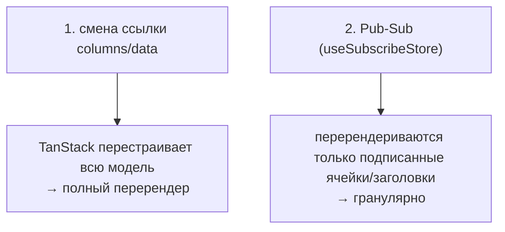

# Реактивность

Содержимое в Tessera обновляется **двумя** способами. Понимание того, какой из них
срабатывает — и насколько широк радиус поражения, — это суть истории про
производительность.

> **Pub-Sub — единственный механизм реакции на внешнее состояние.** Если не считать
> идентичности ссылок, ничто не вынуждает перестройку модели.

## 1. Идентичность ссылки (нативно для TanStack)

Если `columns` или `data` меняют идентичность, TanStack пересчитывает свои модели с
нуля и грид перерендеривается целиком. Именно поэтому правило потребителя №1 —
**мемоизировать `columns` и `data`**. Ничто из того, что делает Tessera, этого не
меняет.

## 2. Pub-Sub (механизм для внешнего состояния)

Pub-Sub даёт **гранулярные** обновления: плагин/ячейка подписывается ровно на то
состояние/значения, которые ему важны, и перерендеривается только когда они
меняются — не перестраивая никакую модель. Источник:
`core/subscribeStore/subscribeStore.tsx`.

Коротко: `SubscriptionStoreProvider` на каждом рендере сравнивает идентичности
`table.getState()` / `getHooks()` / `options` и при изменении вызывает `notify()`,
будя всех подписчиков; каждый `useSubscribeStore` пересчитывает свой снимок и
перерендеривается только если снимок изменился. Гранулярность при этом — это
bail-out на стороне React, а не адресная доставка.

> **Полное описание подхода** — обе части механизма, диаграмма последовательности,
> пример использования, разбор «bail-out, а не адресная доставка» и следствия для
> производительности — в [ADR 0004](../decisions/0004-reactivity-pubsub.md). Он
> источник правды по этому решению; здесь — только архитектурный обзор.

## Выбор механизма

| Нужно                                     | Использовать                          |
| ----------------------------------------- | ------------------------------------- |
| Новый статичный набор данных              | новая ссылка `data` (№1)              |
| Ячейка/заголовок реагирует на значение    | `useSubscribeStore` (№2)              |
| Вызвать бизнес-функцию                     | `table.getHooks()` (без подписки)     |
