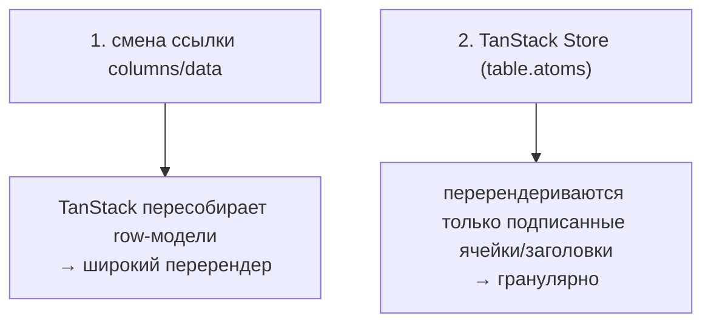

# Реактивность

Содержимое в Tessera обновляется **двумя** способами. Понимание того, какой из них
срабатывает — и насколько широк радиус поражения, — это суть истории про
производительность.

> **Гранулярные подписки — штатный механизм реакции на состояние.** С миграцией на
> TanStack Table v9 ([ADR 0026](../decisions/0026-migrate-to-tanstack-v9.md))
> состояние живёт в **TanStack Store**, и собственный Pub-Sub (`useSubscribeStore`,
> отменённый [ADR 0007](../decisions/0007-reactivity-pubsub.md)) больше не нужен —
> удалён.

## 1. Идентичность ссылки (нативно для TanStack)

Если `columns` или `data` меняют идентичность, TanStack пересчитывает row-модели и
грид перерендеривается широко. Именно поэтому правило потребителя №1 —
**мемоизировать `columns` и `data`**. Ничто из того, что делает Tessera, этого не
меняет. (В v9 пересчёт мемоизирован тоньше, чем в v8: незатронутые срезы состояния
сохраняют референс-идентичность, поэтому смена одного слайса больше не перестраивает
всю модель — это и был мотив миграции.)

Исключение — ответы `loadChildren` при тех же `data`: исходная модель, сортировка и
раскрытие собираются из прошлых, пересчитывая только изменённые поддеревья
([upstream-foundations.md → Свои модели строк](upstream-foundations.md#свои-модели-строк-поверх-tanstack)).
Новая модель забирает словарь `rowsById` прошлой и правит его на месте, поэтому
**`rowsById` читается только у текущей модели**: сохранённая ссылка на словарь (или на
модель ради словаря) после следующего пересчёта видит чужие правки.

## 2. TanStack Store (гранулярные подписки на состояние)

Состояние v9 хранится в TanStack Store и **слайс-адресуемо**: `table.atoms.<slice>` —
атом среза (например `table.atoms.sorting`), а незатронутый срез сохраняет
идентичность. Плагин/ячейка подписывается ровно на нужный срез и перерендеривается
только когда он меняется — не перестраивая никакую модель.

Тонкий слой Tessera поверх этого — `src/lib/core/reactivity.ts`:

- **`useSlice(table, key)`** — подписка на ОДИН атом `table.atoms[key]` (самая узкая;
  прямая замена `useSubscribeStore(() => [table.getState().<key>…])`). Перерисовка
  только подписчика среза — [ADR 0026](../decisions/0026-migrate-to-tanstack-v9.md), ST1.
- **`useTableState(table, selector)`** — проекция из общего `table.store` с
  `shallowEqual`-сравнением (для компонентов, которым нужно несколько срезов сразу).
- **`useSliceProjection(table, key, selector)`** — проекция ОДНОГО среза: ре-рендер
  только при смене проекции. Так ячейки `cellEditing` подписаны на «редактируется ли
  эта ячейка», а не на всю сессию: ввод черновика сетку не перерисовывает, начало и
  конец правки перерисовывают только ячейку в правке (SS20).

Обе построены на `useSelector` из `@tanstack/react-store`. Гранулярность — это
bail-out на стороне React по изменению снимка селектора, а не адресная доставка.

**Ловушка: срезы плагинов общий store не оповещают.** Срез записи `definePlugin` (`plugin:<id>`,
в том числе черновики ядра `plugin:drafts`) живёт своим атомом: `table.store.get()` вернёт его
свежее значение, но подписка `useTableState` на его смену не сработает. Подписывайтесь на атом —
`useSliceProjection(table, 'plugin:<id>', …)` или `useHasDraftAt` для черновиков (ADR 0178, §3).

Корень `DataGrid` держит единственную подписку `useTableState(table, s => …)`
(отдельного `SubscriptionStoreProvider` больше нет).

**Ссылка на `table` не стабильна.** `useTable` отдаёт поверхностную копию экземпляра
(`{ ...table, options, state }`) и пересоздаёт её при каждой смене состояния и опций;
методы копии замкнуты на один экземпляр ядра. `table` в зависимостях `useMemo` и
`useCallback` пересчитывает их на любую смену состояния. Стабильная ссылка — у
`table.store`, свежая копия для колбэков — через `useLatest`. Так было с диапазоном
колонок виртуализатора: новый extractor на каждый выбор строки давал новый массив
колонок окна и перерисовку всех строк (ADR 0099, PF5).

**Подписка на вид, а не на состояние.** Компонент, чей вид — функция многих срезов,
подписывается селектором, который вычисляет то, что он рисует: ячейка шапки — на
закрепление, сортировку, ресайз и индекс колонки (`getHeadCellState`), зона действий —
на ключ своей раскладки, кнопок и кебаба (`zoneViewKey`), флажок строки — на её выбор.
Ячейка тела подписана одним узлом (`useContributionNode`, ADR 0170, CH5): форма колонок,
подсветка, вспышка, ожидание, активная ячейка навигации и выборы вкладчиков плагинов в
одном селекторе; сравнение — по полям до третьего уровня, перерисовываются только ячейки,
чей вклад изменился (CH6). Строка тела — тот же узел в своей подписке.
Открытое меню или панель подписаны на всё состояние, пока видимы
(`useStateWhileOpen`): их пункты и разделы читают живое состояние. Работу ключевых
действий стерегут счётчики PF4–PF11 (`visual/work-counters`).

**Ожидание серверного действия** ([ADR 0116](../decisions/0116-async-server-actions.md))
— срез `serverAction`. Корень подписан только на «ждём ли» и отказ (свечение и
плашка), причина — на то, касается ли срез её (`useServerActionMarks`); строки тела на
срез не подписаны: вход в ожидание и выход из него перерисовывают причину и свечение, но
не строки (SA16). Подтверждённое состояние для отката рендер не читает — оно вне среза.

## Эффективное состояние и предикаты плагинов

Параметры плагина могут сужать допустимое состояние (`rowExpanding` `maxDepth`,
`columnSorting` `multiSort.max`, `columnPinning` без `leafPinning`). Ядро не
переписывает сохранённый срез, а отдаёт TanStack атом-линзу в `options.atoms`
(`core/effectiveState.ts`, ADR 0039, ADR 0171): чтение — эффективное значение, запись — в
сохранённое. Сохранённое ядром — его атом-источник (неконтролируемый срез); значение приложения
(контролируемый срез), сужения и свёртку набора линза читает из опций рендера, как TanStack —
`state`, и сужение не зовёт `on*Change` (RX12). Эффективное — производный атом: пересчитывается по атомам, которые читает
сужение (ответы ленивых строк, группировка), а данные и колонки — простые опции
React-адаптера — линза сверяет сама. Объект `options.atoms` TanStack берёт при создании
таблицы: срезы первого рендера заводятся до неё, новые — в эффекте коммита.
React 18 коммитит атомы и `setState` вне событий React
разными коммитами (ADR 0091): записи из таймера или промиса, задевающие состояние
приложения, идут через `inOneCommit` (`util/oneCommit.ts`). Предикаты отрисовки из `refreshOn` плагина
(`canSelectCell`, `canEditCell`, `canDragRow`) при новой ссылке поднимают версию отрисовки
(`core/renderVersion.ts`) — атом, который пишет эффект коммита вместе с хранилищем аргументов
(ADR 0171, §3): `BodyCell` и `HeadCellView` подписаны на него через контекст и
перерисовываются мимо мемоизации до кадра, хост не перерисовывается (RX2). Предикат,
прочитанный в самом рендере, один рендер видит прежнюю версию.

Сохранённое значение плагин читает `savedSliceOf(table, key)`: до сужения, с учётом уже
отправленного приложению. Так ленивая строка, раскрытая в срезе, видна, пока сужение показывает её
свёрнутой ([ADR 0054](../decisions/0054-lazy-row-children.md), §5). Подписка остаётся на сам срез: смена
сохранённого меняет ссылку эффективного значения.

## Выбор механизма

| Нужно                                   | Использовать                          |
| --------------------------------------- | ------------------------------------- |
| Новый статичный набор данных            | новая ссылка `data` (№1)              |
| Ячейка/заголовок реагирует на один срез | `useSlice(table, key)` (№2)           |
| Ячейке нужна часть среза                | `useSliceProjection` (№2)             |
| Компоненту нужно несколько срезов       | `useTableState(table, selector)` (№2) |
| Вызвать бизнес-функцию                  | `table.getHooks()` (без подписки)     |

> **Урок миграции (важно для авторов контролируемого состояния):** дефолты
> стейт-хуков должны быть **стабильными модуль-константами**. Инлайн-литерал как
> initial даёт новую ссылку каждый рендер → `useEffect`→`setState`→∞ (проявилось
> после дедупа `@tanstack/store`). Новый объект контролируемого `state` с теми же
> срезами цикла не даёт: `useTable` публикует его в атомы по срезам со сравнением
> `shallow` (`table_publishExternalState`), ссылка на сам объект не используется.
> Отсюда же: контролируемый срез (например, `expanded` через `state` и
> `onExpandedChange`) меняется в атоме только после рендера потребителя —
> `table.setExpanded(...)` и чтение `getRowModel()` в той же задаче видят прежнюю
> модель.
