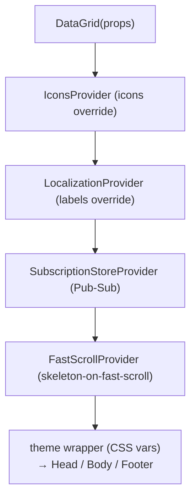
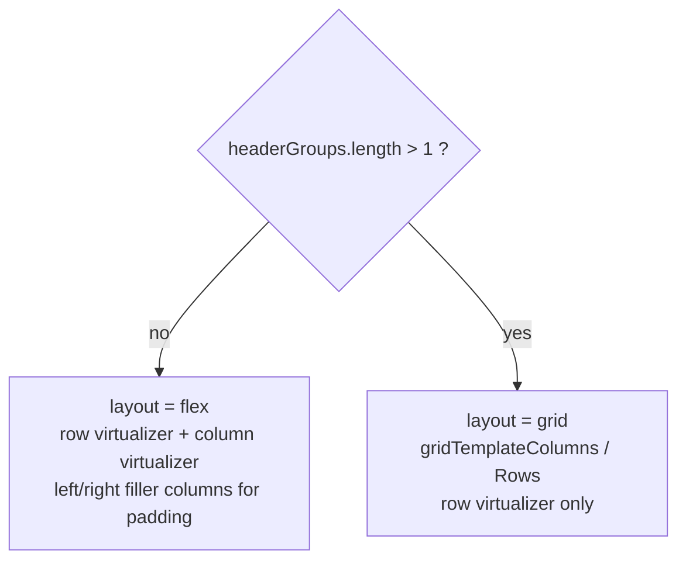
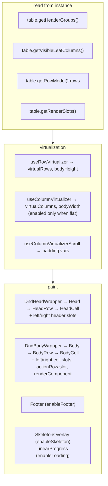
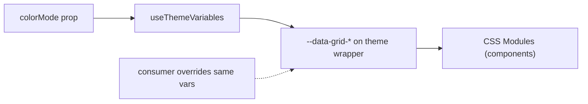

# Rendering, virtualization, DnD & theming

`<DataGrid table={...} />` (`src/lib/ui/DataGrid/DataGrid.tsx`) turns a table
instance into DOM. It renders nothing about _what_ the data is — it composes
providers, virtualizers, DnD wrappers, and the Head/Body/Footer tree.

## Provider stack

`props`: `table`, `height`, `maxHeight`, `stub`, `colorMode`, `icons`,
`localization`. `colorMode` drives the CSS-variable theme; `icons` and
`localization` feed the two override contexts consumed by plugin buttons.

## Two layouts: `flex` vs `grid`

The layout is chosen from header depth:

- **Flat headers** (single header row) → **`flex`** layout, and **columns are
  virtualized**.
- **Nested headers** (multi-level, `headerGroups.length > 1`) → CSS **`grid`**
  layout, and **column virtualization is disabled** (`enabled: !hasNestedGroups`).

Rows are **always** virtualized. This split is why nested headers currently don't
combine with column pinning/dragging — they live on a different layout/render
path (a known area of future work).

## Render pipeline

Per cell, `BodyCell` decides content in priority order: fast-scroll skeleton →
`cell.renderComponent` → action/row-actions slot → `flexRender` of the column's
`cell`. Pinned/action columns are excluded from column virtualization and slot
injection where appropriate.

## Drag & drop

- `DndHeadWrapper` wraps headers in a `DndContext` + `SortableContext` for
  **column** reordering; `DndBodyWrapper` does the same for **row** reordering
  (supports hierarchy).
- Active drag renders an overlay: `OverlayHeadCell` (column) / `OverlayBodyRow`
  (row). Row-drag acceptance state feeds CSS variables that tint accept/reject.
- Column drag order and row order are surfaced back to the consumer via
  `columnOrder`/`onColumnOrderChange` and `onRowOrderChange`.

## Theming — CSS variables

Interactive controls are Base UI primitives (the shadcn foundation) styled with
Tailwind + cva; grid layout and theming use CSS Modules reading CSS custom
properties (`--data-grid-*`).

- `useThemeVariables({ colorMode })` (`core/themeVariables`) produces the full
  token set (backgrounds, pinning tints, transitions, control colors, skeleton,
  loader, accent) for `'light' | 'dark'`. The values are internal defaults;
  consumers override by setting the same `--data-grid-*` variables on a wrapper.
- The theme wrapper also injects layout vars (`--data-grid-head-height`,
  `--data-grid-body-height`).

## Icons & localization overrides

- **Icons** — default inline SVGs live in `ui/icons`; `IconsProvider` merges a
  consumer `icons` prop over `DEFAULT_ICONS`; button plugins read them via
  `useIcons()`.
- **Labels** — `LocalizationProvider` merges a consumer `localization` prop over
  English `DEFAULT_LABELS`; controls read them via `useLocalization()`.

## Loading states

- `enableSkeleton` → `SkeletonOverlay` for first load (configurable via
  `skeletonOptions`); also used per-cell during fast scroll (`FastScrollProvider`).
- `enableLoading` → `LinearProgress` bar under the header for async refreshes.
