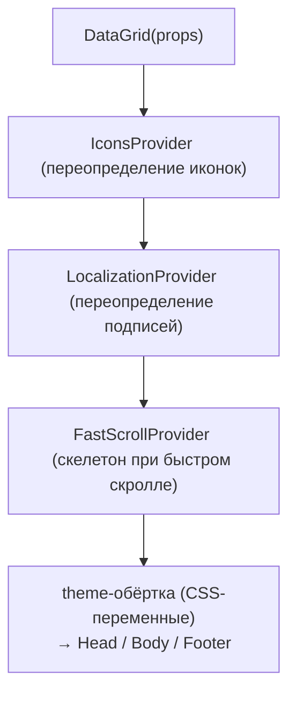
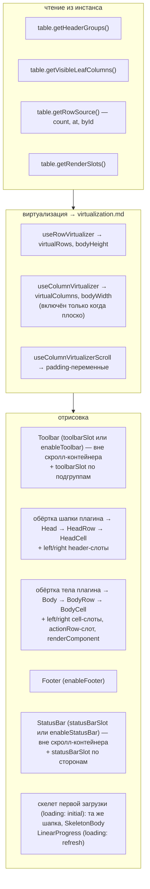

# Рендеринг — `<DataGrid/>`

`<DataGrid table={...} />` (`src/lib/grid/DataGrid.tsx`) превращает инстанс
таблицы в DOM. Он не рендерит ничего о том, _что_ представляют собой данные — он
компонует провайдеры, виртуализаторы, DnD-обёртки и дерево Head/Body/Footer.

Три механики рендер-слоя вынесены в отдельные документы, чтобы этот оставался про
оркестрацию:

- **Виртуализация** — [virtualization.md](virtualization.md).
- **Drag & drop** — [dnd.md](dnd.md).
- **Темизация и контракты переопределения** (`colorMode`, иконки, локализация) —
  [theming-and-overrides.md](theming-and-overrides.md).

## Стек провайдеров

Отдельного провайдера реактивности нет (Pub-Sub снят при миграции на v9): корень
`DataGrid` подписан на состояние единственным `useTableState(table, …)`, а компоненты —
на свои срезы через `useSlice`/`useTableState` (см. [reactivity.md](reactivity.md)).

`DataGrid` обёрнут в `memo` ([ADR 0196](../decisions/0196-app-render-does-not-reach-grid.md)):
при той же ссылке `table` и тех же пропах перерисовка приложения до грида не доходит.
Пропы-объекты — `icons`, `localization`, `stubs`, `style` — приложение держит стабильными
(константа модуля или `useMemo`): объект, созданный в рендере, перерисовывает грид каждый раз.

`props`: `table`, `height`, `maxHeight`, `stubs`, `colorMode`, `icons`,
`localization`. `colorMode` управляет темой на CSS-переменных; `icons` и
`localization` питают два контекста переопределения, потребляемых кнопками
плагинов (см. [theming-and-overrides.md](theming-and-overrides.md)).

Заглушки пустой таблицы — реестр причин ([ADR 0123](../decisions/0123-empty-state-stubs.md),
`core/stubs.ts`): запись — причина, приоритет, условие `when`, тексты из `localization`,
иллюстрация из `icons`, действие. Ядро несёт `loadError`, `noColumns`, `noData`; модели
фильтрации и поиска — `filtered`, `columnVisibility` — `columnsHidden`; автор плагина —
свои записи полем `stubs` в `definePlugin`. Грид показывает первую по приоритету запись с
выполненным условием (скелет главнее любой) и рисует её примитивом `Stub` (`EmptyStub`);
`stubs` грида меняет вид по `id`, но не выбор. `grid` заменяет таблицу целиком (тулбар и
нижняя панель остаются), `body` встаёт под шапкой — контейнер прокрутки на это время
колонка (`data-empty-stub`), иначе при колонках уже грида заглушка встала бы сбоку.
Появление заглушки объявляется её заголовком (`LiveRegion`), кроме `loadError` — у него
своё объявление.

## Одна раскладка строк

Раскладка у всех таблиц одна ([ADR 0207](../decisions/0207-one-head-layout.md)): строки шапки,
тела и футера — боксы `flex` с `role="row"`; закреплённые ячейки — `sticky` в потоке,
центральные — абсолютно по `left` из виртуализатора колонок, ширину строки держит спейсер.
Строки и колонки виртуализируются всегда — и при группах колонок. Детали про виртуализаторы —
в [virtualization.md](virtualization.md).

**Шапка с группами.** Каждая строка шапки рисует заголовки своей глубины по окну колонок:
заголовок рисуется, если в окне хотя бы один его лист; центральный стоит по началу первого листа
шириной в свои листья (`--header-<id>-size`), закреплённый — `sticky` в потоке. Начала всех
колонок даёт виртуализатор (`columnStarts`): первый лист группы может быть вне окна. Строки шапки
— не свои слои наложения (без `contain`): растянутый лист выходит вниз из своей строки над
строками ниже (`z-index: 1` у центрального), закреплённые ячейки всех строк — над центральными.

**Спаны вложенной шапки** считает TanStack v9
([ADR 0049](../decisions/0049-native-header-spans.md)). Лист мельче максимальной
глубины получает плейсхолдеры в строках над собой; вершина цепочки несёт
`header.rowSpan` всей цепочки, покрытые ею заголовки — `rowSpan: 0` и не рисуются.
Растянутый лист — ячейка в верхней строке своей цепочки высотой в `rowSpan` строк шапки
(`getHeaderPlacement`, `grid/layout.ts`); строка над нижней выше на линию под своими
ячейками. У каждого уровня шапки своя высота — переменная `--tsr-comp-head-level-<N>-height`
с запасной высотой строки шапки ([ADR 0218](../decisions/0218-text-wrap-and-auto-height.md),
`core/headSizes.ts`): строка уровня берёт её, растянутый лист — сумму своих уровней, высоту
шапки `DataGrid` считает по ним. Значения ставит плагин `textWrap`; переменные, а не пропсы: шапка
мемоизирована на время протяжки ширины. Вершина цепочки — это заголовок своего листа: контент, слоты, кебаб и клавиатурная
навигация у неё те же. Содержимое растянутого листа прижато к низу, `data-last-headers-row`
отмечает ячейку, доходящую до нижней строки шапки. Подпись группы шире видимой части липнет к
левому краю видимой части правее закреплённых колонок (`--tsr-pinned-start-width`). Ловушка v9:
`header.depth` отсчитывается с 1 (на единицу больше `headerGroup.depth`), а
`getLeafHeaders()` возвращает всех потомков вместе с самим заголовком — общие хелперы спанов
живут в `core/headerSpans.ts`.

**Линии между колонками** — токен темы `--tsr-comp-column-divider-width` (0 по умолчанию) в
шапке, теле и футере; граница группы в шапке видна при любом значении (`data-group-end`).

Свободное место справа (колонки уже контейнера) забирает один и тот же элемент в шапке и в
теле: первый правозакреплённый столбец, иначе колонка действий, иначе заполнитель в конце
строки (`needsRightFiller`, `grid/layout.ts`). Иначе заголовки расходятся с колонками тела
([ADR 0011](../decisions/0011-column-pinning.md), CP29–CP30).

## Пайплайн рендеринга

Обёртки перетаскивания плагинов (`HeadBoundary` / `BodyBoundary`, ADR 0168) разобраны в [dnd.md](dnd.md).

Первый рендер на клиенте идёт по кускам ([ADR 0203](../decisions/0203-whole-window-in-row-portions.md)).
Корень `DataGrid` сначала рисует пустую рамку того же размера, а грид — переходом React: его
рендер React режет на куски. Первое окно после замера области виртуализатор тоже ставит
переходом. Строки окна, сменившегося целиком, тело рисует порциями (`grid/rowPortions.ts`):
на монтировании — с первой (активная строка, видимые сверху вниз, затем запас), при прыжке —
видимые сразу, запас по кадрам. Порция ставится в кадре анимации переходом, размер — по
замеренной цене строки. Серверный рендер и гидратация — сразу грид. Опция ядра
`enableIncrementalRender: false` выключает всё это — для приложения с `<ViewTransition>` над
гридом: переходы React запускают его View Transitions. Для базы перф-гейта нарезку выключает
`windowPortions.enabled`.

На ячейку `BodyCell` решает содержимое в порядке приоритета: скелетон быстрого
скролла → `cell.renderComponent` → слот action/row-actions → `flexRender` от
`cell` столбца. Pinned/action-столбцы исключаются из виртуализации столбцов и
инъекции слотов там, где это уместно.

Без своего `cell` столбец рисует ячейка ядра `defaultCell` — текст по типу данных колонки
([ADR 0172](../decisions/0172-column-data-type.md)): формат `Intl` на языке таблицы, подписи
вариантов, даты в поясе таблицы; ею же рисуются строка группы и агрегат группы. Булево в
ячейке ядра грид заменяет флажком кита в режиме «только значение» — `CheckboxView`, вид `Checkbox` без Base UI (`grid/cellContent.tsx`; ADR 0183, PK18): ядро кит не
импортирует. Выравнивание по типу — атрибуты `data-align` и `data-numeric` у ячейки и
заголовка, правила — в обёртке текста `CellWrapperTitle`.

Быстрый скролл включается выше 2000 px/s по Y (4500 по X; пока тащат строку — ещё и
указателем у самого края зоны автопрокрутки, RM25) — скорость считается по
жесту, а путь, догнавший после паузы главного потока, делится на всю паузу (на тяжёлом
гриде, где каждый кадр дольше 100 мс, — на свой кадр, [ADR 0147](../decisions/0147-fast-scroll-on-heavy-grid.md)), — и держится,
пока скорость не упадёт до четверти порога; ячейки, смонтированные за это время, — скелетоны. Перф-замер
быстрой прокрутки (P2/P4/P7/P8) идёт со скоростью `FAST_SCROLL` чуть выше порога и
меряет режим скелетонов; цену содержимого меряют со скоростью `CONTENT_SCROLL`
(P10–P13, AS14, CF12). Режим замер проверяет сам по выборке кадров.
Одиночный программный прыжок (кнопка «наверх», [ADR 0082](../decisions/0082-back-to-top.md),
BT6) скелетов не даёт: строки на новом месте монтируются в том же событии, до входа
в режим, — как ячейки, видимые до сессии (FS6). Плавная прокрутка программой — это
серия событий, и её строки уже попадают в сессию.

Тултип у обрезанного текста ([ADR 0075](../decisions/0075-overflow-tooltip.md)) —
один на грид: `OverflowTooltip` вешает нативные обработчики на скролл-контейнер (шапка,
тело, футер) и рендерит один ленивый попап `TooltipImpl`. Ячейки о нём не знают: по
`pointerover` или клавиатурному фокусу берётся `.data-grid__cell-wrapper-title`, а по
истечении задержки у него одного сравнивается `scrollWidth > clientWidth`. Прокрутка,
нажатие кнопки мыши, уход указателя или фокуса прячут тултип; Escape и нажатие вне его
закрывает Base UI. Отключается флагом ядра `enableOverflowTooltip: false`.

### Фокус в разных движках

Firefox делает остановкой Tab любую прокручиваемую область. Поэтому обёртки ячеек
держат `overflow: hidden` по обеим осям — одна `overflow-x: hidden` вычисляет вторую
ось как `auto`, и обёртка становится прокручиваемой, — а контейнер прокрутки при
`enableKeyboardNavigation` получает `tabindex=-1`: вход в грид с клавиатуры идёт сразу на
активную ячейку, без прокрутки тела (ADR [0021](../decisions/0021-keyboard-navigation.md),
KN32; набор `keyboard-entry` идёт и в `npm run test:browsers`).

WebKit, как Safari, не фокусирует кнопку кликом и не держит кнопки в порядке Tab.
Кнопка Base UI фокусирует себя при клике, и `Shift+Tab` от неё WebKit не выполняет —
это поведение движка, грид его не исправляет; сценарии «клик по кнопке, затем Tab»
проверяются только в Chromium (BT9).

Кольцо фокуса активной ячейки, строки treegrid и дня календаря рисуется по
`:focus-visible` **или** по признаку последнего ввода `data-tsr-input="keyboard"` на
корне документа (`core/inputModality.ts`, ADR [0084](../decisions/0084-cross-browser-support.md),
CB5): Firefox не даёт `:focus-visible` фокусу от скрипта после ввода мышью, и после
клика стрелки шли бы без кольца. Корень документа — потому что календарь в портале.

Раскрытие скрытых кнопок ячейки (ADR [0076](../decisions/0076-smooth-cell-button-reveal.md))
идёт колонкой `grid` обёртки `minmax(0, 0fr)` → `minmax(0, 1fr)` с `justify-items:
start` — кнопка держит свою ширину, обёртка её обрезает; основа flex — `auto` в обоих
состояниях. `interpolate-size` (только Chromium) не используется — CB6.

Значок скрытой кнопки тела монтируется только у строки, где кнопку видно (ADR
[0149](../decisions/0149-plugin-cost-on-scroll.md), §4): под указателем, с фокусом внутри,
тронутой пальцем последней или с открытым меню своей кнопки. Сама кнопка, её имя и место
в порядке фокуса — у каждой строки. Строки отмечает `grid/rowReveal.ts` слушателями
документа; ячейка тела даёт место показа своей строки (`IconRevealContext`), обёртки
скрытых кнопок кита — признак скрытой кнопки (`HiddenButtonContext`), `IconButton` рисует
значок через `RevealedIcon` (`ui/IconButton/iconReveal.tsx`). Включённая, ждущая и
упавшая кнопка рисует значок всегда. Цена кнопки при прокрутке — в её значке SVG, поэтому
монтируется значок, а не кнопка. Горизонтальная прокрутка со всеми плагинами и так дороже
голой в 2,4–2,7 раза: новые колонки монтируют ячейки со всеми плагинами — известная
проблема roadmap, гейт PS8 по X — вчетверо.

### Касания

Без наведения (`@media (hover: none)`) кнопки шапки и полоска грипа видны всегда,
отступ под грип стоит постоянно, а заголовок сжимается до многоточия. Кнопки тела
видны у ячейки и строки, которых коснулись последними: признак `data-touched` ставит
`core/touchedCell.ts` прямо в DOM по `pointerdown` пальца. При грубом указателе
(`@media (pointer: coarse)`) зона нажатия каждой цели в ячейке — `::before` во всю
высоту ячейки; её обрезает сама ячейка. Грип и ручки не отдают касание прокрутке
(`touch-action: none`), а касание без сдвига открывает их меню по `touchend`.
Контекстное меню открывает долгое нажатие на ячейку тела (500 мс, сдвиг до 10px)
(ADR [0086](../decisions/0086-touch-support.md)).

### React 18, StrictMode и сервер

Грид работает на React 18 и 19, под StrictMode и на сервере
(ADR [0091](../decisions/0091-environment-compatibility.md)). Правила для нового кода:

- **Эффект раскладки — `useIsomorphicLayoutEffect`** (`util/useIsomorphicLayoutEffect`),
  а не `useLayoutEffect`: без DOM он становится `useEffect`, и React 18 не предупреждает
  при серверном рендере. Модуль не обращается к `window` и `document` при импорте —
  только в эффектах и обработчиках или за проверкой `typeof`.
- **`inert` — через `inertProp`** (`core/inertProp`): React 18 атрибута не знает и булево
  значение в DOM не пишет. Различия API 18 и 19 — по `REACT_MAJOR`
  (`util/reactVersion`); так `Tooltip` берёт `ref` триггера.
- **Обновители состояния и эффекты переживают двойной запуск**: StrictMode зовёт их
  дважды. Обновитель не меняет `prev` — `reorderRows` копирует затронутые группы.
- Входы `dist` помечены `'use client'` (баннер сборки), проп `table` у `DataGrid` —
  форма `DataGridTable`: таблица из `useCreateTable` подходит без приведения типов.
- **Список строк — не массивом в пропсах** (ADR [0199](../decisions/0199-row-shifts-in-the-middle-of-data.md),
  MS12): dev-сборка React 19 после коммита сравнивает пропсы каждой перерисованной компоненты и
  спускается в объекты на три уровня. Массив строк, чьё начало сдвинулось, она обходит по сотне
  элементов с их полями, и на 100 000 строк переход занимал секунды. `DataGridTable`, `Body`,
  `RowMotion` и ячейки футера получают геттер `getRows`, созданный раз на список в `DataGrid`.

### Память

Грид после размонтирования отпускает таблицу, DOM и глобальные обработчики, а долгая
работа не копит узлы, обработчики и состояние — это проверяет набор `memory/`
(ADR [0092](../decisions/0092-memory-leaks.md)). Правила для нового кода:

- **Кэш уровня модуля — `WeakMap`/`WeakSet`** по таблице, данным или колонкам. Сильная
  `Map`/`Set` — только с ограниченным ростом и записью в страже LK10.
- **Каждая подписка на `window`/`document` снимается** в очистке эффекта, в том числе
  открытая на время меню или жеста.
- **Стабильный колбэк — в своём хуке.** `useCallback`/`useMemo` с постоянными
  зависимостями живёт, пока смонтирован компонент, а V8 делит контекст замыкания на все
  функции рендера: стабильный колбэк рядом с обработчиком, замкнувшим строку, держит
  строку первого рендера. Так было с `ref` в `useButtonStates` — теперь он в
  `useOwnRef`.
- **Ограниченные удержания вне кода грида** — опции первого рендера в `useTable`
  TanStack, скрытый класс атома, служебные переменные React DOM, пропсы последних
  отрисовок в fiber — перечислены с причиной в `__tests__/leaks.ts`.

### Движение строк

Смена модели строк — раскрытие, сортировка, фильтр, приход ленивых детей, перестановка —
двигает строки к новым местам (ADR [0107](../decisions/0107-row-motion.md)). `RowMotion`
в `Body` — класс ради `getSnapshotBeforeUpdate`: до коммита он снимает видимые позиции
смонтированных строк, позицию прокрутки, тайминг из токенов и копии строк, уходящих из
окна; после коммита `planRowMotion` считает сдвиги, появления и призраков, а строки
едут Web Animations по `translate` и `opacity`. Двигаются только строки, видимые в
области прокрутки; призраки — копии в слое `inert` под строками. Правила:

- **Видимые позиции, а не логические.** После броска строки уже стоят на местах — сдвиг
  нулевой, повторного переезда нет (D38, RM10).
- **Замена без движения.** Не уцелела ни одна строка окна — страница, первая загрузка,
  новый набор — всё встаёт сразу (RM6).
- **Ничего не читать после коммита.** Позиции, прокрутка и тайминг — в снимке, где
  раскладка и стили ещё чисты: чтение после коммита пересчитало бы весь изменённый DOM
  (RM20). Индексы в модели — проходом с ранним выходом только для строк окна.
- **Прокрутка обрывает движение**, если позиция прокрутки сменилась: запоздавшее
  событие прокрутки от фокуса не в счёт (RM12).

### Движение колонок

Смена порядка колонок при том же наборе и закреплении — откат, клавиатура, меню ручки,
`setColumnOrder` — двигает колонки по горизонтали (ADR [0115](../decisions/0115-column-motion.md)).
`ColumnMotion` в `DataGridTable` обёрнут вокруг шапки, тела и футера и устроен как
`RowMotion`: до коммита снимает видимые левые края колонок по ячейкам шапки и копии ячеек
колонок, уходящих из окна; после коммита `planColumnMotion` считает сдвиги и призраков, а
ячейки колонки — шапки, тела и футера — едут Web Animations по `translate` с одним
сдвигом. Порядок — по `getDisplayColumns` (закреплённые первыми); закреплённые ячейки не
ездят. Колонку издалека и цель призрака держит край окна смонтированных колонок; кто
уйдёт из окна, видно по новому месту относительно прежнего окна — окно виртуализации
держится за прокрутку. Показ и скрытие, закрепление, ширина и прокрутка не анимируются;
прокрутка обрывает движение. Узкий грид: перенос с клавиатуры к краю прокручивает грид
к фокусу, и движение обрывается. Правила цены (CN13):

- **Одно чтение раскладки после коммита** — левые края ячеек шапки: ширины ячеек не
  всегда равны размерам колонок, логической раскладке (сумма ширин) верят только колонки
  вне окна. Все замеры — до первого `animate()`: он сбрасывает стили, и замер после него
  пересчитывал бы их на каждую ячейку.
- **Едут только видимые строки.** Видимые строки тела снимаются до коммита; ячейки строк
  запаса виртуализации встают сразу — слой композитора на каждую едущую ячейку дорог.
- **Ячейки — по `id` колонки**, закреплённые и облако отсеиваются в коде: селектор с
  `:not()` проверялся бы на каждой ячейке грида.

### Липкие строки и прилипшие колонки

Строки групп и веток держатся под шапкой копиями (ADR [0160](../decisions/0160-expand-all-and-sticky-rows.md), §3):
`StickyRows` в теле, в окне колонок, рисует копии `BodyRow` (`copy`) в блоке нулевой высоты
`position: sticky` под шапкой. Копии вне окна виртуализации строк — строка группы может уйти
из окна. Ловушки:

- **Копия — не строка.** Копия раньше в DOM, поэтому ни строка-копия, ни её ячейки не
  участвуют в клавиатурной навигации (`participates` у ячейки), иначе фокус активной строки
  уходит в копию; `aria-hidden` у блока, кнопки — `tabindex=-1`.
- **Пересчёт стопки** — в обработчике прокрутки, без кадра (в скрытой вкладке кадры стоят), и
  на каждой отрисовке тела: приход блока серверной модели меняет строки без смены окна.
  Строка под краем ищется с допуском `SCROLL_SNAP` в полтора пикселя: Firefox при дробном
  масштабе округляет `scrollTop`, и строка, вставшая к краю, иначе считалась бы не дошедшей.
- **Контейнер прокрутки** — по DOM блока: окно грида регистрируется позже эффектов тела.

Закреплённые колонки получают тон, разделитель и тень, только когда под блоком прокручено
содержимое (ADR [0011](../decisions/0011-column-pinning.md), CP39–CP40): признаки
`data-pinned-left-stuck` и `data-pinned-right-stuck` ставит `PinnedEdgesAttribute` на
контейнер прокрутки, ширину колонок он видит по размеру шапки. Вне прилипания токены фона
закреплённых ячеек равны фону строки, а разделитель прозрачен — ширина ячеек та же.

### Рамка цели протяжки

Маркер в режиме `'fill'` ([ADR 0219](../decisions/0219-paste-fill-and-bulk-edit.md), §4) не меняет
выделение, пока его тянут: цель показывает рамка `ui/FillFrame` — слой корня грида рядом с
маркером, как и он. Место рамки читается у строк и ячеек под указателем на каждом шаге жеста и
после автопрокрутки; край вне окна виртуализации — у края видимой части тела. Ячейки и строки
при этом не перерисовываются (WR38), значения считаются после отпускания.

## Футер колонок

Строка под колонками (`enableFooter`, ADR [0118](../decisions/0118-column-footer.md)) — шаблон
колонки, итог — один из источников содержимого: свой `footer`, затем `table.getColumnTotal` (ответ
серверной модели или плагин `columnTotals`, [ADR 0184](../decisions/0184-column-totals-and-group-row-count.md)),
затем пустая ячейка. С плагином футер есть без флага, `enableFooter: false` его запрещает. Это одна
строка первой группы футеров TanStack, ячейка в каждой листовой колонке (`FooterCell`,
содержимое — `columnDef.footer`). Положение — `footerPosition`, атрибут `data-position`
строки и `data-footer-position` таблицы:

- **`'pinned'`** (по умолчанию) — у низа области прокрутки. Таблица не ниже области
  (`min-height: 100%`), у футера `position: sticky` с `bottom: 0` и
  `top: calc(100% - высота строки)`: проценты у sticky считаются от области прокрутки, так
  что в короткой таблице футер опускается к низу, а свободное место остаётся над ним. Тень
  вверх — `--tsr-comp-shadow-footer`.
- **`'inline'`** — в потоке сразу за последней строкой, без тени; линию сверху в раскладке
  `grid` даёт нижняя граница тела, в `flex` — своя граница по
  `--tsr-comp-cell-divider-color`. Высота прокрутки в обоих режимах одна, смена режима
  прокрутку не сдвигает и тело не перемонтирует (FT3).

Под телом порядок такой: хвост `bodyEndSlot` (скелет-строки ленты) — всегда до футера;
`tableEndSlot` (строка ошибки ленты) — до закреплённого футера и после незакреплённого;
заглушки пустой таблицы под шапкой (ADR 0123) — перед футером в обоих режимах: в таблице
строкой `TableEndRow` шириной видимой области, высотой — видимая часть между шапкой и
футером, так что футер с заглушкой у низа области. Без футера заглушка — после таблицы.
Порядок — в DOM: клавиатура и скринридер идут как экран (FT9, FT10). Под незакреплённым
футером строка ошибки встаёт за нижним краем; если отказ пришёл, когда пользователь был у
края, лента до отрисовки доводит её в вид (FT17).

Футер всегда смонтирован: он строка клавиатурной навигации. Незакреплённый футер
доводится в вид по вертикали, как строка тела, и окна тела не сужает
(`getBodyViewport` его не учитывает); `scrollToRow` ставит последнюю строку по низу
вместе с ним (FT6, FT7). При смене числа строк над видимым незакреплённым футером
`RowMotion` везёт его тем же движением: сдвиг считается из числа строк и удержанной
высоты тела, без замеров после коммита (FT12). Скелет первой загрузки держит футер у
низа в обоих режимах, вид — по режиму (FT11). Таблица, которая после коммита умещается в
области, на время движения не выше её и обрезает едущее за край: полоса прокрутки уходит
сразу, а не с концом движения (FT18).

## Рамка, тулбар и нижняя панель

Корневая обёртка грида (`table__theme-wrapper`) несёт внешнюю рамку со
скруглением (`--tsr-comp-frame-*`, ADR [0035](../decisions/0035-toolbar-and-column-visibility.md))
и обрезает содержимое по ней (`overflow: hidden`); скроллится только контейнер
таблицы внутри. Обе панели вне скролла показываются по одному правилу
(`resolvePanelVisible`, `core/panels.ts`, ADR [0046](../decisions/0046-toolbar-and-status-bar-visibility.md)):
флаг (`enableToolbar` / `enableStatusBar`) важнее, без флага панель есть, пока у неё
есть хоть один активный слот. Когда тулбар показывается, над контейнером рендерится
`Toolbar` (Base UI
`Toolbar`, `role="toolbar"`): обёртка получает `data-toolbar`, что выставляет
`--tsr-comp-toolbar-offset` равным высоте тулбара, и контейнер таблицы становится
ниже на неё. `LinearProgress` — абсолютный элемент без `top`: его позиция берётся из
потока, поэтому он сам оказывается под тулбаром и остаётся под шапкой. Кнопки
тулбара — `toolbarSlot`; раскладку по подгруппам делает `resolveToolbarGroups`
(`core/toolbar.ts`), между группами — `Toolbar.Separator`. Встроенные группы идут по
фиксированному рангу (`search` → `view` → `data`), а не по порядку плагинов: слева
поле поиска, справа «Настройки вида» — фильтр, сортировка, группировка и колонки разделами (ADR
[0215](../decisions/0215-view-settings.md)) — и «Экспорт» (ADR [0051](../decisions/0051-toolbar-button-order.md)). Место встроенной кнопки
приложение задаёт аргументом `toolbar` её фабрики, `false` её убирает (ADR [0205](../decisions/0205-toolbar-button-placement.md)). Верхней линии у шапки
нет: сверху её ограничивает рамка или разделитель тулбара.

Нижняя панель (`StatusBar`, ADR [0038](../decisions/0038-pagination-and-status-bar.md))
рендерится под контейнером таблицы по тому же правилу (по умолчанию — когда в
`statusBarSlot` есть хоть один слот без `showsPanel: false`, ADR
[0082](../decisions/0082-back-to-top.md)):
обёртка получает `data-status-bar`, что выставляет `--tsr-comp-status-bar-offset`,
и контейнер становится ниже и на неё. Панель есть и в ветке заглушки (пустые
данные). Сверху её отделяет одна линия (`border-top`); у футера колонок нижней
линии нет, поэтому под ним она не двоится. Раскладку по сторонам делает
`resolveStatusBarSides` (`core/statusBar.ts`).

С пагинацией тело показывает одну страницу, но ARIA-разметка описывает весь набор
(`core/pagination.ts`): `getRowWindow` даёт смещение страницы и полное число
строк — из них `aria-rowcount` корня и база `aria-rowindex` строк
(`ariaRowIndexBase`). На клиенте смещение — индекс первой строки страницы в
`getRowsInDisplayOrder` (учитывает раскрытых детей прошлых страниц), на сервере —
`pageIndex × pageSize` при итоге `rowCount`. `usePageChange` после смены страницы
прокручивает тело к началу и переносит активную ячейку навигации на первую строку.

## Состояния загрузки

Состояние загрузки — один проп `loading` ([ADR 0106](../decisions/0106-flag-and-predicate-naming.md)).

- `loading: 'initial'` → скелет первой загрузки ([ADR 0060](../decisions/0060-initial-loading-skeleton.md)).
  Рисует та же `DataGridTable`: шапка остаётся настоящей (контекст режима скелета
  убирает кнопки плагинов и содержимое служебных заголовков), тело и футер —
  `SkeletonBody`: лёгкие ячейки без строк TanStack по переменным ширин, закреплению и
  диапазону виртуализатора колонок, строк — по высоте области (`skeletonOptions.rowsCount`).
  Служебная колонка рисует квадрат, если у неё `columnDef.skeletonCell: 'control'`.
  Скелет скрыт от скринридера (`aria-hidden`, `inert`), у таблицы нет роли, загрузку
  объявляет статус. Компоненты панелей читают режим через `isSkeletonShown`. Проп —
  единственный источник: скелет снимается в том же рендере, без задержки.
- Отдельно от него — скелеты ячеек при быстрой прокрутке (`FastScrollProvider`,
  [ADR 0008](../decisions/0008-fast-scroll.md)).
- `loading: 'refresh'` → обновление данных при старых строках (ADR [0094](../decisions/0094-loading-glow.md)):
  свечение под шапкой (`LinearProgress`), приглушённые тело и строка футера
  (`data-refreshing` на обёртке), тело без откликов на наведение. Показ — через
  `refreshOptions.delayMs` и не короче `minDurationMs` (`useLoadingDisplay`);
  `aria-busy` и объявление — по пропу сразу. Рецепт с TanStack Query:
  `loading: isLoading ? 'initial' : isFetching ? 'refresh' : false`.
- `loadError` / `onRetry` → отказ загрузки (ADR [0096](../decisions/0096-load-error.md)),
  состояние — `useLoadError` (ключ новой ошибки по `Object.is`, закрытие, повтор,
  одно объявление). Со строками: `LinearProgress` смонтирован всегда и по ключу
  вспыхивает красным светом (`::after` полосы, `useErrorFlash`), приглушение снято сразу,
  `LoadErrorBanner` — после полосы, в порядке Tab перед телом. Без строк:
  запись `loadError` реестра заглушек под шапкой (`data-empty-stub="loadError"`); ошибка
  главнее скелета и заглушек `noData` и `filtered`. Рецепт: `loadError: error`, `onRetry: refetch`.
- Промис серверного действия — сортировки, фильтра, поиска или страницы
  ([ADR 0116](../decisions/0116-async-server-actions.md)) — то же обновление без пропа:
  пока он ждёт, корень включает свечение (`loading: 'refresh'` приложения складывается с
  ним), отказ — та же плашка с причиной и повтором действия; `loadError` приложения
  главнее. Свет ожидания и отметка отказа — у контрола-причины.

Ожидание и отказ асинхронного действия показывает кнопка, которая его запустила. У
пункта меню есть цель итога ([ADR 0152](../decisions/0152-menu-action-outcome-on-target.md)):
поле `target` действия, а у контекстного меню без него — ячейка, где меню открыли, или всё
выделение. Пока промис ждёт, ячейки цели несут `aria-busy` (срез
`actionStatus` хранит цель ожидания); у действия из контекстного меню (меню закрылось,
инициатора не видно — признак `wave` записи, `data-pending-wave` ячейки) они ещё и чуть
темнеют, и по ним идёт светлый блик общей волны ADR 0121 (`usePendingWave`), а
сверх `--tsr-comp-pending-wave-limit` ячеек и при уменьшенном движении — одна подложка; отказ — вспышка `reverted` на цели. Диапазон —
одна запись `{ range }` в срезах подсветки и вспышки: ячейка тела проверяет углы по
порядку строк и видимых колонок (`core/highlights/targetRanges`). У меню грипа ресайза
объекта нет (см. [«Осознанные ограничения»](../roadmap.md#осознанные-ограничения)): его
загрузка — `aria-busy` и курсор `progress`, отказ — объявление и запись реестра (OB19).

Один индикатор на одну операцию ([ADR 0155](../decisions/0155-pending-on-data.md)):

| Что ждёт                                                                                            | Как видно                                   |
| --------------------------------------------------------------------------------------------------- | ------------------------------------------- |
| Действие над данными таблицы: кебаб, инлайн-кнопка, пункт контекстного меню, правка ячейки, перенос | волна и подложка на цели                    |
| Процесс вне таблицы: выгрузка, ленивый поповер, кнопка раскрытия ленивых детей                      | дуга и «стоп» на своей кнопке               |
| Меняется вся таблица: серверные действия, цель `'table'`                                            | свечение под шапкой и приглушение тела      |
| Данных ещё нет: первая загрузка, блоки, ленивые дети                                                | скелеты; у первой загрузки — с общей волной |

У кнопки-источника действия над данными ни дуги, ни отметки отказа
([ADR 0177](../decisions/0177-pending-and-failure-on-the-object.md), §1): ожидание — волна на
объекте, отказ значения ячейки — треугольник в её углу (`CellFailureMark` по реестру отказов
`core/failures`), отказ строки и колонки — вспышка `reverted` и объявление; всё — запись
реестра (`table.getFailures()`, `onFailure`); список нерешённых отказов в тулбаре — плагин
`failureLog` (группа `failures` последней справа). Попытка изменить занятый объект — вспышка
`reverted` и объявление «… ещё сохраняется» (`ignoreBusyChange`).

Цель `'table'` пункта меню пишет в `actionStatus` признак `table`: корень складывает его
ожидание со свечением обновления, а отказ — с плашкой (`tableActionFailure`, закрытие —
`dismissTableActionFailure`). Так же пакет записи в ячейки, отклонённый целиком
([ADR 0219](../decisions/0219-paste-fill-and-bulk-edit.md), WR14): одна плашка с причиной и
повтором, ячейки возвращают значения из данных.

Ожидание хука вставки `parseClipboard` и догрузка строк цели вставки в SSRM — запись
`serverAction.loadingRows` вида `paste`, протяжки — вида `fill`: `PendingActionBanner` после
задержки показывает плашку «Вставка…» или «Заполнение…» с отменой. Пока хук
спрашивает пользователя (`confirm()`, WR42), та же плашка сразу становится вопросом: одно
значение буфера или число его значений и ряд квадратных кнопок-иконок — галочка
(`icons.pasteConfirm`) и крестик в тоне отказа (`icons.clear`), их подписи — в тултипе и
доступном имени. Ленивые дети в пути — в клиентской модели ребёнок-заглушка
модели строк (`core/lazyPlaceholder`, собирает `lazyCoreRowModel` по срезу
`rowExpandPending`), тело рисует его `PendingRow` с отступом ребёнка; выбор и выгрузка
его пропускают. В серверной модели — блок скелетов ветки; кнопка раскрытия ждёт по
`rowSource.branchLoading`, «стоп» — `cancelBranch` и сворачивание.

### Строки серверной модели

С `serverRowModel` ([ADR 0138](../decisions/0138-server-side-row-model.md)) тело читает строки
по индексу из источника строк (`table.getRowSource()`, `count` и `at`), а не из модели
TanStack: в списке есть строки, которых ещё нет в кэше. Окно виртуализатора с запасом тело
сообщает источнику (`observe`), и тот грузит блоки этого окна. Ключ строки виртуализатора в
серверной модели — индекс ([virtualization.md](virtualization.md)).

- **Незагруженная строка** — `PendingRow` (`grid/PendingRow.tsx`) на своём месте: статичные
  полоски скелета по колонкам (без волны, `aria-hidden`) и `role="row"` со сквозным
  `aria-rowindex` и `aria-busy`. Под клавиатурной навигацией в колонке активной ячейки —
  одна ячейка навигации с подписью «Loading»: активная ячейка может стоять на незагруженной
  строке, а пришедший блок отдаёт фокус настоящей ячейке той же позиции. В роли `treegrid`
  `aria-level`, `aria-posinset` и `aria-setsize` строки ветки считает источник.
- **Отказ блока** — строка ошибки `LoadMoreError` (та же, что у ленты, ADR 0081) у верха
  видимой части блока: причина и повтор, который перезапрашивает только этот блок. Строки
  блока под ней — `FailedRow`, пустые рамки строк без полосок скелета, скрытые от
  вспомогательных технологий. Блок, вернувшийся в окно, один раз повторяется сам (SD39).
- **Отказ списка целиком** (ничего не загружено) — источник отдаёт ноль строк, и под шапкой
  встаёт заглушка ошибки ADR 0096 с повтором.
- **Смена выборки** (сортировка, фильтр, поиск, `refreshRows`) — прежние строки остаются под
  свечением обновления (`RowSource.refreshing`), пока не придёт окно новой выборки; с
  `purge` — сразу скелеты.
- **`aria-rowcount`** — итог источника (`RowSource.total`) плюс строки шапки, `-1`, пока итог
  неизвестен.
- **Транзакции строк** (`applyRowTransaction`, [ADR 0157](../decisions/0157-ssrm-row-transactions.md))
  — загруженные строки встают на новые места, блоки собираются заново; блок, собранный не
  целиком, держит известные строки «запасными» и не запрашивается, пока окно не дойдёт до
  строки, которой нет (RT1, RT3, RT5). Смены — одной пачкой в журнал списка (ADR 0146, §6).
- **Журнал смен списка** ведёт то, что стоит на индексах: выделение и диапазоны подсветки,
  активную ячейку (`followActiveCell`), якорь прокрутки в `useRowVirtualizer` — первая
  строка экрана держится при вставке и удалении выше, у начала списка нет (RT8) — и движение
  строк: `RowMotion` находит прежние места строк обратным ходом журнала (`priorIndex`).
  Удалённая транзакцией строка сперва гаснет на своём месте, затем строки закрывают щель
  (RT9).
- **Страницы** ([ADR 0158](../decisions/0158-ssrm-pagination.md)) режет источник, а не модель
  TanStack: он читает срез `pagination` и отдаёт телу только строки страницы — от корня
  `pageIndex × pageSize` до корня следующей страницы с раскрытыми ветками (`BlockTree.rootIndex`).
  Индексы тела, окна, клавиш и диапазонов выделения — от начала страницы; `RowSource.offset`
  — её сквозное начало для `aria-rowindex`, `aria-rowcount` — итог всего списка. Смена
  страницы — новая раскладка без журнала: следящие за строками сбрасываются, как при новой
  выборке, а смены внутри страницы журнал отдаёт в её индексах. Тело сообщает окно и после
  смены страницы (`useRowSourceWindow`), блоки ушедшей страницы отменяются вместе с окном.
  Пейджер считает корни источника (`pageCountsOf`); смена страницы — не серверное действие.
- **Линии дерева** ([ADR 0161](../decisions/0161-ssrm-tree-lines.md)) — из раскладки, а не
  проходом по строкам: источник отдаёт `treeLines(index)` (`BlockTree.linesAt` — место строки и
  размер ветки у неё и предков), плагин `treeLines` строит из него тот же индекс линий, что у
  клиентского прохода (`treeLinesOf`), и тем же индексом считает превью броска (данные строк
  окна канала вклада, [ADR 0170](../decisions/0170-body-contribution-channel.md)). Незагруженная строка — с
  линиями своего места; размер ветки без итога — загруженное и блок впереди, поэтому линия
  последней пришедшей строки идёт вниз, пока короткий блок не сделает размер точным.
- **Выбор вложенных строк** ([ADR 0162](../decisions/0162-nested-row-selection.md)) — по пути
  предков из раскладки: строка выбрана по ближайшему узлу ветки (`BlockTree.ancestorsOf`),
  поэтому пришедшие позже строки выбранной ветки выбраны сразу; флажок родителя при каскаде
  — по своему узлу (`rowCheckboxOf`), счётчик точен, когда размер ветки известен
  (`BlockTree.subtreeSize`).

### Пределы браузера и растяжка

Тело — один блок высотой «строк × высота строки», шапка прилипает к верху области
прокрутки. Пределы браузера ([ADR 0141](../decisions/0141-browser-scroll-limits.md))
`core/scrollHeightLimit.ts` меряет пробником, один раз на документ и только для тела выше
8 млн px: высоту элемента (выше Chromium и WebKit обрезают на 33 554 428 px, Firefox даёт
высоту 0 выше 17 895 697 px) и прокрутку, до которой держится `sticky; top: 0` (Firefox —
8 947 848 px, Chromium и WebKit — без предела).

Тело выше границы — меньшего из 8 млн px и обоих пределов за вычетом шапки и строки футера —
растянуто ([ADR 0142](../decisions/0142-scroll-stretching.md)): его высота — граница, а
прокрутку ведёт слой координат `core/scrollStretch.ts` (подробно —
[virtualization.md](virtualization.md#растянутая-область)). Ниже 8 млн px координаты точны во
всех движках; у самого предела Chromium ставит строки с ошибкой в пиксели.

### Каталог скелетов

Все скелеты — примитив `Skeleton` ([ADR 0017](../decisions/0017-ui-components.md)).
Общие правила вида — [ADR 0060](../decisions/0060-initial-loading-skeleton.md) §8:
вид ячейки по `columnDef.skeletonCell` (`'bar'`, `'control'`, `'none'`; SL18),
длина полоски — 40–90 % от id колонки, одинаковая во всех строках (SL7, SL19),
размеры — токены `--tsr-comp-skeleton-*` по роли (SL20). Модель дерева и
`expanded: true` ([ADR 0119](../decisions/0119-tree-data-model.md)) — у части строк
одна-две подстроки с отступом и, с плагином `treeLines`, линиями; квадрат раскрытия — у
родителей, если есть колонка `rowExpanding` (SL22–SL25). Скелет — только для
содержимого, которого ещё нет: при обновлении (`'refresh'`) — свечение, при отказе —
плашка или заглушка.

| Вид                      | Где                                                       | Когда                            | Размер                                                                                              | Волна        | Требования         |
| ------------------------ | --------------------------------------------------------- | -------------------------------- | --------------------------------------------------------------------------------------------------- | ------------ | ------------------ |
| Полоска ячейки           | тело и футер (колонки с `footer`)                         | `loading: 'initial'`             | высота ячейки скелета, длина по колонке                                                             | да           | SL1–SL10, SL16     |
| Квадрат контрола         | колонки с `skeletonCell: 'control'`                       | первая загрузка, хвост ленты     | сторона контрола                                                                                    | как у строки | SL2, SL18          |
| Колонки без колонок      | тело при `columns: []`                                    | `loading: 'initial'`             | `columnsCount` колонок поровну                                                                      | да           | SL9, SL19          |
| Ячейка быстрой прокрутки | все колонки тела, по `skeletonCell`                       | быстрая прокрутка, ячейки сессии | как первая загрузка                                                                                 | нет          | FS6, FS10, FS11    |
| Хвост ленты              | строки за телом                                           | промис `onLoadMore` ожидает      | как первая загрузка, высота строки                                                                  | нет          | IS2, IS12, IS19    |
| Слот броска              | место броска строки                                       | перетаскивание строки            | полоски по колонкам, служебные пустые                                                               | нет          | PV1, DI2           |
| Текст панели             | пагинатор, счётчик выбранного, «Loaded N»                 | `loading: 'initial'`             | высота текста панели, ширина ожидаемого текста                                                      | да           | SL11, IS20, SL21   |
| Строка меню              | асинхронный раздел меню                                   | промис `items` ожидает           | высота строки меню, 3 строки                                                                        | да           | NM10, NM20         |
| Контрол тулбара          | клиентский «Экспорт»; поиск и «Колонки» при `columns: []` | `loading: 'initial'`             | иконка кнопки в её месте (`--tsr-comp-button-icon-size`) или поле (`--tsr-comp-quick-search-width`) | да           | TF2, TF3, TF5, TF8 |

Компоненты слотов своих плагинов следуют тому же договору: `isSkeletonShown(table)`
и `Skeleton` из `/ui`, скелетом — только значения из данных, контролы как есть (SL21).
Функции тулбара до прихода данных — по [ADR 0122](../decisions/0122-toolbar-before-data.md):
доступны, если их результат — запрос или состояние (поиск, «Фильтры», «Колонки», серверный
экспорт); скелет по видимой части контрола (у кнопки — иконка) — у клиентского экспорта и, пока колонки не пришли
(`isWaitingForColumns`), у поиска и «Колонок».

Волна скелетов в рамке грида — общая ([ADR 0121](../decisions/0121-shared-skeleton-wave.md)):
одна наклонная полоса света по телу, футеру и панелям, включая компоненты слотов. Рамка
со скелетом несёт атрибут `data-skeleton-wave`; хук `useSkeletonWave` замеряет смещения
скелетов с волной (`data-tsr-skeleton-wave`) в координатах содержимого по модулю периода
прохода и ведёт блик каждого анимацией WAAPI с числовыми кадрами (композитор Chrome не
подставляет переменные скелета в общие `@keyframes`) и общим `startTime` — в одной фазе. При горизонтальной прокрутке свет едет вместе с содержимым. Строки меню в портале
— вне рамки, с волной своей полоски.

### Ленивые поповеры и меню

Поповеры и меню на Base UI тянут floating-ui и живут в отдельных модулях
([ADR 0061](../decisions/0061-lazy-popover-loading.md)). Общая механика — в ядре:

- `preloadable` (`util/preloadable.tsx`) — ленивый компонент, который после загрузки
  рисуется синхронно, а до неё — заглушку `fallback`, без приостановки рендера: раскрытие
  Suspense внутри `<ViewTransition>` приложения запустило бы его View Transition (ADR 0107,
  RM33–RM34; `React.lazy` и `<Suspense>` в библиотеке не используются); `load()` помнит
  исход, `reload()` после ошибки пробует снова.
  `usePreloaded` начинает загрузку при рендере и сменяет заглушку настоящим
  элементом по состоянию, а не повтором Suspense-границы: React может отложить
  такой повтор до следующего рендера кнопки и провести смену посреди клика.
- `useLazyOpening` (`core/lazyOpening.ts`) — нажатие до загрузки открывает поповер
  после неё; ожидание дольше 150 мс — `pending` у элемента, Escape и уход фокуса его
  отменяют, ошибка — вспышка и объявление `loadFailed`. Отмену слушает и документ
  (`Escape`, `Tab`, нажатие указателем): Safari не фокусирует кнопку по клику, и
  `blur` у неё не наступит (ADR 0084).
- Меню грида (кебабы, инлайн-меню, контекстное, меню ручек) немодальные (ADR 0085):
  без подложки, нажатие мимо закрывает меню и доходит до цели, колесо и касание над
  гридом закрывают меню (`useCloseOnGridScroll`), после ухода пользователя фокус на
  триггер не возвращается (`useMenuLeave`). Перед нажатием и отпусканием над гридом
  `core/stickyGeometry.ts` пересчитывает положение закреплённых ячеек: Firefox после
  перекладки внутри `sticky`-ячейки видит её на незакреплённом месте до прокрутки.
  `useLazyPopover` — то же для кнопки-заглушки (кнопки тулбара, выбор размера
  страницы, кебаб и инлайн-меню заголовка), `usePanelOpening` — для действия заголовка с панелью (ADR 0024),
  `useHandleMenu` — для меню ручек.
- Когда грузить: модули видимых с начала кнопок — при их показе; контекстного меню —
  при первом наведении на тело грида или фокусе внутри; меню ручек — при наведении и
  фокусе на ручке. Ожидание контекстного меню — курсор `progress` и `aria-busy` на
  контейнере прокрутки; его отменяют Escape, колесо, касание и нажатие мимо.
- Live-область рисует каждое объявление новым узлом — повтор того же текста тоже
  объявляется.
