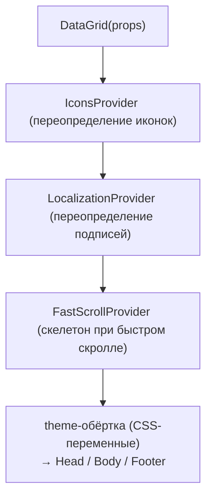
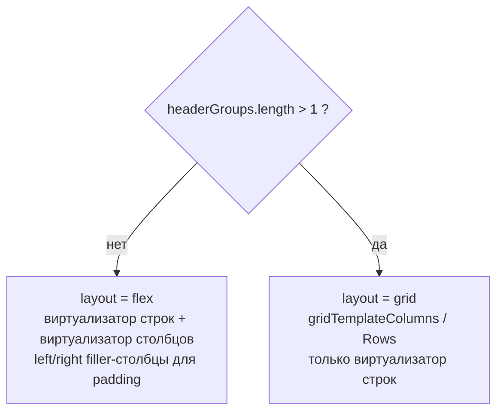
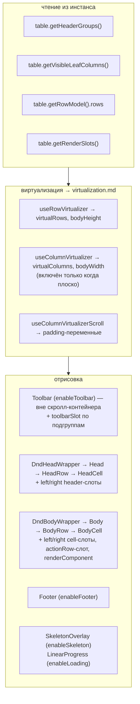

# Рендеринг — `<DataGrid/>`

`<DataGrid table={...} />` (`src/lib/ui/DataGrid/DataGrid.tsx`) превращает инстанс
таблицы в DOM. Он не рендерит ничего о том, _что_ представляют собой данные — он
компонует провайдеры, виртуализаторы, DnD-обёртки и дерево Head/Body/Footer.

Три механики рендер-слоя вынесены в отдельные документы, чтобы этот оставался про
оркестрацию:

- **Виртуализация** — [virtualization.md](virtualization.md).
- **Drag & drop** — [dnd.md](dnd.md).
- **Темизация и контракты переопределения** (`colorMode`, иконки, локализация) —
  [theming-and-overrides.md](theming-and-overrides.md).

## Стек провайдеров

Отдельного провайдера реактивности нет (Pub-Sub снят при миграции на v9): корень
`DataGrid` подписан на состояние единственным `useTableState(table, …)`, а компоненты —
на свои срезы через `useSlice`/`useTableState` (см. [reactivity.md](reactivity.md)).

`props`: `table`, `height`, `maxHeight`, `stub`, `colorMode`, `icons`,
`localization`. `colorMode` управляет темой на CSS-переменных; `icons` и
`localization` питают два контекста переопределения, потребляемых кнопками
плагинов (см. [theming-and-overrides.md](theming-and-overrides.md)).

## Два layout: flex против grid

Layout выбирается по глубине заголовков:

- **Плоские заголовки** (одна строка заголовка) → layout **`flex`**, и **столбцы
  виртуализируются**.
- **Вложенные заголовки** (многоуровневые, `headerGroups.length > 1`) → CSS-layout
  **`grid`**, и **виртуализация столбцов отключена** (`enabled: !hasNestedGroups`).

Строки виртуализируются **всегда**. Именно из-за этого разделения вложенные
заголовки сейчас не сочетаются с закреплением/перетаскиванием столбцов — они живут
на другом layout/render-пути (известная область будущих работ). Детали про
виртуализаторы и их включение — в [virtualization.md](virtualization.md).

## Пайплайн рендеринга

DnD-обёртки (`DndHeadWrapper` / `DndBodyWrapper`) разобраны в [dnd.md](dnd.md).

На ячейку `BodyCell` решает содержимое в порядке приоритета: скелетон быстрого
скролла → `cell.renderComponent` → слот action/row-actions → `flexRender` от
`cell` столбца. Pinned/action-столбцы исключаются из виртуализации столбцов и
инъекции слотов там, где это уместно.

## Рамка и тулбар

Корневая обёртка грида (`table__theme-wrapper`) несёт внешнюю рамку со
скруглением (`--tsr-comp-frame-*`, ADR [0035](../decisions/0035-toolbar-and-column-visibility.md))
и обрезает содержимое по ней (`overflow: hidden`); скроллится только контейнер
таблицы внутри. При `enableToolbar` над контейнером рендерится `Toolbar` (Base UI
`Toolbar`, `role="toolbar"`): обёртка получает `data-toolbar`, что выставляет
`--tsr-comp-toolbar-offset` равным высоте тулбара, и контейнер таблицы становится
ниже на неё. `LinearProgress` — абсолютный элемент без `top`: его позиция берётся из
потока, поэтому он сам оказывается под тулбаром и остаётся под шапкой. Кнопки
тулбара — `toolbarSlot`; раскладку по подгруппам делает `resolveToolbarGroups`
(`core/toolbar.ts`), между группами — `Toolbar.Separator`. Верхней линии у шапки
нет: сверху её ограничивает рамка или разделитель тулбара.

## Состояния загрузки

- `enableSkeleton` → `SkeletonOverlay` для первой загрузки (конфигурируется через
  `skeletonOptions`); также используется на уровне ячейки при быстром скролле
  (`FastScrollProvider`).
- `enableLoading` → полоса `LinearProgress` под заголовком для асинхронных
  обновлений.
