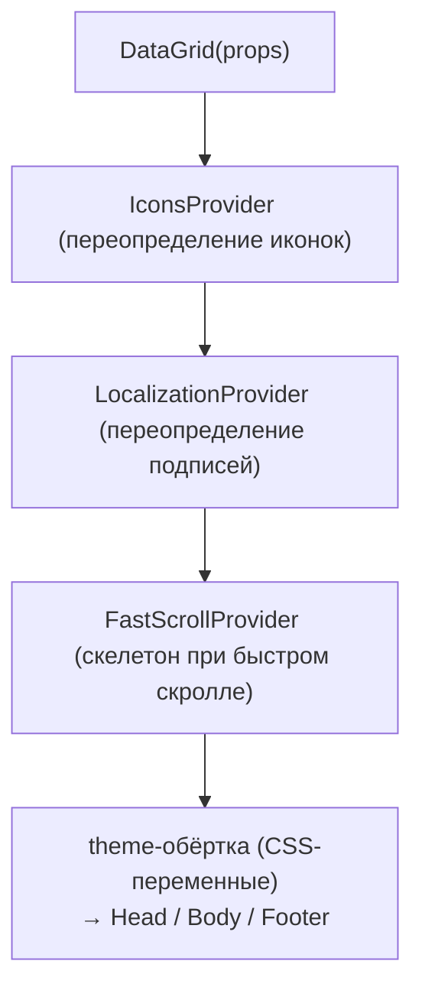
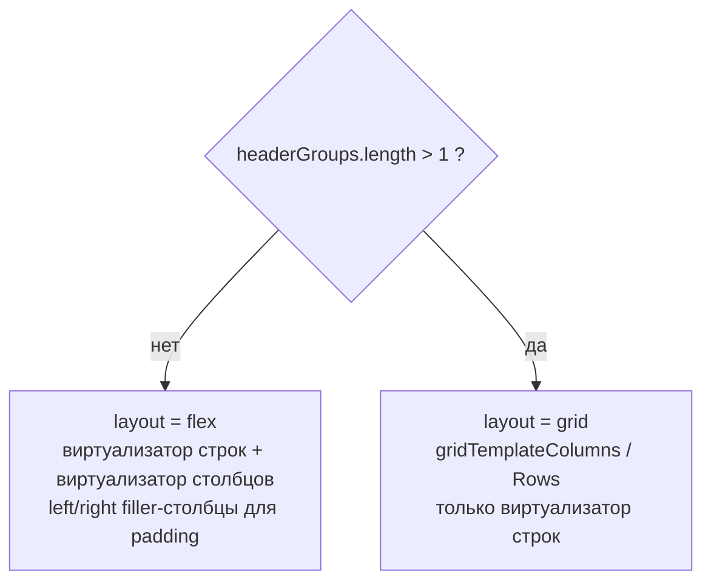
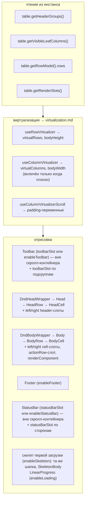

# Рендеринг — `<DataGrid/>`

`<DataGrid table={...} />` (`src/lib/grid/DataGrid.tsx`) превращает инстанс
таблицы в DOM. Он не рендерит ничего о том, _что_ представляют собой данные — он
компонует провайдеры, виртуализаторы, DnD-обёртки и дерево Head/Body/Footer.

Три механики рендер-слоя вынесены в отдельные документы, чтобы этот оставался про
оркестрацию:

- **Виртуализация** — [virtualization.md](virtualization.md).
- **Drag & drop** — [dnd.md](dnd.md).
- **Темизация и контракты переопределения** (`colorMode`, иконки, локализация) —
  [theming-and-overrides.md](theming-and-overrides.md).

## Стек провайдеров

Отдельного провайдера реактивности нет (Pub-Sub снят при миграции на v9): корень
`DataGrid` подписан на состояние единственным `useTableState(table, …)`, а компоненты —
на свои срезы через `useSlice`/`useTableState` (см. [reactivity.md](reactivity.md)).

`props`: `table`, `height`, `maxHeight`, `stub`, `filterStub`, `colorMode`, `icons`,
`localization`. `colorMode` управляет темой на CSS-переменных; `icons` и
`localization` питают два контекста переопределения, потребляемых кнопками
плагинов (см. [theming-and-overrides.md](theming-and-overrides.md)).

Две заглушки. `stub` — пустые данные: заменяет таблицу целиком (тулбар и нижняя
панель остаются). `filterStub` — пустой результат при активном фильтре или поиске
([ADR 0045](../decisions/0045-filtering.md), §9): встаёт поверх пустого тела, шапка с
кнопками фильтров остаётся; без пропа — подпись и «Сбросить фильтры».

## Два layout: flex против grid

Layout выбирается по глубине заголовков:

- **Плоские заголовки** (одна строка заголовка) → layout **`flex`**, и **столбцы
  виртуализируются**.
- **Вложенные заголовки** (многоуровневые, `headerGroups.length > 1`) → CSS-layout
  **`grid`**, и **виртуализация столбцов отключена** (`enabled: !hasNestedGroups`).

Строки виртуализируются **всегда**. Именно из-за этого разделения вложенные
заголовки сейчас не сочетаются с закреплением/перетаскиванием столбцов — они живут
на другом layout/render-пути (известная область будущих работ). Детали про
виртуализаторы и их включение — в [virtualization.md](virtualization.md).

**Спаны вложенной шапки** считает TanStack v9
([ADR 0049](../decisions/0049-native-header-spans.md)). Лист мельче максимальной
глубины получает плейсхолдеры в строках над собой; вершина цепочки несёт
`header.rowSpan` всей цепочки, покрытые ею заголовки — `rowSpan: 0` и не рисуются.
Ячейка ставится в `gridRow: headerGroup.depth + 1 / span rowSpan`, `gridColumn: span
colSpan` (`getHeaderGridPosition`, `grid/layout.ts`). Вершина цепочки — это заголовок
своего листа: контент, слоты, кебаб и клавиатурная навигация у неё те же. Содержимое
растянутого листа прижато к низу, `data-last-headers-row` отмечает ячейку, доходящую до
нижней строки шапки. Ловушка v9: `header.depth` отсчитывается с 1 (на единицу больше
`headerGroup.depth`), а `getLeafHeaders()` возвращает всех потомков вместе с самим
заголовком — общие хелперы спанов живут в `core/headerSpans.ts`.

Свободное место справа (колонки уже контейнера) в обеих раскладках забирает один и тот
же элемент в шапке и в теле: первый правозакреплённый столбец, иначе колонка действий,
иначе заполнитель в конце строки (`needsRightFiller`, `grid/layout.ts`). Иначе заголовки
расходятся с колонками тела ([ADR 0011](../decisions/0011-column-pinning.md), CP29–CP30).

## Пайплайн рендеринга

DnD-обёртки (`DndHeadWrapper` / `DndBodyWrapper`) разобраны в [dnd.md](dnd.md).

На ячейку `BodyCell` решает содержимое в порядке приоритета: скелетон быстрого
скролла → `cell.renderComponent` → слот action/row-actions → `flexRender` от
`cell` столбца. Pinned/action-столбцы исключаются из виртуализации столбцов и
инъекции слотов там, где это уместно.

Быстрый скролл включается выше 2000 px/s по Y (4500 по X) — скорость считается по
жесту, а путь, догнавший после паузы главного потока, в неё не входит, — и держится,
пока скорость не упадёт до четверти порога; ячейки, смонтированные за это время, — скелетоны. Перф-замер
быстрой прокрутки (P2/P4/P7/P8) идёт со скоростью `FAST_SCROLL` чуть выше порога и
меряет режим скелетонов; цену содержимого меряют со скоростью `CONTENT_SCROLL`
(P10–P13, AS14, CF12). Режим замер проверяет сам по выборке кадров.
Одиночный программный прыжок (кнопка «наверх», [ADR 0082](../decisions/0082-back-to-top.md),
BT6) скелетов не даёт: строки на новом месте монтируются в том же событии, до входа
в режим, — как ячейки, видимые до сессии (FS6). Плавная прокрутка программой — это
серия событий, и её строки уже попадают в сессию.

Тултип у обрезанного текста ([ADR 0075](../decisions/0075-overflow-tooltip.md)) —
один на грид: `OverflowTooltip` вешает нативные обработчики на скролл-контейнер (шапка,
тело, футер) и рендерит один ленивый попап `TooltipImpl`. Ячейки о нём не знают: по
`pointerover` или клавиатурному фокусу берётся `.data-grid__cell-wrapper-title`, а по
истечении задержки у него одного сравнивается `scrollWidth > clientWidth`. Прокрутка,
нажатие кнопки мыши, уход указателя или фокуса прячут тултип; Escape и нажатие вне его
закрывает Base UI. Отключается флагом ядра `enableOverflowTooltip: false`.

### Фокус в разных движках

Firefox делает остановкой Tab любую прокручиваемую область. Поэтому обёртки ячеек
держат `overflow: hidden` по обеим осям — одна `overflow-x: hidden` вычисляет вторую
ось как `auto`, и обёртка становится прокручиваемой, — а контейнер прокрутки при
`keyboardNavigation` получает `tabindex=-1`: вход в грид с клавиатуры идёт сразу на
активную ячейку, без прокрутки тела (ADR [0021](../decisions/0021-keyboard-navigation.md),
KN32; набор `keyboard-entry` идёт и в `npm run test:browsers`).

WebKit, как Safari, не фокусирует кнопку кликом и не держит кнопки в порядке Tab.
Кнопка Base UI фокусирует себя при клике, и `Shift+Tab` от неё WebKit не выполняет —
это поведение движка, грид его не исправляет; сценарии «клик по кнопке, затем Tab»
проверяются только в Chromium (BT9).

Кольцо фокуса активной ячейки, строки treegrid и дня календаря рисуется по
`:focus-visible` **или** по признаку последнего ввода `data-tsr-input="keyboard"` на
корне документа (`core/inputModality.ts`, ADR [0084](../decisions/0084-cross-browser-support.md),
CB5): Firefox не даёт `:focus-visible` фокусу от скрипта после ввода мышью, и после
клика стрелки шли бы без кольца. Корень документа — потому что календарь в портале.

Раскрытие скрытых кнопок ячейки (ADR [0076](../decisions/0076-smooth-cell-button-reveal.md))
идёт колонкой `grid` обёртки `minmax(0, 0fr)` → `minmax(0, 1fr)` с `justify-items:
start` — кнопка держит свою ширину, обёртка её обрезает; основа flex — `auto` в обоих
состояниях. `interpolate-size` (только Chromium) не используется — CB6.

## Рамка, тулбар и нижняя панель

Корневая обёртка грида (`table__theme-wrapper`) несёт внешнюю рамку со
скруглением (`--tsr-comp-frame-*`, ADR [0035](../decisions/0035-toolbar-and-column-visibility.md))
и обрезает содержимое по ней (`overflow: hidden`); скроллится только контейнер
таблицы внутри. Обе панели вне скролла показываются по одному правилу
(`resolvePanelVisible`, `core/panels.ts`, ADR [0046](../decisions/0046-toolbar-and-status-bar-visibility.md)):
флаг (`enableToolbar` / `enableStatusBar`) важнее, без флага панель есть, пока у неё
есть хоть один активный слот. Когда тулбар показывается, над контейнером рендерится
`Toolbar` (Base UI
`Toolbar`, `role="toolbar"`): обёртка получает `data-toolbar`, что выставляет
`--tsr-comp-toolbar-offset` равным высоте тулбара, и контейнер таблицы становится
ниже на неё. `LinearProgress` — абсолютный элемент без `top`: его позиция берётся из
потока, поэтому он сам оказывается под тулбаром и остаётся под шапкой. Кнопки
тулбара — `toolbarSlot`; раскладку по подгруппам делает `resolveToolbarGroups`
(`core/toolbar.ts`), между группами — `Toolbar.Separator`. Встроенные группы идут по
фиксированному рангу (`search` → `view` → `data`), а не по порядку плагинов: слева
поиск и сводка фильтров, справа «Колонки» и «Экспорт» (ADR [0051](../decisions/0051-toolbar-button-order.md)). Верхней линии у шапки
нет: сверху её ограничивает рамка или разделитель тулбара.

Нижняя панель (`StatusBar`, ADR [0038](../decisions/0038-pagination-and-status-bar.md))
рендерится под контейнером таблицы по тому же правилу (по умолчанию — когда в
`statusBarSlot` есть хоть один слот без `showsPanel: false`, ADR
[0082](../decisions/0082-back-to-top.md)):
обёртка получает `data-status-bar`, что выставляет `--tsr-comp-status-bar-offset`,
и контейнер становится ниже и на неё. Панель есть и в ветке заглушки (пустые
данные). Сверху её отделяет одна линия (`border-top`); у футера колонок нижней
линии нет, поэтому под ним она не двоится. Раскладку по сторонам делает
`resolveStatusBarSides` (`core/statusBar.ts`).

С пагинацией тело показывает одну страницу, но ARIA-разметка описывает весь набор
(`core/pagination.ts`): `getRowWindow` даёт смещение страницы и полное число
строк — из них `aria-rowcount` корня и база `aria-rowindex` строк
(`ariaRowIndexBase`). На клиенте смещение — индекс первой строки страницы в
`getRowsInDisplayOrder` (учитывает раскрытых детей прошлых страниц), на сервере —
`pageIndex × pageSize` при итоге `rowCount`. `usePageChange` после смены страницы
прокручивает тело к началу и переносит активную ячейку навигации на первую строку.

## Состояния загрузки

- `enableSkeleton` → скелет первой загрузки ([ADR 0060](../decisions/0060-initial-loading-skeleton.md)).
  Рисует та же `DataGridTable`: шапка остаётся настоящей (контекст режима скелета
  убирает кнопки плагинов и содержимое служебных заголовков), тело и футер —
  `SkeletonBody`: лёгкие ячейки без строк TanStack по переменным ширин, закреплению и
  диапазону виртуализатора колонок, строк — по высоте области (`skeletonOptions.rowsCount`).
  Служебная колонка рисует квадрат, если у неё `columnDef.skeletonCell: 'control'`.
  Скелет скрыт от скринридера (`aria-hidden`, `inert`), у таблицы нет роли, загрузку
  объявляет статус. Компоненты панелей читают флаг через `isSkeletonShown`. Флаг —
  единственный источник: скелет снимается в том же рендере, без задержки.
- Отдельно от него — скелеты ячеек при быстрой прокрутке (`FastScrollProvider`,
  [ADR 0008](../decisions/0008-fast-scroll.md)).
- `enableLoading` → полоса `LinearProgress` под заголовком для асинхронных
  обновлений.

### Ленивые поповеры и меню

Поповеры и меню на Base UI тянут floating-ui и живут в отдельных модулях
([ADR 0061](../decisions/0061-lazy-popover-loading.md)). Общая механика — в ядре:

- `preloadable` (`core/preloadable.tsx`) — ленивый компонент, который после загрузки
  рисуется синхронно; `load()` помнит исход, `reload()` после ошибки пробует снова.
  `usePreloaded` начинает загрузку при рендере и сменяет заглушку настоящим
  элементом по состоянию, а не повтором Suspense-границы: React может отложить
  такой повтор до следующего рендера кнопки и провести смену посреди клика.
- `useLazyOpening` (`core/lazyOpening.ts`) — нажатие до загрузки открывает поповер
  после неё; ожидание дольше 150 мс — `pending` у элемента, Escape и уход фокуса его
  отменяют, ошибка — вспышка и объявление `loadFailed`. Отмену слушает и документ
  (`Escape`, `Tab`, нажатие указателем): Safari не фокусирует кнопку по клику, и
  `blur` у неё не наступит (ADR 0084).
- Меню грида (кебабы, инлайн-меню, контекстное, меню ручек) немодальные (ADR 0085):
  без подложки, нажатие мимо закрывает меню и доходит до цели, колесо и касание над
  гридом закрывают меню (`useCloseOnGridScroll`), после ухода пользователя фокус на
  триггер не возвращается (`useMenuLeave`). Перед нажатием и отпусканием над гридом
  `core/stickyGeometry.ts` пересчитывает положение закреплённых ячеек: Firefox после
  перекладки внутри `sticky`-ячейки видит её на незакреплённом месте до прокрутки.
  `useLazyPopover` — то же для кнопки-заглушки (кнопки тулбара, выбор размера
  страницы, кебаб и инлайн-меню заголовка), `usePanelOpening` — для действия заголовка с панелью (ADR 0024),
  `useHandleMenu` — для меню ручек.
- Когда грузить: модули видимых с начала кнопок — при их показе; контекстного меню —
  при первом наведении на тело грида или фокусе внутри; меню ручек — при наведении и
  фокусе на ручке. Ожидание контекстного меню — курсор `progress` и `aria-busy` на
  контейнере прокрутки; его отменяют Escape, колесо, касание и нажатие мимо.
- Live-область рисует каждое объявление новым узлом — повтор того же текста тоже
  объявляется.
