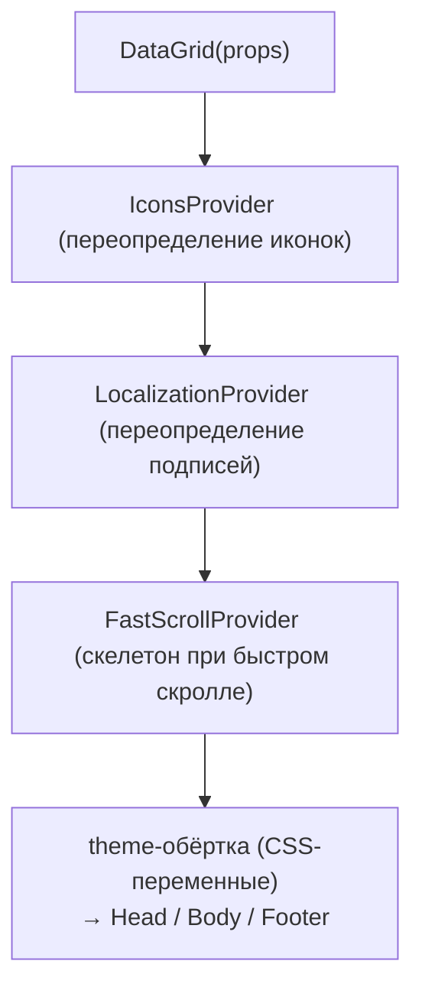
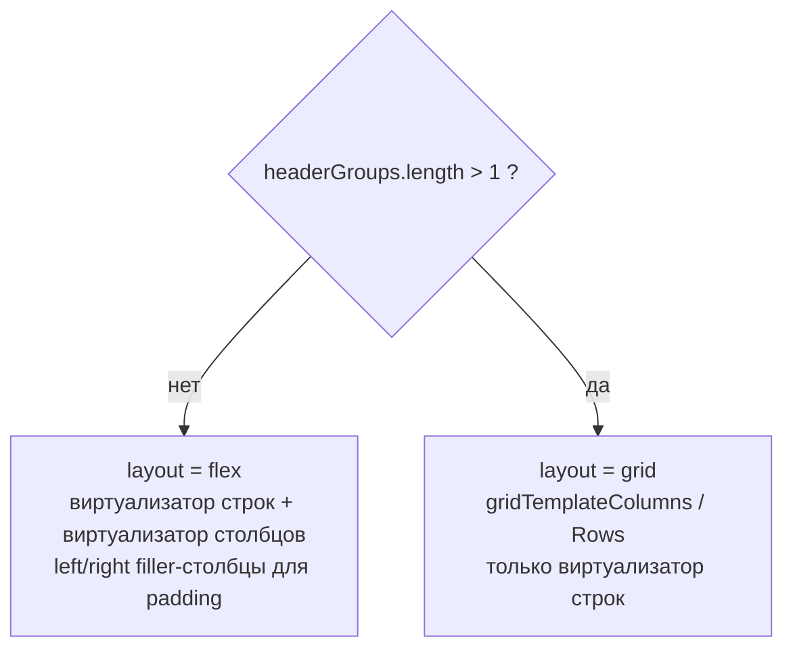
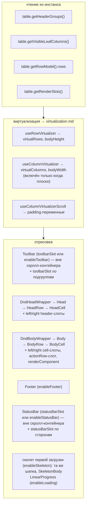

# Рендеринг — `<DataGrid/>`

`<DataGrid table={...} />` (`src/lib/grid/DataGrid.tsx`) превращает инстанс
таблицы в DOM. Он не рендерит ничего о том, _что_ представляют собой данные — он
компонует провайдеры, виртуализаторы, DnD-обёртки и дерево Head/Body/Footer.

Три механики рендер-слоя вынесены в отдельные документы, чтобы этот оставался про
оркестрацию:

- **Виртуализация** — [virtualization.md](virtualization.md).
- **Drag & drop** — [dnd.md](dnd.md).
- **Темизация и контракты переопределения** (`colorMode`, иконки, локализация) —
  [theming-and-overrides.md](theming-and-overrides.md).

## Стек провайдеров

Отдельного провайдера реактивности нет (Pub-Sub снят при миграции на v9): корень
`DataGrid` подписан на состояние единственным `useTableState(table, …)`, а компоненты —
на свои срезы через `useSlice`/`useTableState` (см. [reactivity.md](reactivity.md)).

`props`: `table`, `height`, `maxHeight`, `stub`, `filterStub`, `colorMode`, `icons`,
`localization`. `colorMode` управляет темой на CSS-переменных; `icons` и
`localization` питают два контекста переопределения, потребляемых кнопками
плагинов (см. [theming-and-overrides.md](theming-and-overrides.md)).

Две заглушки. `stub` — пустые данные: заменяет таблицу целиком (тулбар и нижняя
панель остаются). `filterStub` — пустой результат при активном фильтре или поиске
([ADR 0045](../decisions/0045-filtering.md), §9): встаёт поверх пустого тела, шапка с
кнопками фильтров остаётся; без пропа — подпись и «Сбросить фильтры».

## Два layout: flex против grid

Layout выбирается по глубине заголовков:

- **Плоские заголовки** (одна строка заголовка) → layout **`flex`**, и **столбцы
  виртуализируются**.
- **Вложенные заголовки** (многоуровневые, `headerGroups.length > 1`) → CSS-layout
  **`grid`**, и **виртуализация столбцов отключена** (`enabled: !hasNestedGroups`).

Строки виртуализируются **всегда**. Именно из-за этого разделения вложенные
заголовки сейчас не сочетаются с закреплением/перетаскиванием столбцов — они живут
на другом layout/render-пути (известная область будущих работ). Детали про
виртуализаторы и их включение — в [virtualization.md](virtualization.md).

**Спаны вложенной шапки** считает TanStack v9
([ADR 0049](../decisions/0049-native-header-spans.md)). Лист мельче максимальной
глубины получает плейсхолдеры в строках над собой; вершина цепочки несёт
`header.rowSpan` всей цепочки, покрытые ею заголовки — `rowSpan: 0` и не рисуются.
Ячейка ставится в `gridRow: headerGroup.depth + 1 / span rowSpan`, `gridColumn: span
colSpan` (`getHeaderGridPosition`, `grid/layout.ts`). Вершина цепочки — это заголовок
своего листа: контент, слоты, кебаб и клавиатурная навигация у неё те же. Содержимое
растянутого листа прижато к низу, `data-last-headers-row` отмечает ячейку, доходящую до
нижней строки шапки. Ловушка v9: `header.depth` отсчитывается с 1 (на единицу больше
`headerGroup.depth`), а `getLeafHeaders()` возвращает всех потомков вместе с самим
заголовком — общие хелперы спанов живут в `core/headerSpans.ts`.

Свободное место справа (колонки уже контейнера) в обеих раскладках забирает один и тот
же элемент в шапке и в теле: первый правозакреплённый столбец, иначе колонка действий,
иначе заполнитель в конце строки (`needsRightFiller`, `grid/layout.ts`). Иначе заголовки
расходятся с колонками тела ([ADR 0011](../decisions/0011-column-pinning.md), CP29–CP30).

## Пайплайн рендеринга

DnD-обёртки (`DndHeadWrapper` / `DndBodyWrapper`) разобраны в [dnd.md](dnd.md).

На ячейку `BodyCell` решает содержимое в порядке приоритета: скелетон быстрого
скролла → `cell.renderComponent` → слот action/row-actions → `flexRender` от
`cell` столбца. Pinned/action-столбцы исключаются из виртуализации столбцов и
инъекции слотов там, где это уместно.

Быстрый скролл включается выше 2000 px/s по Y (4500 по X) и держится, пока скорость не
упадёт до четверти порога; ячейки, смонтированные за это время, — скелетоны. Перф-замер
с шагом 100 px на кадр поэтому меряет режим скелетонов, а не содержимое ячеек — см.
«Известные проблемы» в roadmap; цену содержимого меряют со скоростью
`CONTENT_SCROLL` (AS14, CF12).

## Рамка, тулбар и нижняя панель

Корневая обёртка грида (`table__theme-wrapper`) несёт внешнюю рамку со
скруглением (`--tsr-comp-frame-*`, ADR [0035](../decisions/0035-toolbar-and-column-visibility.md))
и обрезает содержимое по ней (`overflow: hidden`); скроллится только контейнер
таблицы внутри. Обе панели вне скролла показываются по одному правилу
(`resolvePanelVisible`, `core/panels.ts`, ADR [0046](../decisions/0046-toolbar-and-status-bar-visibility.md)):
флаг (`enableToolbar` / `enableStatusBar`) важнее, без флага панель есть, пока у неё
есть хоть один активный слот. Когда тулбар показывается, над контейнером рендерится
`Toolbar` (Base UI
`Toolbar`, `role="toolbar"`): обёртка получает `data-toolbar`, что выставляет
`--tsr-comp-toolbar-offset` равным высоте тулбара, и контейнер таблицы становится
ниже на неё. `LinearProgress` — абсолютный элемент без `top`: его позиция берётся из
потока, поэтому он сам оказывается под тулбаром и остаётся под шапкой. Кнопки
тулбара — `toolbarSlot`; раскладку по подгруппам делает `resolveToolbarGroups`
(`core/toolbar.ts`), между группами — `Toolbar.Separator`. Встроенные группы идут по
фиксированному рангу (`search` → `view` → `data`), а не по порядку плагинов: слева
поиск и сводка фильтров, справа «Колонки» и «Экспорт» (ADR [0051](../decisions/0051-toolbar-button-order.md)). Верхней линии у шапки
нет: сверху её ограничивает рамка или разделитель тулбара.

Нижняя панель (`StatusBar`, ADR [0038](../decisions/0038-pagination-and-status-bar.md))
рендерится под контейнером таблицы по тому же правилу (по умолчанию — когда в
`statusBarSlot` есть хоть один слот):
обёртка получает `data-status-bar`, что выставляет `--tsr-comp-status-bar-offset`,
и контейнер становится ниже и на неё. Панель есть и в ветке заглушки (пустые
данные). Сверху её отделяет одна линия (`border-top`); у футера колонок нижней
линии нет, поэтому под ним она не двоится. Раскладку по сторонам делает
`resolveStatusBarSides` (`core/statusBar.ts`).

С пагинацией тело показывает одну страницу, но ARIA-разметка описывает весь набор
(`core/pagination.ts`): `getRowWindow` даёт смещение страницы и полное число
строк — из них `aria-rowcount` корня и база `aria-rowindex` строк
(`ariaRowIndexBase`). На клиенте смещение — индекс первой строки страницы в
`getRowsInDisplayOrder` (учитывает раскрытых детей прошлых страниц), на сервере —
`pageIndex × pageSize` при итоге `rowCount`. `usePageChange` после смены страницы
прокручивает тело к началу и переносит активную ячейку навигации на первую строку.

## Состояния загрузки

- `enableSkeleton` → скелет первой загрузки ([ADR 0060](../decisions/0060-initial-loading-skeleton.md)).
  Рисует та же `DataGridTable`: шапка остаётся настоящей (контекст режима скелета
  убирает кнопки плагинов и содержимое служебных заголовков), тело и футер —
  `SkeletonBody`: лёгкие ячейки без строк TanStack по переменным ширин, закреплению и
  диапазону виртуализатора колонок, строк — по высоте области (`skeletonOptions.rowsCount`).
  Служебная колонка рисует квадрат, если у неё `columnDef.skeletonCell: 'control'`.
  Скелет скрыт от скринридера (`aria-hidden`, `inert`), у таблицы нет роли, загрузку
  объявляет статус. Компоненты панелей читают флаг через `isSkeletonShown`. Флаг —
  единственный источник: скелет снимается в том же рендере, без задержки.
- Отдельно от него — скелеты ячеек при быстрой прокрутке (`FastScrollProvider`,
  [ADR 0008](../decisions/0008-fast-scroll.md)).
- `enableLoading` → полоса `LinearProgress` под заголовком для асинхронных
  обновлений.
