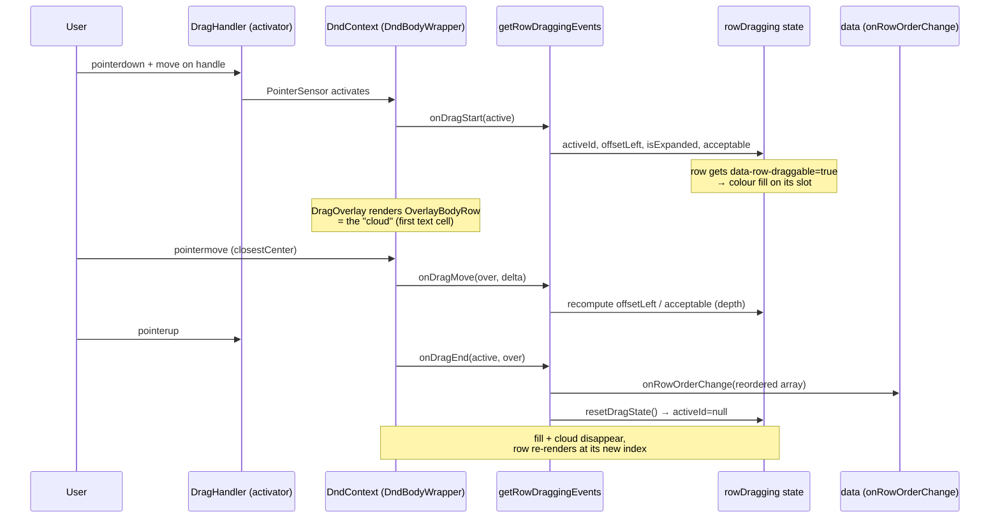

# Row dragging plugin

`rowDragging` lets a user reorder table rows by dragging them. It works both on a
**flat** list and on a **nested** (`subRows`) data set, and is built on the
`TablePlugin` + slots conventions described in
[plugins-and-slots.md](plugins-and-slots.md), plus a dnd-kit drag layer wrapped
around the table body.

> **Scope note.** The reorder algorithm (flat vs. nested, all the
> root↔group cases) lives in `getRowDraggingEvents.ts` and is out of scope for
> this doc — see the case list documented inline there. This doc covers *how the
> plugin is wired into the table and the UI*: activation, the service column, the
> drag handle, the overlay, the drop indicator, and the commit-on-drop flow.

## Activation

The plugin is one of the always-injected base features (`rowDraggingPlugin`,
`src/lib/plugins/rowDragging/rowDraggingPlugin.tsx`); it only does anything once
the consumer turns it on via the **`enableRowDragging`** option on
`useCreateTable`:

```ts
enableRowDragging?: boolean | ((row: Row<TData>) => boolean)
```

- `true` — every row is draggable.
- a **predicate** — decide per row (e.g. only leaf rows, only a given type).
- `false` / omitted — the plugin is inert; no service column, no handles.

### `row.getCanDrag()`

The plugin defines `row.getCanDrag()` in its `createRow` hook. This is the single
source of truth the UI reads to decide whether to render a handle for a row:

```ts
createRow: (row, table) => {
  row.getCanDrag = () => {
    // dragging is unsupported with multi-level headers or grouping
    if (table.getHeaderGroups().length !== 1 || table.options.enableGrouping) {
      return false
    }
    const flag = table.options.enableRowDragging
    return typeof flag === 'function' ? flag(row) : !!flag
  }
}
```

Two hard gates are baked in and cannot be overridden by the consumer:

- **multi-level (nested) headers** — `getHeaderGroups().length !== 1` disables
  dragging (the nested-header render path is CSS-grid, not the flat flex path);
- **grouping** — `enableGrouping` disables dragging.

Both are known, deliberate limitations (see [Known limitations](#known-limitations)).

## The service column

When `enableRowDragging` is truthy, `useCreateColumns`
(`src/lib/core/createColumns/useCreateColumns.ts`) **unshifts** a dedicated
service column to the **front** of the column list (`temp.unshift(...)` — it lands
before selection/expander because it is unshifted last), so the drag handle sits
in its own left-most column.

The column is built by `getRowDraggingColumn(depth)`
(`rowDraggingColumn.ts`). Key facts:

- id = `getActionColumnId('rowDragging')` → it is an **action column**
  (`getIsActionsColumn()` is true), so it is excluded from sizing, pinning,
  sorting, dragging, and from the "first user column" offset math.
- it renders no header/footer.
- for **nested headers** it wraps itself in placeholder group levels
  (`rowSpan`) so it spans the full header height; on a single-level header it is
  returned as-is.
- **width** is `COLUMN_DRAGGING_SIZE = icon (16px) + left padding (4) + right
  padding (4) = 24` (`ACTION_COLUMN_CONTENT_PADDING = 4`).

## The drag handle

`RowDraggingComponent` (`RowDraggingComponent.tsx`) owns the service column's
cell (via `cell.renderComponent`, guarded by the column id). It subscribes to
`row.getCanDrag()` and renders **nothing** when the row is not draggable,
otherwise a `DragHandler`:

```tsx
const RowDraggingComponent = memo(({ row }) => {
  useSubscribeStore(() => [row.getCanDrag()])
  if (!row.getCanDrag()) return null
  return <DragHandler id={row.id} type="row" />
})
```

`DragHandler` (`src/lib/plugins/ui/DragHandler.tsx`):

- is the dnd-kit **activator** node — it reads `setActivatorNodeRef` /
  `attributes` / `listeners` from `ItemSortableContext` (provided per row by
  `ItemDraggableWrapper` in `BodyRow`), and spreads the pointer listeners onto its
  `<span class="drag__handler--column">`.
- renders the `drag` icon (lucide `GripVertical` by default, overridable via
  `<DataGrid icons={{ drag }} />`). The icon is **16×16** (`DragHandler.module.css`:
  `.button svg { width:16px; height:16px }`).

### Hover-only visibility

The handle icon is present in the DOM at all times but **hidden with `opacity: 0`**
until the row is hovered, via the shared `row__button--hidden` convention in
`BodyRow.module.css`:

```css
.body__row .row__button--hidden { opacity: 0; }
.body__row:hover:is([data-row-interact='true']) .row__button--hidden { opacity: 1; }
```

So the drag affordance only appears on row hover (and only while the row is
interactive, i.e. not mid-drag).

## Drag lifecycle

The body is wrapped by `DndBodyWrapper` (`src/lib/ui/Body/DndBodyWrapper.tsx`),
which sets up a single `DndContext` + vertical `SortableContext` for the rows and
wires the handlers from `getRowDraggingEvents(table)`:



### The drop indicator (colour fill)

While a row is being dragged, `BodyRow` sets `data-row-draggable={isDragging}` on
the row element. `BodyRow.module.css` turns that into a colour fill and hides the
row's own content, marking the row's slot as the pending drop location:

```css
.body__row:is([data-row-draggable='true']) {
  background-color: var(--draggable-row-background-color) !important;
  z-index: 5 !important;
  & > * { opacity: 0; height: 0; }
}
```

`--draggable-row-background-color` is set per drag by `getRowDraggableStyles`
(from `rowDragging.acceptable`): `--data-grid-row-accept-draggable-bg` when the
current depth is allowed, `--data-grid-row-not-accept-draggable-bg` when not.

### The drag "cloud" (overlay)

`DndBodyWrapper` renders a dnd-kit `DragOverlay` containing `OverlayBodyRow`
(`src/lib/ui/BodyRow/OverlayBodyRow.tsx`) that follows the cursor. It is built
from the dragged row's **first non-action (text) cell** only —

```ts
const draggableRowCell = draggableRow
  ?.getVisibleCells()
  .find(cell => !cell.column.getIsActionsColumn())
```

— so the cloud is the size of the first text cell of the row (`.overlay` container
is `width: 200px`, matching that column), a drag handle, and — for a group row —
a count `bubble` of its `subRows`.

### Commit + cleanup

On `onDragEnd`, `getRowDraggingEvents` computes the target index/parent for all
the flat/nested cases and calls **`onRowOrderChange`** (the consumer-provided
updater — in the stories it is `setData`) with the reordered array, so the dragged
row lands at the index the drop indicator was over and the row order changes.
Then `resetDragState()` restores the cursor and clears `rowDragging`
(`activeId → null`, `offsetLeft → 0`, …). With `activeId` cleared the overlay
"cloud" unmounts and `data-row-draggable` goes false, so the colour fill
disappears and the row renders normally at its new index. `onDragCancel` /
`onDragAbort` run the same cleanup without reordering.

### Auto-scroll during drag

`DndBodyWrapper` passes `autoScroll={autoScrollOnlyY}`
(`src/lib/core/dnd/parameters.ts`) to the `DndContext`. This constrains edge
auto-scroll to the **vertical axis only**:

- `threshold.y = 0.2` — while dragging, holding the pointer within 20% of the
  scroll container's top or bottom edge scrolls the table that way
  (`acceleration: 20`), so a row can be dragged to an index outside the current
  viewport.
- `threshold.x = 0` — horizontal auto-scroll is disabled: dragging near the
  left/right edge never scrolls the table sideways, even when the grid overflows
  horizontally.

Reordering stays correct after any vertical scroll: the move math keys off the
row-model index / `virtualIndex` of the actually-rendered rows, which the
virtualizer keeps accurate as the window scrolls.

## State & options

`RowDraggingState` / `RowDraggingOptions` (`types.ts`):

- `state.rowDragging: RowDragOverlayState` — `{ activeId, offsetLeft, isExpanded,
  acceptable }`, driven through `onRowDraggingChange`.
- `onRowOrderChange` — the reorder updater (a standard TanStack `Updater`) the
  consumer must handle to persist the new order.

## Requirements & test coverage

Acceptance criteria the visual test encodes. **Play** = a step of the meta-level
`play` in `stories/DataGrid.stories.tsx` (runs on any story with
`enableRowDragging`; the `RowDragging` story is sized to overflow on both axes so
the scroll steps have real scroll to drive); **Runner** = a case in
`stories/__tests__/row-dragging.test.tsx` (vitest-browser, real Chromium input),
which also executes the play so every Play row runs under `npm test`.

| ID  | Requirement                                                          | Coverage                            |
| --- | ------------------------------------------------------------------- | ----------------------------------- |
| R1  | Plugin activates via `enableRowDragging`                            | Play gate + Runner (a story exists) |
| R2  | Drag handle lives in a dedicated first (service) column            | Play                                |
| R3  | Handle icon is 16×16                                                | Play                                |
| R4  | Service column width = 16 + 4 + 4 = 24                             | Play                                |
| R5  | A handle is rendered per `row.getCanDrag()` (one per draggable row) | Play                                |
| R6  | Handle hidden (`opacity: 0`) while the row is not hovered           | Play                                |
| R7  | Handle revealed on row hover                                        | Runner (trusted hover)              |
| R8  | Drag shows the overlay "cloud" (size of the first text cell)        | Play                                |
| R9  | Dragged row's slot shows the colour drop-indicator fill            | Play                                |
| R10 | On drop the row takes a new index → order changes                   | Play                                |
| R11 | After drop the cloud + fill disappear; row renders at its new index | Play                                |
| R12 | Near the top/bottom edge, drag auto-scrolls the table vertically    | Play (gated on overflow)            |
| R13 | A row reorders correctly after a vertical scroll (either direction) | Play (gated on overflow)            |
| R14 | Drag never auto-scrolls the table horizontally                     | Play (gated on overflow)            |

Not covered by the test (see [Known limitations](#known-limitations) and the
`getRowDraggingEvents` case list): nested / cross-group reordering, the exact
landing index, and the negative `getCanDrag()` case (handle hidden for
non-draggable rows).

## Known limitations

- **grouping + row dragging** is not supported (gated off in `getCanDrag`).
- **multi-level headers + row dragging** is not supported (gated off in
  `getCanDrag`).
- nesting depth **> 1** is not supported by the move math yet (see the `acceptable`
  / depth `TODO`s in `getRowDraggingEvents` / `draggingHelpers`).

See [README.md](README.md) for the architecture overview and
[plugins-and-slots.md](plugins-and-slots.md) for the plugin mechanism.
