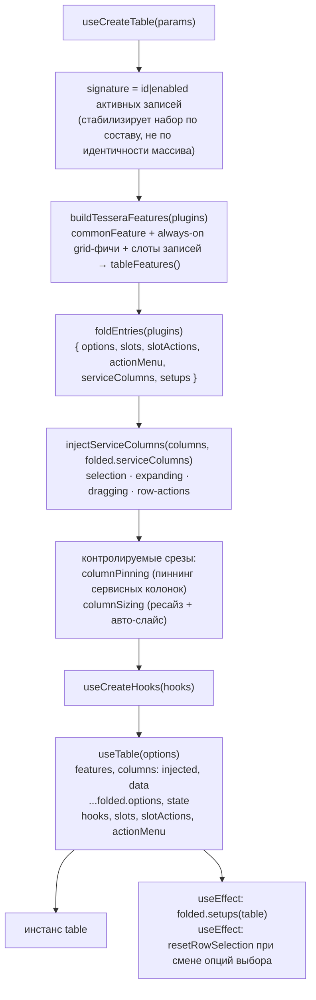
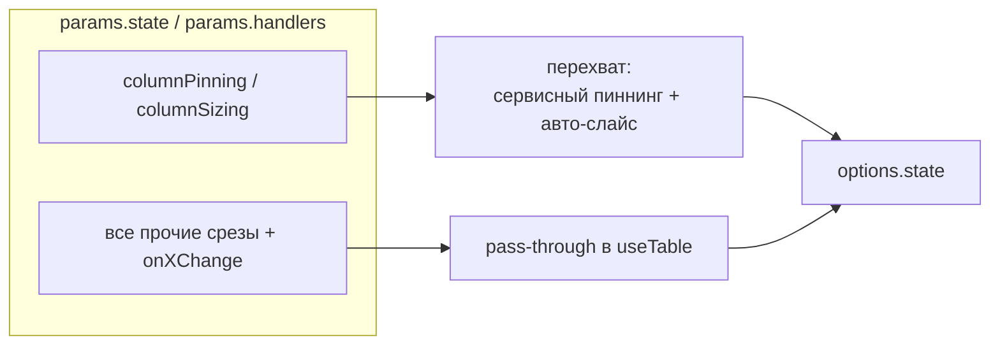

# Сборка таблицы — `useCreateTable`

`useCreateTable<TData, const TEntries>` — единственная точка входа. Она превращает
входы потребителя в сконфигурированный инстанс TanStack v9. Источник:
`src/lib/core/useCreateTable.ts`.

## Дженерики

Сигнатура в v9 сжата до двух параметров:

| Дженерик   | Значение                                                         | По умолчанию                     |
| ---------- | ---------------------------------------------------------------- | -------------------------------- |
| `TData`    | форма строки                                                     | —                                |
| `TEntries` | кортеж записей `plugins` (`const`) — набор фич выводится из него | `readonly TesseraFeatureEntry[]` |

Из `TEntries` выводится набор фич `TesseraFeatures<TEntries>` (см.
[features.ts](../../src/lib/core/features.ts)), который в v9 идёт **ведущим**
дженериком `TFeatures` во все типы TanStack (`Table<TFeatures, TData>`,
`ColumnDef<TFeatures, TData, TValue>`, …). `columns` и `state` потребителя типизируются
через него: `ColumnDef<TesseraFeatures<TEntries>, TData, unknown>[]` и
`Partial<TableState<TesseraFeatures<TEntries>>>`. Бизнес-`hooks` — опция always-on
`commonFeature` (тип `CommonHooks`). Presence-based композиция и её обоснование —
[ADR 0010](../decisions/0010-invert-core-plugins-registry.md).

## Пайплайн

## Сервисные столбцы (`injectServiceColumns`)

Tessera инъектирует не-data столбцы на основе **наличия плагина** в `plugins`
(presence-based, ADR 0010): плагин приносит свою сервисную колонку в записи как
`TesseraFeatureEntry.column` (`rowSelection`, `rowExpanding`, `rowDragging`,
`rowActions`). `foldEntries` собирает их в `serviceColumns`, а `injectServiceColumns`
раскладывает по `side`/`order`; ядро плагины не импортит. У колонок зарезервированные
id, распознаются `column.getIsActionsColumn()` (метод от `commonFeature`). Сервисная
колонка — всегда лист без групп-обёрток: под вложенной шапкой полную высоту ей даёт
вертикальный спан TanStack v9 ([ADR 0049](../decisions/0049-native-header-spans.md)).

## Состояние: контролируемые срезы против pass-through

В отличие от прочих срезов, которыми в v9 владеют сами фичи (uncontrolled), ядро
перехватывает **два** среза, потому что они несут инъекцию сервисных колонок:

- **`columnPinning`** — контролируемый: пользовательский пиннинг + пиннинг сервисных
  колонок как **display-transform**. `mergeServiceColumnPinning` вклеивает сервисные
  `start/end`, а `onColumnPinningChange` срезает их обратно, чтобы наружу уходил
  чистый пользовательский пиннинг.
- **`columnSizing`** — контролируемый: пользовательский ресайз (`mergeColumnSizing`) +
  авто-слайс, который плагины пишут в `setup` через `table.setColumnAutoSizing`
  (`onColumnAutoSizingChange` бейлит при равенстве, иначе цикл).

Всё остальное `state`/`handlers` потребителя (включая кастомные слайсы и `onXChange`
вроде `onExpandedChange`/`onRowSelectionChange`/`onGroupingChange`/`onRowOrderChange`)
пробрасывается в `useTable` **как есть**. Новый объект `state` с теми же срезами
перерисовок не даёт: `useTable` публикует его по срезам со сравнением `shallow`
(см. [reactivity.md](reactivity.md)).

## Hooks — бизнес-контракт

`hooks` — типизированный объект бизнес-колбэков/значений (например,
`rowSelection.onSelectRow`). `useCreateHooks` мемоизирует его; он прикрепляется опцией
таблицы и читается через `table.getHooks()` (устанавливается `commonFeature`). Чтение
`getHooks()` **ни на что не подписывается** — hooks задуманы как точки входа для
сайд-эффектов, а не входы рендера. Динамические значения, которые должны управлять
рендерингом, принадлежат `state` и потребляются через гранулярные подписки
(`useSlice`/`useTableState`, [reactivity.md](reactivity.md)).

## Плагины

Набор фич собирается presence-based (ADR 0010): `buildTesseraFeatures` вклеивает
always-on `commonFeature` + grid-инфраструктурные фичи (columnOrdering/Visibility/
Pinning/Sizing/Grouping — их методы гриду нужны всегда), затем **фичи всех
присутствующих записей** (в т.ч. `enabled: false`) и прогоняет через `tableFeatures()`.
Почему всех: v9 фиксирует набор фич на маунте `useTable`, поэтому рантайм-включение
плагина не добавило бы фичу — вместо этого фича всегда в наборе, а поведение гейтится
`enable*`-опцией (фабрика отключённого плагина эмитит `enable*: false`; `foldEntries`
берёт опции от всех записей, а слоты/колонки/setup — только от активных).

Мемоизация идёт на двух уровнях (ADR 0039), а не по идентичности массива
`plugins` — свежий inline-массив с теми же значениями ничего не пересобирает:

- **по составу набора** (`id|enabled` активных записей) — `features` и сервисные
  колонки. Смена аргумента фабрики не пересоздаёт колонки и не перестраивает модель
  (RX1, RX3);
- **по значению аргументов фабрик** — `folded`: опции, слоты, `actionMenu` и
  `setup`. Запись `definePlugin` несёт `args`, ключ по значению `argsKey` и
  `configure` (`core/pluginArgs.ts`). При смене ключа ядро пересобирает настройку из
  **вида** аргументов: функции в нём — стабильные обёртки, которые зовут последнюю
  версию функции, поэтому пересборка не дёргает мемо row-моделей. Смена только
  функции ключ не меняет — она живёт в обёртке (RX2). `setup` перезапускается только
  при смене состава набора или значения аргументов, после cleanup прежнего (RX24):
  обёртка `useTable` новая на каждом рендере, поэтому в зависимости эффекта её нет, и
  `setup` получает таблицу своего запуска.

Состав набора — договор на время жизни таблицы (`core/pluginSet.ts`): ядро помнит
`id` с момента монтирования. Добавленный позже плагин исключается из сборки
(`'addedAfterMount'`, RX5), удалённый остаётся «призраком» с `enabled: false`
(`'removedAfterMount'`, RX6) — иначе его фича работала бы со старыми опциями. Аргументы
из `lifetime` записи (`server`) берутся с момента монтирования (RX4).

Хуки (`foldHooks`) по-прежнему сворачиваются каждый рендер. Записи, написанные
вручную (без `definePlugin`), не несут `args` — их поля статичны на время состава.

Про жизненный цикл фичи см. [plugins-and-slots.md](plugins-and-slots.md).
