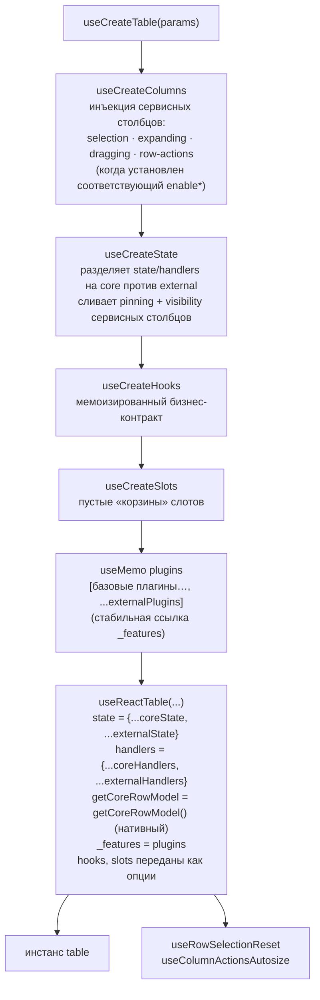
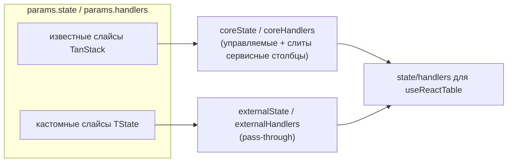

# Сборка таблицы — `useCreateTable`

`useCreateTable<TData, THooks, TState, TOptions>` — единственная точка входа. Она
превращает входы потребителя в сконфигурированный инстанс TanStack. Источник:
`src/lib/core/createTable/useCreateTable.ts`.

## Дженерики

| Дженерик   | Значение                                               | По умолчанию |
| ---------- | ------------------------------------------------------ | ------------ |
| `TData`    | форма строки                                            | `any`        |
| `THooks`   | бизнес-контракт, доступный через `table.getHooks()`     | `any`        |
| `TState`   | кастомные слайсы состояния, влитые в `table.getState()` | `any`        |
| `TOptions` | кастомные handlers/опции, влитые в `table.options`      | `any`        |

Пятый дженерик, `TValue` (значение ячейки), стоит **последним и опциональным** в
`TablePlugin`, `HeaderComponentProps` и `CellComponentProps`.

## Пайплайн

## Сервисные столбцы (`useCreateColumns`)

Tessera инъектирует не-data столбцы на основе флагов `enable*`: столбец с
чекбоксом (`enableRowSelection`), столбец-expander (`enableRowExpanding`),
столбец с drag-ручкой (`enableRowDragging`) и правозакреплённый столбец действий
(`enableRowActions`). У них зарезервированные id, и они распознаются хелперами
`checkIsActionColumn` / `column.getIsActionsColumn()`.

## Состояние: разделение core / external

`useCreateState` — сердце истории Tessera про controlled-состояние. Он разбивает
`state` и `handlers` потребителя:

- **Core state** — слайсы TanStack, которыми Tessera управляет сама
  (`columnSizing`, `columnOrder`, `sorting`, `columnPinning`, `rowSelection`,
  `columnVisibility`, `expanded`, `grouping`) плюс не-TanStack-экстра
  (`columnDraggingActiveId`, `rowDragging`). Для каждого внешнее значение
  побеждает, если передано (`external ?? internal`), а pinning/visibility
  сервисных столбцов вливаются.
- **External state** — всё прочее, что потребитель положил в `state` (кастомные
  слайсы `TState`, например `hiddenCells`), пробрасывается напрямую в
  `useReactTable`, так что оно живёт в `table.getState()` рядом со встроенным.

> **Заметка для контрибьютора.** Поскольку кастомные ключи `TState`
> распространяются в тот же объект, что и встроенное состояние TanStack, будущий
> ключ состояния TanStack мог бы столкнуться с ключом потребителя. Это известный
> острый угол (см. заметки проекта о будущих работах).

## Hooks — бизнес-контракт

`hooks` — это типизированный объект бизнес-колбэков/значений (например,
`rowSelection.onSelectRow`). Он прикрепляется как опция таблицы и читается через
добавленный Tessera `table.getHooks()` (устанавливается `commonPlugin.createTable`).
Чтение `getHooks()` **ни на что не подписывается** — hooks задуманы как точки
входа для сайд-эффектов, а не как входы рендера. Динамические значения, которые
должны управлять рендерингом, принадлежат `state` и потребляются через Pub-Sub
([reactivity.md](reactivity.md)).

## Плагины

Массив `_features` — это мемоизированный список встроенных плагинов, за которым
следует `...externalPlugins`. Мемоизация удерживает ссылку `_features` стабильной
между рендерами (избегает повторного прогона настройки фич). **Теперь стабильность
зависит от того, что потребитель передаёт стабильный проп `plugins`** — inline-массив
сбрасывает memo.

Встроенный порядок: `common`, `rowSelection`, `rowExpanding`, `columnPinning`,
`columnSizing`, `columnSorting`, `columnDragging`, `rowDragging`, `rowGrouping`,
затем плагины потребителя. `commonPlugin` обязан быть первым — он устанавливает
`getHooks/getRenderSlots/setRenderSlot`, которые вызывают более поздние плагины.

Про жизненный цикл см. [plugins-and-slots.md](plugins-and-slots.md).
