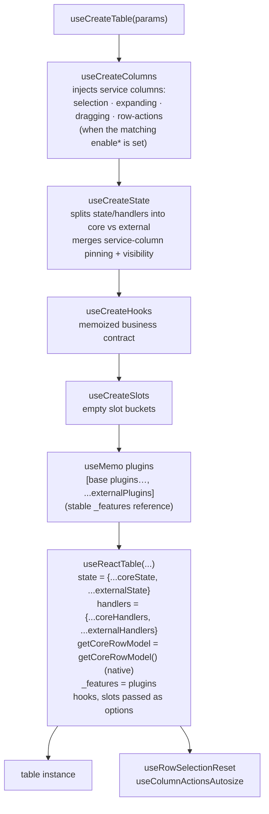
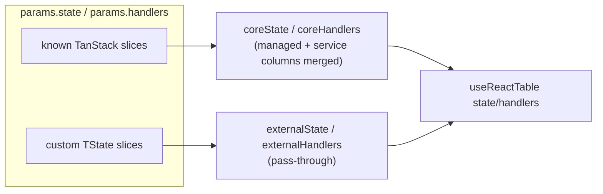

# Table assembly — `useCreateTable`

`useCreateTable<TData, THooks, TState, TOptions>` is the single entry point. It
turns consumer inputs into a configured TanStack instance. Source:
`src/lib/core/createTable/useCreateTable.ts`.

## Generics

| Generic    | Meaning                                                | Default |
| ---------- | ------------------------------------------------------ | ------- |
| `TData`    | row shape                                              | `any`   |
| `THooks`   | business-logic contract exposed via `table.getHooks()` | `any`   |
| `TState`   | custom state slices merged into `table.getState()`     | `any`   |
| `TOptions` | custom handlers/options merged into `table.options`    | `any`   |

A fifth generic, `TValue` (cell value), appears **last and optional** on
`TablePlugin`, `HeaderComponentProps`, and `CellComponentProps`.

## Pipeline

## Service columns (`useCreateColumns`)

Tessera injects non-data columns based on `enable*` flags: a checkbox column
(`enableRowSelection`), an expander column (`enableRowExpanding`), a drag-handle
column (`enableRowDragging`), and a right-pinned actions column
(`enableRowActions`). These have reserved ids and are recognized by the helpers
`checkIsActionColumn` / `column.getIsActionsColumn()`.

## State: the core / external split

`useCreateState` is the heart of Tessera's controlled-state story. It
partitions the consumer's `state` and `handlers`:

- **Core state** — the TanStack slices Tessera manages itself
  (`columnSizing`, `columnOrder`, `sorting`, `columnPinning`, `rowSelection`,
  `columnVisibility`, `expanded`, `grouping`) plus non-TanStack extras
  (`columnDraggingActiveId`, `rowDragging`). For each, an external value wins if
  supplied (`external ?? internal`), and service-column pinning/visibility are
  merged in.
- **External state** — anything else the consumer put in `state` (custom
  `TState` slices, e.g. `hiddenCells`) is spread straight through to
  `useReactTable`, so it lives in `table.getState()` alongside the built-ins.

> **Contributor note.** Because custom `TState` keys are spread into the same
> object as TanStack's built-in state, a future TanStack state key could collide
> with a consumer key. This is a known sharp edge (see the project's
> known-future-work notes).

## Hooks — the business contract

`hooks` is a typed object of business callbacks/values (e.g.
`rowSelection.onSelectRow`). It is attached as a table option and read via the
Tessera-added `table.getHooks()` (installed by `commonPlugin.createTable`).
Reading `getHooks()` does **not** subscribe to anything — hooks are meant to be
side-effect entry points, not render inputs. Dynamic values that must drive
rendering belong in `state` and are consumed via Pub-Sub
([reactivity.md](reactivity.md)).

## Plugins

The `_features` array is a memoized list of the built-in plugins followed by
`...externalPlugins`. Memoizing it keeps the `_features` reference stable across
renders (avoids re-running feature setup). **Stability now depends on the
consumer passing a stable `plugins` prop** — an inline array re-busts the memo.

Built-in order: `common`, `rowSelection`, `rowExpanding`, `columnPinning`,
`columnSizing`, `columnSorting`, `columnDragging`, `rowDragging`, `rowGrouping`,
then consumer plugins. `commonPlugin` must be first — it installs
`getHooks/getRenderSlots/setRenderSlot` that later plugins call.

See [plugins-and-slots.md](plugins-and-slots.md) for the lifecycle.
