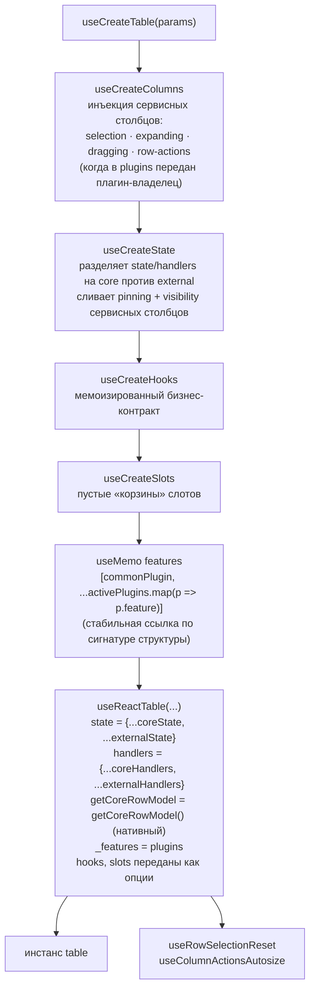
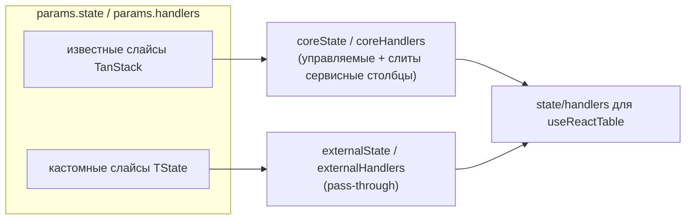

# Сборка таблицы — `useCreateTable`

`useCreateTable<TData, THooks, TState, TOptions, TPlugins>` — единственная точка
входа. Она превращает входы потребителя в сконфигурированный инстанс TanStack.
Источник: `src/lib/core/createTable/useCreateTable.ts`.

## Дженерики

| Дженерик    | Значение                                                     | По умолчанию          |
| ----------- | ------------------------------------------------------------ | --------------------- |
| `TData`     | форма строки                                                  | `any`                 |
| `THooks`    | **кастомные** хуки (контракты своих плагинов)                 | `any`                 |
| `TState`    | кастомные слайсы состояния, влитые в `table.getState()`       | `any`                 |
| `TOptions`  | кастомные handlers/опции, влитые в `table.options`            | `any`                 |
| `TPlugins`  | кортеж записей `plugins` (`const`), из него выводится тип хуков | `readonly PluginEntryInput[]` |

Хуки **встроенных** плагинов больше не входят в `THooks` (types-mode b, ADR 0010):
их тип выводится из `TPlugins` через `InferPluginHooks<TPlugins>` и подставляется в
параметр `hooks` (`Partial<InferPluginHooks<TPlugins>> & THooks`). `TPlugins`
выводится только в вызове **без явных generic-аргументов**; при явных дженериках
встроенные слайсы указывают через агрегат `BuiltinPluginsHooks` из
`@mstrvtt/tessera/plugins`. См. [ADR 0010](../decisions/0010-invert-core-plugins-registry.md).

Дженерик `TValue` (значение ячейки) стоит **последним и опциональным** в
`TablePlugin`, `HeaderComponentProps` и `CellComponentProps`.

## Пайплайн

## Сервисные столбцы (`useCreateColumns`)

Tessera инъектирует не-data столбцы на основе **наличия плагина** в `plugins`
(presence-based, ADR 0010): плагин приносит свою сервисную колонку записью
`ServiceColumn` (`rowSelection`, `rowExpanding`, `rowDragging`, `rowActions`).
`useCreateColumns` раскладывает их по `side`/`order`, ядро плагинов не импортит.
У колонок зарезервированные id, и они распознаются хелперами
`checkIsActionColumn` / `column.getIsActionsColumn()`.

## Состояние: разделение core / external

`useCreateState` — сердце истории Tessera про controlled-состояние. Он разбивает
`state` и `handlers` потребителя:

- **Core state** — слайсы TanStack, которыми Tessera управляет сама
  (`columnSizing`, `columnOrder`, `sorting`, `columnPinning`, `rowSelection`,
  `columnVisibility`, `expanded`, `grouping`) плюс не-TanStack-экстра
  (`columnDraggingActiveId`, `rowDragging`). Для каждого внешнее значение
  побеждает, если передано (`external ?? internal`), а pinning/visibility
  сервисных столбцов вливаются.
- **External state** — всё прочее, что потребитель положил в `state` (кастомные
  слайсы `TState`, например `hiddenCells`), пробрасывается напрямую в
  `useReactTable`, так что оно живёт в `table.getState()` рядом со встроенным.

> **Заметка для контрибьютора.** Поскольку кастомные ключи `TState`
> распространяются в тот же объект, что и встроенное состояние TanStack, будущий
> ключ состояния TanStack мог бы столкнуться с ключом потребителя. Это известный
> острый угол (см. заметки проекта о будущих работах).

## Hooks — бизнес-контракт

`hooks` — это типизированный объект бизнес-колбэков/значений (например,
`rowSelection.onSelectRow`). Он прикрепляется как опция таблицы и читается через
добавленный Tessera `table.getHooks()` (устанавливается `commonPlugin.createTable`).
Чтение `getHooks()` **ни на что не подписывается** — hooks задуманы как точки
входа для сайд-эффектов, а не как входы рендера. Динамические значения, которые
должны управлять рендерингом, принадлежат `state` и потребляются через Pub-Sub
([reactivity.md](reactivity.md)).

**Типизация (types-mode b, ADR 0010).** Ядро не агрегирует хуки: `PluginsHooks` в
`core/createHooks` пуст, импортов плагинов там нет. Тип хуков собирается
**per-instance** из набора `plugins` (`InferPluginHooks<TPlugins>`), а таблица
инстанцируется как `useReactTable<…, InferPluginHooks<TPlugins> & THooks, …>` —
поэтому `table.getHooks()` у потребителя несёт выведенные слайсы. Именованный
union всех встроенных слайсов вынесен во вход `/plugins` как `BuiltinPluginsHooks`
(для вызовов с явными дженериками). `useCreateHooks` — тонкий generic-merge с
always-on no-op дефолтами (значения-литералы в ядре, не импорт плагинов).

## Плагины

Массив `_features` собирается presence-based (ADR 0010): `commonPlugin` всегда
первым, затем фичи активных записей из `plugins` в порядке их следования
(`[commonPlugin, ...activePlugins.map(p => p.feature)]`). Никакого центрального
списка встроенных плагинов в ядре нет — набор определяет потребитель тем, что
импортировал и передал; отфильтровываются falsy-записи и `enabled: false`.

Мемоизация удерживает ссылку `_features` стабильной **по сигнатуре структуры**
(состав/порядок фич + id/side/order сервисных колонок), а не по идентичности
массива `plugins` — поэтому свежий inline-массив с тем же составом не пересобирает
таблицу (см. перф-ловушку в ADR 0010). `commonPlugin` обязан быть первым — он
устанавливает `getHooks/getRenderSlots/setRenderSlot`, которые вызывают более
поздние плагины.

Про жизненный цикл см. [plugins-and-slots.md](plugins-and-slots.md).
