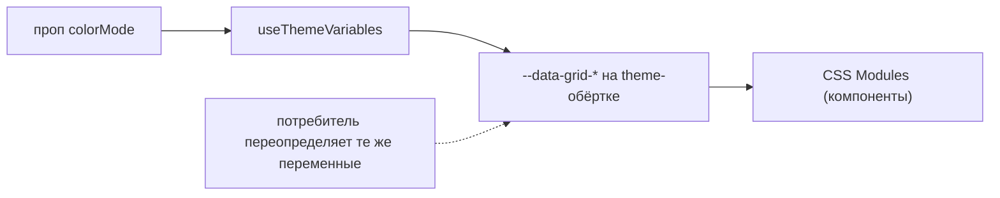

# Темизация и контракты переопределения

Три поверхности, через которые потребитель настраивает внешний вид грида, не
трогая его внутренности: **тема** (`colorMode` → CSS-переменные), **иконки** и
**подписи** (локализация). Все три — контракты переопределения: Tessera задаёт
дефолты и позволяет их перекрыть, ничего не хардкодя. Питаются из провайдеров в
стеке `<DataGrid/>` (см. [rendering.md](rendering.md)).

## Тема — CSS-переменные

Интерактивные контролы — это примитивы Base UI (фундамент shadcn),
стилизованные Tailwind + cva; layout грида и темизация используют CSS Modules,
читающие CSS custom properties (`--data-grid-*`).

- `useThemeVariables({ colorMode })` (`core/themeVariables`) производит полный
  набор токенов (фоны, тона закрепления, переходы, цвета контролов, скелетон,
  лоадер, акцент) для `'light' | 'dark'`. Значения — это внутренние дефолты;
  потребители переопределяют, задавая те же `--data-grid-*`-переменные на обёртке.
- Theme-обёртка также инъектирует layout-переменные
  (`--data-grid-head-height`, `--data-grid-body-height`).

## Иконки

Дефолтные inline-SVG живут в `ui/icons`; `IconsProvider` сливает проп потребителя
`icons` поверх `DEFAULT_ICONS`; кнопки-плагины читают их через `useIcons()`.

## Локализация

`LocalizationProvider` сливает проп потребителя `localization` поверх английских
`DEFAULT_LABELS`; контролы читают их через `useLocalization()`. Дефолтные подписи —
на английском (см. инвариант де-брендинга).
