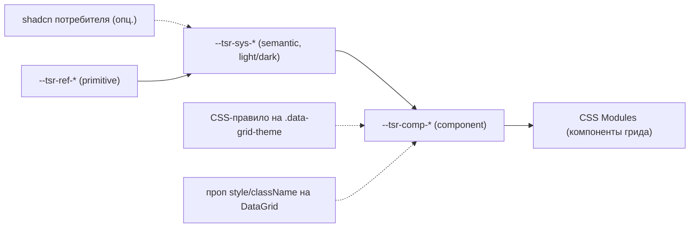

# Темизация и контракты переопределения

Три поверхности, через которые потребитель настраивает внешний вид грида, не
трогая его внутренности: **тема** (`colorMode` → CSS-переменные), **иконки** и
**подписи** (локализация). Все три — контракты переопределения: Tessera задаёт
дефолты и позволяет их перекрыть, ничего не хардкодя. Питаются из провайдеров в
стеке `<DataGrid/>` (см. [rendering.md](rendering.md)).

## Тема — CSS-переменные (трёхуровневая система токенов)

Интерактивные контролы — это примитивы Base UI (фундамент shadcn),
стилизованные Tailwind + cva; layout грида и темизация используют CSS Modules,
читающие CSS custom properties `--tsr-*`. Токены разложены на **три уровня**
(ADR [0019](../decisions/0019-token-architecture.md)); слой и шиппинг — ADR
[0018](../decisions/0018-external-theming.md).

| Уровень   | Префикс        | Что                                                        | Тема-зависим      |
| --------- | -------------- | ---------------------------------------------------------- | ----------------- |
| Primitive | `--tsr-ref-*`  | сырые шкалы (`neutral-50…950`, `blue-500`, `radius-md`)    | нет               |
| Semantic  | `--tsr-sys-*`  | роли (`fg`/`surface`/`accent`/`overlay-*`) + мост к shadcn | **да**            |
| Component | `--tsr-comp-*` | токены части грида (`head-bg`/`row-*`/`checkbox-*`)        | нет (из semantic) |

- **Ссылки строго вниз:** `comp → sys → ref`. Component упоминает только
  `--tsr-sys-*`; primitive и shadcn там не встречаются.
- **Мост к shadcn — только в Semantic:** `--tsr-sys-x: var(--<shadcn>, <ref>)`.
  Если потребитель задал апстрим-палитру (`--foreground`/`--card`/…), она
  наследуется в обёртку и побеждает; иначе берётся primitive-дефолт. Дженерик-имена
  в глобальный скоуп НЕ выносятся — грид не мешает чужому UI-фреймворку.
- **Тема-зависимость — только в Semantic:** light/dark переключают, какой primitive
  играет роль. Дефолты — на `.data-grid-theme` через `:where()`; dark —
  `.data-grid-theme.dark` или `.dark .data-grid-theme`, кроме обёртки с
  `data-tsr-color-mode="light"` и её потомков. Обёртка несёт стабильный
  `DATA_GRID_THEME_CLASS = 'data-grid-theme'`.
- **Шиппинг:** `theme.css` — ГЛОБАЛЬНЫЙ (не-модульный) CSS side-effect, импортится
  из `DataGrid.tsx`. Через `@import` в `.module.css` его нельзя — CSS Modules
  захешировали бы классы `data-grid-theme`/`dark` (инвариант сборки:
  `grep -c '_data-grid-theme_' dist/style.css` = 0).
- **Три публичные поверхности переопределения** (все без `!important`, бьют
  `:where(...)` нулевой специфичности): broad — shadcn (`--foreground`…);
  mid — `--tsr-sys-*`; narrow — `--tsr-comp-*`. Ось режима — `.dark`; ось
  инстанса — проп `style`/`className` на `<DataGrid/>`. Primitive НЕ является
  поверхностью переопределения.
- Цвет текста грид задаёт сам на обёртке (`--tsr-comp-fg`, ADR 0018, TH10) и не
  наследует его от страницы: без этого в тёмной теме на странице без shadcn текст
  оставался тёмным на тёмном фоне.
- Фон грид тоже красит сам (`--tsr-comp-bg` = `--tsr-sys-bg`, TH11): под строками до
  страницы — фон грида, а не страница. Прозрачный грид на своём фоне —
  `--tsr-comp-bg: transparent`, но тогда фон страницы должен быть в тон темы. Наведение и
  выбор строки — слой поверх фона самой строки (см. «Состояния строки»).
- Инлайн на обёртке остаются только РАНТАЙМ-переменные
  (`--tsr-comp-head-height`, `--tsr-comp-body-height`, drag-офсеты) и токены высоты,
  когда их задали пропы `rowHeight`/`headerHeight`.
- **Высота строк и шапки** ([ADR 0077](../decisions/0077-row-height-and-default-column-width.md)):
  `--tsr-comp-row-height` (50px) и `--tsr-comp-head-row-height` (по умолчанию — как
  строки). Шапка переопределяет у себя `--tsr-comp-row-height` значением высоты шапки.
  Тема может задать оба токена в CSS — грид прочтёт их для виртуализации.
- **Рамка и тулбар** (ADR 0035): рамка грида — `--tsr-comp-frame-border-color` /
  `-border-width` / `-radius` (ширина `0` убирает рамку); тулбар —
  `--tsr-comp-toolbar-height` / `-padding-x` / `-gap` / `-bg` / `-divider-color`,
  высота контролов панелей — `--tsr-comp-toolbar-button-size` (размер кнопок кита).
  `--tsr-comp-toolbar-offset` выставляет сам грид при `enableToolbar` — его не
  переопределяют.
- **Кнопки кита** (ADR [0098](../decisions/0098-button-system.md)): `Button` и
  `IconButton` делят `--tsr-comp-button-size` (32px; `-size-compact` — 24px для ручек
  перетаскивания, ADR [0114](../decisions/0114-async-column-moves.md)), `-icon-size` (16px), формы
  `-radius-circle` (50%) и `-radius-square` (`--tsr-comp-control-radius`) и цвет
  покоя `-color`; у `Button` ещё `-padding-x` / `-gap` / `-border` (ADR
  [0097](../decisions/0097-text-button.md)). Все кнопки грида и плагинов собраны из
  этих двух баз — тема меняет их разом.
- **Нижняя панель** (ADR 0038): `--tsr-comp-status-bar-height` / `-padding-x` /
  `-gap` / `-bg` / `-divider-color`. `--tsr-comp-status-bar-offset` выставляет сам
  грид, когда есть `statusBarSlot`, — его не переопределяют.
- **Ожидание и отказ кнопок** (ADR [0055](../decisions/0055-button-pending-and-error-flash.md),
  [0127](../decisions/0127-initiator-pending-and-failure.md)): по контуру кнопки лежит
  бледная дорожка (оттенок дуги силой `--tsr-comp-pending-track-strength`) и бежит дуга с
  хвостом толщиной `--tsr-comp-pending-ring-width` и длиной `--tsr-comp-pending-arc`
  процентов периметра; круг — 0,5 `--tsr-comp-pending-glow-duration`, цвет перетекает
  `--tsr-comp-pending-spinner-1…4`. Отказ (`failure`, ADR
  [0136](../decisions/0136-outcome-on-target-not-button.md)) — дуга встаёт и вместе с
  дорожкой гаснет за `--tsr-comp-pending-stop-duration`, контур не краснеет; точка
  отказа появляется сразу на месте бабла (`--tsr-comp-indicator-inset`), в высокой
  контрастности — `Mark`. Токены `--tsr-comp-error-flash-*` — только у красного света
  под шапкой (`LinearProgress`). Дуга — SVG-слой
  `PendingArc` последним ребёнком кнопки (дорожка — первый `rect`, хвост — `g` из восьми
  отрезков), радиус — из её `border-radius`; `--tsr-ring-border` — рамка кнопки, от
  которой отсчитан внешний край. У спиннера пункта меню — та же дорожка и дуга
  `--tsr-comp-pending-spinner-arc` с хвостом. Пока грид прокручивается (`data-scrolling`), дуга стоит
  (ADR [0078](../decisions/0078-async-menu-actions.md), MI25).
- **Подсветка** (ADR [0080](../decisions/0080-highlight-api.md)): заливка тона —
  `--tsr-comp-highlight-<tone>-bg` для `danger`/`warning`/`success` (роли
  `--tsr-sys-danger`, новые `--tsr-sys-warning` и `--tsr-sys-success` с мостом к
  `--warning`/`--success` потребителя); появление и затухание —
  `--tsr-comp-highlight-fade-duration`. Заливка статична, без бегущих слоёв (ADR [0101](../decisions/0101-static-highlight.md)).
  Свой тон — токен `--tsr-comp-highlight-<имя>-bg` в теме
  приложения; синий и нейтральный не берите — их занимают выделение ячеек, приход и
  состояния строк. Заливка — слой `background-image` под текстом и индикаторами:
  строка рисует его своим фоном, ячейки с непрозрачной подложкой закрепления повторяют
  его по `--tsr-highlight-row`; слои — зарегистрированные цветовые свойства, поэтому
  снятие гаснет переходом. Блик всех элементов цели идёт в одной фазе (`startTime` с момента постановки); пока грид прокручивается (`data-scrolling`), полосы нет.
- **Вспышка итога** (ADR [0134](../decisions/0134-outcome-flash.md)): тоны
  `--tsr-comp-flash-arrived-bg` (синий, как приход), `--tsr-comp-flash-accepted-bg` (по
  умолчанию `--tsr-comp-highlight-success-bg`), `--tsr-comp-flash-reverted-bg` (по
  умолчанию `--tsr-comp-highlight-danger-bg`); удержание и угасание любого итога —
  `--tsr-comp-flash-duration` и `--tsr-comp-flash-fade-duration`. Слои `--tsr-flash-row`/`-cell`/`-column` лежат над
  слоями подсветки той же цели; атрибуты — `data-flash` у строки и ячейки,
  `data-column-flash` у ячеек колонки, заголовка и футера, `-out` — пока гаснет. Время
  перехода слоя — `--tsr-flash-time`/`--tsr-column-flash-time`: появление сразу, уход — угасанием. В
  `forced-colors` рисуется только `reverted` — `Mark`.
- **Общая волна скелетов** (ADR [0121](../decisions/0121-shared-skeleton-wave.md)):
  проход рамки `--tsr-comp-skeleton-frame-wave-duration` (из базовой длительности),
  пауза до первого прохода `--tsr-comp-skeleton-wave-delay`, ширина полосы
  `--tsr-comp-skeleton-wave-width`, наклон `--tsr-comp-skeleton-wave-tilt` (сдвиг на
  пиксель высоты), цвет пика `--tsr-comp-skeleton-frame-wave`. Скелет вне рамки грида —
  прежняя волна своей полоски: `--tsr-comp-skeleton-wave-duration` и
  `--tsr-comp-skeleton-wave`.
- **Лента** (ADR [0081](../decisions/0081-infinite-scroll.md)): блок ошибки догрузки в
  конце списка — высота `--tsr-comp-load-more-height`, иконка
  `--tsr-comp-load-more-icon-color` (из `--tsr-sys-danger`), заголовок
  `--tsr-comp-load-more-title-color`, причина `--tsr-comp-load-more-reason-color`
  (приглушённый текст); иконки — `icons.loadMoreFailed` и `icons.retry`; хвост
  ожидания — те же статичные полоски `--tsr-comp-skeleton-bg`, что у скелет-ячеек
  быстрой прокрутки.
- **Отказ действия меню** (ADR [0078](../decisions/0078-async-menu-actions.md)):
  `--tsr-comp-action-error-color` — иконка `actionFailed` упавшего пункта и
  отметка ошибки на кебабе (тон `error` у `Bubble`).
- **Шаг отступа вложенности** (ADR [0059](../decisions/0059-row-nesting-indent.md)):
  `--tsr-comp-row-nesting-indent` (16px) — отступ первой колонки, шаг линий дерева и
  шаг перетаскивания строки по уровням (JS читает его из темы грида).
- **Грип ширины и кнопки заголовка** (ADR
  [0111](../decisions/0111-resize-grip-on-column-border.md)):
  `--tsr-comp-resize-handler-width` (24px) — зона грипа на границе колонок, по половине в
  каждую; `--tsr-comp-head-title-min-width` (72px, ADR 0135) — наименьшая подпись заголовка: кнопки,
  которым не хватает места, уходят в кебаб.
- **Будущий родитель при перетаскивании строки** (ADR
  [0109](../decisions/0109-drop-into-collapsed-groups.md)):
  `--tsr-comp-row-drop-parent-bg` (10 % `--tsr-sys-accent`) — заливка строки слоем
  подсветки строки; в высокой контрастности — контур `Highlight`.
- **Недопустимое место броска строки** (ADR
  [0137](../decisions/0137-invalid-drop-on-row-cloud.md)):
  `--tsr-comp-row-drop-invalid-overlay-bg` (15 % `--tsr-sys-danger` в фон облака) —
  заливка облака строки; в высокой контрастности — `Mark` с текстом `MarkText`.
- **Линии дерева** (ADR [0058](../decisions/0058-tree-lines.md),
  [0102](../decisions/0102-curved-tree-lines.md)): ветки со скруглёнными поворотами —
  декоративные элементы-рамки в ячейке отступа с `data-tree-depth`.
  `--tsr-comp-tree-line-color` (12 % цвета текста, рычаг `--tsr-sys-tint-guide`; в
  повышенном контрасте 55 %), `--tsr-comp-tree-line-width` (1.5px),
  `--tsr-comp-tree-line-radius` (9px), `--tsr-comp-tree-line-inset` (вертикаль под
  началом текста), `--tsr-comp-tree-line-gap` (12px — зазор от поворота до текста) и
  `--tsr-comp-tree-line-indent` (10px + зазор, 22px) — шаг отступа, пока корень
  несёт `data-tree-lines`. Рамки, а не прямоугольник, тень или стоп градиента: те в 1px
  при дробном масштабе схлопываются в ноль (ADR 0084).
- **Обновление данных** (ADR [0094](../decisions/0094-loading-glow.md)): свечение под
  шапкой — оттенки `--tsr-comp-loader-glow-1…4` (по умолчанию синий `--tsr-comp-loader-bar`,
  `--tsr-sys-info-sky`, `-indigo`, `-violet` с силой `--tsr-comp-loader-glow-opacity` —
  80 % `--tsr-sys-glow-strength`, у тёмной темы она 100 %), глубина `--tsr-comp-loader-glow-size`,
  проход цветов `--tsr-comp-loader-duration`, рост и убывание по высоте
  `--tsr-comp-loader-grow-duration` и `--tsr-comp-loader-shrink-duration`, пульсация при уменьшенном движении
  `--tsr-comp-loader-pulse-duration`; линия высокой контрастности —
  `--tsr-comp-loader-height`; приглушение тела и футера — `--tsr-comp-loader-dim-opacity`.
- **Ошибка загрузки данных** (ADR [0096](../decisions/0096-load-error.md)): красный свет
  под шапкой — `--tsr-comp-load-error-glow` (цвет ошибки с силой свечения, в высокой
  контрастности — линия `Mark`), плашка —
  `--tsr-comp-load-error-banner-bg` / `-shadow` / `-radius` / `-max-width` (по умолчанию
  поверхность поповера, 36rem); подписи — `loadErrorTitle`, `loadFailedTitle`, `loadRetry`,
  `loadErrorDismiss`, `announceLoadError`, `announceLoadFailed`; иконка плашки —
  `icons.loadFailed`, у заглушки — общая иллюстрация `icons.emptyState` (ADR 0123).
- **Индикатор включённого действия** (ADR [0062](../decisions/0062-active-action-indicator.md)):
  точка на кнопке заголовка и кебабе, номер приоритета сортировки, счётчики тулбара —
  `--tsr-comp-active-indicator` (по умолчанию `--tsr-comp-loader-bar`), цифры —
  `--tsr-comp-active-indicator-fg` (`--tsr-sys-surface`: белые цифры на синем тёмной
  темы не держат 4.5:1). `Bubble` с `tone="active"`; тон по умолчанию — акцент
  (счётчик перетаскиваемых строк).
- **Пришедшие строки** (ADR [0056](../decisions/0056-lazy-children-arrival-highlight.md)):
  новые дети асинхронного ответа и брошенная строка вспыхивают итогом `arrived` — токены
  вспышки итога выше.
- **Асинхронная правка ячейки** (ADR [0057](../decisions/0057-async-cell-edit-feedback.md),
  [0127](../decisions/0127-initiator-pending-and-failure.md)): ожидание и отказ сохранения
  показывает кнопка правки — дуга, красное заполнение и отметка; ячейка показывает только
  значение. Итог сохранения на ячейке — вспышка `accepted` или `reverted` (ADR 0134).
  Токена приглушения ожидания больше нет. Текст
  причины отказа и ошибки проверки у поля правки — `--tsr-comp-error-text-color`
  (тон ошибки с текстом: 4.5:1, в повышенном контрасте 7:1).
- **Длинный текст** (ADR [0083](../decisions/0083-text-overflow.md)): меню действий и
  панель экспорта не шире `--tsr-comp-popup-max-width` (320px), подпись пункта
  переносится. Где высота задана — `…` и тултип только у обрезанного текста
  (`Tooltip` с `overflowOnly`); где свободна — перенос; числа не обрезаются.
- **Ширина поповеров** (ADR [0133](../decisions/0133-hide-all-columns.md), HA11): у
  поповеров один предел — `--tsr-comp-popup-max-width` (320px). Меню действий и панель
  экспорта — по содержимому до предела (от 180px и 240px), панели со списком — «Колонки»,
  сводка «Фильтры», варианты фильтра — ровно по пределу: `--tsr-comp-column-menu-width`
  по умолчанию равен ему.
- **Дерево меню колонок** (ADR [0133](../decisions/0133-hide-all-columns.md), HA12):
  галочки соединены линиями дерева таблицы — тот же `TreeLines` и токены
  `--tsr-comp-tree-line-*`: поворот той же длины, то же скругление и тот же зазор до
  содержимого, что у дерева строк. Вертикаль уровня — под центром галочки родителя, шаг
  длиннее шага строк на полгалочки. Шаг, отступ и длину поворота дерева вне таблицы задают
  локальные `--tsr-tree-indent`, `--tsr-tree-inset` и `--tsr-tree-elbow-width`.



### Состояния строки и закреплённые ячейки

`background-color` строки — всегда её фон (`--tsr-comp-row-bg` или `-row-odd-bg`).
Наведение и выбор — слой `--tsr-row-state` (зарегистрированный цвет, наследуется, идёт
переходом движения) со значением `--tsr-comp-row-hovered-bg`, `-selected-bg` или
`-selected-hovered-bg`; строка рисует его `background-image` под слоем подсветки.
Закреплённая ячейка с непрозрачной подложкой (`--tsr-comp-cell-pinned-left-bg`,
`-right-bg`, нечётные — `-odd-pinned-*`) несёт стопку слоёв поверх своего фона: тинт
диапазона, подсветка ячейки, колонки, строки и состояние строки. Обычная и закреплённая
ячейки получают один и тот же слой — состояние сдвигает их одинаково, ступень закрепления
(CP28) не растёт ([ADR 0126](../decisions/0126-cell-fill-precedence.md)).

Первенство заливок: ячейка главнее строки (диапазон, подсветка ячейки и колонки),
подсветка строки главнее выбора, выбор главнее нечётности; наведение в `forced-colors`
заливку не меняет. Новое состояние строки или ячейки — слой, а не замена
`background-color`; правило, красящее закреплённую ячейку своим фоном по состоянию
строки, не пишется. Проверка — инвариант по произведению состояний, видов ячеек и режимов
(`visual/cell-fill-precedence`, FP1–FP3); состояние строки в тестах читает помощник
`rowState`.

### Высокая контрастность

В контрастных темах Windows (`@media (forced-colors: active)`) браузер заменяет цвета
палитрой пользователя и снимает фоны, кроме заданных системным цветом. Блок в
`theme.css` переопределяет токены состояний системными цветами: выбор и выделение —
`Highlight`, подсветка — `Mark`, линии дерева и скелет — `GrayText`, свет ожидания —
`Highlight`, ошибка — `Mark`. Цвет текста на заливке, выделение ячеек и подсветка на градиентах —
правила режима в модулях; свет ожидания (`::after` и спиннер) не перекрашивается
(`forced-color-adjust: none`). Системные цвета вне медиа-запроса запрещены (HC11,
ADR [0087](../decisions/0087-forced-colors.md)). Переопределённый приложением токен
состояния с обычным цветом браузер в режиме заменит на `Canvas`.

Градиенты браузер в режиме снимает, поэтому слои состояния и подсветки не рисуются:
заливку дают правила режима — `background-color` системным цветом (выбранная строка
`Highlight`, подсвеченная `Mark`, диапазон `Highlight`, подсветка ячейки и колонки
`Mark`). Такое правило задаёт тем же цветом и четыре токена фона закреплённой ячейки
(`--tsr-comp-cell-pinned-left-bg`, `-right-bg`, `-odd-pinned-left-bg`,
`-odd-pinned-right-bg`): первенство тогда задаёт уровень элемента, а не специфичность
(ADR 0126, FP4 — страж `cellFillTokens`). Под текстом элемента с фоновой картинкой Chromium
кладёт подложку `Canvas` — текст на заливках стоит с `forced-color-adjust: none` (HC14).

### Повышенный контраст

Тона, которые грид смешивает сам, выводятся из пяти рычагов — долей цвета текста:
`--tsr-sys-tint-hover` (наведение), `-selected` (выбор), `-pinned` (подложка
закреплённых), `-line` (линии дерева; в режиме — разделители и контуры через
`--tsr-sys-line`), `-fill` (скелет, выключенный `Switch`, ползунок прокрутки). По
`prefers-contrast: more` или `contrast="more"` надстройка в `theme.css` поднимает рычаги,
запасную рамку, приглушённые тексты грида и включает контуры там, где заливка за
текстом не даёт 3:1 ([ADR 0088](../decisions/0088-increased-contrast.md)). Роли из
палитры shadcn приложения надстройка не трогает. `contrast="standard"` её выключает,
атрибут `data-tsr-contrast` на предке (например, `<html>`) переключает все гриды.

Рецепт приложения — свои рычаги и своя палитра в том же режиме:

```css
@media (prefers-contrast: more) {
  :root {
    --border: #737373; /* палитра shadcn приложения */
  }
  .my-grid.data-grid-theme {
    --tsr-sys-tint-hover: 10%;
    --tsr-sys-tint-selected: 14%;
  }
}
```

Правило приложения перебивает надстройку без `!important`. Рычаг, переопределённый вне
медиа-запроса, перебивает её и в режиме — своё усиление приложение пишет отдельным
блоком.

### Источник темы и её смена

`colorMode` ([ADR 0090](../decisions/0090-theme-source-and-switching.md)):

- `'auto'` (по умолчанию) — класса нет, грид следует `.dark` у предка;
- `'dark'` — класс `.dark` на обёртке; правило `.dark {…}` палитры приложения
  совпадает и с ней, поэтому мост к shadcn даёт тёмные значения;
- `'light'` — атрибут `data-tsr-color-mode="light"`: тёмный блок темы его исключает.
  Под тёмным предком палитра приложения унаследована тёмной, светлой там нет — роли
  берут запасные значения грида (мост отключён).

Роль `--tsr-sys-scheme` (`light` | `dark`) задаёт `color-scheme` обёртки и порталов:
нативные полосы прокрутки и поля следуют теме грида.

Смена темы перекрашивает грид в одном кадре. Переходы фона и цвета нужны для наведения
и выбора, но сработали бы и при смене темы — строки медленно темнели бы под уже светлым
текстом. Поэтому `ThemeScope` (`ui/theme/themeSource.tsx`) узнаёт о смене до
кадра — проп в эффекте раскладки, `.dark` и `data-tsr-contrast` у предков через
`MutationObserver` — и на кадр ставит на `<html>` атрибут `data-tsr-theme-switching`:
правило темы выключает с ним переходы грида и порталов. Ещё раз атрибут ставит
коммит, сменивший фактическую тему порталов: светлую тему портал получает только снятием
класса `dark`, а этот коммит под нагрузкой приходит позже кадров гашения наблюдателя
(TM13). Новый переход с цветом отдельной защиты не требует.

В разработке грид сверяет яркость вычисленных `--tsr-sys-bg` и `--tsr-sys-fg` со своей
темой и один раз предупреждает о смеси: например, палитра приложения объявлена только на
`html.dark`, а грид тёмный пропом.

### Порталы и тёмная тема

Меню, поповеры и тултипы рендерятся в портал вне корня грида, поэтому не наследуют его
класс `dark`. Грид передаёт класс фактической темы через контекст
(`usePortalThemeClass`, [ADR 0017](../decisions/0017-ui-components.md), PP5) — проп или
`.dark` у предка, в том числе на контейнере, а не на `<html>`. Атрибуты контраста и
светлой темы (`data-tsr-contrast`, `data-tsr-color-mode`) позиционер получает из
`usePortalThemeData` (ADR 0088, ADR 0090); новый всплывающий компонент обязан брать оба
оттуда, а не ставить `data-grid-theme` сам.
Пользовательский `className` и инлайн-`style` грида в порталы не попадают:
переопределения токенов для поповеров объявляются на `.data-grid-theme`.

### Ловушка: `composes` и dev-сервер

Поверхность поповеров и пункт списка подключаются из
[`ui/Popup/Popup.module.css`](../../src/lib/ui/Popup/Popup.module.css) через
`composes … from`. Vite в dev-режиме (Storybook, `npm run dev`) не отслеживает эту
зависимость: модули, которые подключают общий файл (`ActionMenu`, меню колонок, панель
экспорта, пагинация), держат его старую копию, и правка `Popup.module.css` не видна даже
после перезагрузки страницы. Сборка `dist` и тесты собирают всё заново и этой ловушке не
подвержены. После правки общего файла перезапустите dev-сервер или обновите время
изменения подключающих модулей (`touch`). Второе следствие `composes`: порядок правил в
бандле не гарантирован, поэтому локальный модуль не должен переопределять свойства,
которые задаёт общий. Свойство, которое наследникам нужно менять, базовый класс берёт из
приватной переменной со значением по умолчанию — так пункт поповера открывает
`--_item-align`, `--_item-padding-block` и `--_item-cursor`. Модульный страж `cssComposes`
(PP10, ADR 0017) роняет любое переобъявление с учётом сокращённых записей (`font` задаёт
и `line-height`, `padding` — `padding-block`).

### Ловушка: `:has()` строки и свет ожидания

Свет ожидания ([ADR 0095](../decisions/0095-pending-and-error-light.md)) — четыре
CSS-анимации зарегистрированных свойств на `::after` кнопки. Пересчёт стиля такой кнопки
дорог даже на паузе, а смена `animation-play-state` дороже вдвое: при прокрутке это
главная доплата за кнопки в ожидании (MI23). Поэтому:

- правило, зависящее от `:has()` строки или ячейки, не заканчивается тегом (`… > button`):
  вставка ячейки в строку при горизонтальной прокрутке инвалидирует `:has()` и вместе с
  ним — все элементы строки под правым селектором. Токены вида кнопок строки поэтому
  стоят на обёртке `.row__button--hidden`, кнопка их наследует;
- кнопка не трогает свой стиль на каждом рендере: фаза света (`--tsr-pending-phase`)
  ставится один раз на узел (LL6);
- цвет пятна вне вспышки ошибки — один `color-mix()`: вложенные смеси разбираются при
  каждом пересчёте.

## Иконки

Дефолтные inline-SVG живут в `ui/icons`; `IconsProvider` сливает проп потребителя
`icons` поверх `DEFAULT_ICONS`; кнопки-плагины читают их через `useIcons()`.

## Локализация

`DataGrid` разрешает словарь потребителя `localization` поверх английского словаря-шаблона
`DEFAULT_LABELS` (`core/localization/labels.ts`; готовые английские подписи — `ENGLISH_LABELS`)
(`resolveLabels`, [ADR 0132](../decisions/0132-key-value-localization.md)): значение —
строка-шаблон с `{имя}` или функция, формы слова — ключами `<ключ>_<форма>` по
`Intl.PluralRules`, числа и списки — по пропу `locale`. Шаблон становится функцией с
позиционными параметрами, поэтому контролы читают подписи через `useLocalization()`, как
раньше; объявления — через `announcerLabels(table)`. Дефолтные подписи —
на английском (см. инвариант де-брендинга). У счётчиков нижней панели две формы:
полная и короткая (`*Short`) для компактного вида
([ADR 0083](../decisions/0083-text-overflow.md), TX6).
