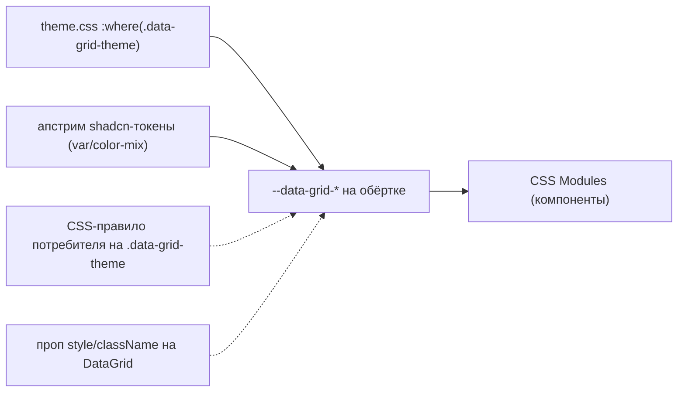

# Темизация и контракты переопределения

Три поверхности, через которые потребитель настраивает внешний вид грида, не
трогая его внутренности: **тема** (`colorMode` → CSS-переменные), **иконки** и
**подписи** (локализация). Все три — контракты переопределения: Tessera задаёт
дефолты и позволяет их перекрыть, ничего не хардкодя. Питаются из провайдеров в
стеке `<DataGrid/>` (см. [rendering.md](rendering.md)).

## Тема — CSS-переменные

Интерактивные контролы — это примитивы Base UI (фундамент shadcn),
стилизованные Tailwind + cva; layout грида и темизация используют CSS Modules,
читающие CSS custom properties (`--data-grid-*`). См.
[ADR 0018](../decisions/0018-external-theming.md).

- **Дефолты токенов** объявлены в
  [`theme.css`](../../src/lib/core/themeVariables/theme.css) на классе
  `.data-grid-theme` через `:where()` (нулевая специфичность). Обёртка грида
  несёт стабильный класс `DATA_GRID_THEME_CLASS = 'data-grid-theme'`. Значения —
  тонкая производная от апстрим-токенов shadcn (`--primary`/`--foreground`/
  `--info`…) через `var()`/`color-mix()`, с «Vercel»-фолбэками, поэтому грид не
  ломается без global.css. Тёмный режим — класс `.dark` на обёртке
  переопределяет апстрим-токены.
- **Два рычага переопределения** (оба без `!important`):
  - глобально/по селектору — обычным CSS: `.data-grid-theme { --data-grid-*: … }`
    бьёт слой `:where(...)`;
  - пер-инстансно — пропы `style`/`className` на `<DataGrid/>` кладутся на
    обёртку (`style={{ '--data-grid-loader-bar': '#f00' }}`), инлайн бьёт дефолт
    слоя.
- Правка апстрим-палитры согласованно меняет ВСЕ производные `--data-grid-*`.
- Инлайн на обёртке остаются только РАНТАЙМ-переменные
  (`--data-grid-head-height`, `--data-grid-body-height`, drag-офсеты).

## Иконки

Дефолтные inline-SVG живут в `ui/icons`; `IconsProvider` сливает проп потребителя
`icons` поверх `DEFAULT_ICONS`; кнопки-плагины читают их через `useIcons()`.

## Локализация

`LocalizationProvider` сливает проп потребителя `localization` поверх английских
`DEFAULT_LABELS`; контролы читают их через `useLocalization()`. Дефолтные подписи —
на английском (см. инвариант де-брендинга).
