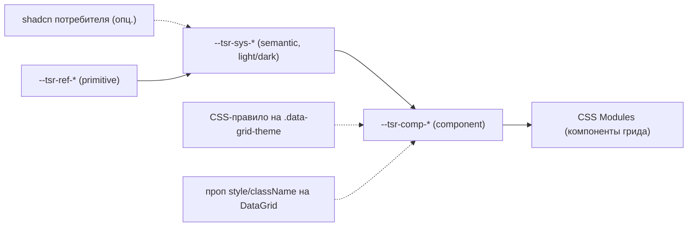

# Темизация и контракты переопределения

Три поверхности, через которые потребитель настраивает внешний вид грида, не
трогая его внутренности: **тема** (`colorMode` → CSS-переменные), **иконки** и
**подписи** (локализация). Все три — контракты переопределения: Tessera задаёт
дефолты и позволяет их перекрыть, ничего не хардкодя. Питаются из провайдеров в
стеке `<DataGrid/>` (см. [rendering.md](rendering.md)).

## Тема — CSS-переменные (трёхуровневая система токенов)

Интерактивные контролы — это примитивы Base UI (фундамент shadcn),
стилизованные Tailwind + cva; layout грида и темизация используют CSS Modules,
читающие CSS custom properties `--tsr-*`. Токены разложены на **три уровня**
(ADR [0019](../decisions/0019-token-architecture.md)); слой и шиппинг — ADR
[0018](../decisions/0018-external-theming.md).

| Уровень   | Префикс        | Что                                                        | Тема-зависим      |
| --------- | -------------- | ---------------------------------------------------------- | ----------------- |
| Primitive | `--tsr-ref-*`  | сырые шкалы (`neutral-50…950`, `blue-500`, `radius-md`)    | нет               |
| Semantic  | `--tsr-sys-*`  | роли (`fg`/`surface`/`accent`/`overlay-*`) + мост к shadcn | **да**            |
| Component | `--tsr-comp-*` | токены части грида (`head-bg`/`row-*`/`checkbox-*`)        | нет (из semantic) |

- **Ссылки строго вниз:** `comp → sys → ref`. Component упоминает только
  `--tsr-sys-*`; primitive и shadcn там не встречаются.
- **Мост к shadcn — только в Semantic:** `--tsr-sys-x: var(--<shadcn>, <ref>)`.
  Если потребитель задал апстрим-палитру (`--foreground`/`--card`/…), она
  наследуется в обёртку и побеждает; иначе берётся primitive-дефолт. Дженерик-имена
  в глобальный скоуп НЕ выносятся — грид не мешает чужому UI-фреймворку.
- **Тема-зависимость — только в Semantic:** light/dark переключают, какой primitive
  играет роль. Дефолты — на `.data-grid-theme` через `:where()`; dark —
  `:where(.data-grid-theme.dark), :where(.dark .data-grid-theme)`. Обёртка несёт
  стабильный `DATA_GRID_THEME_CLASS = 'data-grid-theme'`.
- **Шиппинг:** `theme.css` — ГЛОБАЛЬНЫЙ (не-модульный) CSS side-effect, импортится
  из `DataGrid.tsx`. Через `@import` в `.module.css` его нельзя — CSS Modules
  захешировали бы классы `data-grid-theme`/`dark` (инвариант сборки:
  `grep -c '_data-grid-theme_' dist/style.css` = 0).
- **Три публичные поверхности переопределения** (все без `!important`, бьют
  `:where(...)` нулевой специфичности): broad — shadcn (`--foreground`…);
  mid — `--tsr-sys-*`; narrow — `--tsr-comp-*`. Ось режима — `.dark`; ось
  инстанса — проп `style`/`className` на `<DataGrid/>`. Primitive НЕ является
  поверхностью переопределения.
- Инлайн на обёртке остаются только РАНТАЙМ-переменные
  (`--tsr-comp-head-height`, `--tsr-comp-body-height`, drag-офсеты).
- **Рамка и тулбар** (ADR 0035): рамка грида — `--tsr-comp-frame-border-color` /
  `-border-width` / `-radius` (ширина `0` убирает рамку); тулбар —
  `--tsr-comp-toolbar-height` / `-padding-x` / `-gap` / `-bg` / `-divider-color`,
  кнопки F4 — `--tsr-comp-toolbar-button-size` / `-button-radius`.
  `--tsr-comp-toolbar-offset` выставляет сам грид при `enableToolbar` — его не
  переопределяют.
- **Нижняя панель** (ADR 0038): `--tsr-comp-status-bar-height` / `-padding-x` /
  `-gap` / `-bg` / `-divider-color`. `--tsr-comp-status-bar-offset` выставляет сам
  грид, когда есть `statusBarSlot`, — его не переопределяют.

## Иконки

Дефолтные inline-SVG живут в `ui/icons`; `IconsProvider` сливает проп потребителя
`icons` поверх `DEFAULT_ICONS`; кнопки-плагины читают их через `useIcons()`.

## Локализация

`LocalizationProvider` сливает проп потребителя `localization` поверх английских
`DEFAULT_LABELS`; контролы читают их через `useLocalization()`. Дефолтные подписи —
на английском (см. инвариант де-брендинга).
