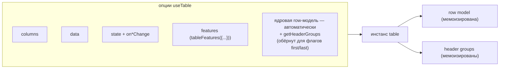
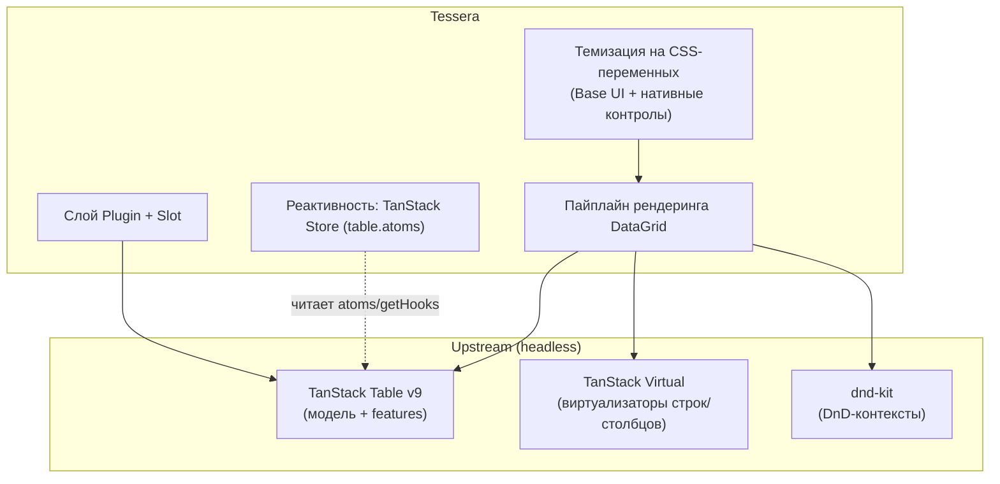

# Upstream-основания

Tessera компонует три headless-библиотеки. Эта страница своими словами резюмирует
те части каждой из них, что важны для Tessera, и помечает точные точки расширения,
в которые Tessera врезается. За авторитетными деталями API обращайтесь к
документации каждой библиотеки.

## TanStack Table v9

TanStack Table — это **headless** ядро таблицы: оно вычисляет модели (строки,
столбцы, заголовки, футеры) из `columns` + `data` + `state` и выдаёт инстанс с
методами — само по себе оно ничего не рендерит.

Концепции, на которые опирается Tessera:

- **Instance** — создаётся через `useTable(options)`; стабильный объект, чьи методы
  (`getHeaderGroups`, `getRowModel`, …) читаются во время рендера. Состояние живёт в
  **TanStack Store**: `table.state` (снимок), `table.store` и слайс-атомы
  `table.atoms.<slice>` (см. [reactivity.md](reactivity.md)).
- **Модели мемоизированы.** Каждая модель (core row model, sorted, grouped,
  expanded, header groups) — мемоизированная функция от конкретных входов; пересчёт
  только при смене их идентичности. В v9 состояние разложено по атомам, поэтому смена
  одного среза не инвалидирует все модели — это и был мотив миграции с v8 (см.
  [reactivity.md](reactivity.md)).
- **Состояние controlled/uncontrolled по слайсам.** Вы можете передать `state.X` +
  `onXChange`, чтобы контролировать слайс, либо отдать его во владение таблице.
  Tessera формализует это в разделение core/external (см.
  [table-assembly.md](table-assembly.md)).
- **`features` (`tableFeatures({...})`).** API кастомных фич. В v9 набор фич —
  типизированная карта, собираемая `tableFeatures()` (tree-shakeable). Фича вешает
  методы на **прототипы** (`assign*Prototype`, используют `this`), кладёт мутабельные
  данные на инстанс (`init*InstanceData`), аугментирует API таблицы
  (`constructTableAPIs`) и вносит дефолтные опции/состояние. **Плагин Tessera строится
  на этом `TableFeature`**; карту фич Tessera собирает из записей presence-based
  (`buildTesseraFeatures`).
- **`meta`** — произвольный контекстный «мешок» на столбец (`column.columnDef.meta`),
  используемый потребителями для переноса метаданных поля.

Точки соприкосновения Tessera: ядровая row-модель включается автоматически (v9;
прочие row-модели приходят слотами фич), `getHeaderGroups` с флагами первой/последней
группы через `commonFeature`, карта `features` и аугментация инстанса через
`constructTableAPIs` фичи `commonFeature` (добавляет `getHooks`, `getRenderSlots`,
`setRenderSlot` и SDK-хелперы).

## TanStack Virtual

TanStack Virtual вычисляет, **какие элементы в scroll-контейнере видимы**, и
padding, нужный для сохранения размера прокрутки. Это измерение + математика; он
ничего не рендерит.

Концепции, на которые опирается Tessera:

- **Virtualizer** — конфигурируется через `count`, `getScrollElement`,
  `estimateSize` и (опционально) `getItemKey` / динамическое измерение. Он выдаёт
  `virtualItems` (index, start, size) и `totalSize`.
- **Range extractor** — функция, решающая, какие индексы «в диапазоне». Tessera
  кастомизирует её, чтобы всегда удерживать pinned/action-столбцы и расширять
  диапазон строк (см. `core/virtualization`).
- **Динамическое измерение строк** — строки могут измерять свою реальную высоту
  через `measureElement`, так что строки переменной высоты работают.

Как именно Tessera это использует — два виртуализатора (строки всегда, столбцы
только при плоском layout), кастомные range extractors, filler-столбцы для padding
и динамическое измерение строк — см. [virtualization.md](virtualization.md).

## dnd-kit

dnd-kit — это headless-тулкит drag-and-drop для React.

Концепции, на которые опирается Tessera:

- **`DndContext`** — предоставляет состояние перетаскивания, подключает сенсоры,
  эмитит `onDragStart/Over/End`. Tessera оборачивает head и body в
  `DndHeadWrapper` / `DndBodyWrapper`.
- **`SortableContext` + `useSortable`** — упорядоченные, сортируемые списки;
  используются для переупорядочивания столбцов (header) и строк (body).
- **Sensors / collision detection / modifiers** — Tessera поставляет кастомную
  стратегию коллизий для столбцов и модификаторы для ограничения движения.
- **Drag overlay** — плавающий элемент, рендерящийся во время перетаскивания;
  Tessera рендерит для этого `OverlayHeadCell` / `OverlayBodyRow`.

## Где находится Tessera

Практическое правило при чтении кодовой базы: всё, что названо `assign*Prototype` /
`init*InstanceData` на фиче, `features`, `getRowModel`, `table.atoms` / `table.store` —
это **TanStack** (v9); всё, что названо `setRenderSlot`, `getRenderSlots`, `getHooks`,
`useSlice` / `useTableState`, `TesseraFeatureEntry` — это расширение **самой Tessera**.
