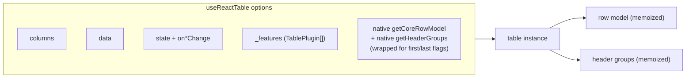
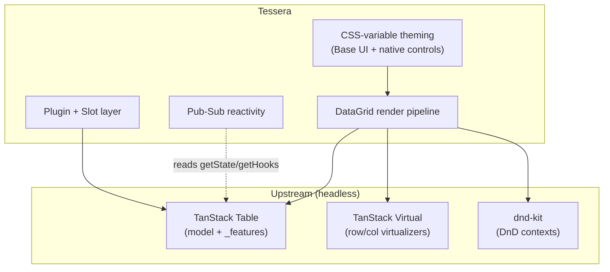

# Upstream foundations

Tessera composes three headless libraries. This page summarizes, in our own
words, the parts of each that matter for Tessera, and marks the exact extension
points Tessera hooks into. For authoritative API details, see each library's
own documentation.

## TanStack Table v8

TanStack Table is a **headless** table core: it computes models (rows, columns,
headers, footers) from `columns` + `data` + `state`, and exposes an instance of
methods — it renders nothing itself.

Concepts Tessera relies on:

- **Instance** — created by `useReactTable(options)`; a stable object whose
  methods (`getHeaderGroups`, `getRowModel`, `getState`, …) are read during
  render.
- **Models are memoized.** Each model (core row model, sorted, grouped,
  expanded, header groups) is a memoized function keyed on specific inputs.
  Recomputation happens only when those inputs change identity. Tessera
  **replaces** the core row model function to widen those keys (see
  [reactivity.md](reactivity.md)).
- **State is controlled/uncontrolled per slice.** You may pass `state.X` +
  `onXChange` to control a slice, or let the table own it. Tessera formalizes
  this into a core/external split (see [table-assembly.md](table-assembly.md)).
- **`_features` (TableFeature[]).** The custom-features API. Each feature can
  hook the lifecycle of the instance and of every column/row/header/cell, and
  can contribute default options and initial state. **A Tessera `TablePlugin`
  is exactly a `TableFeature`** with a small amount of added convention.
- **`meta`** — an arbitrary per-column context bag (`column.columnDef.meta`),
  used by consumers to carry field metadata.

Tessera's touch points: native `getCoreRowModel`, native `getHeaderGroups`
(wrapped by `commonPlugin` for first/last-group flags), `_features` list, and
instance augmentation via a feature's `createTable` (adds `getHooks`,
`getRenderSlots`, `setRenderSlot`, and SDK helpers).

## TanStack Virtual

TanStack Virtual computes **which items in a scroll container are visible** and
the padding needed to preserve scroll size. It is measurement + math; it renders
nothing.

Concepts Tessera relies on:

- **Virtualizer** — configured with `count`, `getScrollElement`,
  `estimateSize`, and (optionally) `getItemKey` / dynamic measurement. It yields
  `virtualItems` (index, start, size) and `totalSize`.
- **Range extractor** — the function that decides which indices are "in range".
  Tessera customizes this to always keep pinned/action columns and to widen the
  row range (see `core/virtualization`).
- **Dynamic row measurement** — rows can measure their real height via
  `measureElement`, so variable-height rows work.

Tessera uses **two** virtualizers: one for rows (always on) and one for columns
(on only for the flat/`flex` layout — see
[rendering-and-virtualization.md](rendering-and-virtualization.md)). Padding is
emitted as left/right filler columns and body height CSS variables.

## dnd-kit

dnd-kit is a headless drag-and-drop toolkit for React.

Concepts Tessera relies on:

- **`DndContext`** — provides drag state, wires sensors, emits
  `onDragStart/Over/End`. Tessera wraps head and body in `DndHeadWrapper` /
  `DndBodyWrapper`.
- **`SortableContext` + `useSortable`** — ordered, sortable lists; used for
  column reordering (header) and row reordering (body).
- **Sensors / collision detection / modifiers** — Tessera supplies a custom
  collision strategy for columns and modifiers to constrain movement.
- **Drag overlay** — a floating element rendered during drag; Tessera renders
  `OverlayHeadCell` / `OverlayBodyRow` for this.

## Where Tessera sits

Rule of thumb when reading the codebase: anything named `create*` on a
plugin, `_features`, `getRowModel`, `getState` is **TanStack**; anything named
`setRenderSlot`, `getRenderSlots`, `getHooks`, `useSubscribeStore`,
`renderComponent` is **Tessera's** extension.
