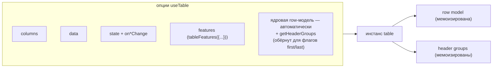
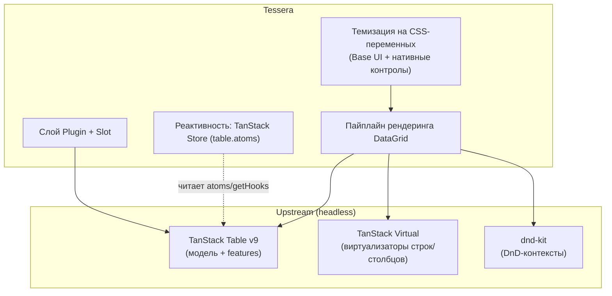

# Upstream-основания

Tessera компонует три headless-библиотеки. Эта страница своими словами резюмирует
те части каждой из них, что важны для Tessera, и помечает точные точки расширения,
в которые Tessera врезается. За авторитетными деталями API обращайтесь к
документации каждой библиотеки.

## TanStack Table v9

TanStack Table — это **headless** ядро таблицы: оно вычисляет модели (строки,
столбцы, заголовки, футеры) из `columns` + `data` + `state` и выдаёт инстанс с
методами — само по себе оно ничего не рендерит.

Концепции, на которые опирается Tessera:

- **Instance** — создаётся через `useTable(options)`; стабильный объект, чьи методы
  (`getHeaderGroups`, `getRowModel`, …) читаются во время рендера. Состояние живёт в
  **TanStack Store**: `table.state` (снимок), `table.store` и слайс-атомы
  `table.atoms.<slice>` (см. [reactivity.md](reactivity.md)).
- **Модели мемоизированы.** Каждая модель (core row model, sorted, grouped,
  expanded, header groups) — мемоизированная функция от конкретных входов; пересчёт
  только при смене их идентичности. В v9 состояние разложено по атомам, поэтому смена
  одного среза не инвалидирует все модели — это и был мотив миграции с v8 (см.
  [reactivity.md](reactivity.md)).
- **Состояние controlled/uncontrolled по слайсам.** Вы можете передать `state.X` +
  `onXChange`, чтобы контролировать слайс, либо отдать его во владение таблице.
  Tessera формализует это в разделение core/external (см.
  [table-assembly.md](table-assembly.md)).
- **`features` (`tableFeatures({...})`).** API кастомных фич. В v9 набор фич —
  типизированная карта, собираемая `tableFeatures()` (tree-shakeable). Фича вешает
  методы на **прототипы** (`assign*Prototype`, используют `this`), кладёт мутабельные
  данные на инстанс (`init*InstanceData`), аугментирует API таблицы
  (`constructTableAPIs`) и вносит дефолтные опции/состояние. **Плагин Tessera строится
  на этом `TableFeature`**; карту фич Tessera собирает из записей presence-based
  (`buildTesseraFeatures`).
- **`meta`** — произвольный контекстный «мешок» на столбец (`column.columnDef.meta`),
  используемый потребителями для переноса метаданных поля.

Точки соприкосновения Tessera: ядровая row-модель включается автоматически (v9;
прочие row-модели приходят слотами фич), `getHeaderGroups` с флагами первой/последней
группы через `commonFeature`, карта `features` и аугментация инстанса через
`constructTableAPIs` фичи `commonFeature` (добавляет `getHooks`, `getRenderSlots`,
`setRenderSlot` и SDK-хелперы).

## TanStack Virtual

TanStack Virtual — не зависимость, а изменённая копия в `src/vendor/tanstack-virtual/`
([ADR 0143](../decisions/0143-tanstack-virtual-fork.md)): исходники upstream с одним патчем —
пересчёт позиций от места изменения. Код грида импортирует его оттуда; версия, патч и
процедура обновления — в `README.md` вендора.

TanStack Virtual вычисляет, **какие элементы в scroll-контейнере видимы**, и
padding, нужный для сохранения размера прокрутки. Это измерение + математика; он
ничего не рендерит.

Концепции, на которые опирается Tessera:

- **Virtualizer** — конфигурируется через `count`, `getScrollElement`,
  `estimateSize` и (опционально) `getItemKey` / динамическое измерение. Он выдаёт
  `virtualItems` (index, start, size) и `totalSize`.
- **Range extractor** — функция, решающая, какие индексы «в диапазоне». Tessera
  кастомизирует её, чтобы всегда удерживать pinned/action-столбцы и расширять
  диапазон строк (см. `core/virtualization`).
- **Динамическое измерение строк** — строки могут измерять свою реальную высоту
  через `measureElement`, так что строки переменной высоты работают.

Как именно Tessera это использует — два виртуализатора (строки всегда, столбцы
только при плоском layout), кастомные range extractors, filler-столбцы для padding
и динамическое измерение строк — см. [virtualization.md](virtualization.md).

## dnd-kit

dnd-kit — это headless-тулкит drag-and-drop для React.

Концепции, на которые опирается Tessera:

- **`DndContext`** — предоставляет состояние перетаскивания, подключает сенсоры,
  эмитит `onDragStart/Over/End`. Tessera оборачивает head и body в
  обёртки плагинов `HeadBoundary` / `BodyBoundary` (ADR 0168).
- **`SortableContext` + `useSortable`** — упорядоченные, сортируемые списки;
  используются для переупорядочивания столбцов (header) и строк (body).
- **Sensors / collision detection / modifiers** — Tessera поставляет кастомную
  стратегию коллизий для столбцов и модификаторы для ограничения движения.
- **Drag overlay** — плавающий элемент, рендерящийся во время перетаскивания;
  Tessera рендерит для этого `OverlayHeadCell` / `OverlayBodyRow`.

## Свои модели строк поверх TanStack

Цепочка моделей TanStack (исходная → фильтрация → группировка → сортировка → раскрытие →
страница) на любое изменение входа пересобирается с нуля, за время, пропорциональное
числу строк; инкрементального API нет. Для ленивых детей это давало сотни миллисекунд
на приход одного ответа на 100 000 корней. Tessera подменяет часть моделей своими
фабриками в штатных слотах фич v9 — без форка и патчей — и пересчитывает только
изменённое; во всех непривычных случаях фабрика откатывается на модель TanStack.

| Слот                                  | Фабрика Tessera                                                                                                                    | ADR                                                                                                              |
| ------------------------------------- | ---------------------------------------------------------------------------------------------------------------------------------- | ---------------------------------------------------------------------------------------------------------------- |
| `coreRowModel`                        | [`createLazyCoreRowModel`](../../src/lib/plugins/rowExpanding/lazyCoreRowModel.ts) — сборка из прежней при смене ответов           | [0067](../decisions/0067-incremental-lazy-core-row-model.md), [0069](../decisions/0069-rowsbyid-handover.md)     |
| `filteredRowModel`, `groupedRowModel` | [`skipIdlePasses`](../../src/lib/shared/rowModels/idleRowModel.ts) — без холостых проходов                                         | [0068](../decisions/0068-idle-filter-and-group-passes.md)                                                        |
| `sortedRowModel`                      | [`createTesseraSortedRowModel`](../../src/lib/plugins/columnSortingModel/sortedRowModel.ts) — значения один раз, сборка из прошлой | [0064](../decisions/0064-tessera-sorted-row-model.md), [0072](../decisions/0072-incremental-sorted-row-model.md) |
| `expandedRowModel`                    | [`createIncrementalExpandedRowModel`](../../src/lib/shared/rowModels/expandedRowModel.ts) — обход затронутых корней                | [0070](../decisions/0070-incremental-expanded-row-model.md)                                                      |

**Решение не целевое.** Фабрики встают в публичные слоты, но опираются на поведение
TanStack, которого его API не обещает. Целевой путь — инкрементальное API в самом
TanStack (вопрос в upstream) либо свой движок за источником строк ядра. Серверной модели
строк эти фабрики не нужны: она строит строки блока публичной `constructRow`, а цепочка
моделей в её режиме простаивает ([ADR 0138](../decisions/0138-server-side-row-model.md),
§3).

### На что опираемся и что это держит

| Поведение TanStack                                                                                                                                         | Кто опирается                                                           | Тесты                                   |
| ---------------------------------------------------------------------------------------------------------------------------------------------------------- | ----------------------------------------------------------------------- | --------------------------------------- |
| Строка переживает смену модели: кэш значений зависит от `original`, кэш листовых строк — от `subRows`, индекс отображения пересчитывается на каждой модели | исходная, сортировка, раскрытие                                         | IM1–IM7, SM8–SM9, XM1–XM4               |
| `constructRow(table, id, original, index, depth, subRows, parentId)` и `getRowId(original, index, parent)` — как в `accessRows`                            | исходная                                                                | IM1–IM5                                 |
| Новая строка создаётся с пустыми `columnFilters` и `columnFiltersMeta` (`initRowInstanceData`)                                                             | фильтрация                                                              | PT1–PT2, PT5                            |
| `depth` и `parentId` строк пишут только исходная модель и группировка                                                                                      | группировка                                                             | PT3–PT5                                 |
| Автосбросы страницы и раскрытия — микрозадачи после пересчёта, сравнивают модели на момент выполнения                                                      | фильтрация, группировка                                                 | PT6                                     |
| `copyInstancePropertiesWithoutMemos` копирует строку для родителя с переставленными детьми                                                                 | сортировка                                                              | SM3, SM5, SM8                           |
| «Раскрыть всё» материализуется обходом `Object.values(getRowModel().rowsById)` с `row_getCanExpand`                                                        | исходная (передача словаря)                                             | IM11                                    |
| `expandRows`: строка, затем дети раскрытой (`row.getIsExpanded()`)                                                                                         | раскрытие                                                               | XM1–XM4                                 |
| `row.index` — простое поле строки: TanStack не кэширует по нему ничего, кроме `_displayIndexCache`, который сверяет по тождеству (`rows[i] === row`)       | исходная (живой индекс, ADR 0199), сортировка (правило равных)          | MS1–MS7                                 |
| Атом среза с тем же содержимым сохраняет ссылку (сравнение по значению)                                                                                    | сортировка (только скорость)                                            | SM12                                    |
| Группировка читает значение строки через `row.getValue` и `_groupingValuesCache`, кэш — первым                                                             | Стадия переноса между группами кладёт значения в кэши строки (ADR 0186) | `row-group-move`, `clientGroupMove.dom` |
| **`rowsById` модели никто не хранит между моделями**                                                                                                       | исходная, сортировка                                                    | — (договор, см. ниже)                   |

Последнее — договор, а не тест: исходная модель и модель сортировки передают словарь
`rowsById` новой модели и правят его на месте; прежней модели остаётся снимок по её
`flatRows` ([ADR 0069](../decisions/0069-rowsbyid-handover.md)). Нижние модели TanStack
передают ссылку на словарь дальше, поэтому их прежние результаты видят правки. Код
Tessera читает `rowsById` только у текущей модели; сохранять словарь (или модель ради
словаря) между пересчётами нельзя — см. [reactivity.md](reactivity.md).

### При обновлении TanStack

1. Прогнать паритет: `npx vitest run --config vitest.node.config.ts` — наборы
   `lazyCoreRowModel.dom`, `idleRowModelPasses`, `sortedRowModel`, `expandedRowModel`.
2. Сверить строки таблицы выше с исходниками новой версии: `accessRows`,
   `initRowInstanceData` фильтрации, `resetRowRelationships`, `expandRows`,
   `row_toggleExpanded`, автосбросы (`table_autoReset*`), `tableMemo`.
3. Перф `npm run perf`: IM8, PT7, XM5, SM7, SM12 — выигрыш против фабрик TanStack в том
   же замере.

Последняя сверка — 9.2.4 → 9.3.1 (2026-11-08, [ADR 0200](../decisions/0200-own-row-engine.md),
этап 0): фичи обращаются друг к другу через заглушки `core/featureStubs` и внутренние API с `_`
(`table._expandRows`), автосбросы зовутся методами таблицы (`table.autoResetExpanded?.()`);
поведение строк таблицы выше не изменилось. Агрегаты группировки считаются, только если
подключён `rowAggregationFeature` (у нас — `shared/aggregation.ts`). Таблица опор уходит вместе
со своими фабриками (ADR 0200, этап 5).

## Обходы апстрима

Ошибки upstream, которые Tessera обходит композицией (без форка). У каждого обхода —
условие снятия: проверяйте его при обновлении зависимости.

### Сортировка дерева: `rowsById` указывает на строку вне модели

- **Версия:** `@tanstack/table-core` 9.2.4 (установлена); в 9.2.6 и в `main` на
  2026-10-07 не исправлено, issue в TanStack/table нет.
- **Суть.** `createSortedRowModel` копирует строку, чьих детей переставила сортировка
  (`Object.create` + `copyInstancePropertiesWithoutMemos`), и кладёт копию в `rows` и
  `flatRows`, но `rowsById` возвращает от предыдущей модели — с оригиналом. Всё, что
  ищет строку по id, получает объект, которого нет в отображаемых строках: например,
  `resolveRowIndex` выделения ячеек берёт `getPrePaginatedRowModel().rowsById[id]`,
  `getDisplayIndex()` оригинала даёт `-1` — ячейка не выделяется и не копируется.
- **Воспроизведение.** Дерево (`subRows`), клиентская сортировка, при которой меняется
  порядок детей строки, и `cellSelectionFeature`: клик по ячейке этой строки не
  выделяет её. Строки без детей и строки, чей порядок детей не изменился, не
  затронуты.
- **Как устранено.** Плагин `columnSorting` подключает свою фабрику
  [`createTesseraSortedRowModel`](../../src/lib/plugins/columnSorting/sortedRowModel.ts)
  ([ADR 0064](../decisions/0064-tessera-sorted-row-model.md)) — ради скорости она
  повторяет устройство модели TanStack и строит `rowsById` с копиями (SM5). Ошибка
  upstream на Tessera больше не влияет; требование CS24
  ([ADR 0012](../decisions/0012-column-sorting.md)) это проверяет.
- **При обновлении TanStack.** Паритет порядка своей модели с `createSortedRowModel`
  держат SM1–SM4 (одни сценарии через обе фабрики).

## Где находится Tessera

Практическое правило при чтении кодовой базы: всё, что названо `assign*Prototype` /
`init*InstanceData` на фиче, `features`, `getRowModel`, `table.atoms` / `table.store` —
это **TanStack** (v9); всё, что названо `setRenderSlot`, `getRenderSlots`, `getHooks`,
`useSlice` / `useTableState`, `TesseraFeatureEntry` — это расширение **самой Tessera**.
