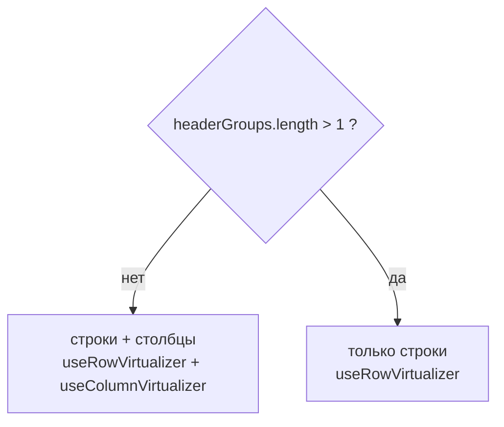

# Виртуализация

Tessera рендерит только видимую часть таблицы, опираясь на **TanStack Virtual**
(что это такое концептуально — в [upstream-foundations.md](upstream-foundations.md)).
Этот документ описывает, как именно Tessera его использует: два виртуализатора,
кастомные range extractors, filler-столбцы для padding и динамическое измерение
строк. Точка входа в коде — `core/virtualization`; включается в рендер-пайплайне
`<DataGrid/>` (см. [rendering.md](rendering.md)).

## Два виртуализатора

Tessera использует **два** независимых виртуализатора:

- **Строки — всегда.** `useRowVirtualizer` считает `virtualRows` и высоту body
  (`bodyHeight`) для любой таблицы.
- **Столбцы — только при плоском layout.** `useColumnVirtualizer` включён лишь
  когда заголовки одноуровневые (`flex`-layout, `enabled: !hasNestedGroups`). При
  вложенных заголовках (`grid`-layout) виртуализация столбцов отключена — см. выбор
  layout в [rendering.md](rendering.md).

Смещения столбцов пересчитываются (`virtualizer.measure()`) при смене порядка
отображения, в конце протяжки грипа и при смене среза `columnSizing` вне протяжки
— ширину без протяжки задают стрелки сплиттера, меню грипа и сброс.

## Кастомные range extractors

**Range extractor** — функция, решающая, какие индексы «в диапазоне». Tessera
кастомизирует её, чтобы:

- **всегда удерживать pinned/action-столбцы** в диапазоне, независимо от позиции
  скролла (иначе закреплённый столбец «выпал» бы из окна виртуализации);
- **расширять диапазон строк**, чтобы сгладить быстрый скролл и уменьшить мелькание
  пустых областей.
- **удерживать «пин-сет» индексов** вне видимой области: перетаскиваемую строку
  (`rowDragging`) и активную строку/колонку клавиатурной навигации
  (`keyboardNavigation`, [ADR 0021](../decisions/0021-keyboard-navigation.md)) —
  чтобы сфокусированный DOM-узел не размонтировался, а цель перехода с клавиатуры
  гарантированно была смонтирована. Индекс колонки здесь — в порядке отображения
  (start-закреплённые → центр → end-закреплённые), как у ячеек строки.

## Filler-столбцы и padding

Виртуализатор столбцов не рендерит то, что вне окна, — но ширина прокрутки должна
сохраняться. Padding эмитится как **левый/правый filler-столбцы** плюс
CSS-переменные высоты body. `useColumnVirtualizerScroll` пересчитывает эти
padding-переменные при скролле.

## Динамическое измерение строк

Строки измеряют свою реальную высоту через `measureElement`: виртуализатор не
полагается только на `estimateSize`, а уточняет размеры по фактически отрендеренным
элементам. Высота строки фиксирована (ADR 0004, R7) и задаётся `rowHeight` или токеном
`--tsr-comp-row-height` ([ADR 0077](../decisions/0077-row-height-and-default-column-width.md)):
оценка `estimateSize` равна ей, поэтому полная высота тела верна до замеров. Хук
`useRowHeights` берёт число из пропа, а без него — из вычисленного токена корня до
первой отрисовки; при смене высоты виртуализатор сбрасывает кэш замеров (`measure()`).
Высота шапки (`headerHeight`, `--tsr-comp-head-row-height`) входит в
`--tsr-comp-head-height`.

## Почему это важно для корректности

Математика, зависящая от видимых строк (например, переупорядочивание при
перетаскивании), опирается на индекс row-model / `virtualIndex` **реально
отрендеренных** строк, которые виртуализатор держит точными по мере прокрутки окна.
Подробнее про взаимодействие с DnD — в [dnd.md](dnd.md) и
[ADR 0006](../decisions/0006-dnd-with-dnd-kit.md).
