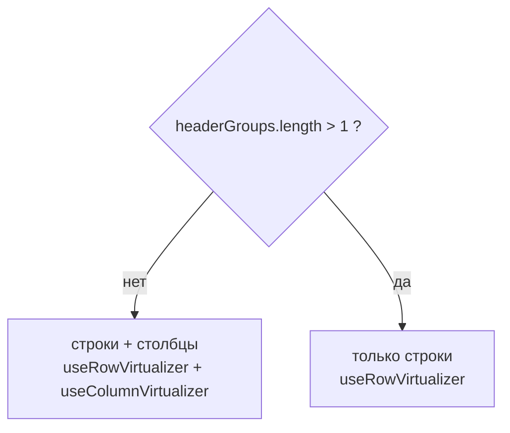

# Виртуализация

Tessera рендерит только видимую часть таблицы, опираясь на **TanStack Virtual**
(что это такое концептуально — в [upstream-foundations.md](upstream-foundations.md)).
Этот документ описывает, как именно Tessera его использует: два виртуализатора,
кастомные range extractors, filler-столбцы для padding и динамическое измерение
строк. Точка входа в коде — `core/virtualization`; включается в рендер-пайплайне
`<DataGrid/>` (см. [rendering.md](rendering.md)).

## Два виртуализатора

Tessera использует **два** независимых виртуализатора:

- **Строки — всегда.** `useRowVirtualizer` считает `virtualRows` и высоту body
  (`bodyHeight`) для любой таблицы.
- **Столбцы — только при плоском layout.** `useColumnVirtualizer` включён лишь
  когда заголовки одноуровневые (`flex`-layout, `enabled: !hasNestedGroups`). При
  вложенных заголовках (`grid`-layout) виртуализация столбцов отключена — см. выбор
  layout в [rendering.md](rendering.md).

Смещения столбцов пересчитываются (`virtualizer.measure()`) при смене порядка
отображения, в конце протяжки грипа и при смене среза `columnSizing` вне протяжки
— ширину без протяжки задают стрелки сплиттера, меню грипа и сброс.

## Кастомные range extractors

**Range extractor** — функция, решающая, какие индексы «в диапазоне». Tessera
кастомизирует её, чтобы:

- **всегда удерживать pinned/action-столбцы** в диапазоне, независимо от позиции
  скролла (иначе закреплённый столбец «выпал» бы из окна виртуализации);
- **расширять диапазон строк**, чтобы сгладить быстрый скролл и уменьшить мелькание
  пустых областей.
- **удерживать «пин-сет» индексов** вне видимой области: перетаскиваемую строку
  (`rowDragging`) и активную строку/колонку клавиатурной навигации
  (`keyboardNavigation`, [ADR 0021](../decisions/0021-keyboard-navigation.md)) —
  чтобы сфокусированный DOM-узел не размонтировался, а цель перехода с клавиатуры
  гарантированно была смонтирована. Индекс колонки здесь — в порядке отображения
  (start-закреплённые → центр → end-закреплённые), как у ячеек строки.

## Filler-столбцы и padding

Виртуализатор столбцов не рендерит то, что вне окна, — но ширина прокрутки должна
сохраняться. Padding эмитится как **левый/правый filler-столбцы** плюс
CSS-переменные высоты body. `useColumnVirtualizerScroll` пересчитывает эти
padding-переменные при скролле.

Центральные ячейки строки, шапки и футера стоят `position: absolute` по своему `left`;
поток держат закреплённые ячейки и спейсер `VirtualCenterSpacer` шириной
`--virtual-center-width`. Спейсер в DOM — первый, ячейки после него — одним массивом с
ключами в порядке start → центр → end; на экран между блоками спейсер ставит `order: 1`,
правые закреплённые — `order` из `--tsr-virtual-end-order`. Закрепление и открепление
колонки у края поэтому не перемонтируют и не переставляют её узел: кнопки заголовка под
указателем не теряют наведение (ADR 0011, CP38).

Число строк и ключ строки по индексу виртуализатор строк берёт у источника строк
(`table.getRowSource()`, [ADR 0138](../decisions/0138-server-side-row-model.md)), а не у
массива модели: серверная модель строк отдаёт итог с незагруженными строками. Ключ
незагруженной строки — её индекс, а тело рисует на её месте строку скелета. В серверной
модели индекс — ключ всех строк (`RowSource.keyByIndex`): ключ по id обходил бы ветки
дерева на миллионе строк. На смене числа строк виртуализатор пересчитывает позиции от
первого изменённого ключа, а не весь список — правка вендора TanStack Virtual
([ADR 0143](../decisions/0143-tanstack-virtual-fork.md), VF4): дописанный блок ленты
пересчитывает только новые строки. Место первого отличия подсказывают те, кто его знает
([ADR 0145](../decisions/0145-first-changed-row-hint.md), `core/rowChanges.ts`): модель раскрытия
из прошлой пишет журнал смен списка, лента объявляет `appendOnlyData`, при ключах по индексу
место — прежнее число строк. Виртуализатор строк помнит список прошлой сборки и спрашивает
журнал опцией вендора `getFirstChangedIndex`; цепочки нет — сверка ключей начала списка. В
dev подсказка сверяется с ней. Окно для
загрузки блоков — видимые строки с запасом (`virtualizer.range`), а не смонтированные:
среди них бывают закреплённые далёкие строки.

## Динамическое измерение строк

Строки измеряют свою реальную высоту через `measureElement`: виртуализатор не
полагается только на `estimateSize`, а уточняет размеры по фактически отрендеренным
элементам. Высота строки фиксирована (ADR 0004, R7) и задаётся `rowHeight` или токеном
`--tsr-comp-row-height` ([ADR 0077](../decisions/0077-row-height-and-default-column-width.md)):
оценка `estimateSize` равна ей, поэтому полная высота тела верна до замеров. Хук
`useRowHeights` берёт число из пропа, а без него — из вычисленного токена корня до
первой отрисовки; при смене высоты виртуализатор сбрасывает кэш замеров (`measure()`).
Высота шапки (`headerHeight`, `--tsr-comp-head-row-height`) входит в
`--tsr-comp-head-height`.

## Строки за концом тела

Хвост ленты ([ADR 0081](../decisions/0081-infinite-scroll.md)) — не строки модели и
не элементы виртуализатора строк: он рисуется в `bodyEndSlot` сразу за блоком тела
(высота `--tsr-comp-body-height`) и удлиняет прокрутку на свою высоту. Колонки хвост
берёт из того же окна виртуализатора колонок. Вне области прокрутки (её пересечение
отслеживает `IntersectionObserver`) хвост держит только высоту, без ячеек, — как тело
вне окна; горизонтальная прокрутка у начала списка за него не платит (IS17). Край для
следующего блока — метка нулевой высоты сразу за телом: расстояние от неё до низа
области прокрутки сравнивается с порогом на прокрутке, не чаще кадра, и без замеров,
пока блок в пути.

## Прокрутка к строке

`table.scrollToRow` ([ADR 0104](../decisions/0104-scroll-to-row.md)) живёт в ядре, а
виртуализаторы — в `DataGrid`: грид регистрирует «окно прокрутки» (контейнер и оба
виртуализатора) на хранилище таблицы (`core/scrollToRow/viewport.ts`) и снимает при
размонтировании. Прокрутка — один `scrollTo` по замерам `measurementsCache` и геометрии
липких шапки, футера и закреплённых колонок (`keyboardNavigation/geometry.ts`), без
`scrollToIndex`: его цикл доводки спорит с доводом по DOM, а серия событий прокрутки
включает быструю прокрутку, и строки на новом месте приходят скелетами. Довод по DOM —
только при промахе оценки высоты. Незакреплённый футер ([ADR 0118](../decisions/0118-column-footer.md))
окна не сужает — он в потоке за строками; последняя строка по низу встаёт вместе с ним.

## Растянутая область

Тело выше 8 млн px ([ADR 0142](../decisions/0142-scroll-stretching.md)) — растянутая
область: высота тела — граница, позиция прокрутки виртуальная. Слой координат
`core/scrollStretch.ts` — один на элемент области (`scrollLayer(scroller)`):

- **Позиция.** Виртуальная — число в JS, физический `scrollTop` — она / `scale`.
  Виртуализатор строк получает её через `observeElementOffset` и пишет через `scrollToFn`;
  итог (`getTotalSize`) — виртуальный, высоту тела `DataGrid` обрезает до границы
  (`clampBodyHeight`). Без растяжки слой — тождество.
- **Место строк.** Экранное место — виртуальное начало минус сдвиг (позиция − `scrollTop`).
  От базы сдвига строки ставит React (база догоняет сдвиг раз на 100 000 px), остаток слой
  пишет в `translate` детей тела на каждое событие. Объект строки — прежний, пока место не
  сменилось: строки мемоизированы по нему. Строки дальше четырёх экранов (активная,
  перетаскиваемая) стоят на этом расстоянии.
- **Ввод.** Колесо — не пассивный слушатель только в растянутой области: дельта 1:1, щелчок —
  анимация по токенам движения (кривую считает Web Animations). Ползунок и касание —
  доля физической позиции. Во время перетаскивания строки физический сдвиг dnd-kit идёт 1:1.
  Привязка прокрутки выключена: Firefox двигал бы `scrollTop` сам.
- **Чтение.** Кто следит за прокруткой (быстрая прокрутка, «наверх», лента), берёт
  `scrollLayer(scroller).area` — виртуальный `scrollTop` и событие на каждый сдвиг слоя.
  Прямой `scrollTop` вне слоя — по списку стража XS10 с причиной.
- **Программная запись** сообщает виртуализатору позицию как конец прокрутки: её зовут и из
  эффектов React, где синхронная перерисовка (`flushSync`) запрещена.

## Почему это важно для корректности

Математика, зависящая от видимых строк (например, переупорядочивание при
перетаскивании), опирается на индекс row-model / `virtualIndex` **реально
отрендеренных** строк, которые виртуализатор держит точными по мере прокрутки окна.
Подробнее про взаимодействие с DnD — в [dnd.md](dnd.md) и
[ADR 0006](../decisions/0006-dnd-with-dnd-kit.md).
