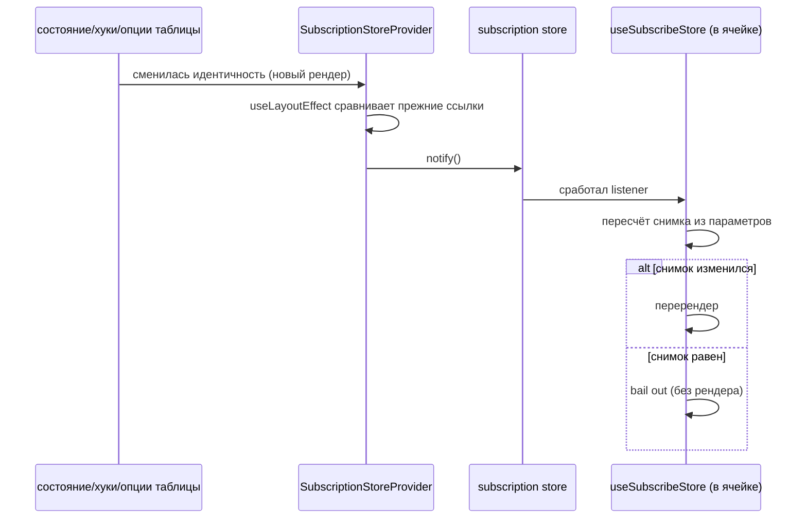

# 0004 — Гранулярная реактивность на TanStack v8: Pub-Sub

- **Статус:** Принято
- **Дата:** 2026-08-02

## Контекст

У TanStack Table v8 есть архитектурная цена производительности: **любое изменение
состояния таблицы или данных пересчитывает всю модель таблицы**, что каскадом
приводит к перерендеру огромного числа ячеек. На высоконагруженных таблицах это
ощущается напрямую. Смена стека (на будущий TanStack v9) **рассматривается** как
долгосрочное решение, но производительность нам была нужна **без** смены стека уже
сейчас.

Нужно было разорвать связь «изменение состояния → широкий перерендер»: чтобы
ячейка/заголовок обновлялись только когда меняется именно то состояние, которое им
важно, а не при каждом пересчёте модели. При этом нельзя опираться на смену
идентичности `columns`/`data` — это как раз тот путь, который вынуждает TanStack
перестроить всю модель.

## Решение

Ввести **Pub-Sub-реактивность** (`useSubscribeStore`) поверх v8 как **единственный
механизм реакции на внешнее состояние**. Плагин/ячейка подписывается ровно на те
значения, которые ему важны, и перерендеривается только когда они меняются — **не
перестраивая никакую модель**. Источник: `core/subscribeStore/subscribeStore.tsx`.

Механизм состоит из двух частей:

- **`SubscriptionStoreProvider`** оборачивает грид. На каждом рендере он сравнивает
  идентичности `table.getState()`, `table.getHooks()` и `table.options` с
  предыдущим рендером (в `useLayoutEffect`). Если что-то изменилось — он вызывает
  `store.notify()`, будя **всех** подписчиков.
- **`useSubscribeStore(() => [primitives])`** — тонкая обёртка над React-примитивом
  **`useSyncExternalStore`**. `subscribe` регистрирует слушателя в сторе, а
  `getSnapshot` склеивает массив примитивов в одну строку (через символ NUL). После
  каждого `notify()` React вызывает `getSnapshot` и перерендеривает компонент
  **только если строка снимка изменилась** (сравнение через `Object.is`).

**Почему именно `useSyncExternalStore`.** Это официальный React-примитив для
подписки на внешний изменяемый источник — здесь таким источником выступает состояние
таблицы TanStack, которым владеет не React, а внешний стор. Он даёт две вещи из
коробки, которые иначе пришлось бы городить вручную (`useState` + принудительный
ре-рендер + собственная сверка):

- **встроенный bail-out по снимку** — React сравнивает результат `getSnapshot` через
  `Object.is` и пропускает рендер, если значение не изменилось; именно поэтому снимок
  сведён к **строке из примитивов** (одинаковое содержимое ⇒ одинаковая строка ⇒
  рендера нет);
- **корректность при конкурентном рендеринге** — примитив защищает от рассинхрона
  (tearing), когда часть дерева уже отрендерена со старым состоянием.



Использование внутри компонента плагина/ячейки — подписка на нужное значение
состояния, дальше обычное чтение из `table.getState()`:

```tsx
export const CellHiddenComponent = memo(
  ({ cell, table }: CellComponentProps) => {
    useSubscribeStore(() => [table.getState().hiddenCells[cell.id]])
    const isHidden = table.getState().hiddenCells[cell.id]
    // ...
  },
)
```

**Ключевое свойство: гранулярность — это bail-out на стороне React, а не адресная
доставка.** `notify()` будит **каждого** подписчика; фильтрация происходит на
стороне подписчика в `useSyncExternalStore` через сравнение снимка из склеенных
примитивов. Модель при этом не перестраивается — в этом весь выигрыш относительно
пути со сменой идентичности `columns`/`data`.

## Последствия

- **+** Гранулярные обновления: изменения состояния больше не влекут полный
  перерендер; перерендериваются только компоненты, чей снимок действительно
  изменился; `hooks` не обязаны быть мемоизированы, чтобы оставаться
  производительными.
- **−** Так как `notify()` будит всех, каждое изменение идентичности
  состояния/хуков/опций запускает геттер снимка **у каждого** подписчика. Fan-out на
  тысячах подписанных ячеек **не измерен** — известное ограничение и область для
  профилирования; возможное будущее направление — уведомления по ключу/селектору.
- **−** Механизм смягчает, но не устраняет корневую причину v8. Миграция на
  **TanStack Table v9** **рассматривается** как настоящее решение, где поведение с
  полным пересчётом модели было бы устранено на уровне архитектуры (см.
  [roadmap](../roadmap.md)).
- Архитектурный обзор **обоих** путей обновления (смена идентичности vs Pub-Sub) и
  таблицу выбора механизма см. в
  [architecture/reactivity.md](../architecture/reactivity.md); этот ADR — источник
  правды по подходу Pub-Sub.
