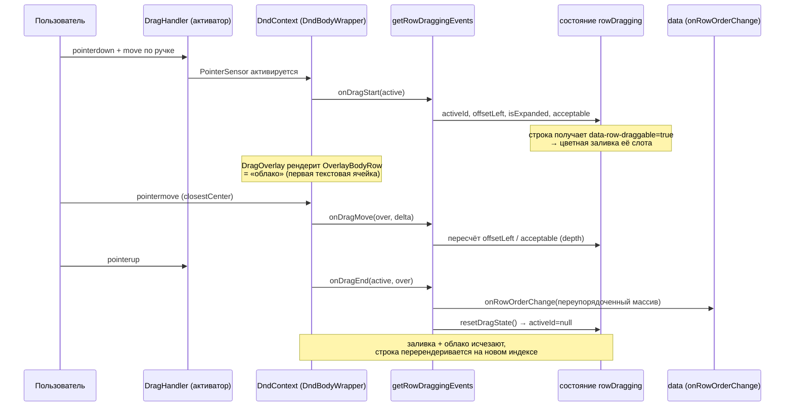
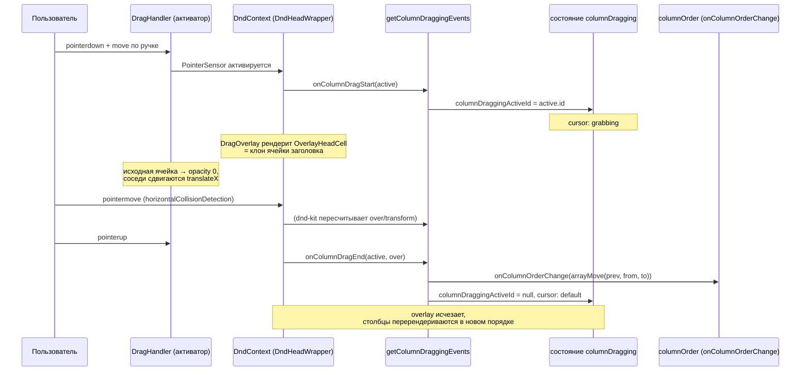

# 0006 — Drag & drop через dnd-kit: rowDragging + columnDragging

- **Статус:** Принято
- **Дата:** 2026-08-02 (решение по dnd-kit); 2026-08-07 (в ADR влиты реализации
  плагинов `rowDragging` и `columnDragging`)
- **Изменён:** 2026-10-08 — `SortableContext` тела получает id только строк окна
  виртуализатора (D34–D36); поиск перетаскиваемой строки — только при перетаскивании
  (D33). 2026-10-13 — соседи и слот-заливка строки сдвигаются переходом на время
  сессии, облако при броске долетает до слота ([ADR 0107](0107-row-motion.md)).
  2026-10-14 — слот строки — скелет на целевом уровне вместо цветной заливки, сдвинутой
  вправо ([ADR 0108](0108-row-drop-preview.md)). 2026-10-14 — свёрнутая группа
  раскрывается задержкой над ней и после броска в неё, будущий родитель подсвечен
  ([ADR 0109](0109-drop-into-collapsed-groups.md)). 2026-10-14 — анимации броска у облака
  нет: облако пропадает, строка вспыхивает на месте ([ADR 0110](0110-row-drop-flash.md)).
  2026-10-14 — перенос, задевающий ленивого родителя, не пишется в `data` сразу, а
  показывается стадией модели строк до промиса `onRowDragEnd`; колбэк получает место после
  переноса; ручка строки — квадратная кнопка кита, D4 изменён
  ([ADR 0112](0112-lazy-tree-row-moves.md)). 2026-10-14 — ручки строки и колонки —
  компактная кнопка 24px, колонка ручки строки 32px; ручка колонки раскрывается по ширине
  при наведении; D19 (ручка в левом отступе) снят — его заменяет
  CO6, D29 — у закреплённой колонки ручки нет ([ADR 0114](0114-async-column-moves.md)).

> **Обновление ([ADR 0010](0010-invert-core-plugins-registry.md)).** Активация
> через флаги `enableRowDragging`/`enableColumnDragging` у `useCreateTable` заменена
> presence-based композицией: плагины включаются фабриками `rowDragging()` /
> `columnDragging()` в массиве `plugins`. Упомянутые ниже имена `enable*` остаются
> TanStack-опциями, которые фабрика проставляет сама (`RegistryEntry.options`).
>
> **Механика ниже приведена к v9** ([ADR 0026](0026-migrate-to-tanstack-v9.md)): методы
> фич вешаются через `assign*Prototype`, реактивность — на `useSelector` (TanStack Store,
> `table.atoms`); фичи — `rowDraggingFeature` / `columnDraggingFeature`.

## Контекст

Потребителям нужно было переупорядочивать и **колонки**, и **строки** через drag &
drop — причём перетаскивание строк должно было работать **внутри иерархии и
группировки**, а не только на плоском списке. Это требовательная задача:
DnD-решение должно было интегрироваться с виртуализацией и моделью TanStack, не
завладевая раскладкой.

Этот ADR — единый источник истины по drag & drop в Tessera. Он фиксирует и **само
решение** (какой DnD-фундамент выбран), и **как** на его основе реализованы оба
плагина — `rowDragging` и `columnDragging`: их активацию, drag-ручку, overlay,
drop-индикатор и flow фиксации-при-сбросе, — плюс единую таблицу требований (D1–D30)
со ссылками на тесты.

## Решение

### Выбор фундамента: dnd-kit

Используем **dnd-kit** (`@dnd-kit/core`, `sortable`, `modifiers`, `utilities`) для
drag & drop как колонок, так и строк, включая перетаскивание **иерархических /
сгруппированных строк**. Порядок возвращается потребителям через штатные контракты:
`columnOrder` / `onColumnOrderChange` для столбцов и `onRowOrderChange` для строк.

### Общая механика (единая для строк и столбцов)

Оба плагина — v9-фичи (записи `TesseraFeatureEntry`), построенные на конвенциях фич и
слотов ([plugins-and-slots.md](../architecture/plugins-and-slots.md)) поверх слоя
перетаскивания dnd-kit ([dnd.md](../architecture/dnd.md)). Они делят одну и ту же
механику; отличия — следствие того, что перетаскивается строка против столбца.

- **`DragHandler`-активатор.** Ручку рендерит общий компонент `DragHandler` — это
  узел-**активатор** dnd-kit: он читает `setActivatorNodeRef` / `attributes` /
  `listeners` из `ItemSortableContext` и распространяет pointer-listeners на свой
  `<span>`. Иконка `drag` (по умолчанию lucide `GripVertical`, переопределяема через
  `<DataGrid icons={{ drag }} />`) — **16×16** (`DragHandler.module.css`:
  `.button svg { width:16px; height:16px }`).
- **Единый источник истины `getCanDrag()`.** Плагин определяет предикат
  (`row.getCanDrag()` / `column.getCanDrag()`), который UI читает, чтобы решить,
  рендерить ли ручку. Оба предиката жёстко гейтят **многоуровневые (вложенные)
  заголовки** (`getHeaderGroups().length !== 1`), потому что render-путь вложенных
  заголовков — CSS-grid, а не плоский flex-путь.
- **Видимость только при наведении.** Иконка ручки присутствует в DOM всё время, но
  **скрыта через `opacity: 0`** до наведения на строку/ячейку заголовка (общие
  конвенции `row__button--hidden` / `cell__button--hidden`). Affordance
  перетаскивания появляется только при наведении.
- **Жизненный цикл** start → overlay → end → очистка. Тело/заголовок обёрнуты своим
  wrapper'ом, поднимающим единый `DndContext` + `SortableContext` и подключающим
  handlers из `getRowDraggingEvents` / `getColumnDraggingEvents`. Активное
  перетаскивание рендерит плавающий `DragOverlay`, следующий за курсором.
- **Автоскролл заперт по одной оси** (`src/lib/grid/dnd/parameters.ts`):
  `autoScrollOnlyY` для строк, `autoScrollOnlyX` для столбцов — зеркала друг друга
  (порог 0.2 по рабочей оси, 0 по другой).

---

## rowDragging

`rowDragging` позволяет переупорядочивать строки таблицы, перетаскивая их. Он
работает как на **плоском** списке, так и на **вложенном** (`subRows`) наборе
данных.

> **Заметка об охвате.** Алгоритм переупорядочивания (плоский против вложенного,
> все случаи root↔group) живёт в `getRowDraggingEvents.ts` и вне охвата этого ADR —
> см. список случаев, задокументированный там inline.

### Активация

Плагин (`rowDragging` — `src/lib/plugins/rowDragging/registry.ts` + `rowDraggingFeature.ts`)
делает что-либо только после того, как потребитель включит его через опцию
**`enableRowDragging`** у `useCreateTable`:

```ts
enableRowDragging?: boolean | ((row: Row<TData>) => boolean)
```

- `true` — каждая строка перетаскиваемая.
- **предикат** — решать на строку (например, только листовые строки, только
  заданный тип).
- `false` / опущено — плагин инертен; нет сервисного столбца, нет ручек.

#### `row.getCanDrag()`

Плагин определяет `row.getCanDrag()` через `assignRowPrototype` (`row_getCanDrag`). Это
единственный источник истины, который читает UI, чтобы решить, рендерить ли ручку для строки:

```ts
assignRowPrototype: (prototype, table) => {
  assignPrototypeAPIs('rowDraggingFeature', prototype, table, {
    row_getCanDrag: {
      fn: row => {
        const enable = row.table.options.enableRowDragging
        const wants = typeof enable === 'function' ? enable(row) : !!enable
        if (!wants) return false
        // гасят drag: многоуровневая шапка / активная группировка / активная сортировка
        if (row.table.getHeaderGroups().length !== 1) return false
        if ((row.table.atoms.grouping?.get() ?? []).length > 0) return false
        if ((row.table.atoms.sorting?.get() ?? []).length > 0) return false
        return true
      },
    },
  })
}
```

Жёсткие гейты вшиты и не могут быть переопределены потребителем:

- **многоуровневые (вложенные) заголовки** — `getHeaderGroups().length !== 1`
  отключает перетаскивание;
- **активная группировка** и **активная сортировка** — отключают перетаскивание
  (читаются из атомов состояния).

Оба — известные, намеренные ограничения (см. [Известные ограничения](#известные-ограничения)).

### Сервисный столбец

Когда плагин `rowDragging` подключён, `injectServiceColumns`
(`src/lib/core/createColumns`) раскладывает выделенный сервисный столбец **слева**
(по `side`/`order`), перед selection/expander, так что drag-ручка сидит в своём
крайнем левом столбце.

Столбец строится через `getRowDraggingColumn(depth)`
(`rowDraggingColumn.ts`). Ключевые факты:

- id = `getActionColumnId('rowDragging')` → это **action-столбец**
  (`getIsActionsColumn()` истинно), поэтому он исключён из sizing, pinning,
  sorting, dragging и из математики offset «первого пользовательского столбца».
- он не рендерит header/footer.
- колонка есть всегда, пока плагин подключён, — даже когда переставлять нечего;
  это осознанно ([ADR 0050](0050-service-column-presence.md)): при инертности прячутся
  ручки, а не колонка.
- колонка — всегда лист без групп-обёрток: под **вложенными заголовками** полную
  высоту ей даёт вертикальный спан TanStack v9
  ([ADR 0049](0049-native-header-spans.md), HS6).
- **ширина** — это `COLUMN_DRAGGING_SIZE = иконка (16px) + левый padding (4) +
правый padding (4) = 24` (`ACTION_COLUMN_CONTENT_PADDING = 4`).

### Drag-ручка

`RowDraggingComponent` (`RowDraggingComponent.tsx`) владеет ячейкой сервисного
столбца (через `cell.renderComponent`, защищённую по id столбца). Она
подписывается на срез `rowDragging` (`useSelector(table.atoms.rowDragging)`) и рендерит
**ничего**, когда строка не перетаскиваемая, иначе — `DragHandler`:

```tsx
const RowDraggingComponent = ({ row, table }) => {
  useSelector(table.atoms.rowDragging)
  if (!row.getCanDrag()) return null
  return <DragHandler id={row.id} type="row" />
}
```

`DragHandler` (`src/lib/grid/dnd/DragHandler.tsx`) — общий активатор (см.
[Общая механика](#общая-механика-единая-для-строк-и-столбцов)); контекст на строку
предоставляет `ItemDraggableWrapper` в `BodyRow`. Он распространяет
pointer-listeners на свой `<span class="drag__handler--column">`.

#### Видимость только при наведении

Иконка ручки скрыта через `opacity: 0` до наведения на строку, через общую
конвенцию `row__button--hidden` в `BodyRow.module.css`:

```css
.body__row .row__button--hidden {
  opacity: 0;
}
.body__row:hover:is([data-row-interact='true']) .row__button--hidden {
  opacity: 1;
}
```

Так что affordance перетаскивания появляется только при наведении на строку (и
только пока строка интерактивна, т. е. не в процессе перетаскивания).

### Жизненный цикл перетаскивания

Body обёрнут `DndBodyWrapper` (`src/lib/grid/DndBodyWrapper.tsx`), который
поднимает единый `DndContext` + вертикальный `SortableContext` для строк и
подключает handlers из `getRowDraggingEvents(table)`:



#### Drop-индикатор (цветная заливка)

Пока строка перетаскивается, `BodyRow` устанавливает `data-row-draggable={isDragging}`
на элементе строки. `BodyRow.module.css` превращает это в цветную заливку и
скрывает собственное содержимое строки, отмечая слот строки как ожидаемое место
сброса:

```css
.body__row:is([data-row-draggable='true']) {
  background-color: var(--draggable-row-background-color) !important;
  z-index: 5 !important;
  & > * {
    opacity: 0;
    height: 0;
  }
}
```

`--draggable-row-background-color` устанавливается на каждое перетаскивание через
`getRowDraggableStyles` (из `rowDragging.acceptable`):
`--tsr-comp-row-accept-draggable-bg`, когда текущая глубина разрешена,
`--tsr-comp-row-not-accept-draggable-bg`, когда нет.

#### «Облако» перетаскивания (overlay)

`DndBodyWrapper` рендерит dnd-kit `DragOverlay`, содержащий `OverlayBodyRow`
(`src/lib/grid/OverlayBodyRow.tsx`), который следует за курсором. Он строится
только из **первой не-action (текстовой) ячейки** перетаскиваемой строки —

```ts
const draggableRowCell = draggableRow
  ?.getVisibleCells()
  .find(cell => !cell.column.getIsActionsColumn())
```

— так что облако размером с первую текстовую ячейку строки (контейнер `.overlay` —
`width: 200px`, совпадает с этим столбцом), drag-ручка и — для строки-группы —
`bubble` со счётчиком её `subRows`.

#### Фиксация + очистка

На `onDragEnd` `getRowDraggingEvents` вычисляет целевой индекс/родителя для всех
плоских/вложенных случаев и вызывает **`onRowOrderChange`** (updater,
предоставляемый потребителем — в историях это `setData`) с переупорядоченным
массивом, так что перетаскиваемая строка приземляется на индексе, над которым был
drop-индикатор, и порядок строк меняется. Затем `resetDragState()` восстанавливает
курсор и очищает `rowDragging` (`activeId → null`, `offsetLeft → 0`, …). С
очищенным `activeId` overlay-«облако» демонтируется, а `data-row-draggable`
становится false, так что цветная заливка исчезает и строка рендерится нормально на
своём новом индексе. `onDragCancel` / `onDragAbort` выполняют ту же очистку без
переупорядочивания.

#### Автоскролл во время перетаскивания

`DndBodyWrapper` передаёт `autoScroll={autoScrollOnlyY}`
(`src/lib/grid/dnd/parameters.ts`) в `DndContext`. Это ограничивает edge-автоскролл
**только вертикальной осью**:

- `threshold.y = 0.2` — во время перетаскивания удержание указателя в пределах 20%
  от верхнего или нижнего края scroll-контейнера скроллит таблицу туда
  (`acceleration: 20`), так что строку можно перетащить на индекс вне текущего
  вьюпорта.
- `threshold.x = 0` — горизонтальный автоскролл отключён: перетаскивание у
  левого/правого края никогда не скроллит таблицу вбок, даже когда грид переполнен
  по горизонтали.

Переупорядочивание остаётся корректным после любого вертикального скролла:
математика перемещения опирается на индекс row-model / `virtualIndex` реально
отрендеренных строк, которые виртуализатор держит точными по мере прокрутки окна.

`SortableContext` тела получает id только строк окна виртуализатора — тех, что
смонтированы, включая закреплённую перетаскиваемую строку, — в порядке индекса.
Список всех строк модели (100 000 id) пересобирался и сравнивался dnd-kit на каждой
смене строк, а индексы и смещения нужны только смонтированным строкам. При
автопрокрутке окно сдвигается и список меняется вместе с ним; смещения строк
остаются согласованными с над-строкой (D36). Стратегия — `windowedListSortingStrategy`:
`verticalListSortingStrategy` без зазора между соседями по списку. Со стоковой
стратегией первая строка окна получала сдвиг на расстояние до закреплённой
перетаскиваемой строки (её сосед по списку, но не на экране); строки тела идут
вплотную, сдвиг — ровно высота строки.

### Состояние и опции

`RowDraggingState` / `RowDraggingOptions` (`types.ts`):

- `state.rowDragging: RowDragOverlayState` — `{ activeId, offsetLeft, isExpanded,
acceptable }`, управляется через `onRowDraggingChange`.
- `onRowOrderChange` — updater переупорядочивания (стандартный TanStack `Updater`),
  который потребитель обязан обработать, чтобы сохранить новый порядок.

---

## columnDragging

`columnDragging` позволяет переупорядочивать столбцы таблицы, перетаскивая их за
заголовок. Он **очень похож** на `rowDragging` — тот же dnd-kit, тот же
`DragHandler`-активатор, та же конвенция видимости «только-при-наведении», тот же
цикл start → overlay → end → очистка. Отличия — следствие того, что перетаскивается
**столбец**, а не строка:

- ось **горизонтальная**, а не вертикальная;
- ручка живёт **в самой ячейке заголовка** (через слот), а **не** в выделенном
  сервисном столбце;
- **вся ячейка заголовка** — sortable-объект (в `rowDragging` sortable — строка,
  а ручка сидит в отдельном action-столбце);
- нет цветной заливки drop-индикатора — соседи в реальном времени сдвигаются
  через `translateX`;
- фиксация идёт через штатный TanStack-контракт `columnOrder` /
  `onColumnOrderChange`, а не через кастомный updater массива данных.

> **Заметка об охвате.** Алгоритм вычисления целевого индекса при сбросе
> (в т. ч. clamp-логика для сброса над закреплённой/сервисной колонкой) живёт в
> `getColumnDraggingEvents.ts` и подробнее раскрыт в разделе
> [Фиксация + очистка](#фиксация--очистка-1).

### Активация

Плагин (`columnDragging` —
`src/lib/plugins/columnDragging/registry.ts` + `columnDraggingFeature.ts`) делает что-либо только
после **двух** совпавших условий — глобального включения и opt-in на конкретный
столбец:

- **`enableColumnDragging`** у `useCreateTable` — глобальный переключатель:

  ```ts
  enableColumnDragging?: boolean
  ```

  В отличие от `enableRowDragging`, это **только boolean** — предиката на
  «столбец» нет: избирательность выражается на уровне определения столбца.

- **`columnDef.enableDragging`** — opt-in на конкретный столбец. Столбец
  перетаскиваем, только если поднят и глобальный флаг, и флаг на его `columnDef`.

`false` / опущено у любого из двух — столбец инертен: нет ручки, заголовок не
sortable.

#### `column.getCanDrag()`

Плагин определяет `column.getCanDrag()` через `assignColumnPrototype`
(`column_getCanDrag`). Это единственный источник истины, который читает UI, чтобы
решить, рендерить ли ручку и делать ли ячейку заголовка перетаскиваемой:

```ts
assignColumnPrototype: (prototype, table) => {
  assignPrototypeAPIs('columnDraggingFeature', prototype, table, {
    column_getCanDrag: {
      fn: column => {
        // многоуровневая шапка гасит перетаскивание столбцов
        if (column.table.getHeaderGroups().length !== 1) return false
        return (
          !!column.columnDef.enableDragging &&
          !!column.table.options.enableColumnDragging
        )
      },
    },
  })
}
```

Жёсткий гейт вшит и не может быть переопределён потребителем:

- **многоуровневые (вложенные) заголовки** — `getHeaderGroups().length !== 1`
  отключает перетаскивание.

Это — известное, намеренное ограничение (см. [Известные ограничения](#известные-ограничения)).

#### `column.getDraggableIndex()`

Плагин также определяет `column.getDraggableIndex()` — индекс
столбца **среди только перетаскиваемых** столбцов:

```ts
column_getDraggableIndex: {
  // индекс среди перетаскиваемых листьев (порядок определения листьев)
  fn: column =>
    column.table
      .getAllLeafColumns()
      .filter(leaf => leaf.getCanDrag())
      .findIndex(leaf => leaf.id === column.id),
}
```

Он намеренно отличается от штатного `column.getIndex()` (позиция среди **всех**
видимых столбцов, включая сервисные/action-столбцы плагинов). `getDraggableIndex`
даёт потребителю «чистый» индекс порядка — без учёта локальных хардкод-столбцов
(например, action-столбцов с кнопками в начале), чтобы серверный порядок можно
было сохранять корректно. Разграничение этих двух индексов пока неполно — см.
`TODO` в `getColumnDraggingEvents.ts` и [Известные ограничения](#известные-ограничения).

### Никакого сервисного столбца

Ключевое отличие от `rowDragging`: **выделенного сервисного столбца нет.** Ручку
некуда «повесить сбоку» — единица перетаскивания сама и есть заголовок. Поэтому
плагин `columnDragging` объявляет свой UI **декларативным слотом записи**
(`RegistryEntry.slots`) в существующую ячейку заголовка:

```ts
slots: [
  {
    id: 'columnDraggingPlugin',
    slot: 'leftHeaderSlot',
    order: 0,
    component: ColumnDraggingComponent,
  },
]
```

`HeadCell` рендерит `leftHeaderSlot` внутри контента ячейки (перед заголовком),
так что ручка оказывается в левой части каждой перетаскиваемой ячейки заголовка.
`injectServiceColumns` для этого плагина **ничего не добавляет** — список столбцов не
меняется.

### Drag-ручка

`ColumnDraggingComponent` (`ColumnDraggingComponent.tsx`) — компонент слота. Он
подписывается на срез `columnDraggingActiveId` и рендерит **ничего**, когда столбец
не перетаскиваемый, иначе — `DragHandler`:

```tsx
export const ColumnDraggingComponent = ({ column, table }) => {
  // всегда-присутствующий срез плагина (реактивность dnd)
  useSelector(table.atoms.columnDraggingActiveId)
  if (!column.getCanDrag()) return null
  return (
    <DragHandler
      id={column.id}
      type="column"
      disabled={column.getIsPinned() !== false}
    />
  )
}
```

`DragHandler` (`src/lib/grid/dnd/DragHandler.tsx`) — тот же общий активатор, что и
в `rowDragging`. Для столбцов `ItemSortableContext` предоставляет **сам `HeadCell`**:
он вызывает `useSortable({ id: column.id })` и раздаёт активатор-реф/listeners в
`ItemDraggableWrapper` вокруг контента ячейки. (В `rowDragging` контекст даёт
`ItemDraggableWrapper` в `BodyRow`.)

#### Позиционирование ручки

В отличие от `rowDragging`, где ручка занимает собственный сервисный столбец,
ручка столбца **накладывается** на левый внутренний отступ содержимого ячейки
заголовка — она вынута из потока абсолютным позиционированием
(`HeadCell.module.css`):

```css
.head__cell :global(.drag__handler--column) {
  position: absolute !important;
  left: 0 !important;
}
```

`.head__cell` даёт контейнер (`overflow: hidden`, `padding: 0`), а
`CellWrapperContent` внутри держит `position: relative` и горизонтальный отступ
`--tsr-comp-cell-content-padding` = `0px COLUMN_CONTENT_PADDING(16)px`. Ручка
`16×16` прижата к `left: 0` и **умещается ровно в этот 16px левый отступ-жёлоб**:
она садится в паддинг, не занимает layout-ширину и не наезжает на текст заголовка
(который начинается за отступом).

#### Закреплённый столбец не перетаскивается

Ручка получает `disabled`, когда столбец закреплён (`getIsPinned() !== false`):
курсор становится `not-allowed`, а pointer-listeners не запускают перетаскивание.
Это согласовано с `HeadCell`, где `disabledSortable` (и как следствие
`disabled: true` у `useSortable`) истинно для закреплённых, action- и
неперетаскиваемых столбцов.

#### Видимость только при наведении

Иконка ручки скрыта через `opacity: 0` до наведения на ячейку заголовка, через
общую конвенцию `cell__button--hidden` в `buttonVisibility.css`:

```css
.data-grid__head-cell .cell__button--hidden:not([data-button-active='true']) {
  opacity: 0; /* + min-width:0; flex:1; overflow:hidden */
}
.data-grid__head-cell:not([data-column-resizing='true']):hover
  .cell__button--hidden:not([data-button-active='true']) {
  opacity: 1;
}
```

Так что affordance перетаскивания появляется только при наведении на заголовок (и
не мешается во время ресайза столбца).

### Жизненный цикл перетаскивания

Заголовок обёрнут `DndHeadWrapper` (`src/lib/grid/DndHeadWrapper.tsx`),
который поднимает единый `DndContext` + **горизонтальный** `SortableContext` для
столбцов и подключает handlers из `getColumnDraggingEvents(table)`:



Горизонтальность обеспечивают три параметра `DndHeadWrapper`:

- `strategy={horizontalListSortingStrategy}` у `SortableContext`;
- `modifiers={[restrictToHorizontalAxis]}` — движение overlay заперто по X, так
  что перетаскивание **никогда не двигает столбец по вертикали**;
- `collisionDetection={horizontalCollisionDetection}`
  (`src/lib/grid/Head/collisionDetection.ts`) — кастомная стратегия: ближайшим
  считается контейнер, чья точка на **10% ширины от левого края** ближе всего к
  X-координате указателя (а не геометрический центр).

#### Drop-индикатор: сдвиг соседей (без заливки)

В отличие от `rowDragging` (цветная заливка слота строки), у столбцов **нет
заливки**. Пока столбец тащат, `HeadCell` через `useSortable` держит `isDragging`
и:

- прячет **исходную** ячейку — `opacity: isDragging ? 0 : 1`;
- сдвигает **соседние** ячейки в реальном времени — `transform:
translateX(${transform?.x || 0}px)` (для перетаскиваемых, не-`disabledSortable`
  столбцов),

так что зазор, куда встанет столбец, показывается самим расступанием соседей.

#### Overlay-клон заголовка

`DndHeadWrapper` рендерит dnd-kit `DragOverlay`, содержащий `OverlayHeadCell`
(`src/lib/grid/OverlayHeadCell.tsx`), который следует за курсором. В
отличие от `rowDragging` (облако из **первой текстовой ячейки** строки), overlay
столбца — **полный клон ячейки заголовка**: та же ширина
(`var(--header-size-…)`), тот же контент заголовка, те же left/right-слоты. Так
overlay визуально совпадает с перетаскиваемым заголовком «один-в-один».

#### Фиксация + очистка

На `onColumnDragEnd` `getColumnDraggingEvents` вычисляет целевую позицию и
фиксирует порядок через **штатный TanStack-контракт** — `onColumnOrderChange`
(updater `columnOrder`), а не через кастомный updater массива данных:

- обычный случай — `arrayMove(prev, activeOrderIndex, overOrderIndex)`, где
  индексы берутся из `over.data.current` (`orderIndex` / `draggableIndex`),
  проброшенного `HeadCell` в `useSortable({ data })`;
- **сброс над «недропаемым» столбцом** (закреплённым или action —
  `over.data.current.disabledSortable`): целевой индекс **зажимается** к первому
  или последнему перетаскиваемому-и-незакреплённому столбцу (в зависимости от
  того, за какой край утащили), так что столбец нельзя «просунуть» внутрь
  закреплённой зоны;
- нет `over`, совпадение `active.id === over.id`, либо неопределённые индексы —
  ранний выход без изменения порядка.

Параллельно плагин вызывает свой hook `onColumnDragEnd({ dragIndex, hoverIndex })`
(в `draggableIndex`-пространстве) — точку расширения для потребителя. Затем
`columnDraggingActiveId` сбрасывается в `null`, а `document.body.style.cursor`
возвращается в `default`. С очищенным id overlay-клон демонтируется, `isDragging`
у бывшей ячейки становится false — она снова видима и рендерится на новом индексе.

#### Автоскролл во время перетаскивания

`DndHeadWrapper` передаёт `autoScroll={autoScrollOnlyX}`
(`src/lib/grid/dnd/parameters.ts`) в `DndContext` — зеркало `autoScrollOnlyY` у
строк:

- `threshold.x = 0.2` — удержание указателя в пределах 20% от левого или правого
  края scroll-контейнера скроллит таблицу туда (`acceleration: 10`), так что
  столбец можно перетащить на позицию вне текущего вьюпорта;
- `threshold.y = 0` — вертикальный автоскролл отключён.

Вместе с `restrictToHorizontalAxis` это удерживает всё взаимодействие строго на
горизонтальной оси.

### Состояние и опции

`ColumnDraggingState` / `ColumnDraggingOptions` (`types.ts`):

- `state.columnDraggingActiveId: DragOverlayState` — `UniqueIdentifier | null`,
  id столбца, который сейчас тащат; управляется через `onColumnDraggingActiveIdChange`.
- порядок фиксируется через штатные `columnOrder` / `onColumnOrderChange` — их
  потребитель обязан обработать, чтобы сохранить новый порядок.
- `ColumnDraggingPluginParams.onColumnDragEnd({ dragIndex, hoverIndex })` — hook
  плагина в `draggableIndex`-пространстве (дефолт — no-op).

---

## Последствия

- **+** Переупорядочивание колонок и строк опирается на единый современный,
  компонуемый DnD-фундамент.
- **+** Перетаскивание иерархических строк (смена родителя внутри групп/деревьев)
  работает — по-настоящему сложная возможность, которую готовые таблицы редко
  предоставляют аккуратно.
- **−** Корректно реализовать DnD иерархических строк вместе с виртуализацией было
  **очень трудно**, и это одна из самых замысловатых частей кодовой базы;
  изменения здесь требуют живой проверки в Storybook.

Клавиатурная альтернатива перетаскиванию — `Alt+Shift+стрелки` через канал
`keyboardActions` с теми же `setColumnOrder`/`onColumnDragEnd` и
`onRowOrderChange` — специфицирована в [ADR 0031](0031-wcag-keyboard.md)
(KB3, KB4) и [ADR 0032](0032-wcag-aa-remainder.md) (W12 — смена уровня
вложенности строки).

Альтернатива одним указателем без перетаскивания (WCAG 2.5.7) —
[ADR 0034](0034-wcag-22-dragging-and-target-size.md): клик по ручке без сдвига
открывает меню перестановки, а сенсоры dnd-kit стартуют после сдвига на 5 px
(`activationConstraint`, `grid/dnd/parameters.ts`). Ручка — кнопка меню с
именем из локализации; в заголовке её зона нажатия 24×24 лежит вправо от края
ячейки.

### Требования и покрытие тестами

Критерии приёмки, которые кодируют визуальные тесты. По конвенции проекта
(см. [ADR 0001](0001-spec-driven-development.md) и
[ADR 0009](0009-test-coverage-visual-and-performance.md)) каждое требование — это
**отдельный именованный тест** с ID-префиксом `D<n>:`, совпадающим с ID из таблиц
ниже. Нумерация сквозная по обоим плагинам: **D1–D14** — строки, **D15–D30, D32** —
столбцы. Тесты строк живут в `stories/__tests__/visual/row-dragging.test.tsx`, тесты
столбцов — в `stories/__tests__/visual/column-dragging.test.tsx` (оба — vitest-browser,
реальный Chromium). Каждый набор гоняет свою историю (`RowDragging` /
`ColumnDragging`), подобранную по размеру так, чтобы переполнять по обеим осям
(поэтому требования скролла D12–D14 и D26–D28 имеют реальную дистанцию для
работы); guard-тесты `… story overflows on both axes` защищают их от «тихого»
прохождения. Пойнтер-механику оба набора делят через `stories/rowDragging.dnd.ts`
(общие `firePointer` / `nextFrame`). Мета-уровневый `play` в
`stories/dataGridMeta.tsx` — тонкий демо-сценарий для панели Interactions в
Storybook; он **не** несёт ассертов требований, но прогоняется под `npm test`
smoke-тестом ради паритета.

#### Строки — `rowDragging` (D1–D14, DN1–DN2, `row-dragging.test.tsx`; D33–D34, D39 — модульный `rowDragging`; D35–D36 — `row-dragging-window.test.tsx`)

| ID  | Требование                                                                                                                                                                               | Тест                                             |
| --- | ---------------------------------------------------------------------------------------------------------------------------------------------------------------------------------------- | ------------------------------------------------ |
| D1  | Плагин активируется через `enableRowDragging`                                                                                                                                            | `D1: the plugin activates …`                     |
| D2  | Drag-ручка живёт в выделенном первом (сервисном) столбце                                                                                                                                 | `D2: … dedicated first … column`                 |
| D3  | Иконка ручки — 16×16                                                                                                                                                                     | `D3: … icon is 16×16`                            |
| D4  | Ширина сервисного столбца = 24 + 4 + 4 = 32: ручка — компактная квадратная кнопка кита ([ADR 0112](0112-lazy-tree-row-moves.md), [ADR 0114](0114-async-column-moves.md))                 | `D4: … service column width …`                   |
| D5  | Ручка рендерится на каждый `row.getCanDrag()` (одна на перетаскиваемую строку)                                                                                                           | `D5: one drag handle per … row`                  |
| D6  | Ручка скрыта (`opacity: 0`), пока на строку не наведён курсор                                                                                                                            | `D6: … hidden … until … hovered`                 |
| D7  | Ручка проявляется при наведении на строку                                                                                                                                                | `D7: … revealed on row hover` (доверенный hover) |
| D8  | Перетаскивание показывает overlay-«облако» (размером с первую текстовую ячейку)                                                                                                          | `D8: … "cloud" overlay`                          |
| D9  | Слот перетаскиваемой строки показывает цветную заливку drop-индикатора                                                                                                                   | `D9: … drop-indicator fill`                      |
| D10 | При сбросе строка занимает новый индекс → порядок меняется                                                                                                                               | `D10: … new index → order changes`               |
| D11 | После сброса облако + заливка исчезают; строка рендерится на новом индексе                                                                                                               | `D11: … cloud + fill are gone`                   |
| D12 | Возле верхнего/нижнего края перетаскивание автоскроллит таблицу вертикально                                                                                                              | `D12: … auto-scrolls vertically`                 |
| D13 | Строка переупорядочивается корректно после вертикального скролла (в любом направлении)                                                                                                   | `D13: … reorders … after a vertical scroll`      |
| D14 | Перетаскивание никогда не автоскроллит таблицу горизонтально                                                                                                                             | `D14: … never scrolls horizontally`              |
| D33 | Без активного перетаскивания тело не обходит строки в поисках перетаскиваемой (модульный `rowDragging`)                                                                                  | unit                                             |
| D34 | `items` в `SortableContext` тела — id строк окна виртуализатора (с закреплённой перетаскиваемой) в порядке индекса, а не все строки модели                                               | unit                                             |
| D35 | Настоящее перетаскивание мышью вниз через границу окна с автопрокруткой ставит строку на верный индекс                                                                                   | visual                                           |
| D36 | Во время удержания после автопрокрутки строки между исходной и над-строкой сдвинуты на высоту строки, остальные — на месте (выборка по кадрам)                                           | visual                                           |
| D37 | Облако перетаскивания строки — визуальный клон: вне дерева доступности и фокуса (`inert`), как призрак колонки (ND13); пока оно на экране, axe по таблице без нарушений                  | visual                                           |
| D39 | Нажатие на ручку строки без сдвига (`onDragAbort`) при состоянии перетаскивания по умолчанию не пишет в store таблицы: подписчики store не уведомляются, потребитель не перерисовывается | unit                                             |
| DN1 | Раскрытое дерево показывает подстроки родителя — у перетаскивания в дереве есть цели                                                                                                     | `DN1: expanded tree renders its subrows …`       |
| DN2 | Подстрока переставляется среди сиблингов, ни одна строка дерева не пропадает                                                                                                             | `DN2: a subrow reorders among its siblings …`    |

#### Столбцы — `columnDragging` (D15–D30, D32, `column-dragging.test.tsx`)

| ID  | Требование                                                                                                                                                                                                                                     | Тест                                       |
| --- | ---------------------------------------------------------------------------------------------------------------------------------------------------------------------------------------------------------------------------------------------- | ------------------------------------------ |
| D15 | Плагин активируется совпадением `enableColumnDragging` + `columnDef.enableDragging`                                                                                                                                                            | `D15: the plugin activates …`              |
| D16 | Только столбцы с `enableDragging` получают ручку (opt-in на столбец)                                                                                                                                                                           | `D16: only columns with … handle`          |
| D17 | Drag-ручка живёт в самой ячейке заголовка (слот `leftHeaderSlot`), без сервисного столбца                                                                                                                                                      | `D17: … in the header cell …`              |
| D18 | Иконка ручки — 16×16                                                                                                                                                                                                                           | `D18: … icon is 16×16`                     |
| D20 | Ручка скрыта (`opacity: 0`), пока на заголовок не наведён курсор                                                                                                                                                                               | `D20: … hidden … until … hovered`          |
| D21 | Ручка проявляется при наведении на заголовок                                                                                                                                                                                                   | `D21: … revealed on header hover`          |
| D22 | Перетаскивание показывает overlay-клон ячейки заголовка (та же ширина/контент)                                                                                                                                                                 | `D22: … overlay clone …`                   |
| D23 | Исходная ячейка скрыта (`opacity: 0`) во время перетаскивания; соседи сдвигаются `translateX`                                                                                                                                                  | `D23: … neighbours shift …`                |
| D24 | При сбросе `columnOrder` меняется → столбцы переупорядочиваются                                                                                                                                                                                | `D24: … columnOrder changes …`             |
| D25 | После сброса overlay исчезает; столбец рендерится на новой позиции                                                                                                                                                                             | `D25: … overlay is gone …`                 |
| D26 | Возле левого/правого края перетаскивание автоскроллит таблицу горизонтально                                                                                                                                                                    | `D26: … auto-scrolls horizontally`         |
| D27 | Столбец переупорядочивается корректно после горизонтального скролла (в любом направлении)                                                                                                                                                      | `D27: … after a horizontal scroll`         |
| D28 | Перетаскивание никогда не двигает столбец по вертикали (restrictToHorizontalAxis + autoScrollOnlyX)                                                                                                                                            | `D28: … never scrolls vertically`          |
| D29 | Закреплённый столбец нельзя перетащить: ручки у него нет, `useSortable` disabled ([ADR 0114](0114-async-column-moves.md))                                                                                                                      | `D29: … pinned column cannot be dragged`   |
| D30 | Сброс над закреплённой/сервисной колонкой зажимается к крайней перетаскиваемой колонке                                                                                                                                                         | `D30: … never lands in the pinned zone`    |
| D32 | Фон зоны грипа ширины в overlay-клоне совпадает с фоном самого клона                                                                                                                                                                           | `D32: … resize zone background …`          |
| D38 | После броска мышью брошенная колонка и сдвинутый сосед стоят на новых местах с первого кадра — без обратного переезда (выборка по кадрам); сдвиг `translateX` плавный только во время перетаскивания (`--tsr-comp-head-cell-shift-transition`) | `D38: after a mouse drop … frame by frame` |

Не покрыто тестом (см. [Известные ограничения](#известные-ограничения), список
случаев `getRowDraggingEvents` и `TODO` в `getColumnDraggingEvents.ts`): вложенное /
кросс-групповое переупорядочивание строк, точный индекс приземления, негативный
случай `getCanDrag()` для строк (ручка скрыта для неперетаскиваемых). Точную
математику приземления при clamp (D30) спек проверяет по наблюдаемому инварианту —
«столбец нельзя уронить внутрь закреплённой зоны», — а не по точному целевому
индексу.

### Известные ограничения

- **группировка + перетаскивание строк** не поддерживается (отключено в
  `getCanDrag`); группировка + перетаскивание строк вместе пока **не** реализованы
  (считается выполнимым).
- **многоуровневые заголовки + перетаскивание** — поддержано
  [ADR 0052](0052-dnd-under-nested-headers.md): узел (лист или группа) переставляется
  среди соседей своего уровня, строки перетаскиваются как в плоской шапке.
- глубина вложенности строк **> 1** пока не поддерживается математикой перемещения
  (см. `TODO` по `acceptable` / depth в `getRowDraggingEvents` / `draggingHelpers`).
- **`getIndex` против `getDraggableIndex`** разграничены не до конца: при сохранении
  порядка столбцов на сервере хардкод/action-столбцы могут искажать индексы (см.
  `TODO` в `getColumnDraggingEvents.ts`).

См. [dnd.md](../architecture/dnd.md) про механизм DnD рендер-слоя и
[plugins-and-slots.md](../architecture/plugins-and-slots.md) про механизм плагинов.
</content>
</invoke>
