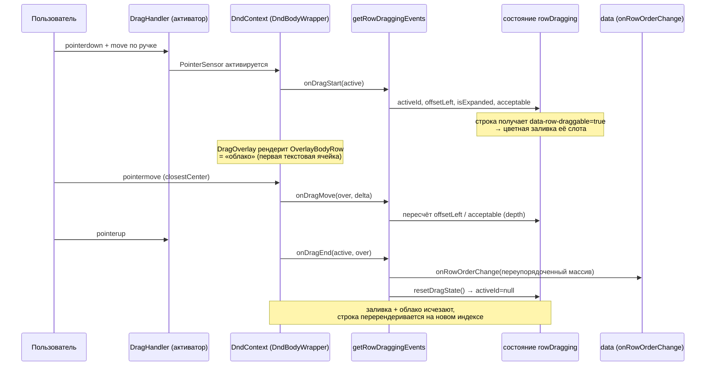

# 0009 — Плагин rowDragging: реализация

- **Статус:** Принято
- **Дата:** 2026-08-06
- **Связано:** [ADR 0006](0006-dnd-with-dnd-kit.md) — решение использовать dnd-kit
  для drag & drop колонок и строк.

## Контекст

[ADR 0006](0006-dnd-with-dnd-kit.md) зафиксировал решение строить drag & drop на
dnd-kit. Этот ADR фиксирует, **как** на его основе реализован плагин `rowDragging`
— как он подключён к таблице и UI: активация, сервисный столбец, drag-ручка,
overlay, drop-индикатор и flow фиксации-при-сбросе.

`rowDragging` позволяет пользователю переупорядочивать строки таблицы, перетаскивая
их. Он работает как на **плоском** списке, так и на **вложенном** (`subRows`) наборе
данных и построен на конвенциях `TablePlugin` + слоты
([plugins-and-slots.md](../architecture/plugins-and-slots.md)), плюс слой
перетаскивания dnd-kit, обёрнутый вокруг body таблицы
([dnd.md](../architecture/dnd.md)).

> **Заметка об охвате.** Алгоритм переупорядочивания (плоский против вложенного,
> все случаи root↔group) живёт в `getRowDraggingEvents.ts` и вне охвата этого ADR —
> см. список случаев, задокументированный там inline.

## Решение

### Активация

Плагин — одна из всегда инъектируемых базовых фич (`rowDraggingPlugin`,
`src/lib/plugins/rowDragging/rowDraggingPlugin.tsx`); он делает что-либо только
после того, как потребитель включит его через опцию **`enableRowDragging`** у
`useCreateTable`:

```ts
enableRowDragging?: boolean | ((row: Row<TData>) => boolean)
```

- `true` — каждая строка перетаскиваемая.
- **предикат** — решать на строку (например, только листовые строки, только
  заданный тип).
- `false` / опущено — плагин инертен; нет сервисного столбца, нет ручек.

#### `row.getCanDrag()`

Плагин определяет `row.getCanDrag()` в своём хуке `createRow`. Это единственный
источник истины, который читает UI, чтобы решить, рендерить ли ручку для строки:

```ts
createRow: (row, table) => {
  row.getCanDrag = () => {
    // перетаскивание не поддерживается с многоуровневыми заголовками или группировкой
    if (table.getHeaderGroups().length !== 1 || table.options.enableGrouping) {
      return false
    }
    const flag = table.options.enableRowDragging
    return typeof flag === 'function' ? flag(row) : !!flag
  }
}
```

Два жёстких гейта вшиты и не могут быть переопределены потребителем:

- **многоуровневые (вложенные) заголовки** — `getHeaderGroups().length !== 1`
  отключает перетаскивание (render-путь вложенных заголовков — CSS-grid, а не
  плоский flex-путь);
- **группировка** — `enableGrouping` отключает перетаскивание.

Оба — известные, намеренные ограничения (см. [Известные ограничения](#известные-ограничения)).

### Сервисный столбец

Когда `enableRowDragging` истинно, `useCreateColumns`
(`src/lib/core/createColumns/useCreateColumns.ts`) **unshift-ит** выделенный
сервисный столбец в **начало** списка столбцов (`temp.unshift(...)` — он
оказывается перед selection/expander, потому что unshift-ится последним), так что
drag-ручка сидит в своём крайнем левом столбце.

Столбец строится через `getRowDraggingColumn(depth)`
(`rowDraggingColumn.ts`). Ключевые факты:

- id = `getActionColumnId('rowDragging')` → это **action-столбец**
  (`getIsActionsColumn()` истинно), поэтому он исключён из sizing, pinning,
  sorting, dragging и из математики offset «первого пользовательского столбца».
- он не рендерит header/footer.
- для **вложенных заголовков** он оборачивает себя в placeholder-уровни групп
  (`rowSpan`), чтобы охватить полную высоту заголовка; на одноуровневом заголовке
  возвращается как есть.
- **ширина** — это `COLUMN_DRAGGING_SIZE = иконка (16px) + левый padding (4) +
  правый padding (4) = 24` (`ACTION_COLUMN_CONTENT_PADDING = 4`).

### Drag-ручка

`RowDraggingComponent` (`RowDraggingComponent.tsx`) владеет ячейкой сервисного
столбца (через `cell.renderComponent`, защищённую по id столбца). Она
подписывается на `row.getCanDrag()` и рендерит **ничего**, когда строка не
перетаскиваемая, иначе — `DragHandler`:

```tsx
const RowDraggingComponent = memo(({ row }) => {
  useSubscribeStore(() => [row.getCanDrag()])
  if (!row.getCanDrag()) return null
  return <DragHandler id={row.id} type="row" />
})
```

`DragHandler` (`src/lib/plugins/ui/DragHandler.tsx`):

- это узел-**активатор** dnd-kit — он читает `setActivatorNodeRef` /
  `attributes` / `listeners` из `ItemSortableContext` (предоставляемого на строку
  через `ItemDraggableWrapper` в `BodyRow`) и распространяет pointer-listeners на
  свой `<span class="drag__handler--column">`.
- рендерит иконку `drag` (по умолчанию lucide `GripVertical`, переопределяема через
  `<DataGrid icons={{ drag }} />`). Иконка — **16×16** (`DragHandler.module.css`:
  `.button svg { width:16px; height:16px }`).

#### Видимость только при наведении

Иконка ручки присутствует в DOM всё время, но **скрыта через `opacity: 0`** до
наведения на строку, через общую конвенцию `row__button--hidden` в
`BodyRow.module.css`:

```css
.body__row .row__button--hidden { opacity: 0; }
.body__row:hover:is([data-row-interact='true']) .row__button--hidden { opacity: 1; }
```

Так что affordance перетаскивания появляется только при наведении на строку (и
только пока строка интерактивна, т. е. не в процессе перетаскивания).

### Жизненный цикл перетаскивания

Body обёрнут `DndBodyWrapper` (`src/lib/ui/Body/DndBodyWrapper.tsx`), который
поднимает единый `DndContext` + вертикальный `SortableContext` для строк и
подключает handlers из `getRowDraggingEvents(table)`:



#### Drop-индикатор (цветная заливка)

Пока строка перетаскивается, `BodyRow` устанавливает `data-row-draggable={isDragging}`
на элементе строки. `BodyRow.module.css` превращает это в цветную заливку и
скрывает собственное содержимое строки, отмечая слот строки как ожидаемое место
сброса:

```css
.body__row:is([data-row-draggable='true']) {
  background-color: var(--draggable-row-background-color) !important;
  z-index: 5 !important;
  & > * { opacity: 0; height: 0; }
}
```

`--draggable-row-background-color` устанавливается на каждое перетаскивание через
`getRowDraggableStyles` (из `rowDragging.acceptable`):
`--data-grid-row-accept-draggable-bg`, когда текущая глубина разрешена,
`--data-grid-row-not-accept-draggable-bg`, когда нет.

#### «Облако» перетаскивания (overlay)

`DndBodyWrapper` рендерит dnd-kit `DragOverlay`, содержащий `OverlayBodyRow`
(`src/lib/ui/BodyRow/OverlayBodyRow.tsx`), который следует за курсором. Он строится
только из **первой не-action (текстовой) ячейки** перетаскиваемой строки —

```ts
const draggableRowCell = draggableRow
  ?.getVisibleCells()
  .find(cell => !cell.column.getIsActionsColumn())
```

— так что облако размером с первую текстовую ячейку строки (контейнер `.overlay` —
`width: 200px`, совпадает с этим столбцом), drag-ручка и — для строки-группы —
`bubble` со счётчиком её `subRows`.

#### Фиксация + очистка

На `onDragEnd` `getRowDraggingEvents` вычисляет целевой индекс/родителя для всех
плоских/вложенных случаев и вызывает **`onRowOrderChange`** (updater,
предоставляемый потребителем — в историях это `setData`) с переупорядоченным
массивом, так что перетаскиваемая строка приземляется на индексе, над которым был
drop-индикатор, и порядок строк меняется. Затем `resetDragState()` восстанавливает
курсор и очищает `rowDragging` (`activeId → null`, `offsetLeft → 0`, …). С
очищенным `activeId` overlay-«облако» демонтируется, а `data-row-draggable`
становится false, так что цветная заливка исчезает и строка рендерится нормально на
своём новом индексе. `onDragCancel` / `onDragAbort` выполняют ту же очистку без
переупорядочивания.

#### Автоскролл во время перетаскивания

`DndBodyWrapper` передаёт `autoScroll={autoScrollOnlyY}`
(`src/lib/core/dnd/parameters.ts`) в `DndContext`. Это ограничивает edge-автоскролл
**только вертикальной осью**:

- `threshold.y = 0.2` — во время перетаскивания удержание указателя в пределах 20%
  от верхнего или нижнего края scroll-контейнера скроллит таблицу туда
  (`acceleration: 20`), так что строку можно перетащить на индекс вне текущего
  вьюпорта.
- `threshold.x = 0` — горизонтальный автоскролл отключён: перетаскивание у
  левого/правого края никогда не скроллит таблицу вбок, даже когда грид переполнен
  по горизонтали.

Переупорядочивание остаётся корректным после любого вертикального скролла:
математика перемещения опирается на индекс row-model / `virtualIndex` реально
отрендеренных строк, которые виртуализатор держит точными по мере прокрутки окна.

### Состояние и опции

`RowDraggingState` / `RowDraggingOptions` (`types.ts`):

- `state.rowDragging: RowDragOverlayState` — `{ activeId, offsetLeft, isExpanded,
  acceptable }`, управляется через `onRowDraggingChange`.
- `onRowOrderChange` — updater переупорядочивания (стандартный TanStack `Updater`),
  который потребитель обязан обработать, чтобы сохранить новый порядок.

## Последствия

### Требования и покрытие тестами

Критерии приёмки, которые кодирует визуальный тест. Каждое требование — это
**отдельный именованный тест** в `stories/__tests__/row-dragging.test.tsx`
(vitest-browser, реальный Chromium), с именем-префиксом `R<n>:`, совпадающим с ID
из таблицы ниже. Все тесты гоняют историю `RowDragging`, подобранную по размеру
так, чтобы переполнять по обеим осям (поэтому требования скролла R12–R14 имеют
реальный скролл для работы); guard-тест `RowDragging story overflows on both axes`
защищает их от «тихого» прохождения. Мета-уровневый `play` в
`stories/DataGrid.stories.tsx` — тонкий демо-сценарий для панели Interactions в
Storybook (одно перетаскивание с drop); он **не** несёт ассертов требований, но
прогоняется под `npm test` smoke-тестом ради паритета. Пойнтер-механику `play` и
тесты делят через `stories/rowDragging.dnd.ts`.

| ID  | Требование                                                          | Тест (`row-dragging.test.tsx`)        |
| --- | ------------------------------------------------------------------- | ------------------------------------- |
| R1  | Плагин активируется через `enableRowDragging`                       | `R1: the plugin activates …`          |
| R2  | Drag-ручка живёт в выделенном первом (сервисном) столбце            | `R2: … dedicated first … column`      |
| R3  | Иконка ручки — 16×16                                                | `R3: … icon is 16×16`                 |
| R4  | Ширина сервисного столбца = 16 + 4 + 4 = 24                         | `R4: … service column width …`        |
| R5  | Ручка рендерится на каждый `row.getCanDrag()` (одна на перетаскиваемую строку) | `R5: one drag handle per … row` |
| R6  | Ручка скрыта (`opacity: 0`), пока на строку не наведён курсор       | `R6: … hidden … until … hovered`      |
| R7  | Ручка проявляется при наведении на строку                          | `R7: … revealed on row hover` (доверенный hover) |
| R8  | Перетаскивание показывает overlay-«облако» (размером с первую текстовую ячейку) | `R8: … "cloud" overlay`   |
| R9  | Слот перетаскиваемой строки показывает цветную заливку drop-индикатора | `R9: … drop-indicator fill`        |
| R10 | При сбросе строка занимает новый индекс → порядок меняется          | `R10: … new index → order changes`    |
| R11 | После сброса облако + заливка исчезают; строка рендерится на новом индексе | `R11: … cloud + fill are gone`  |
| R12 | Возле верхнего/нижнего края перетаскивание автоскроллит таблицу вертикально | `R12: … auto-scrolls vertically` |
| R13 | Строка переупорядочивается корректно после вертикального скролла (в любом направлении) | `R13: … reorders … after a vertical scroll` |
| R14 | Перетаскивание никогда не автоскроллит таблицу горизонтально        | `R14: … never scrolls horizontally`   |

Не покрыто тестом (см. [Известные ограничения](#известные-ограничения) и список
случаев `getRowDraggingEvents`): вложенное / кросс-групповое переупорядочивание,
точный индекс приземления и негативный случай `getCanDrag()` (ручка скрыта для
неперетаскиваемых строк).

### Известные ограничения

- **группировка + перетаскивание строк** не поддерживается (отключено в
  `getCanDrag`).
- **многоуровневые заголовки + перетаскивание строк** не поддерживается (отключено
  в `getCanDrag`).
- глубина вложенности **> 1** пока не поддерживается математикой перемещения (см.
  `TODO` по `acceptable` / depth в `getRowDraggingEvents` / `draggingHelpers`).

См. [ADR 0006](0006-dnd-with-dnd-kit.md) про общее решение по DnD,
[dnd.md](../architecture/dnd.md) про механизм DnD рендер-слоя и
[plugins-and-slots.md](../architecture/plugins-and-slots.md) про механизм плагинов.
