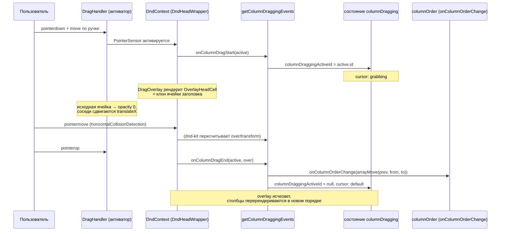

# 0011 — Плагин columnDragging: реализация

- **Статус:** Принято
- **Дата:** 2026-08-06
- **Связано:** [ADR 0006](0006-dnd-with-dnd-kit.md) — решение использовать dnd-kit
  для drag & drop колонок и строк; [ADR 0009](0009-rowdragging-plugin.md) —
  плагин `rowDragging` (близнец этого ADR для строк).

## Контекст

[ADR 0006](0006-dnd-with-dnd-kit.md) зафиксировал решение строить drag & drop на
dnd-kit. Этот ADR фиксирует, **как** на его основе реализован плагин
`columnDragging` — как он подключён к таблице и UI: активация, drag-ручка в
заголовке, overlay, сдвиг соседей и flow фиксации-при-сбросе.

`columnDragging` позволяет пользователю переупорядочивать столбцы таблицы,
перетаскивая их за заголовок. Он построен на конвенциях `TablePlugin` + слоты
([plugins-and-slots.md](../architecture/plugins-and-slots.md)), плюс слой
перетаскивания dnd-kit, обёрнутый вокруг заголовка таблицы
([dnd.md](../architecture/dnd.md)).

Он **очень похож** на `rowDragging` ([ADR 0009](0009-rowdragging-plugin.md)) —
тот же dnd-kit, тот же `DragHandler`-активатор, та же конвенция видимости
«только-при-наведении», тот же цикл start → overlay → end → очистка. Отличия —
следствие того, что перетаскивается **столбец**, а не строка:

- ось **горизонтальная**, а не вертикальная;
- ручка живёт **в самой ячейке заголовка** (через слот), а **не** в выделенном
  сервисном столбце;
- **вся ячейка заголовка** — sortable-объект (в `rowDragging` sortable — строка,
  а ручка сидит в отдельном action-столбце);
- нет цветной заливки drop-индикатора — соседи в реальном времени сдвигаются
  через `translateX`;
- фиксация идёт через штатный TanStack-контракт `columnOrder` /
  `onColumnOrderChange`, а не через кастомный updater массива данных.

> **Заметка об охвате.** Алгоритм вычисления целевого индекса при сбросе
> (в т. ч. clamp-логика для сброса над закреплённой/сервисной колонкой) живёт в
> `getColumnDraggingEvents.ts` и подробнее раскрыт в разделе
> [Фиксация + очистка](#фиксация--очистка).

## Решение

### Активация

Плагин — одна из всегда инъектируемых базовых фич (`columnDraggingPlugin`,
`src/lib/plugins/columnDragging/columnDraggingPlugin.tsx`); он делает что-либо
только после **двух** совпавших условий — глобального включения и opt-in на
конкретный столбец:

- **`enableColumnDragging`** у `useCreateTable` — глобальный переключатель:

  ```ts
  enableColumnDragging?: boolean
  ```

  В отличие от `enableRowDragging`, это **только boolean** — предиката на
  «столбец» нет: избирательность выражается на уровне определения столбца.

- **`columnDef.enableDragging`** — opt-in на конкретный столбец. Столбец
  перетаскиваем, только если поднят и глобальный флаг, и флаг на его `columnDef`.

`false` / опущено у любого из двух — столбец инертен: нет ручки, заголовок не
sortable.

#### `column.getCanDrag()`

Плагин определяет `column.getCanDrag()` в своём хуке `createColumn`. Это
единственный источник истины, который читает UI, чтобы решить, рендерить ли ручку
и делать ли ячейку заголовка перетаскиваемой:

```ts
createColumn: (_staticColumn, table) => {
  _staticColumn.getCanDrag = () => {
    // перетаскивание не поддерживается с многоуровневыми заголовками
    if (table.getHeaderGroups().length !== 1) {
      return false
    }
    return (
      !!_staticColumn.columnDef.enableDragging &&
      !!table.options.enableColumnDragging
    )
  }
}
```

Жёсткий гейт вшит и не может быть переопределён потребителем:

- **многоуровневые (вложенные) заголовки** — `getHeaderGroups().length !== 1`
  отключает перетаскивание (render-путь вложенных заголовков — CSS-grid, а не
  плоский flex-путь).

Это — известное, намеренное ограничение (см. [Известные ограничения](#известные-ограничения)).

#### `column.getDraggableIndex()`

Плагин также определяет мемоизированный `column.getDraggableIndex()` — индекс
столбца **среди только перетаскиваемых** столбцов:

```ts
_staticColumn.getDraggableIndex = memo(
  () => [_getVisibleLeafColumns(table)],
  columns =>
    columns
      .filter(column => column.getCanDrag())
      .findIndex(d => d.id === _staticColumn.id),
  getMemoOptions(table.options, 'debugColumns', 'getDraggableIndex'),
)
```

Он намеренно отличается от штатного `column.getIndex()` (позиция среди **всех**
видимых столбцов, включая сервисные/action-столбцы плагинов). `getDraggableIndex`
даёт потребителю «чистый» индекс порядка — без учёта локальных хардкод-столбцов
(например, action-столбцов с кнопками в начале), чтобы серверный порядок можно
было сохранять корректно. Разграничение этих двух индексов пока неполно — см.
`TODO` в `getColumnDraggingEvents.ts` и [Известные ограничения](#известные-ограничения).

### Никакого сервисного столбца

Ключевое отличие от `rowDragging`: **выделенного сервисного столбца нет.** Ручку
некуда «повесить сбоку» — единица перетаскивания сама и есть заголовок. Поэтому
`columnDraggingPlugin` регистрирует свой UI **слотом** в существующую ячейку
заголовка:

```ts
table.setRenderSlot({
  id: 'columnDraggingPlugin',
  slot: 'leftHeaderSlot',
  order: 0,
  component: ColumnDraggingComponent,
})
```

`HeadCell` рендерит `leftHeaderSlot` внутри контента ячейки (перед заголовком),
так что ручка оказывается в левой части каждой перетаскиваемой ячейки заголовка.
`useCreateColumns` для этого плагина **ничего не unshift-ит** — список столбцов не
меняется.

### Drag-ручка

`ColumnDraggingComponent` (`ColumnDraggingComponent.tsx`) — компонент слота. Он
подписывается на `column.getCanDrag()` (и на состояние закрепления) и рендерит
**ничего**, когда столбец не перетаскиваемый, иначе — `DragHandler`:

```tsx
export const ColumnDraggingComponent = memo(({ column, table }) => {
  useSubscribeStore(() => [
    column.getCanDrag(),
    column.getCanPin(),
    table.options.enableColumnDragging,
  ])
  if (!column.getCanDrag()) return null
  return (
    <DragHandler
      id={column.id}
      type="column"
      disabled={column.getIsPinned() !== false}
    />
  )
})
```

`DragHandler` (`src/lib/grid/dnd/DragHandler.tsx`) — тот же общий компонент, что и
в `rowDragging`:

- это узел-**активатор** dnd-kit — он читает `setActivatorNodeRef` /
  `attributes` / `listeners` из `ItemSortableContext`. Для столбцов этот контекст
  предоставляет **сам `HeadCell`**: он вызывает `useSortable({ id: column.id })`
  и раздаёт активатор-реф/listeners в `ItemDraggableWrapper` вокруг контента
  ячейки. (В `rowDragging` контекст даёт `ItemDraggableWrapper` в `BodyRow`.)
- рендерит иконку `drag` (по умолчанию lucide `GripVertical`, переопределяема
  через `<DataGrid icons={{ drag }} />`). Иконка — **16×16**
  (`DragHandler.module.css`: `.button svg { width:16px; height:16px }`).

#### Позиционирование ручки

В отличие от `rowDragging`, где ручка занимает собственный сервисный столбец,
ручка столбца **накладывается** на левый внутренний отступ содержимого ячейки
заголовка — она вынута из потока абсолютным позиционированием
(`HeadCell.module.css`):

```css
.head__cell :global(.drag__handler--column) {
  position: absolute !important;
  left: 0 !important;
}
```

`.head__cell` даёт контейнер (`overflow: hidden`, `padding: 0`), а
`CellWrapperContent` внутри держит `position: relative` и горизонтальный отступ
`--data-grid-cell-content-padding` = `0px COLUMN_CONTENT_PADDING(16)px`. Ручка
`16×16` прижата к `left: 0` и **умещается ровно в этот 16px левый отступ-жёлоб**:
она садится в паддинг, не занимает layout-ширину и не наезжает на текст заголовка
(который начинается за отступом).

#### Закреплённый столбец не перетаскивается

Ручка получает `disabled`, когда столбец закреплён (`getIsPinned() !== false`):
курсор становится `not-allowed`, а pointer-listeners не запускают перетаскивание.
Это согласовано с `HeadCell`, где `disabledSortable` (и как следствие
`disabled: true` у `useSortable`) истинно для закреплённых, action- и
неперетаскиваемых столбцов.

#### Видимость только при наведении

Иконка ручки присутствует в DOM всё время, но **скрыта через `opacity: 0`** до
наведения на ячейку заголовка, через общую конвенцию `cell__button--hidden` в
`buttonVisibility.css`:

```css
.data-grid__head-cell .cell__button--hidden:not([data-button-active='true']) {
  opacity: 0; /* + min-width:0; flex:1; overflow:hidden */
}
.data-grid__head-cell:not([data-column-resizing='true']):hover
  .cell__button--hidden:not([data-button-active='true']) {
  opacity: 1;
}
```

Так что affordance перетаскивания появляется только при наведении на заголовок (и
не мешается во время ресайза столбца).

### Жизненный цикл перетаскивания

Заголовок обёрнут `DndHeadWrapper` (`src/lib/grid/Head/DndHeadWrapper.tsx`),
который поднимает единый `DndContext` + **горизонтальный** `SortableContext` для
столбцов и подключает handlers из `getColumnDraggingEvents(table)`:



Горизонтальность обеспечивают три параметра `DndHeadWrapper`:

- `strategy={horizontalListSortingStrategy}` у `SortableContext`;
- `modifiers={[restrictToHorizontalAxis]}` — движение overlay заперто по X, так
  что перетаскивание **никогда не двигает столбец по вертикали**;
- `collisionDetection={horizontalCollisionDetection}`
  (`src/lib/grid/Head/collisionDetection.ts`) — кастомная стратегия: ближайшим
  считается контейнер, чья точка на **10% ширины от левого края** ближе всего к
  X-координате указателя (а не геометрический центр).

#### Drop-индикатор: сдвиг соседей (без заливки)

В отличие от `rowDragging` (цветная заливка слота строки), у столбцов **нет
заливки**. Пока столбец тащат, `HeadCell` через `useSortable` держит `isDragging`
и:

- прячет **исходную** ячейку — `opacity: isDragging ? 0 : 1`;
- сдвигает **соседние** ячейки в реальном времени — `transform:
  translateX(${transform?.x || 0}px)` (для перетаскиваемых, не-`disabledSortable`
  столбцов),

так что зазор, куда встанет столбец, показывается самим расступанием соседей.

#### Overlay-клон заголовка

`DndHeadWrapper` рендерит dnd-kit `DragOverlay`, содержащий `OverlayHeadCell`
(`src/lib/grid/HeadCell/OverlayHeadCell.tsx`), который следует за курсором. В
отличие от `rowDragging` (облако из **первой текстовой ячейки** строки), overlay
столбца — **полный клон ячейки заголовка**: та же ширина
(`var(--header-size-…)`), тот же контент заголовка, те же left/right-слоты. Так
overlay визуально совпадает с перетаскиваемым заголовком «один-в-один».

#### Фиксация + очистка

На `onColumnDragEnd` `getColumnDraggingEvents` вычисляет целевую позицию и
фиксирует порядок через **штатный TanStack-контракт** — `onColumnOrderChange`
(updater `columnOrder`), а не через кастомный updater массива данных:

- обычный случай — `arrayMove(prev, activeOrderIndex, overOrderIndex)`, где
  индексы берутся из `over.data.current` (`orderIndex` / `draggableIndex`),
  проброшенного `HeadCell` в `useSortable({ data })`;
- **сброс над «недропаемым» столбцом** (закреплённым или action —
  `over.data.current.disabledSortable`): целевой индекс **зажимается** к первому
  или последнему перетаскиваемому-и-незакреплённому столбцу (в зависимости от
  того, за какой край утащили), так что столбец нельзя «просунуть» внутрь
  закреплённой зоны;
- нет `over`, совпадение `active.id === over.id`, либо неопределённые индексы —
  ранний выход без изменения порядка.

Параллельно плагин вызывает свой hook `onColumnDragEnd({ dragIndex, hoverIndex })`
(в `draggableIndex`-пространстве) — точку расширения для потребителя. Затем
`columnDraggingActiveId` сбрасывается в `null`, а `document.body.style.cursor`
возвращается в `default`. С очищенным id overlay-клон демонтируется, `isDragging`
у бывшей ячейки становится false — она снова видима и рендерится на новом индексе.

#### Автоскролл во время перетаскивания

`DndHeadWrapper` передаёт `autoScroll={autoScrollOnlyX}`
(`src/lib/core/dnd/parameters.ts`) в `DndContext` — зеркало `autoScrollOnlyY` у
строк:

- `threshold.x = 0.2` — удержание указателя в пределах 20% от левого или правого
  края scroll-контейнера скроллит таблицу туда (`acceleration: 10`), так что
  столбец можно перетащить на позицию вне текущего вьюпорта;
- `threshold.y = 0` — вертикальный автоскролл отключён.

Вместе с `restrictToHorizontalAxis` это удерживает всё взаимодействие строго на
горизонтальной оси.

### Состояние и опции

`ColumnDraggingState` / `ColumnDraggingOptions` (`types.ts`):

- `state.columnDraggingActiveId: DragOverlayState` — `UniqueIdentifier | null`,
  id столбца, который сейчас тащат; управляется через `onColumnDraggingActiveIdChange`.
- порядок фиксируется через штатные `columnOrder` / `onColumnOrderChange` — их
  потребитель обязан обработать, чтобы сохранить новый порядок.
- `ColumnDraggingPluginParams.onColumnDragEnd({ dragIndex, hoverIndex })` — hook
  плагина в `draggableIndex`-пространстве (дефолт — no-op).

## Последствия

### Требования и покрытие тестами

Критерии приёмки, которые кодирует визуальный тест. По конвенции проекта
(см. [ADR 0009](0009-rowdragging-plugin.md) и
[visual-tests.md](../architecture/visual-tests.md)) каждое требование — это
**отдельный именованный тест** в `stories/__tests__/column-dragging.test.tsx`
(vitest-browser, реальный Chromium), с именем-префиксом `C<n>:`, совпадающим с ID
из таблицы ниже, гоняемый на истории `ColumnDragging`, подобранной по размеру так,
чтобы переполнять по обеим осям (поэтому требования скролла C12–C14 имеют реальную
дистанцию: C12–C13 — горизонтальную для проверки автоскролла/переупорядочивания,
C14 — вертикальную, чтобы проверить, что перетаскивание её *не* трогает).
Guard-тест `ColumnDragging story overflows on both axes` защищает их от «тихого»
прохождения. Пойнтер-механику тесты делят с row-набором через
`stories/rowDragging.dnd.ts` (общие `firePointer` / `nextFrame`); специфичная для
столбцов хореография (горизонтальная активация, цели-заголовки) живёт в самом
спек-файле.

| ID  | Требование                                                                    |
| --- | ----------------------------------------------------------------------------- |
| C1  | Плагин активируется совпадением `enableColumnDragging` + `columnDef.enableDragging` |
| C2  | Только столбцы с `enableDragging` получают ручку (opt-in на столбец)          |
| C3  | Drag-ручка живёт в самой ячейке заголовка (слот `leftHeaderSlot`), без сервисного столбца |
| C4  | Иконка ручки — 16×16                                                          |
| C5  | Ручка спозиционирована абсолютно (`left: 0`) и умещается в левый отступ содержимого ячейки (16px) |
| C6  | Ручка скрыта (`opacity: 0`), пока на заголовок не наведён курсор              |
| C7  | Ручка проявляется при наведении на заголовок                                 |
| C8  | Перетаскивание показывает overlay-клон ячейки заголовка (та же ширина/контент) |
| C9  | Исходная ячейка скрыта (`opacity: 0`) во время перетаскивания; соседи сдвигаются `translateX` |
| C10 | При сбросе `columnOrder` меняется → столбцы переупорядочиваются               |
| C11 | После сброса overlay исчезает; столбец рендерится на новой позиции            |
| C12 | Возле левого/правого края перетаскивание автоскроллит таблицу горизонтально   |
| C13 | Столбец переупорядочивается корректно после горизонтального скролла (в любом направлении) |
| C14 | Перетаскивание никогда не двигает столбец по вертикали (restrictToHorizontalAxis + autoScrollOnlyX) |
| C15 | Закреплённый столбец нельзя перетащить (ручка `disabled`, `useSortable` disabled) |
| C16 | Сброс над закреплённой/сервисной колонкой зажимается к крайней перетаскиваемой колонке |

### Известные ограничения

- **многоуровневые заголовки + перетаскивание столбцов** не поддерживается
  (отключено в `getCanDrag`).
- **`getIndex` против `getDraggableIndex`** разграничены не до конца: при сохранении
  порядка на сервере хардкод/action-столбцы могут искажать индексы (см. `TODO`
  в `getColumnDraggingEvents.ts`).

Точную математику приземления при clamp (C16) спек проверяет по наблюдаемому
инварианту — «столбец нельзя уронить внутрь закреплённой зоны», — а не по точному
целевому индексу (по аналогии с тем, как [ADR 0009](0009-rowdragging-plugin.md)
выносит алгоритм переупорядочивания строк за охват своего теста).

См. [ADR 0006](0006-dnd-with-dnd-kit.md) про общее решение по DnD,
[ADR 0009](0009-rowdragging-plugin.md) про плагин-близнец `rowDragging`,
[dnd.md](../architecture/dnd.md) про механизм DnD рендер-слоя и
[plugins-and-slots.md](../architecture/plugins-and-slots.md) про механизм плагинов.
